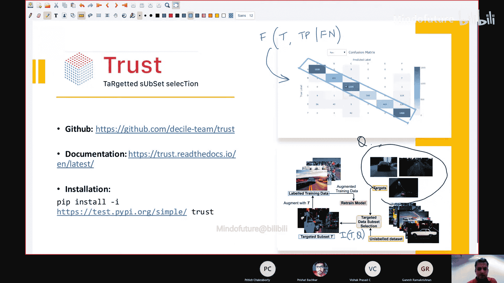

# 031：约束非单调子模极大化算法与技巧


## 概述
在本节课中，我们将学习约束条件下的非单调子模函数极大化算法。我们将回顾上一节课的内容，并探讨其“对偶”问题，即子模覆盖问题。接着，我们将引入更复杂的约束类型，如拟阵约束，并学习相应的贪心算法。最后，我们将介绍一些实用的工程技巧，如“惰性贪心”和“随机贪心”，以提升算法效率，并简要了解一个名为Decile的子模优化工具库。

## 回顾：子模极大化与对偶问题

上一节我们介绍了在成本或基数约束下，最大化单调子模函数的贪心算法框架。该算法在每一步选择能带来最大**条件增益** `f(e|S)` 的元素，或者选择**单位成本条件增益** `f(e|S)/c(e)` 最大的元素。

本节中，我们来看看这个问题的“对偶”形式——子模覆盖问题。其目标不再是最大化函数值，而是寻找一个最小的集合，使其函数值至少达到某个目标值 `Q`。

**问题定义（对偶-子模覆盖）**：
```
最小化 |S| （或总成本 c(S)）
约束条件： f(S) >= Q
```

对于这个最小化问题，同样可以采用贪心算法：从一个空集开始，当 `f(S) < Q` 时，持续添加能带来最大条件增益 `f(e|S)` 的元素。理论分析表明，该贪心解的大小最多是最优解的 `O(log( max_e f({e}) ))` 倍。

一个有趣的现象是，对于原问题（给定预算 `C`，最大化 `f(S)`）和对偶问题（给定目标 `Q`，最小化 `|S|`），如果参数设置得当（例如，将原问题最优解的函数值作为对偶问题的 `Q`），两种算法得出的解集在实践中往往非常相似。

## 复杂约束：拟阵约束

在实际问题中，约束可能更为复杂。例如，在部署传感器时，我们可能有一系列分区，每个分区内最多只能选择一个点（如 `{1A, 1B}` 中二选一）。这类约束可以统一用**拟阵**来描述。

拟阵是一种组合结构，它定义在集合上，并满足以下三条公理：
1.  **遗传性**：如果集合 `S` 是独立的，那么它的任何子集也是独立的。
2.  **交换性**：如果 `A` 和 `B` 都是独立集，且 `|A| < |B|`，那么存在某个元素 `e ∈ B \ A`，使得 `A ∪ {e}` 也是独立的。
3.  **基的大小相同**：所有极大的独立集（称为“基”）具有相同的大小。

常见的拟阵类型包括：
*   **均匀拟阵**：独立集定义为大小不超过 `k` 的任意集合。这对应基数约束。
*   **分区拟阵**：元素被划分到不同组，独立集定义为每组中最多包含一个元素的集合。这对应上述传感器部署约束。
*   **图拟阵**：元素是图的边，独立集定义为不包含环的边集（即森林）。

对于**单调子模函数在拟阵约束下的极大化问题**，可以采用一种类似投影梯度法的贪心策略：
```
从空集 S 开始。
当 S 不是基时：
    在满足“S ∪ {e} 仍是独立集”的元素 e 中，选择使条件增益 f(e|S) 最大的那个。
    将 e 加入 S。
```
该算法能保证获得至少 `1/2` 的最优解近似比。这可以看作是在每步贪心选择后，将解“投影”回可行域（独立集族）。

## 处理非单调性子模函数

当子模函数 `f` 是非单调的（即添加元素可能使函数值减少）时，简单的贪心添加策略可能失效。以下是两种应对策略：

**1. 双向贪心算法**
该算法同时维护两个集合 `A` 和 `B`，并始终保持 `A ⊆ B ⊆ V`（全集）。
*   初始化：`A = ∅`, `B = V`。
*   在每一步，以概率 `p` 考虑向 `A` 添加元素，以概率 `1-p` 考虑从 `B` 中移除元素。
*   **添加概率** `p` 基于当前最佳“添加收益”和“移除收益”计算：`p = δ⁺ / (δ⁺ + δ⁻)`，其中：
    *   `δ⁺ = max_{e∉A} f(e|A)` （若为负则忽略此操作）
    *   `δ⁻ = max_{e∈B} f({e}|B\{e})` （若为负则忽略此操作）
*   算法运行直至 `A = B`，最终输出 `A`（或 `B`）。该算法为无约束非单调子模极大化提供了 `1/2` 的近似保证。

**2. 随机贪心算法**
这是针对基数约束的非单调子模极大化的一种变体。
```
S = ∅
for i = 1 to k:
    // 1. 找到能带来最大总边际收益的候选集
    X = argmax_{X⊆V\S, |X|=k} Σ_{v∈X} f(v|S)
    // 2. 从候选集 X 中随机选择一个元素 v
    v = RandomSelect(X)
    // 3. 将其加入解集
    S = S ∪ {v}
```
该算法通过随机化来避免非单调性可能导致的局部最优。

在实践中，对于许多非单调函数，标准的贪心算法（总是添加当前边际收益最大的元素）往往表现得出奇地好，因为函数的非单调性可能只体现在局部区域。

## 提升效率的工程技巧

子模贪心算法的复杂度通常是 `O(nk)`，其中 `n` 是地面集大小，`k` 是解集大小。以下技巧可以显著加速计算：

**1. 惰性贪心（Lazy Greedy）**
利用子模性的递减收益性质，通过优先队列避免不必要的计算。
*   为每个剩余元素 `e` 维护一个**上界** `u[e]`，表示其边际收益可能达到的最大值（例如，使用上一轮迭代计算出的边际收益值）。
*   将元素按上界 `u[e]` 降序排列在优先队列中。
*   每轮迭代，取出队首元素 `e_hat`，计算其**真实的**当前边际收益 `f(e_hat|S)`。
*   如果 `f(e_hat|S) >= u[next]`（即队首元素的真实收益不低于队列中下一个元素的上界），那么 `e_hat` 就是本轮最佳选择，无需检查其他元素。
*   否则，更新 `e_hat` 的上界为 `f(e_hat|S)`，重新插入优先队列，然后检查新的队首元素。
惰性贪心能得到与标准贪心完全相同的结果，但在实践中能大幅减少函数评估次数。

**2. 随机采样 + 惰性贪心（Stochastic + Lazy Greedy）**
为了进一步加速，可以在每轮迭代中，不是从全部剩余元素中寻找最佳者，而是先随机采样一个子集 `R`（大小约为 `(n/k) log(1/ε)`），然后仅在这个子集上运行惰性贪心选择最佳元素。这以微小的近似比损失（`1 - 1/e - ε`）换取了计算速度的显著提升。

## Decile 工具库简介

Decile 是一个用于子模优化的 C++ 库，提供了丰富的函数类型和高效的优化器实现。

**支持的核心函数类型包括**：
*   设施选址函数
*   分散求和/最小函数
*   对数行列式函数
*   互信息函数
*   条件增益函数

**内置的优化器**：
*   标准贪心
*   惰性贪心
*   加速贪心（惰性+随机）
*   双向贪心

**关键特性：记忆化**
Decile 利用子模函数的特性，为许多函数实现了记忆化。它预先计算并缓存一些中间统计量，使得在迭代过程中评估边际收益 `f(e|S)` 的复杂度从 `O(n)` 降为 `O(1)` 或 `O(log n)`，从而带来数量级的速度提升。

**使用示例**：
```python
# 伪代码示例
from decile import FacilityLocation, AcceleratedGreedy

# 定义数据和查询点
data = ... # 数据点
query = ... # 查询点
# 创建查询敏感的设施选址函数对象
func = FacilityLocation(query_data=query, data=data)
# 创建优化器
optimizer = AcceleratedGreedy(budget=10) # 预算为10
# 执行优化
selected_items = optimizer.optimize(func, data)
```
通过指定 `query_data`，可以实现查询聚焦的子集选择；通过结合隐私数据约束，可以实现隐私保护的数据选择。

## 总结




本节课我们一起学习了约束下非单调子模函数极大化的算法与技巧。我们从子模极大化问题的对偶形式——子模覆盖问题入手，然后引入了更一般的拟阵约束及其贪心算法。针对非单调性，我们介绍了双向贪心和随机贪心等策略。为了提升计算效率，我们探讨了惰性贪心和随机采样等工程优化技巧。最后，我们简要了解了 Decile 这一强大的子模优化工具库，它集成了多种函数和优化器，并能通过记忆化等技术实现高效计算。掌握这些内容，将有助于你在实际机器学习任务中应用子模优化来选择代表性、多样性或信息量最大的数据子集。