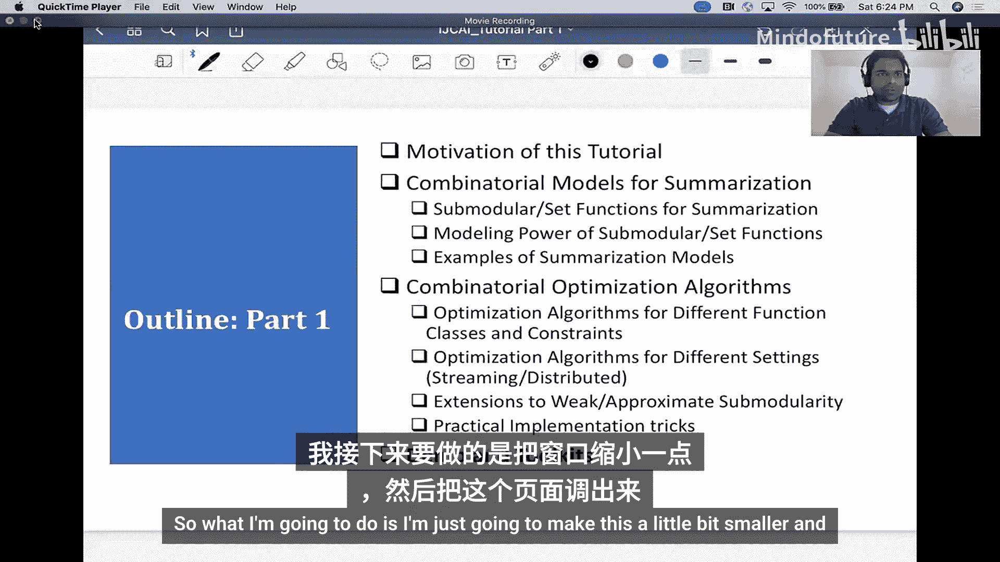
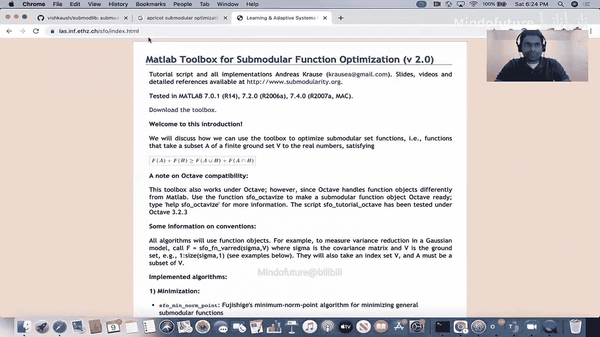
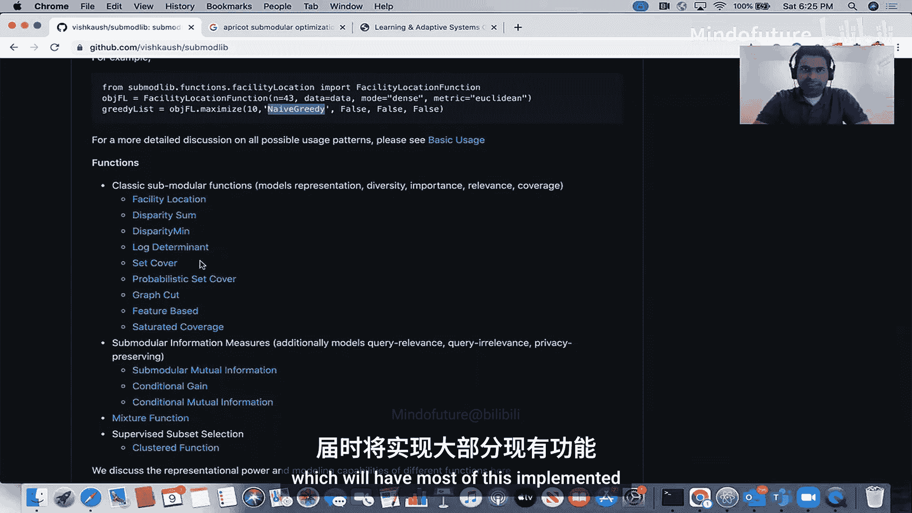
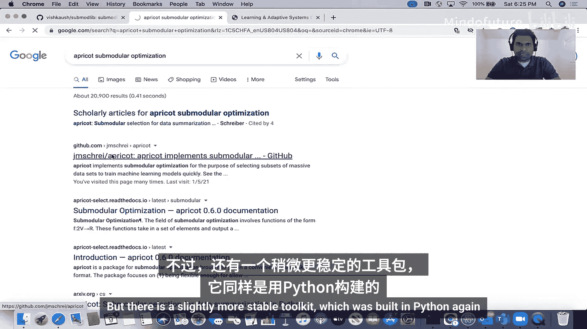
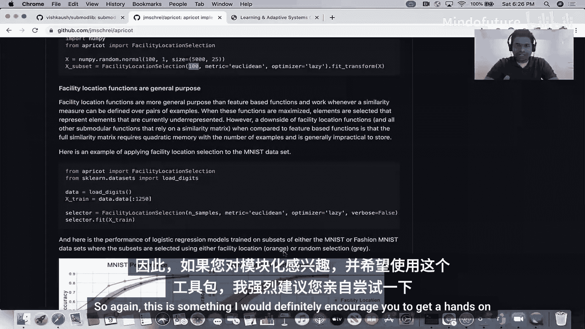
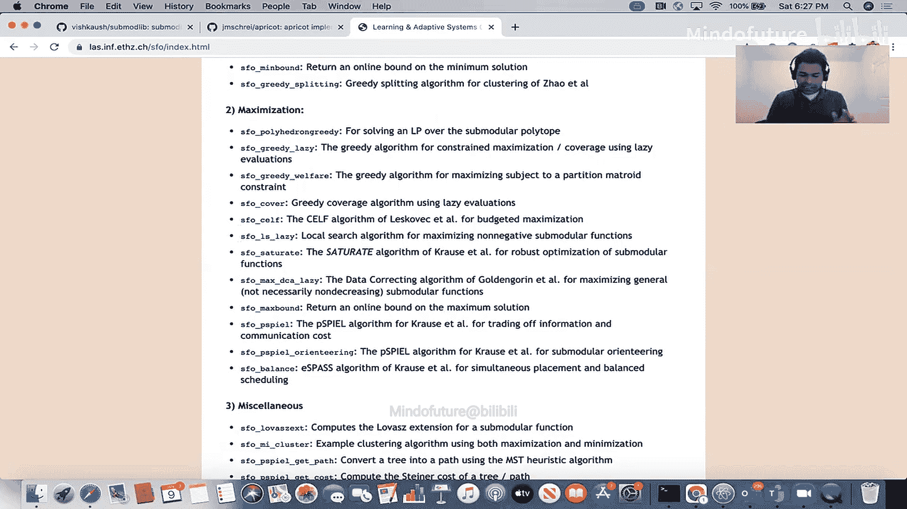
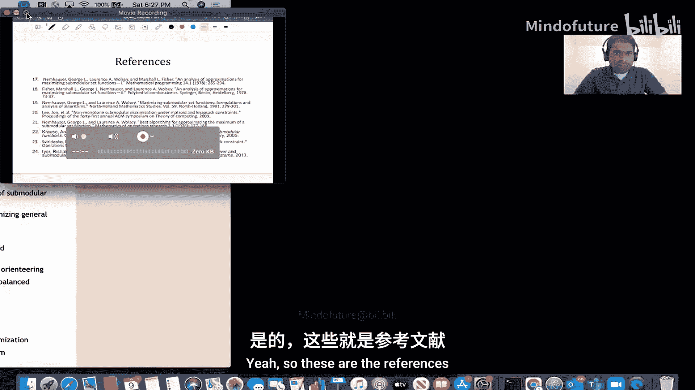
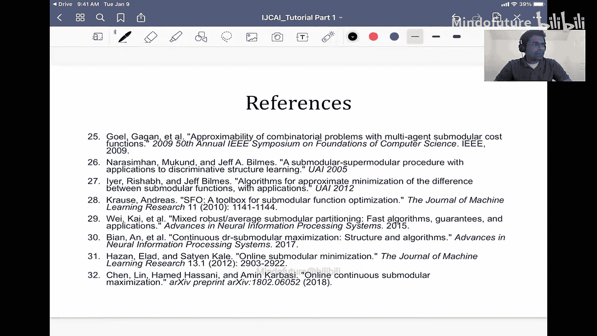

# 032：用于数据、特征和主题摘要的子模优化 - 第一部分

## 概述

在本教程的第一部分中，我们将学习子模优化及其在机器学习中的应用。我们将从子模函数的基本概念和建模能力开始，然后探讨针对不同函数类别和约束条件的优化算法。最后，我们将了解一些实际应用场景，如流式处理和分布式环境下的优化，以及近似子模性和实用的实现技巧。

---

## 子模函数：动机与定义

上一节我们概述了本教程的内容。本节中，我们来看看子模优化的核心动机和子模函数的定义。

机器学习，特别是深度学习，正日益影响着个性化、机器人技术、物流和自动驾驶等多个领域。然而，深度学习模型和数据集的规模不断增长，带来了高昂的训练成本、标注成本以及数据过载等问题。一个核心挑战是：如何利用“正确的”小数据，使其性能与大数据相当，并显著优于随机选择的小数据？子模优化为解决数据子集选择、特征选择和摘要生成等问题提供了强大的理论框架。

我们首先定义一些术语。设 **V** 为全集（或称为基础集），包含所有可能的数据点。子集选择问题通常通过一个估值函数 **F** 来建模，该函数为 **V** 的任意子集 **A** 分配一个实数值，即 **F: 2^V → R**。如果没有特定的结构，优化 **F** 通常是 NP 难问题。子模性是一种特殊的结构，它基于“收益递减”的直观准则。

子模性的定义如下：对于任意集合 **A ⊆ B ⊆ V** 和任意元素 **e ∈ V \ B**，有：
**F(A ∪ {e}) - F(A) ≥ F(B ∪ {e}) - F(B)**
这意味着，随着集合的扩大（上下文更丰富），添加一个新元素所带来的边际增益会减少。这类似于凹函数。反之，超模函数则类似于凸函数，边际增益随集合扩大而增加。

子模函数有两个等价定义：
1.  **收益递减定义**：如上所述。
2.  **并交不等式定义**：对于任意集合 **A, B ⊆ V**，有 **F(A) + F(B) ≥ F(A ∪ B) + F(A ∩ B)**。

如果函数 **F** 是单调的，则意味着对于 **A ⊆ B**，有 **F(A) ≤ F(B)**，即集合越大，信息量（或价值）越高。许多信息函数（如影响力、熵、信息增益）都是单调子模函数。

---

## 子模函数的建模能力

上一节我们介绍了子模性的基本定义。本节中，我们来看看子模函数强大的建模能力，它能够捕捉摘要生成和数据选择中的多种特性。

子模函数可以建模摘要生成中的信息含量。当我们总结一个大型数据集时，我们希望用一个函数来度量子集的信息含量。随着集合扩大，新元素与现有元素相似的可能性增加，因此其边际增益倾向于减少，这符合子模性。

以下是几类重要的子模函数示例：

### 1. 代表性函数
这类函数旨在找到一个能代表整个数据集的子集。它更关注数据点簇的中心，而非离群点。
*   **设施选址函数**：类似于 K-Medoids 目标，旨在选择能使数据点得到良好“代表”的中心点。
    *   **公式**：**F(A) = Σ_{i∈V} max_{j∈A} s_{ij}**，其中 **s_{ij}** 是相似度。

### 2. 多样性函数
这类函数关注所选点之间的差异程度，希望点与点之间尽可能远离。
*   **分散函数**：例如最小成对距离，旨在最大化点之间的最小距离。

### 3. 覆盖函数
这类函数旨在选择能覆盖一组概念（如关键词、主题）的最小子集。
*   **加权集合覆盖**：每个数据点覆盖一组带权重的概念，目标是最大化所选子集覆盖的概念总权重。
    *   **公式**：**F(A) = w(Γ(A))**，其中 **Γ(A)** 是子集 **A** 覆盖的概念集合，**w** 是权重函数。
*   **概率集合覆盖**：概念覆盖是概率性的，而非二元的。

### 4. 基于特征和深度子模函数
这类函数在模型诱导的特征空间上操作，以建模特征间的多样性。深度子模函数通过端到端的深度模型来学习特征并保持子模性。

### 5. 信息函数
这类函数定义在随机变量上，例如熵。
*   **熵**：子集 **S** 中随机变量的联合熵 **H(X_S)** 是单调子模函数。证明基于“信息永不有害”的原则。

受熵的启发，我们可以定义**子模信息度量**，作为熵的推广：
*   **子模互信息**：**I_F(A; B) = F(A) + F(B) - F(A ∪ B)**
*   **子模条件增益**：**F(A | B) = F(A ∪ B) - F(B)**
*   **子模条件互信息**：**I_F(A; B | C) = F(A | C) + F(B | C) - F(A ∪ B | C)**

这些度量在查询相关摘要、隐私保护摘要等应用中非常有用。例如，最大化 **F(A | Q)** 可以得到与查询集 **Q** 尽可能不同的摘要（即最小化与 **Q** 的互信息）。

---

## 子模优化算法：单调子模最大化

上一节我们探讨了子模函数的建模能力。本节中，我们开始学习如何优化子模函数，首先从最简单的单调子模最大化问题开始。

我们关注的核心优化问题是子模最大化：**max_{A ⊆ V} F(A)**，通常带有约束。对于数据子集选择等问题，我们希望最大化信息或多样性。

首先考虑**基数约束下的单调子模最大化**问题：
**max_{A ⊆ V, |A|≤k} F(A)**

解决此问题的经典算法是**贪心算法**：
1.  从空集 **S = ∅** 开始。
2.  在每一轮迭代中，选择能带来最大边际增益的元素：**e = argmax_{e ∈ V \ S} F(S ∪ {e}) - F(S)**。
3.  将该元素加入 **S**。
4.  重复步骤2和3，直到 **|S| = k**。

**理论保证**：Nemhauser 等人 (1978) 证明，贪心算法得到的解 **S_k** 满足：
**F(S_k) ≥ (1 - 1/e) * F(OPT) ≈ 0.63 * F(OPT)**
其中 **OPT** 是最优解。并且，没有多项式时间算法能在最坏情况下取得比这更好的近似比。在实践中，贪心算法的性能通常远优于理论下界。

**证明思路**：
1.  利用单调性：**F(OPT) ≤ F(OPT ∪ A_i)**。
2.  将 **F(OPT ∪ A_i) - F(A_i)** 写成关于 **OPT** 中元素的边际增益的求和。
3.  利用子模性，将每个边际增益上界为贪心算法在第 **i** 步的增益 **δ_i**。
4.  得到递推关系：**δ_{i+1} ≥ (OPT - F(A_i)) / k**。
5.  通过数学推导，最终得到 **F(A_k) ≥ (1 - 1/e) * OPT**。

---

## 扩展的优化问题与算法

上一节我们学习了基数约束下的单调子模最大化。本节中，我们来看看其他常见的约束和问题变体，以及对应的算法。

### 1. 背包约束
当每个元素 **e** 有成本 **c(e)**，且总预算为 **B** 时，问题变为：
**max_{A ⊆ V, Σ_{e∈A} c(e) ≤ B} F(A)**
修改后的贪心算法在每一步选择**单位成本边际增益最大**的元素：**e = argmax_{e ∈ V \ S} (F(S ∪ {e}) - F(S)) / c(e)**。
结合枚举小规模子集等技术，可以获得 **1 - 1/e** 的近似保证。

### 2. 子模集合覆盖
这是最大化问题的对偶形式：寻找满足性能要求的最小集合。
**min_{A ⊆ V} |A|， s.t. F(A) ≥ Q**
这在希望用最小数据子集达到特定准确度时很有用。

### 3. 拟阵约束
拟阵是更复杂的组合结构，可以统一建模分区约束（每组至多选一个）、基数约束等。
*   **分区拟阵**：每组至多选一个元素。
*   **均匀拟阵**：即基数约束。
对于单调子模函数在拟阵约束下的最大化，贪心算法能提供 **1/2** 的近似保证。

### 4. 非单调子模最大化
当函数 **F** 非单调时，需要使用**随机化贪心算法**。该算法不是直接选择增益最大的元素，而是从增益最大的前 **k** 个元素中随机选择一个加入。该算法能提供约 **1/e ≈ 0.37** 的近似保证。

### 5. 正则化/无约束问题
考虑问题：**max_{A ⊆ V} F(A) - λ|A|**。即使 **F** 单调，整个目标也是非单调的。
可以使用**双向贪心算法**：维护两个集合 **A**（从空集开始扩张）和 **B**（从全集开始收缩），根据边际增益随机决定添加或删除元素。该算法能提供 **1/2** 的近似保证。

### 6. 子模+分散函数
对于子模函数与分散函数（如最小成对距离）的和或最小值优化，也有相应的常数近似比算法。

---

## 高效算法与扩展场景

上一节我们介绍了多种约束下的优化算法。本节中，我们关注算法的计算效率，并探讨流式处理和分布式计算这两种重要场景。

### 计算效率
标准贪心算法的复杂度是 **O(nk * T)**，其中 **n** 是全集大小，**k** 是所选子集大小，**T** 是计算一次边际增益的时间。当 **n** 很大时，这可能很慢。
*   **惰性贪心**：通过优先队列维护边际增益上界，避免每次重新计算所有增益，在实践中能大幅加速，但最坏复杂度不变。
*   **随机贪心**：在每轮迭代中，只从随机采样的子集中（大小为 **O((n/k) log(1/ε))**）选择最佳元素。总复杂度为 **O(n log(1/ε))**，并能获得 **1 - 1/e - ε** 的近似保证，在实践中非常高效。

### 流式处理
数据以流的形式到达，算法只能单遍扫描数据，且内存有限。
*   **算法思想**：维护多个阈值和候选集。当新元素到达时，计算其相对于各候选集的增益，若超过对应阈值则加入。最终从所有候选集中选最好的。
*   **理论保证**：单遍扫描，**1/2** 近似比，内存和计算复杂度低。

### 分布式处理
数据量过大，无法存放在单台机器上。需要将数据随机分割到多台机器上并行处理。
*   **简单方法**：每台机器对自己的数据分区运行贪心算法，选出 **k** 个元素。将所有机器选出的元素（共 **m*k** 个）汇总到一台机器，再运行一次贪心算法选出最终的 **k** 个元素。
*   **理论保证**：通过改进（例如，比较各机器局部解与全局汇总解），可以获得 **1/2 * (1 - 1/e)** 的近似保证。

---

## 近似子模性与实用工具

上一节我们讨论了高效算法和扩展场景。本节中，我们将了解近似子模性的概念，并介绍一些实用的子模优化工具包。

### 近似子模性
许多实际函数并不是严格的子模函数，而是近似子模的（也称为弱子模或伪子模）。对于单调函数，如果存在 **γ ∈ (0,1]**，使得对于所有 **A ⊆ B** 和 **e ∉ B**，有：
**F(A ∪ {e}) - F(A) ≥ γ (F(B ∪ {e}) - F(B))**
则称 **F** 是 **γ-弱子模**。当 **γ=1** 时就是严格子模。
对于这类函数，贪心算法仍能提供理论保证，例如对于单调 **γ-弱子模**函数，近似比为 **1 - e^{-γ}**。

### 实用技巧：记忆化
对于许多具体的子模函数（如设施选址、覆盖函数），可以预先计算并缓存一些中间统计量。在贪心算法运行过程中，可以利用这些缓存快速计算边际增益，而无需每次都从头计算。这能带来数量级的速度提升。

### 子模优化工具包
以下是几个可用于实现子模优化的工具包：
1.  **SubmodLib**：C++ 实现，带有 Python 接口。高效，支持多种函数和优化器。
2.  **Apricot**：纯 Python 实现。易于使用，同样支持多种函数和优化器。
3.  **SFO Toolbox**：MATLAB 工具箱。功能全面，但依赖于 MATLAB 环境。

建议根据熟悉的编程语言和性能需求选择合适的工具包进行实践。

---

## 总结

在本教程的第一部分中，我们一起学习了子模优化在机器学习中的核心作用。我们从子模函数的定义和直观理解开始，认识到其“收益递减”特性非常适合建模信息、多样性和覆盖度。接着，我们探索了子模函数强大的建模能力，包括代表性、多样性、覆盖性和信息度量等多种函数类别。

在算法方面，我们重点研究了单调子模最大化问题，并学习了经典的贪心算法及其理论保证。我们还扩展到了背包约束、拟阵约束、非单调子模最大化以及正则化问题等更复杂的场景。为了处理大规模数据，我们介绍了提升计算效率的技术（如惰性贪心和随机贪心），以及流式处理和分布式环境下的优化算法。最后，我们了解了近似子模性的概念和一些实用的优化工具包。

这些理论和算法为第二部分将要深入探讨的具体应用——数据子集选择、特征选择和数据摘要——奠定了坚实的基础。通过选择“正确的”小数据，我们有望以更低的成本获得与大数据相媲美的性能。