# 033：用于数据、特征和主题摘要的子模优化 📊

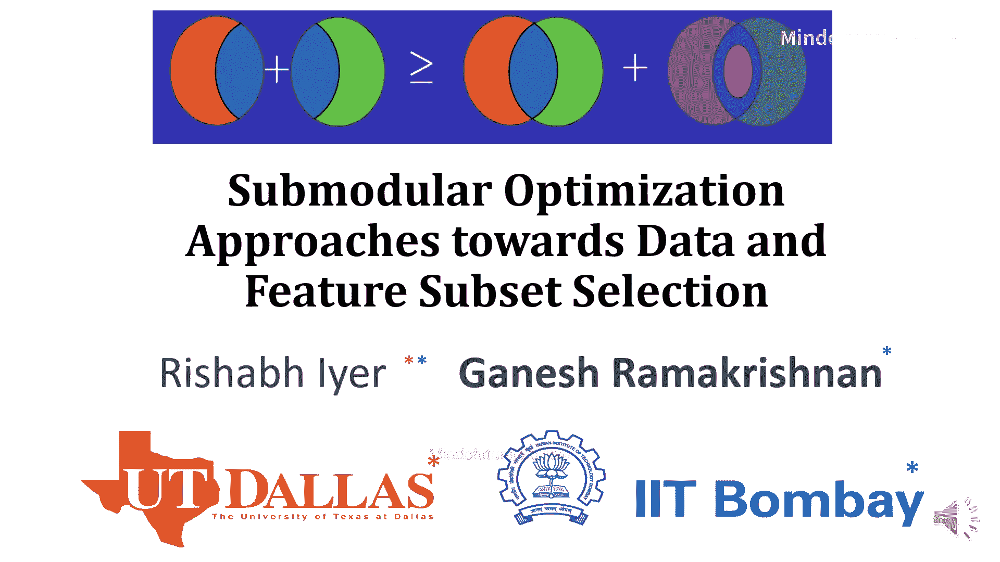

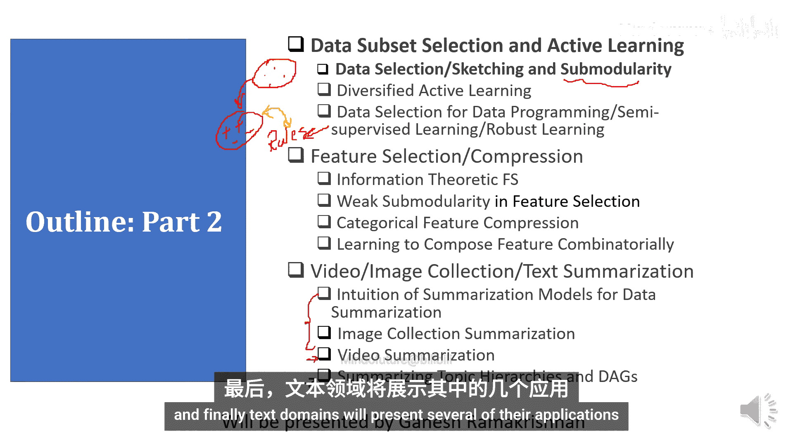

## 概述

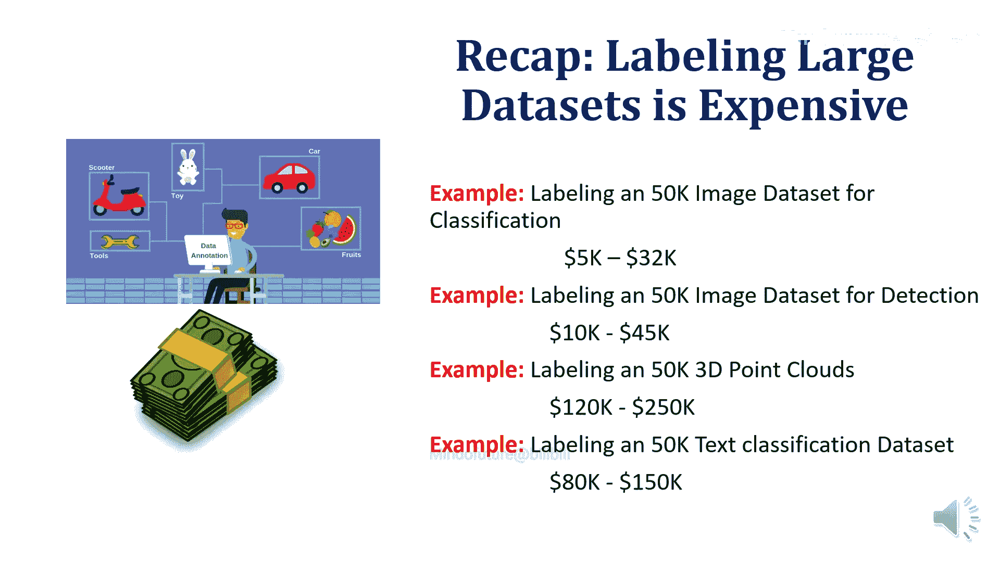

在本节课程中，我们将学习子模优化在机器学习中的关键应用，特别是如何利用子模函数进行高效的数据子集选择、特征选择以及内容摘要。我们将从数据选择的基础方法开始，逐步深入到主动学习、数据编程、特征选择，最后探讨在图像、视频和文本领域的摘要应用。

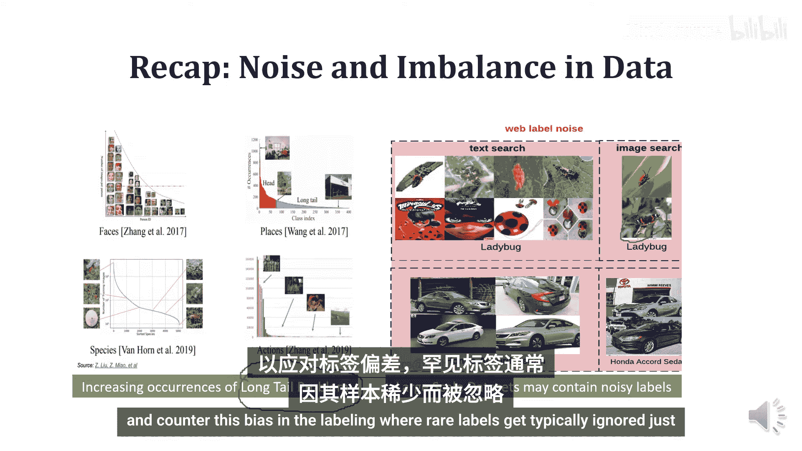

---

## 数据子集选择 📈

上一部分我们介绍了子模优化的基本概念。本节中，我们来看看如何将其应用于数据子集选择，以降低标注成本、减少训练时间，同时保持模型性能。

### 数据选择的挑战与动机

标注大规模数据集可能极其昂贵。例如，通过众包平台标注一个5万张图像的分类数据集，成本可能在5000到32000美元之间。此外，标注过程可能引入噪声，且数据分布可能存在长尾效应，即许多类别的样本数量很少。

机器学习的数据准备和模型训练是一个需要多次迭代的循环。我们的目标是：在给定的训练预算下，能否选择一个训练数据的子集，使得模型训练和超参数调优能更高效地进行，同时不牺牲准确性？

以下是实现鲁棒且高效机器学习的一些关键组件：
*   **高效机器学习**： 旨在减少标注成本和时间、减少训练时间和计算开销、减少超参数调优和网络架构搜索时间。
*   **鲁棒机器学习**： 旨在减少特征噪声、对类别不平衡具有鲁棒性、处理分布外数据。

数据子集选择的应用包括快速训练和推理、快速超参数调优、从无标签数据中学习（主动学习、半监督学习）以及鲁棒学习。

### 问题设定

我们假设参数 **θ** 表征机器学习模型。我们有一个训练数据集 **U** 和一个验证数据集 **V**。损失函数（例如似然函数）可以在训练集 **U** 上评估（记作 **L_T**），也可以在验证集 **V** 上评估（记作 **L_V**）。通常，参数 **θ** 是在带标签的训练数据 **U** 上估计的。我们的目标是选择一个 **U** 的子集，使得在该子集上训练的模型性能最佳。

挑战在于，我们需要在庞大的子集空间（大小为 **2^N**）中进行搜索，同时这个选择过程还需要与参数 **θ** 的估计过程交织在一起。即使选择10%的数据子集能带来10倍的训练加速，如果子集选择过程本身耗时过长，其优势也会被抵消。因此，我们希望子集选择算法的时间复杂度可以忽略不计，并且最好能有理论保证。

### 方法一：使用子模函数作为代理

一种直接的方法是使用子模函数作为数据子集选择的代理函数。给定一个基础集 **U**，我们有一个衡量子集 **X** 质量的集合函数 **F(X)**。在基数约束下最大化 **F(X)** 的问题，如果 **F** 是单调子模的，贪婪算法可以提供 **(1 - 1/e)** 的近似保证。在实践中，我们通常能得到接近最优的解。当 **F** 是分散函数时，我们可以获得 **1/2** 的近似保证。

许多论文使用了代理子模函数，例如基于特征的加权集合覆盖函数（子模）、分散函数、对数行列式（也是子模）等。经验表明，这些函数通常表现出收益递减的特性，这恰好符合子模函数的定义，因此使用子模函数是合理的。

### 方法二：通过梯度近似进行选择

我们尝试选择一个数据子集，使其梯度加权平均能够近似整个数据集的梯度。假设选中的子集 **X ⊆ U** 中的点 **i** 被赋予权重 **w_i**。点 **i** 的损失梯度为 **∇l_i(θ)**。我们希望所选子集上梯度的加权和能近似整个数据集上的全梯度。

一个收敛性定理表明，有效的数据选择算法应努力最小化加权子集梯度与全梯度之间的误差范数。因此，我们可以将问题形式化为：在给定子集基数约束下，估计权重 **w** 并确定子集 **X**，使得上述梯度误差尽可能小。

**CRAIG算法** 就是通过一个上界推导出来的，该上界本质上是一个设施选址问题。最大化设施选址函数（在基数约束下）是一个单调子模最大化问题，存在高效的近似算法。然而，基于设施选址的方法可能需要较大的子集规模才能达到期望的梯度误差。

我们能否通过直接优化误差项来做得更好？答案是肯定的。我们可以直接优化一个带正则化的误差函数，并将其转化为一个最大化问题。可以证明，这个目标函数是近似子模的，贪婪算法能提供 **1 - exp(-γ)** 的近似保证。但贪婪算法计算开销较大。

一个更好的提议是使用**正交匹配追踪（OMP）**算法。在基数约束下，OMP 也能提供 **1 - exp(-γ)** 的近似保证。该算法迭代地选择与当前残差（即全梯度与当前加权子集梯度之差）投影最大的样本加入子集，并更新权重。这种方法中，训练梯度与验证梯度之间的点积影响了算法的选择。

### 方法三：通过双层优化进行选择

目标是选择一个数据子集，使其能近似整个训练集（或验证集）的性能。这可以通过一个双层优化问题来形式化：外层最小化验证集损失，内层在选定的训练子集上估计模型参数。

对于某些简单分类器（如朴素贝叶斯、最近邻、线性回归），内层问题有闭式解。在某些假设下（如基数约束、类别平衡），优化目标可以表示为关于子集的子模函数，从而可以使用高效的贪婪算法。

然而，即使内层有闭式解，为了求解外层优化，仍然需要对每个候选子集求解内层问题，这违背了通过子集选择加速训练的初衷。因此，我们需要将 **θ** 的求解与子集 **X** 的选择交织起来。

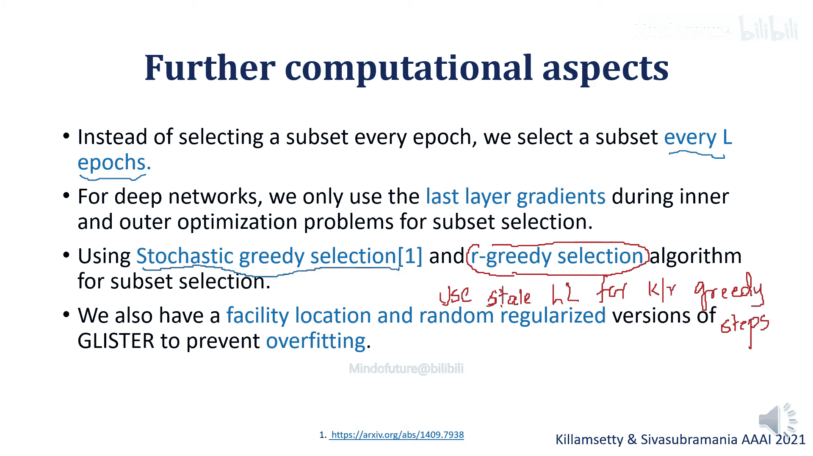

一种方法是使用**在线单步元近似**，即用单个梯度步长来近似内层优化问题的解。将这种近似代入外层问题后，对于许多常用的损失函数（如负对数损失、负平方损失、负合页损失等），该优化问题变成了一个基数约束的子模最大化问题。如果验证损失是负交叉熵损失，则目标函数是弱子模的，也有相应的近似保证。

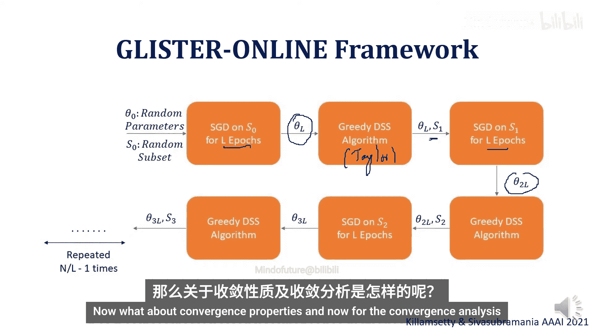

为了进一步降低计算成本，我们可以使用泰勒展开的一阶近似，从而只需要 **K** 次前向传播和 **K** 次反向传播来计算验证损失及其梯度。我们还可以使用“陈旧”的似然值、随机贪婪选择、每隔多个周期才重新选择子集、在深度网络中仅使用最后一层梯度等工程技巧来加速。此外，可以加入设施选址或随机正则化来防止过拟合。

整个 **GLISTER** 策略流程是：用随机参数和随机子集初始化，在子集 **S_n** 上进行 **L** 步随机梯度下降得到参数 **θ_L**，然后使用泰勒近似进行贪婪数据子集选择得到新子集 **S_{n+1}**，如此循环。

**收敛性分析**表明，如果验证损失函数是 Lipschitz 光滑的，并且训练和验证损失的梯度范数有界，那么验证损失会随着每个训练周期单调递减。在训练梯度与验证梯度点积非负的假设下，收敛速度是 **O(1/ε²)** 个周期。收敛界中的一个关键项与训练梯度及验证梯度之间的夹角余弦有关，而泰勒近似法选择的子集正是最大化这个点积的，因此我们期望该夹角接近0，从而获得快速收敛。

### 方法四：通过最小化散度进行选择

这类方法将数据子集选择的目标视为最小化原始完整数据分布与子集数据分布之间的某种散度（如 KL 散度）。在实践中，可以使用任何子模模型（如代表性、覆盖度、多样性等）作为数据子集选择的代理函数。

### 应用与实验结果

*   **高效学习**： 在最近邻分类任务中，仅使用40%的训练数据就能达到与使用100%数据相似的准确率。设施选址方法明显优于随机采样和分散最小化方法。
*   **GLISTER 加速**： 在 MNIST 数据集上，GLISTER 使用10%的数据子集实现了7.2倍的加速，准确率仅下降2.5%；使用30%数据实现3.5倍加速；使用50%数据实现2倍加速。
*   **鲁棒学习**： 在存在类别分布偏移或噪声的情况下，GLISTER 的性能甚至可能优于使用全部数据，准确率提升可达15-20%。
*   **超参数调优**： 使用5-10%的数据子集进行超参数调优，设施选址方法选择的超参数相比随机子集选择的超参数，能带来10.5%的 top-5 准确率提升。
*   **无监督数据选择**： 在视频数据标注中，使用无监督摘要方法选择子集进行标注，分散最小化和设施选址方法相比随机子集，在平均精度上带来近5%的提升。

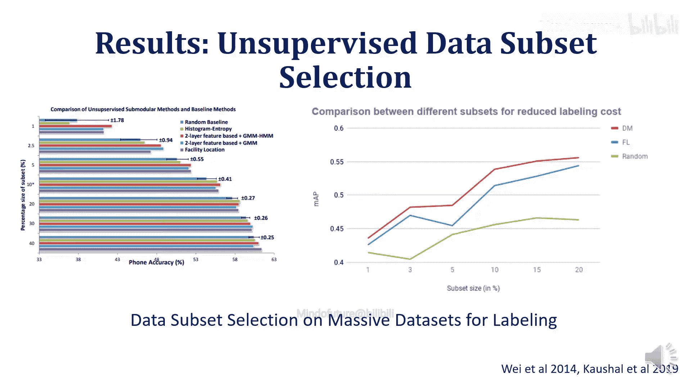

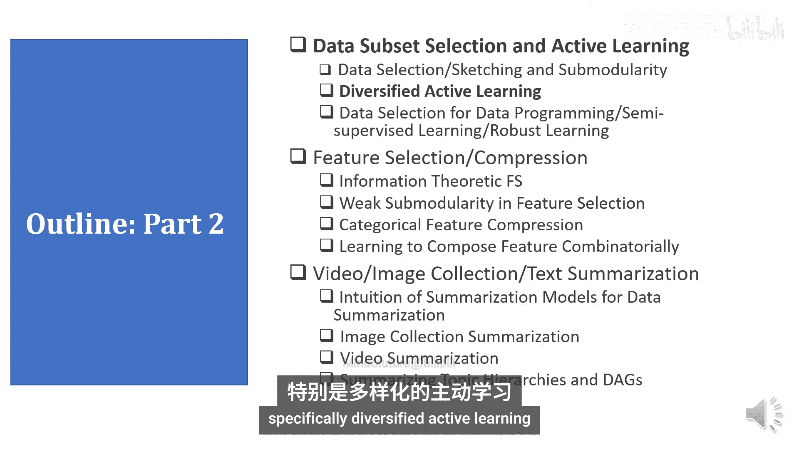

---

## 主动学习 🎯

上一节我们介绍了通用的数据子集选择方法。本节中，我们来看看其在主动学习这一特定场景中的应用，目标是利用尽可能少的标注查询获得高性能模型。

### 多样化主动学习

在多样化主动学习中，我们通常从一个“热启动”开始（即已有部分标注数据）。基于当前模型，我们可以估计未标注样本的不确定性（例如熵）。主动学习的目标是选择一批样本进行标注，以最大化模型提升。

如果逐一样本查询，可以选择最不确定的样本（熵最高）。但实践中标注通常是批量的，因此我们希望选择一批**既不确定又多样化**的样本。多样性可以通过行列式点过程（DPP）来衡量，覆盖度可以通过设施选址或加权集合覆盖来衡量。

**过滤式主动子模选择** 分为两步：首先进行不确定性过滤，移除模型已经很确定的样本；然后在剩余的不确定样本上，使用子模函数（结合假设的标签）进行子集选择，以获取多样化和有代表性的样本集。实验表明，在不确定性采样基础上加入子模选择（多样化或代表性），其性能优于单纯的不确定性采样和随机采样。

### 基于影响的采样

另一种思路是衡量选择一个未标注样本（并赋予其假设标签）后，对分类器整体准确率或似然的影响。虽然计算精确影响很困难，但可以通过近似方法进行估计。研究表明，结合影响力考虑的采样方法具有很大价值。

### 基于核心集的主动学习

可以通过一个经验风险的上界来推导核心集选择方法。最小化这个上界等价于选择一个样本集，以最大化一个鲁棒版本的设施选址目标（即 **k-Center** 问题）。贪婪算法能为这个非子模问题提供 **2** 倍近似。实验表明，该方法相比当时其他先进方法有显著优势。

### 基于梯度多样性的主动学习

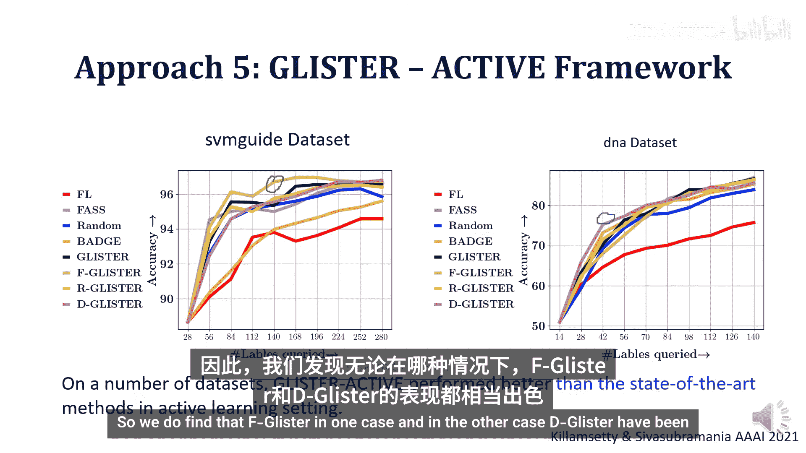

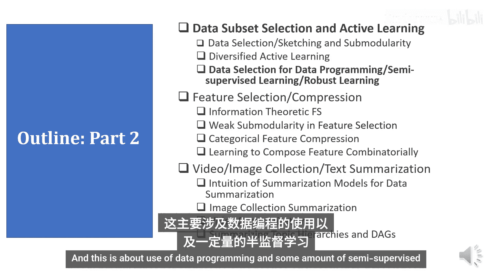

**BADGE** 算法是 CRAIG 在主动学习中的变体。它选择一批具有多样化梯度的样本，其中梯度是基于当前模型为未标注样本赋予的假设标签计算的。通过选择梯度多样化的样本，BADGE 同时兼顾了不确定性和多样性。它在多个数据集上保持了性能领先。

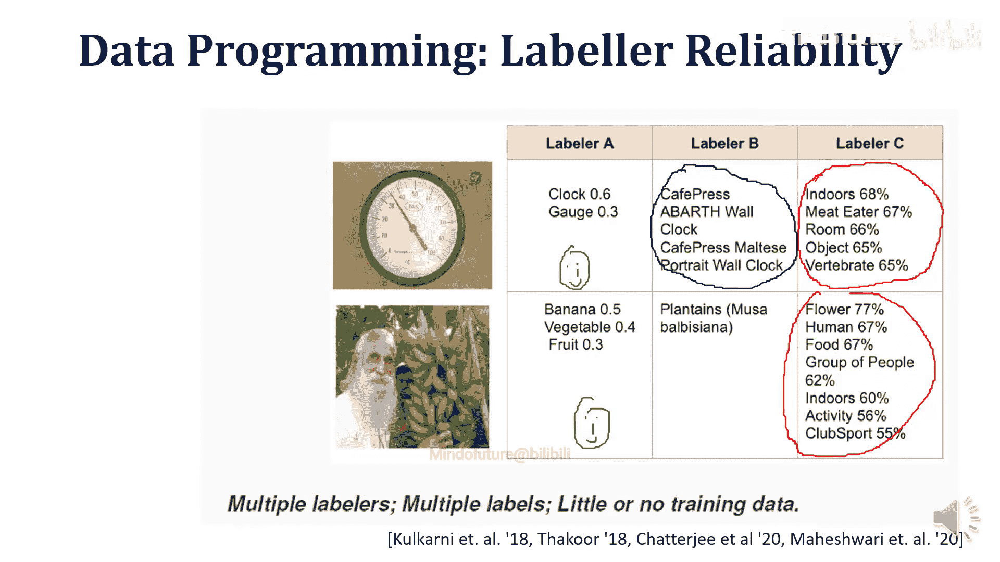

### 基于代理的选择

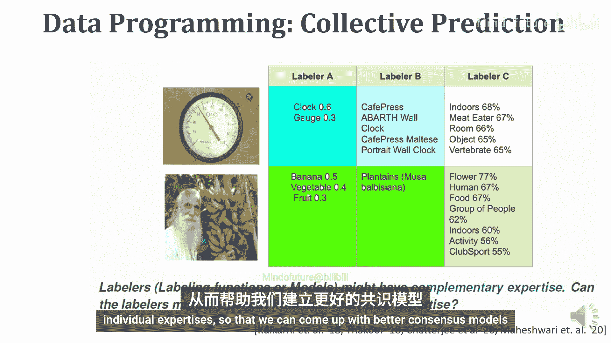

**SVP** 方法的核心思想是：训练一个缩小版的代理模型，用它来估计各个训练数据点的效用（如不确定性），然后选择信息量最大的样本用于训练大型目标模型。实验显示，仅选择60%的数据子集，就能获得1.6倍到1.8倍的加速。

### GLISTER 在主动学习中的应用：GLISTER-ACTIVE

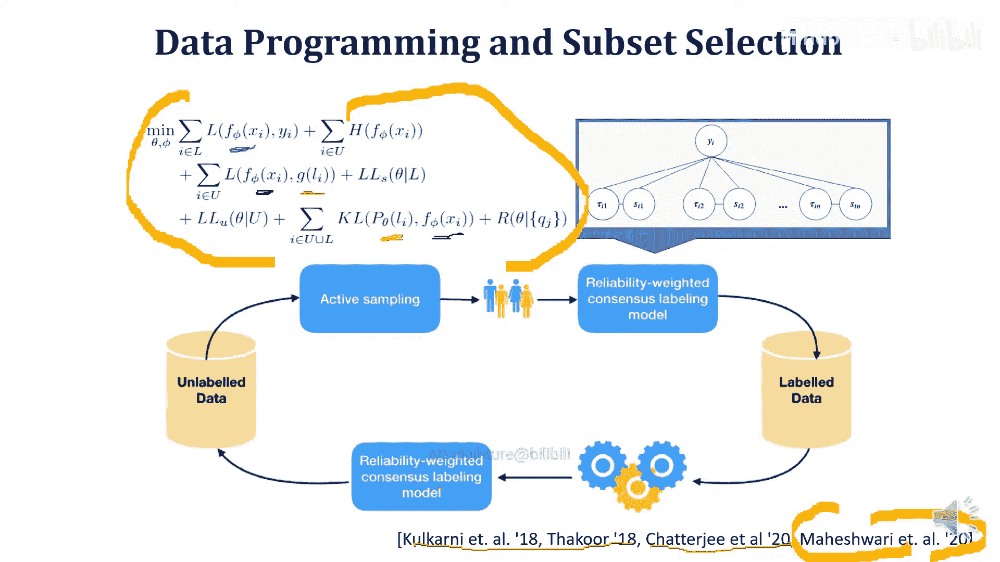

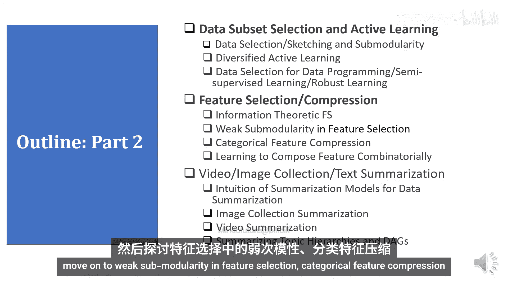

**GLISTER-ACTIVE** 是 GLISTER 算法在主动学习中的改进。它在每个周期选择一批未标注样本进行标注，并将其加入当前标注集。选择过程中，使用假设的标签进行内部优化。实验表明，GLISTER-ACTIVE 在多个数据集上优于当时的主流方法（包括 BADGE），并且具有计算效率高的优势。

---

## 数据编程与半监督学习 🤖

上一节我们讨论了主动学习。本节中，我们来看一种互补的方法：数据编程，它结合了少量标注数据和大量弱监督规则（或标注函数）。

假设我们有多个标注器，这些标注器可能是规则、弱分类器或人类。在标注数据极少或没有的情况下，估计标注器的可靠性至关重要。一个简单的想法是观察标注器与多数投票结果的差异。

标注器可能具有互补的专业知识。主动学习可以用于选择那些标注器之间分歧大的样本进行人工标注，从而以最小的标注预算补充规则标注的不足，获得高质量的标注数据集。

数据编程的目标是，不仅要在标注函数之间达成共识，还要确定需要人工标注的样本子集。我们希望基于特征的预测模型 **F** 和基于标注函数的共识模型 **G** 在标注数据和未标注数据上都达成一致。具体来说，在标注数据上，特征模型应具有低熵；在未标注数据上，特征模型的预测应与标注函数模型的预测一致。这方面的研究正在不断发展中。

---

## 特征选择与压缩 🔍

从数据空间转向特征空间，特征选择同样可以受益于子模优化。我们将探讨信息论特征选择、特征选择中的弱子模性、分类特征压缩以及学习组合特征。

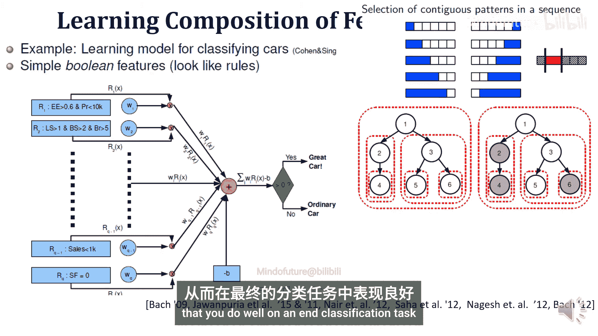

### 信息论特征选择

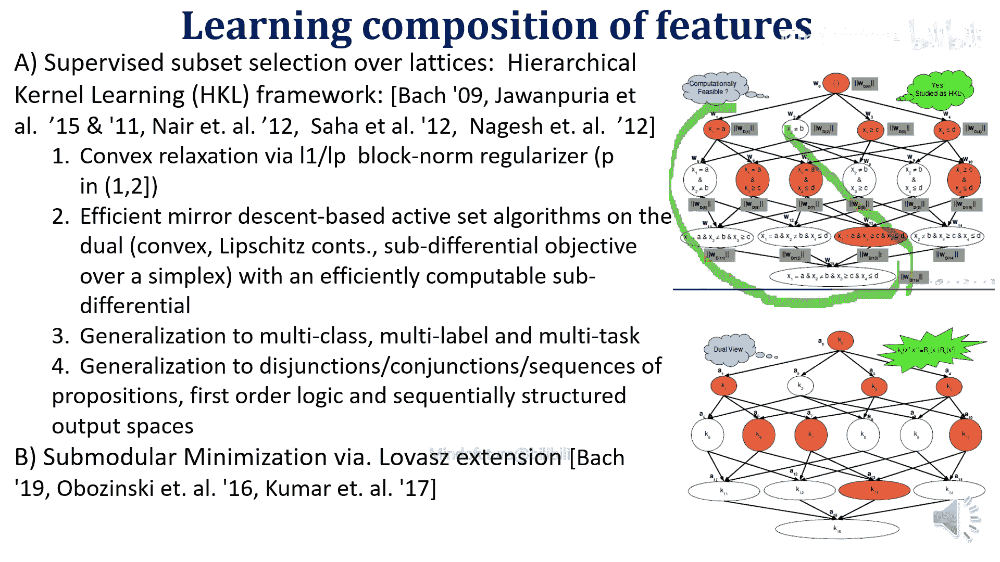

互信息常用于特征选择。虽然互信息本身并不总是子模的，但如果所有特征在给定类别条件下相互独立，则关于特征子集的互信息函数是子模的。即使不满足条件独立性，互信息也可以表示为两个子模函数之差。

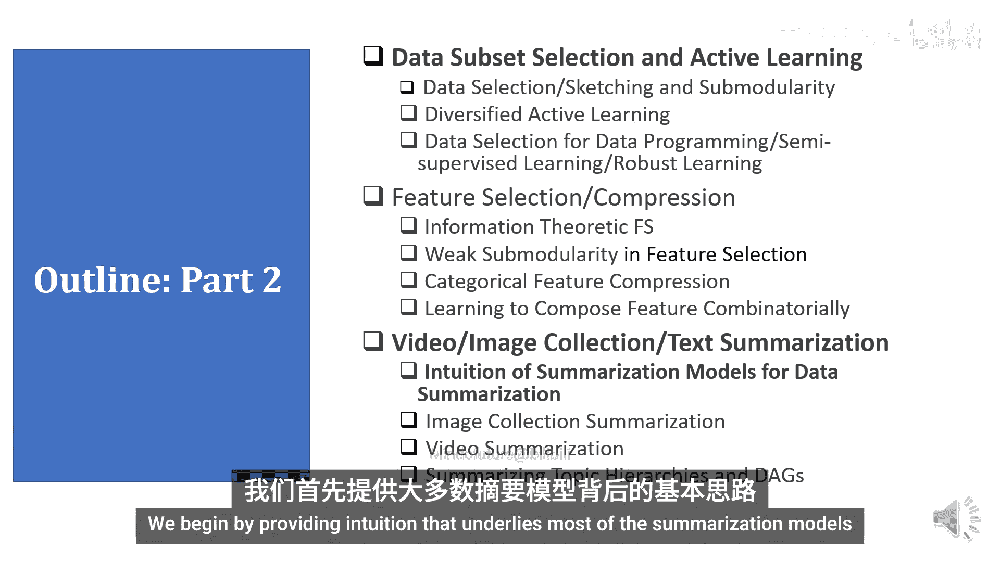

由于在高维特征空间中直接估计互信息困难，许多方法采用近似，如 **最大相关最小冗余（mRMR）** 准则。它将互信息近似为相关性减去冗余性，旨在选择与目标高度相关但彼此之间冗余度低的特征。

### 成本敏感的特征选择

在医疗等领域，获取特征本身可能成本高昂。**成本敏感特征选择** 方法可以考虑特征获取成本，并结合患者聚类信息，为不同的患者群体选择不同的特征子集。

### 基于损失函数的特征选择

对于线性回归等模型，可以直接最大化决定系数 **R²**。研究表明，在限制强凸和平滑的假设下，负对数似然（与 **R²** 相关）是弱子模的。基于弱子模性，可以为正交匹配追踪（OMP）和前向选择算法提供数据依赖的近似保证。

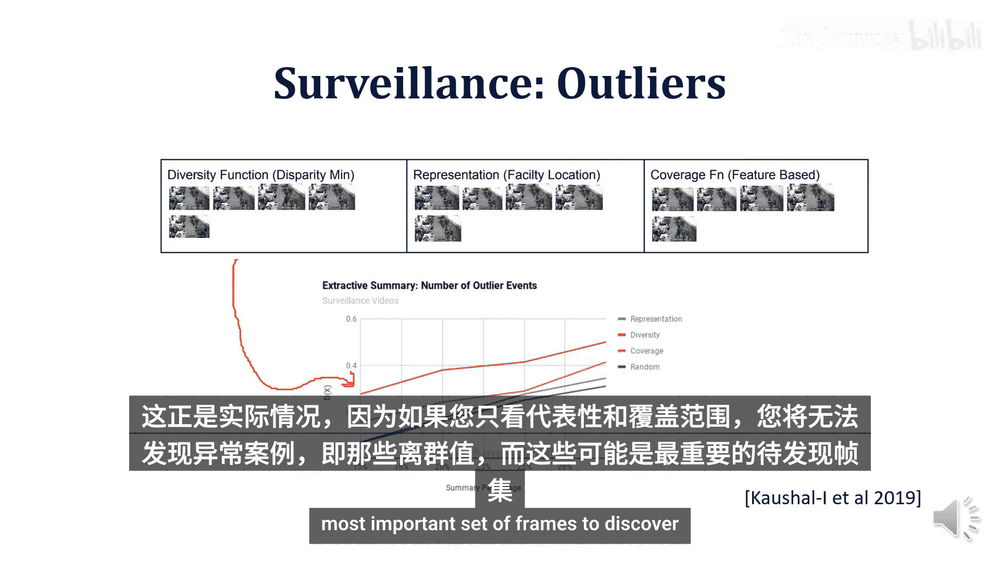

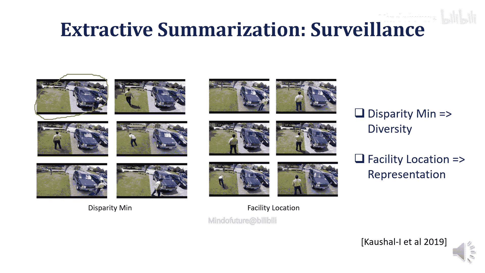

### 分类特征压缩

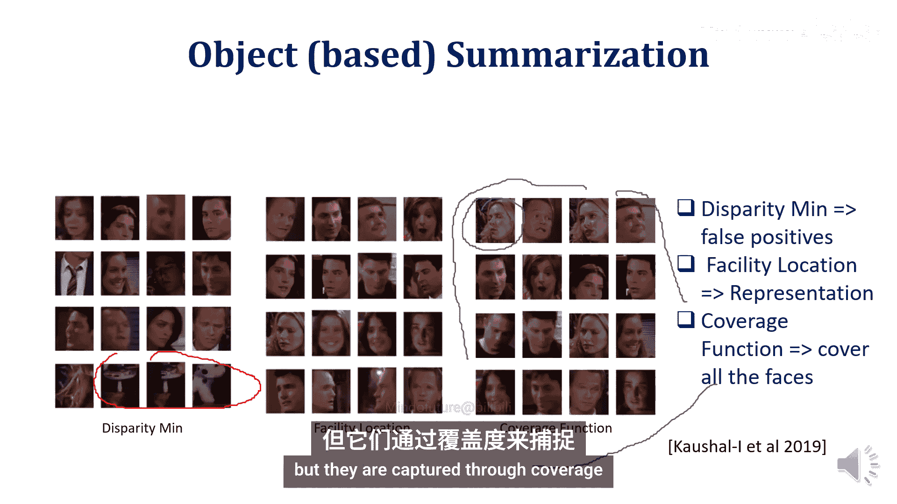

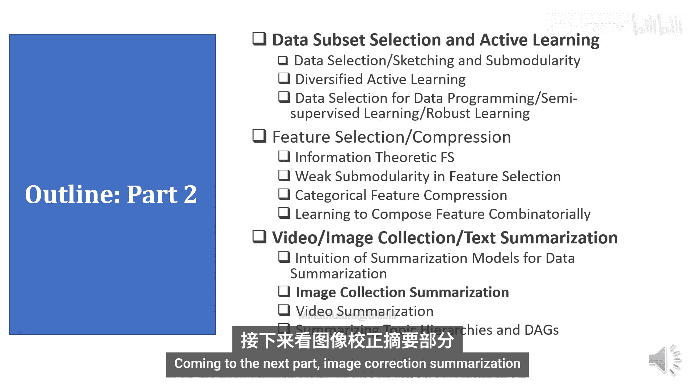

对于分类特征，目标不是选择特征，而是将原始特征值（如“中国”、“日本”）压缩映射到更少的类别（如“亚洲”）。这可以看作一种特征压缩。最大化压缩后特征与目标类别的互信息，可以重新参数化为一个子模函数，从而有高效的拟阵约束算法。

### 学习组合特征

在许多任务中，我们需要学习基本特征的组合（如合取、序列模式）。搜索空间可能非常大（如格结构）。目标是选择格中的一组节点（即特征组合），使其在分类任务上表现良好。可以通过块范数正则化等方法来实现，例如对每个节点的所有后代施加 **L1** 范数惩罚，以获得稀疏且紧凑的规则集。这项工作已推广到多类、多标签、多任务场景，并适用于更一般的结构（如一阶逻辑公式）。

---

## 摘要应用：图像、视频与文本 📝

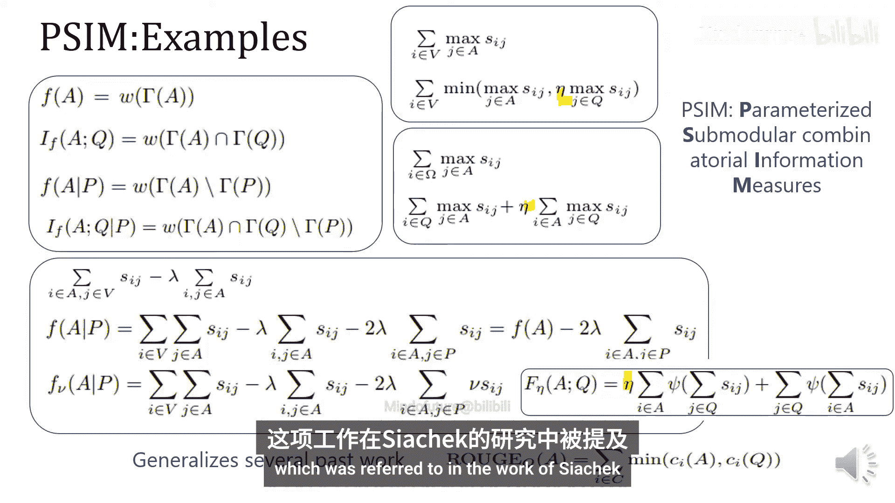

最后，我们探讨子模优化在内容摘要中的应用。摘要可以看作一种特殊的数据子集选择，但在图像、视频和文本领域有其独特的要求。

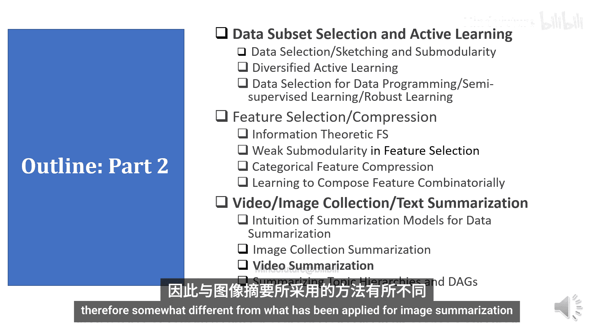

### 摘要的基本原理

摘要的目标是从一个大型集合（如图像集、文档集）中选择一个子集，使其具有**多样性、覆盖度和代表性**。通常，摘要可能需要与查询相关，或者需要保护隐私（即隐藏与查询相关的内容）。

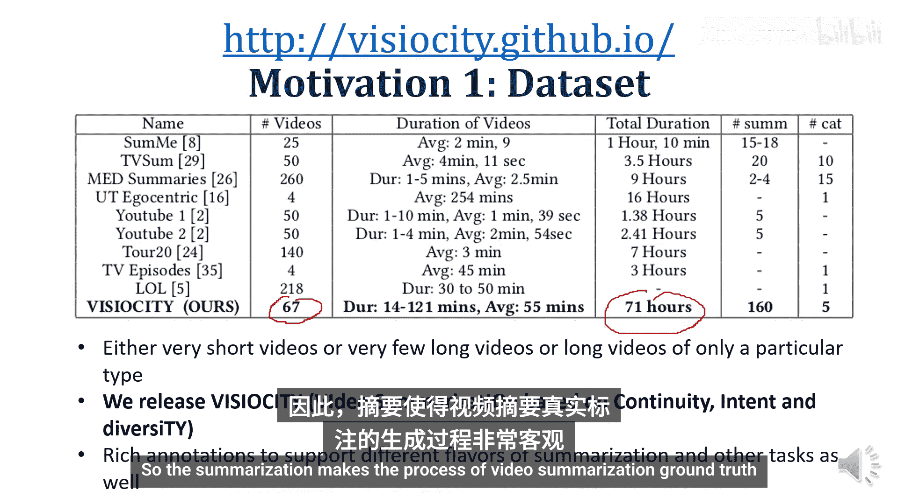

通用流程是：首先进行特征提取，然后实例化一个子模函数（如基于相似性的覆盖函数、设施选址函数等），最后在预算约束下运行摘要算法（如贪婪算法）。

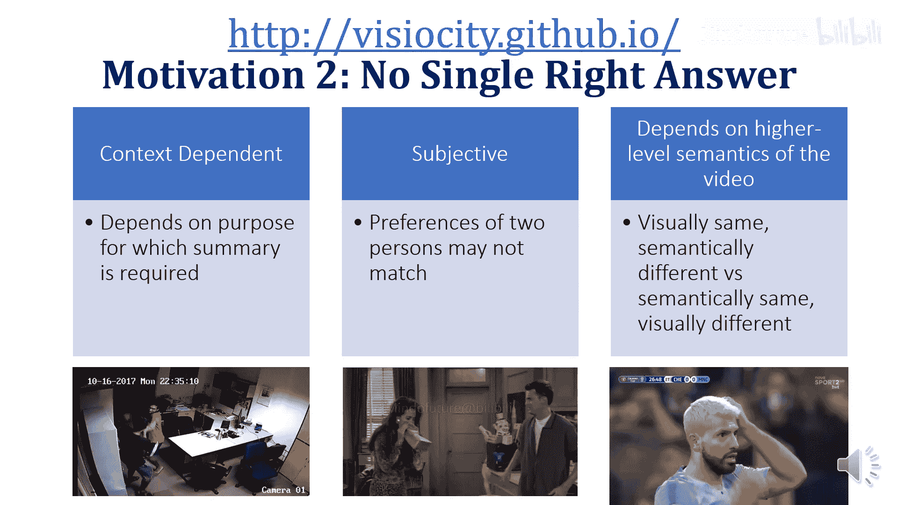

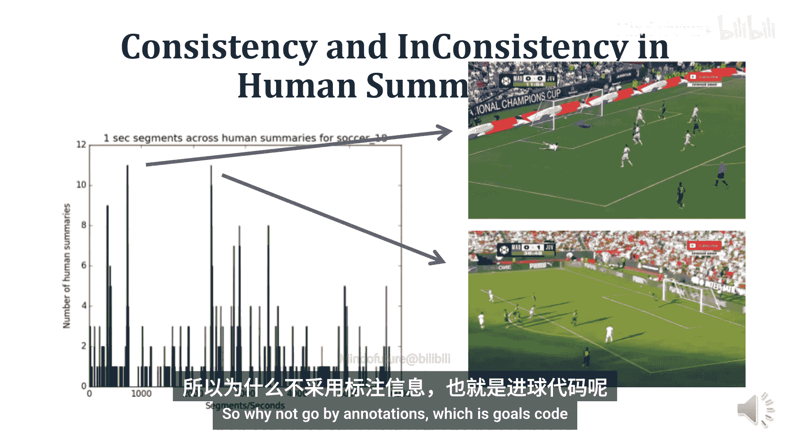

### 图像摘要

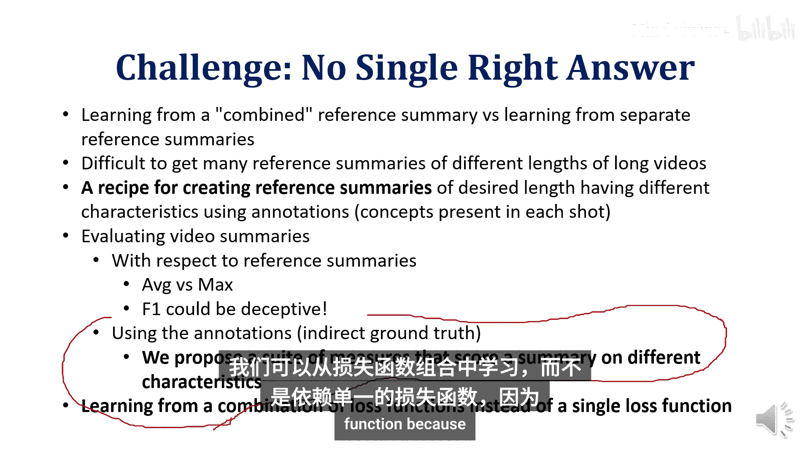

在图像收集中，用户可能需要进行基于查询的摘要（如“海滩”），或隐私保护摘要（隐藏私人信息）。研究表明，单纯追求多样性可能选择离群点，而单纯追求代表性可能错过孤立点。因此，需要结合多样性和代表性。学习子模函数的混合权重（例如通过最大边际学习）可以生成更符合人类偏好的摘要。

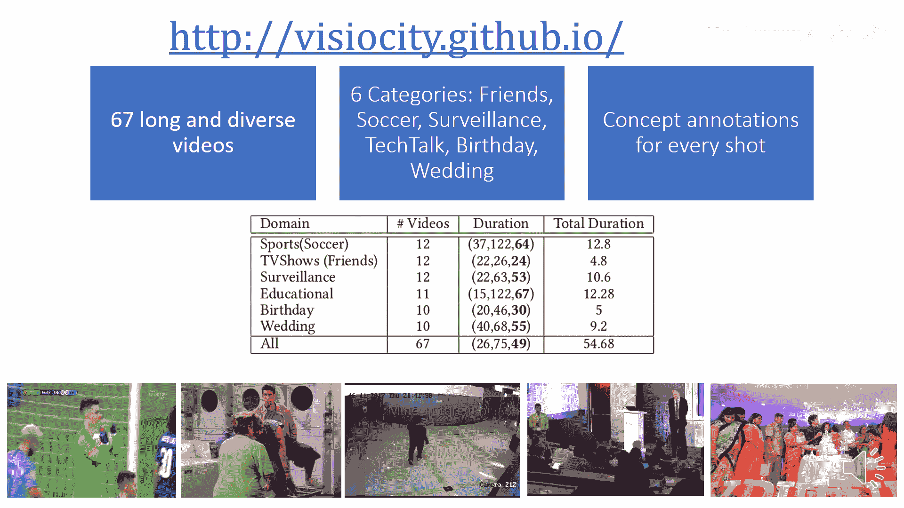

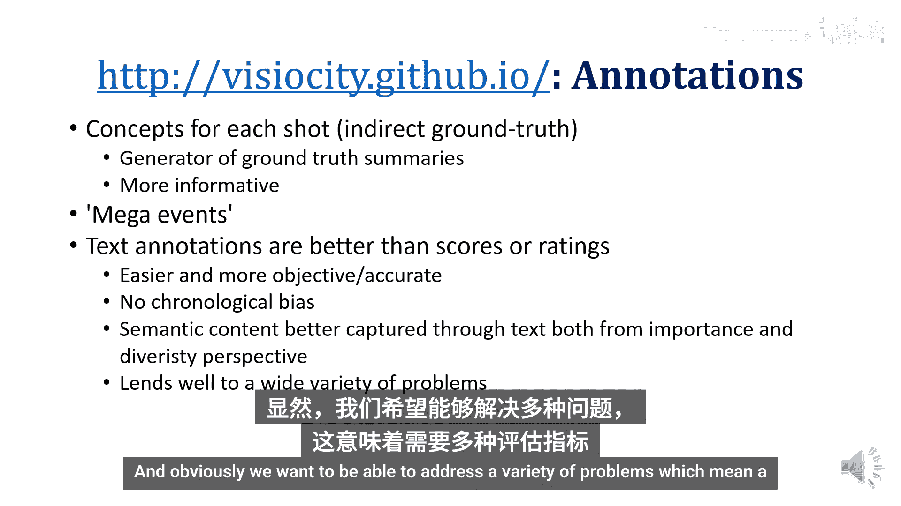

### 视频摘要

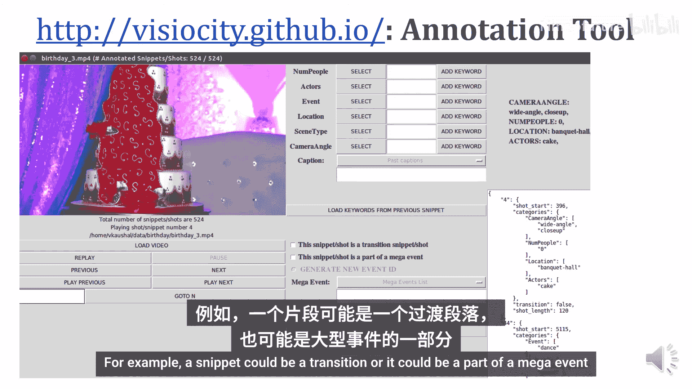

视频摘要更为复杂，除了多样性、代表性，还需考虑时序连贯性。早期工作将视频片段可视化，并组合“趣味性”（模块化）、“代表性”（k-Medoid）和“均匀性”（时序平滑）目标。后续工作引入了 DPP、LSTM 与 DPP 的结合等方法来同时捕获时序信息和多样性。

**VisioSum** 是一个新提出的大规模视频摘要数据集和评估框架。它包含71小时视频，并通过基于客观标准（如“进球”）生成参考摘要，以解决“没有单一正确答案”和人工摘要一致性低的问题。该框架支持通过一组评估指标来学习摘要模型，这些指标衡量摘要的不同特性。

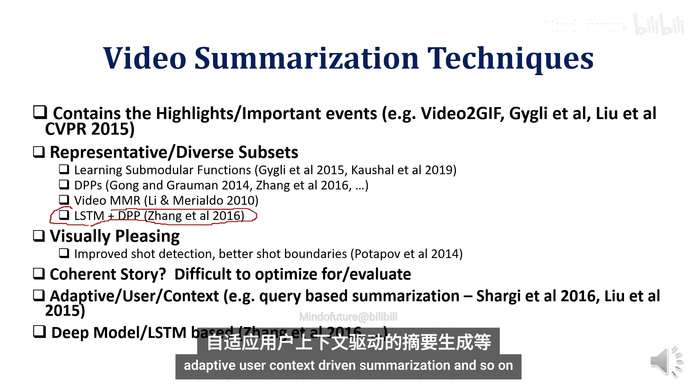

### 文本与主题摘要

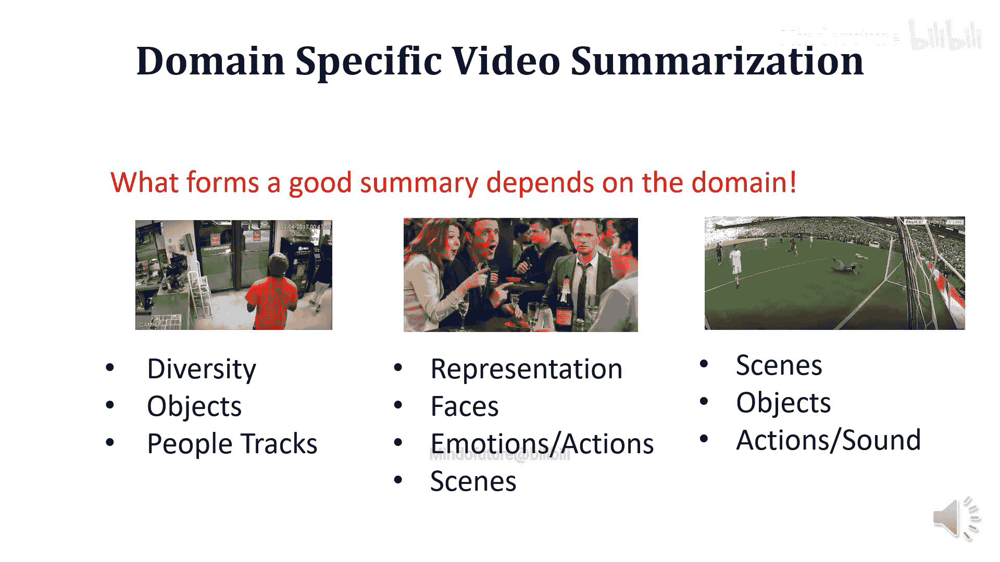

子模优化也可用于摘要主题层次结构（如维基百科分类体系）。目标是从庞大的主题树中选择一个节点子集，使其能很好地覆盖底层文档，同时满足预算约束，并避免选择彼此包含的冗余节点。这可以通过覆盖度、特异性、清晰度等子模函数来建模。

类似地，在机器翻译等领域，可以从大规模有向无环图中提取高质量的短语模式集合，同时考虑单个模式的质量和集合整体的覆盖度与多样性。

---

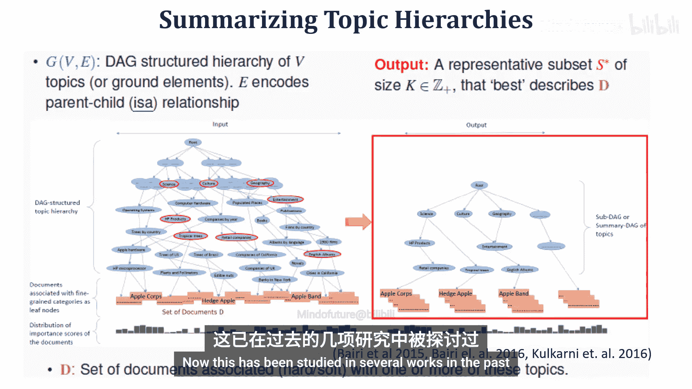

## 总结 🎓

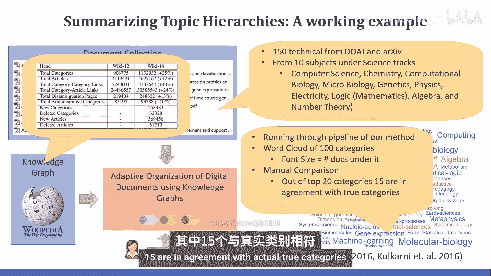

本节课中，我们一起学习了子模优化在机器学习中的多种高级应用。

1.  **数据子集选择与主动学习**： 我们探讨了使用代理函数、梯度近似、双层优化和散度最小化等方法进行数据选择。在主动学习中，我们看到了如何结合不确定性、多样性、影响力和梯度信息来高效选择样本进行标注。
2.  **数据编程**： 我们了解了如何结合少量标注数据和大量弱监督规则，并通过主动学习选择关键样本来提升标注质量。
3.  **特征选择与压缩**： 我们回顾了信息论方法、成本敏感方法、基于损失函数的方法、分类特征压缩以及学习特征组合等技术，其中子模性或弱子模性起到了关键作用。
4.  **摘要应用**： 我们深入研究了子模优化在图像、视频和文本摘要中的应用，包括查询相关摘要、隐私保护摘要、视频时序摘要以及主题层次结构摘要。

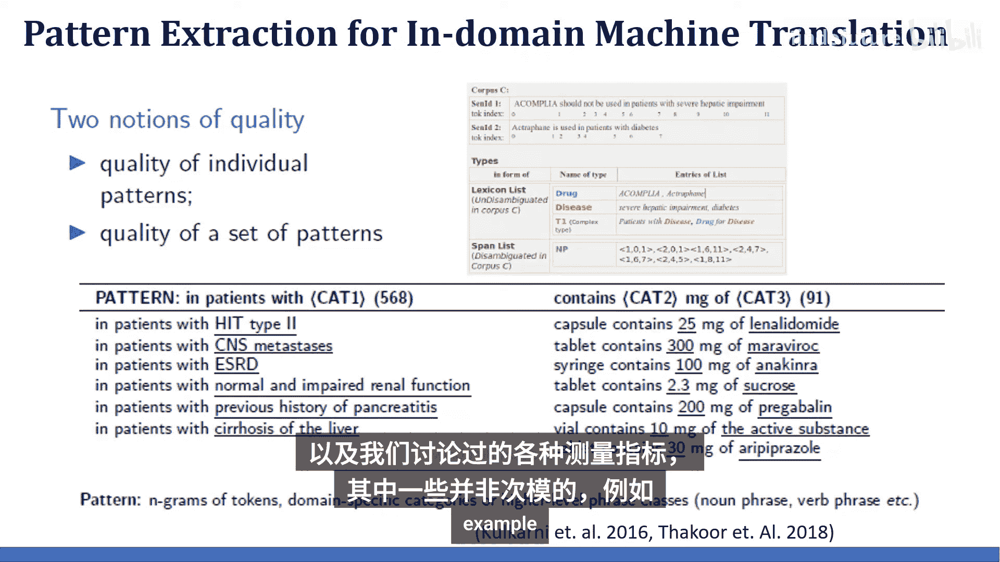

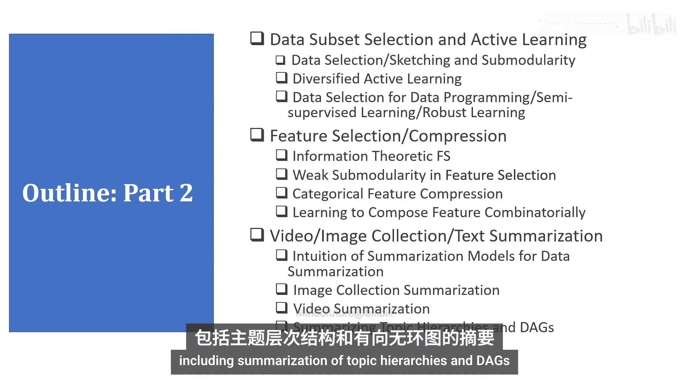

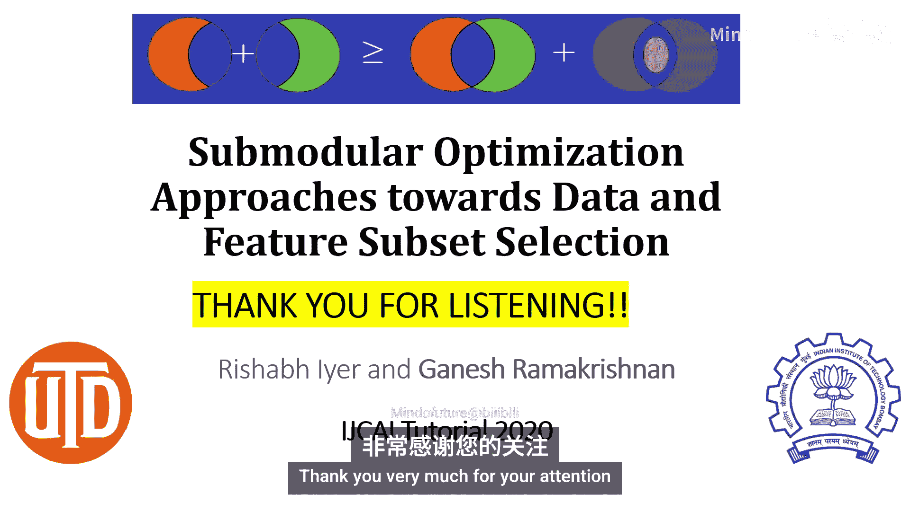

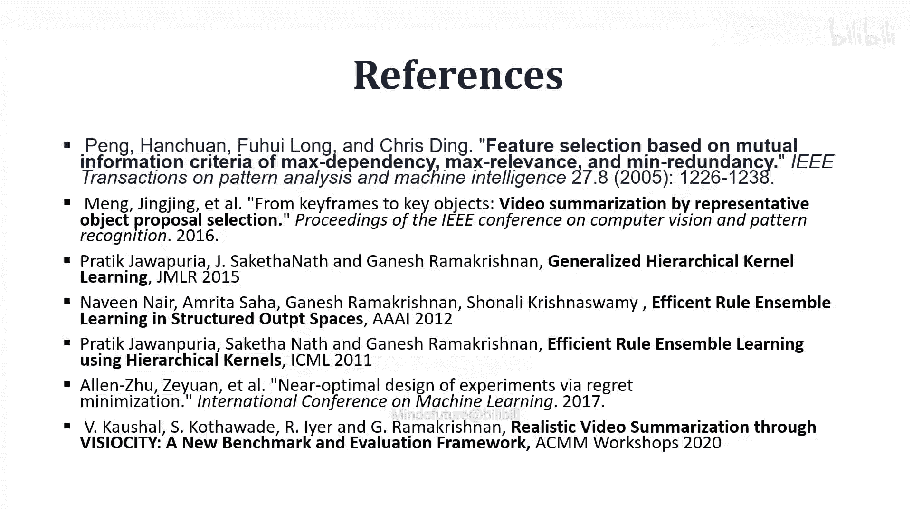

子模优化为这些机器学习中的核心问题提供了强大的理论工具和高效的实用算法，帮助我们在数据爆炸的时代实现更高效、更鲁棒的模型学习与信息处理。