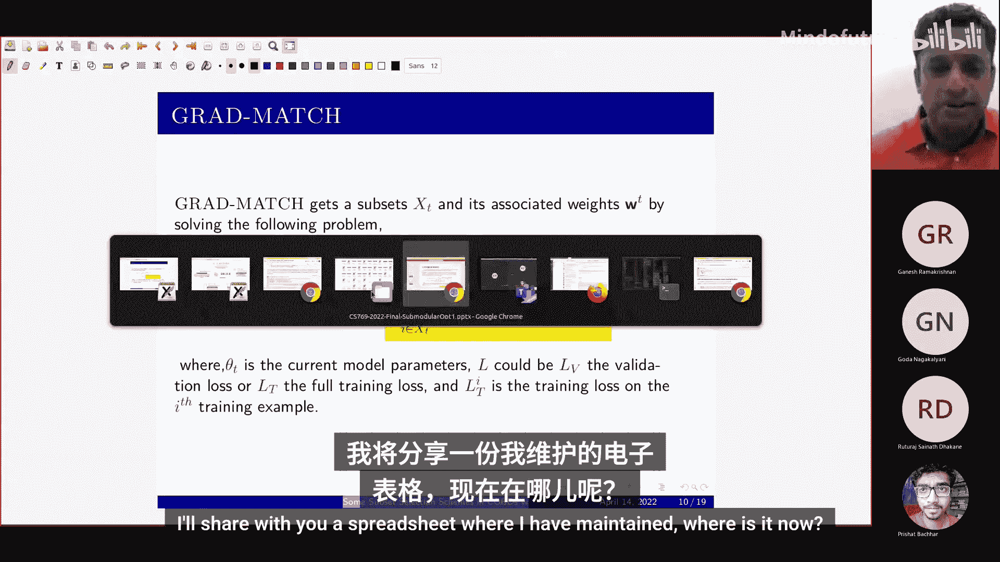
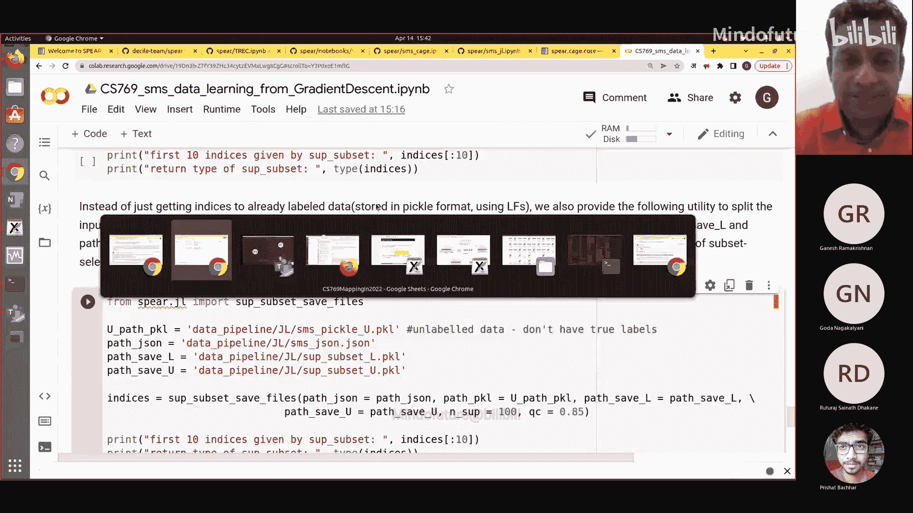

# 034：子模优化算法在数据编程与子集选择中的应用

## 概述
在本节课中，我们将学习子模优化算法在机器学习，特别是数据编程（Data Programming）和数据子集选择（Data Subset Selection）中的具体应用。我们将探讨如何利用标注函数（Labeling Functions）和少量标注数据来高效地生成训练数据，以及如何智能地选择数据子集来加速模型训练并提升鲁棒性。

---

## 数据编程（Data Programming）简介
上一节我们介绍了子模函数的基本概念。本节中，我们来看看如何将其应用于数据稀缺场景下的机器学习问题，即数据编程。

数据编程的核心思想是，当我们缺乏大量标注数据时，可以利用人工编写的规则或弱监督模型（统称为“标注函数”）为未标注数据自动生成噪声标签，然后通过一个聚合模型将这些可能存在冲突的噪声标签整合成相对可靠的伪标签。

### 标注函数示例
以下是几种常见的标注函数类型：
*   **基于规则的函数**：例如，在文本中，如果“配偶”和“丈夫/妻子”等关键词在特定距离内同时出现，则判定句子描述的是婚姻关系。
*   **基于相似度的函数（连续型）**：例如，计算句子中实体与“配偶”词典中词的余弦相似度最大值，作为该句子描述婚姻关系的置信度分数。
*   **基于样本的函数**：例如，给定一张“兄弟”的示例照片，在相册中寻找与之相似的所有照片并打上“兄弟”标签。

### 标签聚合模型
标注函数可能产生冲突或噪声。我们需要一个模型来聚合这些信号。早期的Snorkel模型使用了一个概率图模型，其核心是最大化以下形式的联合概率（简化表示）：
`P_θ(Y, Λ) ∝ exp(∑_j θ_j * 1{Λ_j = Y})`
其中，`Y`是真实标签，`Λ_j`是第`j`个标注函数的输出，`θ_j`是该函数的权重参数。

然而，该模型存在对初始化敏感、不支持连续型标注函数输出等问题。

---

## 改进的CAGE模型
为了解决上述问题，我们引入了CAGE模型。它对标注函数的建模进行了重要改进。

### 关键改进点
1.  **支持连续型标注函数**：模型能够处理输出为连续置信度分数的标注函数。
2.  **引入质量引导（Quality Guides）**：允许用户为标注函数提供先验的质量估计（例如，函数A的准确率约为90%），并将其作为正则化项加入目标函数，极大地稳定了训练过程。

改进后的模型势函数（以离散标注函数为例）形式如下：
`ψ_j(Y, Λ_j) = exp(θ_{j,Y})`，当标注函数`j`被触发且其输出与估计标签`Y`一致时。
这里的关键是`exp(θ_{j,Y})`永远为正，避免了原始模型中参数符号翻转导致似然值不变的问题。

质量引导正则项`R(θ)`的形式类似于衡量模型估计的标注函数准确率与用户提供的先验准确率之间的KL散度，从而将先验知识融入学习过程。

---

## 联合学习与级联学习
在数据编程的实践中，我们可能拥有少量标注数据。如何利用它们？通常有两种范式：

*   **级联学习（Cascaded Approach）**：先仅使用标注函数在未标注数据上生成伪标签，然后用生成的伪标签数据集去训练一个最终的判别模型（如逻辑回归、神经网络）。标注数据仅用于最终模型的评估。
*   **联合学习（Joint Learning）**：将标注函数模型（如CAGE）和最终的判别模型（称为特征模型）**同时进行优化**。目标函数同时考虑标注函数的一致性、特征模型在标注数据上的损失、特征模型在未标注数据上的预测熵、以及两个模型预测之间的一致性等。

联合学习能够实现标注函数与标注数据之间的互补，通常能获得比级联学习更好的性能。

---

## 智能数据子集选择
即使我们采用了联合学习，另一个关键问题是：**应该标注哪些数据？** 盲目地随机选择或全量标注成本高昂。我们希望智能地选择一个数据子集进行标注，使其能最大程度地提升模型性能。

### 问题形式化
我们可以将数据子集选择表述为一个双层优化问题：
*   **内层优化**：在选定的训练子集`S`上训练模型，得到参数`θ_S`。
*   **外层优化**：寻找一个大小固定的子集`S`，使得用`θ_S`在**验证集**上计算得到的损失`L_val(θ_S)`最小化。

外层优化是一个离散组合优化问题，直接求解非常困难。

### 高效近似算法：GLISTER
为了高效求解，我们采用**一阶元近似**：
1.  我们不对内层进行完整优化，而是假设模型参数从某个初始点`θ`仅沿在子集`S`上计算的梯度方向更新一步：`θ_S ≈ θ + η * ∇_θ L_train(θ, S)`。
2.  将这个近似代入外层验证损失，并进一步做泰勒展开。最终，外层优化目标可以近似为最大化验证集梯度与训练子集梯度之间的**点积**，即寻求一个其梯度方向与验证集梯度方向最一致的训练子集。

在一定的假设下（如使用逻辑损失），这个近似后的目标函数具有**弱子模性**。因此，我们可以使用贪心算法来高效地选择数据子集，并享有理论上的近似比保证。

这种方法（如GLISTER算法）能在几乎不损失模型精度的情况下，将训练速度提升数倍至数十倍，特别适用于超参数调优和架构搜索等需要多次训练的场景。

### 子集选择的意义
所选的数据子集应**补充**而非**替代**标注函数的信息。例如，我们应优先选择那些标注函数之间产生**冲突**或**置信度低**的样本进行人工标注，因为这些样本能提供最大的信息增益。

---

## 总结
本节课中我们一起学习了子模优化在机器学习前沿领域的两个紧密相连的应用：
1.  **数据编程**：利用子模优化思想（如通过质量引导实现稳定学习），我们能够整合多源、可能冲突的弱监督信号（标注函数）和少量标注数据，高效地生成高质量的训练数据集。
2.  **数据子集选择**：通过将子集选择问题形式化为一个可近似为子模优化的双层优化问题，我们能够智能地选择最具信息量的数据进行标注或训练，从而在保证模型性能的同时，大幅降低标注成本和计算开销。

这两个方向为在资源受限环境下开展机器学习提供了强大的工具，也是当前研究的热点。