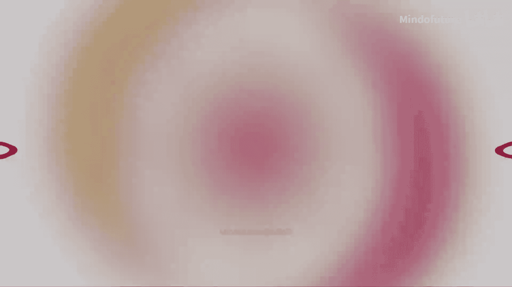
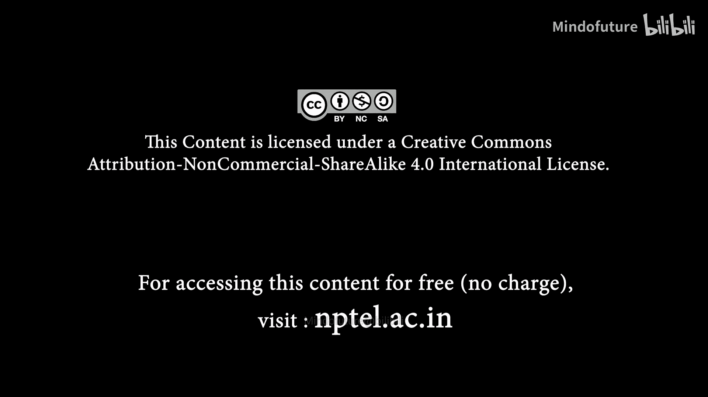
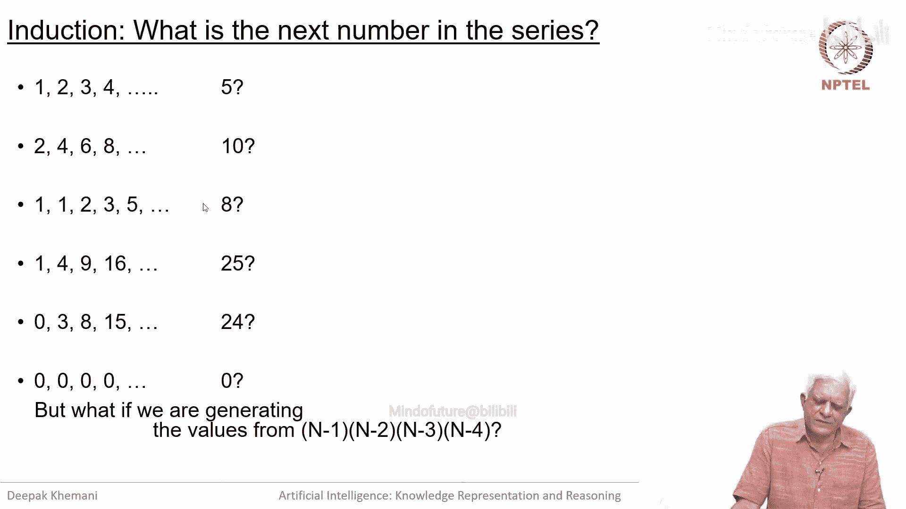

# 001：引言

## 概述

在本节课中，我们将要学习知识表示与推理的入门概念。这门课程是人工智能的核心组成部分，旨在探讨智能体如何理解其所在环境，并基于已有知识进行推理。我们将从智能体的基本概念出发，介绍几种获取知识的方式，并重点探讨三种主要的推理类型：演绎、溯因和归纳。

## 智能体与世界模型

上一节我们介绍了课程的整体目标，本节中我们来看看什么是智能体。一个智能体可以被视为一个持续运行、自主决策、主动设定并追求目标的程序。例如，NASA多年前开发的“远程智能体1号”（RA1）就是一个典型例子，它被赋予目标后送入太空，能够自主检测故障并利用系统冗余进行修复。

一个智能体要在世界中表现出智能，它必须在“头脑”中构建一个关于其所处环境或领域的模型。这个模型通常是对现实世界的抽象，因为我们无法也无必要完全复制现实世界的所有细节。正如有人所说，如果模拟与现实世界同等详细，那么模拟所需的时间将与现实世界事件发生的时间一样长。

更重要的是，一个真正智能的、具有自我意识的智能体，其内部的世界模型中还必须包含一个关于它自身的模型。下图展示了一个智能体及其内部世界模型的概念：

## 获取知识的方式

智能体需要知识，人类也是如此。哲学家和心理学家研究了我们认识事物的几种主要方式：

以下是几种主要的认知方式：

1.  **经验主义**：通过观察和经验获取知识。例如，看到一棵苹果树，就知道那里有一棵苹果树。俗话说“眼见为实”，但在当今数字时代，对屏幕上看到的内容（如深度伪造视频）需要保持警惕。
2.  **科学方法**：通过系统性地收集和评估证据来检验观点、回答问题。例如，要验证“印度马纳利非常寒冷”的说法，可以进行实地测量。
3.  **直觉**：基于感觉而非理性分析来相信某事为真。例如，“我感觉今天会下雨”。这可能源于我们潜意识的信息处理。
4.  **权威**：接受权威人物或来源所声称的真实性。例如，儿童常说“老师告诉我的”或“妈妈告诉我的”。
5.  **理性主义**：**使用逻辑和推理来获取新知识**。这是本课程的核心，即基于已知事实，通过推理得出新的结论。

## 推理的类型

本课程标题中的“推理”，主要指从已有知识中**推导出新信息**的过程，即使得隐含的信息变得明确。推理主要有三种类型：

以下是三种主要的推理类型：

1.  **演绎推理**：从一组给定事实中，**必然地**推断出另一个事实。它从原因推导到结果。
    *   **公式/逻辑表示**：如果 `P` 为真，且 `P → Q`（如果P则Q）为真，那么 `Q` 必然为真。
    *   **例子**：如果你患有某种疾病，那么你必然会出现该疾病的症状。
2.  **溯因推理**：从观察到的结果出发，推断可能导致该结果的原因。这种推理得出的结论是**可能为真**，而非必然。
    *   **例子**：医生根据病人的症状（结果）推断可能患有的疾病（原因）。为了确认，医生通常会要求进行化验检查。
3.  **归纳推理**：从一组具体事实或例子中，推断出一个**普遍的结论或规律**。
    *   **例子**：观察到橡树叶、罗望子叶、楝树叶、芒果叶都是绿色的，从而得出结论“所有叶子都是绿色的”。

推理是连接信息点的过程。正如夏洛克·福尔摩斯所说：“犯罪是普遍的，逻辑是罕见的。因此，你应当关注逻辑而非罪行本身。”他擅长演绎推理，例如能从一个人的外表细节推断出其职业、习惯和经历。

然而，溯因推理并不总是可靠的。在福尔摩斯的故事中，雷斯垂德探长常做出错误的猜测（即溯因），而福尔摩斯则能指出其猜测与已知事实（如门从内部反锁）之间的矛盾，从而证明其无效。

## 多智能体与认知逻辑

随着多智能体系统（如机器人团队或人机协作团队）的发展，智能体需要能够推理其他智能体知道什么。这引出了**认知逻辑**。

认知逻辑允许我们表达关于智能体知识的陈述。例如：“莉娜知道苏塔去了书展。”或者“奥姆知道苏塔知道阿卡什要来。”与认知逻辑紧密相关的是**信念逻辑**，它处理的是智能体相信什么（信念可能为假，而知识通常被定义为真信念）。

## 归纳推理的挑战

归纳推理虽然强大，但也存在陷阱。一个经典的例子是数列预测：

以下是几个数列预测的例子：

*   `1, 2, 3, 4, ?` 大多数人会预测 `5`。
*   `2, 4, 6, 8, ?` 预测为 `10`（偶数序列）。
*   `1, 1, 2, 3, 5, ?` 预测为 `8`（斐波那契数列）。
*   `1, 4, 9, 16, ?` 预测为 `25`（平方数序列）。
*   `0, 3, 8, 15, ?` 可能预测为 `24`（`n² - 1` 序列）。

然而，考虑这个数列：`0, 0, 0, 0, ?`。你很可能预测下一个数是 `0`。但是，如果这个数列是由多项式 `(n-1)(n-2)(n-3)(n-4)` 生成的，那么第五个数将是 `24`，而不是 `0`。这个例子说明了归纳得出的规律可能并非唯一或绝对正确。

## 总结

本节课我们一起学习了知识表示与推理的引言部分。我们了解了智能体的基本特征及其内部世界模型的重要性，回顾了人类获取知识的多种方式（经验、科学、直觉、权威、理性）。我们重点探讨了三种核心推理类型：**演绎**（必然结论）、**溯因**（可能原因）和**归纳**（普遍规律），并通过例子说明了它们的特点与区别。最后，我们简要提及了用于多智能体系统的认知逻辑，并指出了归纳推理所固有的不确定性。在接下来的课程中，我们将深入探讨如何形式化地表示知识，并构建可靠的推理系统。