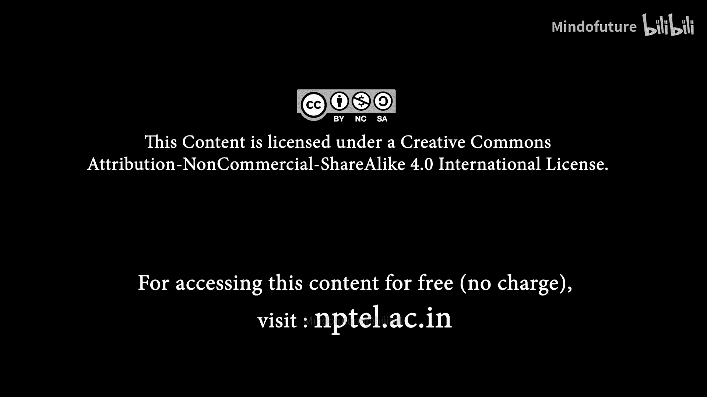

**知识表示与推理：P02：溯因推理与预期**

在本节课中，我们将探讨智能体如何通过**溯因推理**来理解世界并做出决策。我们将以足球比赛为例，说明智能体如何利用背景知识进行猜测、生成**预期**，并据此调整行动。理解这些概念是构建能够进行常识推理的智能系统的关键。

---

### **智能体与推理**

上一节我们讨论了智能体与知识。现在，我们来看一个具体的例子，说明智能体需要做什么。

想象你是一名足球前锋，正带球冲向对方球门。你的队友用蓝色表示，对手用红色表示。当你带球前进时，对方球员正在向你逼近，一名后卫和守门员也向你冲来。在这种情况下，你必须做出决策。

这就是我们所说的**自主智能体**：在某个领域或世界中，拥有一个需要达成的目标（此处指目的，而非球门），并有一系列可供选择的行动来努力实现这个目标。智能体必须清楚了解正在发生的情况。它必须在头脑中拥有对其所处领域的**表示**，对其他智能体行为的表示，并且能够获取在此类情况下人们通常使用的策略和计划。基于所有这些信息，智能体做出决策。

那么，你会怎么做？你可能会选择不射门，而是将球传到队友正在跑向的区域，这样你的队友可能有更好的得分机会。如果发生这种情况，人们肯定会认为这名球员是**智能**的。

### **溯因推理的作用**

当你在足球比赛中带球奔跑时，你必须知道其他球员的位置，这就是对你所处领域进行**建模**的必要性。你还必须能够推断其他球员可能的意图。如果你知道人们在各种情况下的标准行为方式或标准计划，并且看到某个行动是这些计划的一部分，那么你就可以推断出他们的意图或目标。

这种对意图的推断来自于**背景知识**。例如，你必须知道人们在足球比赛中通常会做什么。这就是为什么球队有教练，他们会不断研究对手球队的动向，制定策略和计划。球员在场上运用的这类知识来自于训练。

### **想象与预期**

你应该能够想象，如果你把球踢到队友应该跑向的位置，那么他将有更好的射门机会。这种**想象**的能力是智能行为的一个关键方面。你无法想象一个不能想象的智能体。为了做到这一点，智能体当然必须拥有大量知识，包括它们所处的领域、它们可能采取的行动、这些行动的后果，以及在像足球这样的多智能体游戏中，其他球员可能会做什么。

毫无疑问，对手也在思考同样的事情。为什么对方球员跑向那个位置？因为她已经推断出你打算把球传给队友，而她想要**拦截**这个传球。因此，**推理**是智能思维的基本认知行为。我们一直在进行推理，有些可能是正确的，有些可能不是，但我们总是有各种想象和推断，通过填补信息来理解我们看到的事物。

### **溯因推理的本质**

在最近出版的《人工智能的神话》一书中，作者埃里克·拉森指出，我们人类进行的大多数推理本质上是**溯因的**。因为大多数时候，我们面对某种情况，拥有背景知识，然后进行推断。溯因推理就像是基于我们对世界的了解进行**猜测**。有些人比其他人做出更明智的猜测，比如夏洛克·福尔摩斯。

每当我们进行推理时，我们实际上是在谈论**预期**。溯因推理会产生预期，你期望看到某些事情发生。例如，如果你看到乌云，你会预期可能会下雨。在足球场上，你可能会推断守门员预计会做什么，你的队友会做什么，对方球员可能会做什么。你生成了所有这些预期，然后基于此监控自己的活动和计划，并在必要时改变路线或选择不同的计划。这一切都发生得非常动态和迅速。

### **预期与理解**

有一种句子叫做“花园路径句”。如果你读这个句子：“The old man's glasses...”（老人的眼镜……），你可能会产生某种预期。但突然，你读到句子的其余部分：“...were filled with sherry.”（……装满了雪利酒。）你的预期被违反了。当你读到“眼镜”时，你可能想到的是阅读用的眼镜或眼镜片，但突然发现它指的是玻璃杯。你在阅读句子时产生的预期被违反了，然后你必须修正对句子的理解。

笑话也依赖于这种**预期违反**。预期不像演绎推理那样确定。溯因推理让你想象很多可能性，但这并不意味着它们一定会发生。

### **一个关于推理的笑话**

这里有一个笑话，虽然不是柯南·道尔爵士写的，但很好地说明了在进行推理时，你面临着大量的选择和可能性，有时甚至很难做出最明显的推断。

故事是这样的：福尔摩斯和华生正在进行一次露营旅行。半夜，福尔摩斯醒来，推了推华生。“华生，”他说，“看看天空，告诉我你看到了什么。”华生说：“我看到了数百万颗星星。”福尔摩斯又问：“那么你从中得出了什么结论？”华生给出了一长串解释：“从天文学上讲，这告诉我存在数百万个星系和数十亿颗行星；从占星学上讲，我观察到土星在狮子座；从计时学上讲，我推断时间大约是三点一刻；从气象学上讲，我猜明天会是个好天气；从神学上讲，我看到上帝是万能的，而我们是渺小且微不足道的。这告诉了你什么，福尔摩斯？”福尔摩斯说：“华生，你这个白痴，有人偷了我们的帐篷！”

你可以看到，当你读这个故事时，你并没有预期到这样的结局。笑话就是这样运作的：它们引导你走向某种预期，然后呈现一些略有不同的东西。

### **预期从何而来？**

耶鲁大学的罗杰·尚克及其团队对预期进行了大量研究。他们编写程序来理解英语故事，并使用一种机制来生成预期以理解这些故事。

让我们看一个罗杰·尚克在他的书中给出的例子。请阅读以下故事：

> 弗雷德和约翰正在交谈。约翰对玛丽非常生气。他说：“我受够玛丽了。我要去杀了她。”弗雷德说：“别做傻事，约翰。给你这把刀。”

我们暂时保留了高潮部分。但读完弗雷德和约翰之间的对话后，作为读者，你显然对约翰接下来要说什么有一些**预期**。约翰对玛丽很生气，并且索要了一把刀，这可能意味着任何事情。

这种预期从何而来？尚克认为，预期有多个来源：
1.  **话语的句法和语义**：当他说“I think I ought to...”时，你预期会有一个动词来描述某个动作。
2.  **概念结构**：一种表示动作及其类型填充物的结构。尚克假设了一种称为“概念结构”的知识结构，这些结构包含一些信息，但也有一些**空白**（或称为“槽”），这些空白会生成预期，你会寻找能填补这些空白的信息。
3.  **上下文**：上下文限定了可能行动的范围。例如，在争吵和愤怒的背景下，你可能会预期伤害某人、去某个地方、写信等反应。
4.  **对话目的**：人们交谈通常是为了沟通某事，因此存在对话预期，即约翰会说一些可能重要的话。
5.  **个人与世界知识**：这取决于你对约翰的了解。如果约翰是已知的杀人犯，那么递给他刀就不是个好主意。另一方面，如果他是个公认的和平主义者，你会有不同的预期。预期还来自文化背景，不同文化有不同的行为规范。

罗杰·尚克提出的问题是：记忆中的哪种**知识结构**能够产生这样的预期，使得程序在听故事时能够说：“好吧，我预期接下来会看到这个”？如果你听到的是“I think I ought to go and eat some fish”（我想我应该去吃些鱼），你会非常惊讶。正如我们所说，笑话正是利用了这种**预期违反**——你并不期望他说出这样的话。

重要的是，我们在听故事时确实会生成预期。我们感兴趣的是，智能体头脑中的哪种知识对于生成此类预期是有用的。

---

本节课中，我们一起学习了**溯因推理**如何作为智能体理解世界和做出决策的核心机制。我们通过足球比赛的例子，看到了智能体如何利用背景知识进行猜测并生成**预期**。我们还探讨了预期在语言理解和幽默中的作用，以及预期产生的多种来源，包括句法、语义、上下文、对话目的和个人知识。理解这些是构建能够进行类似人类常识推理的智能系统的关键一步。