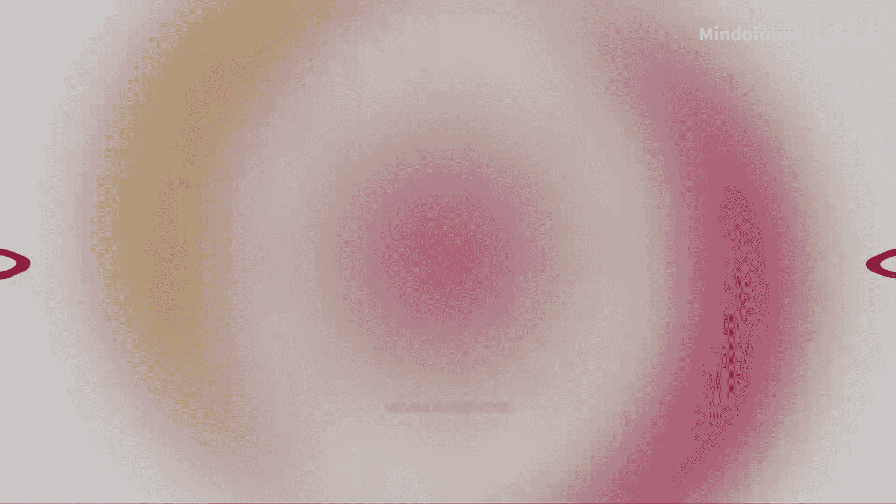
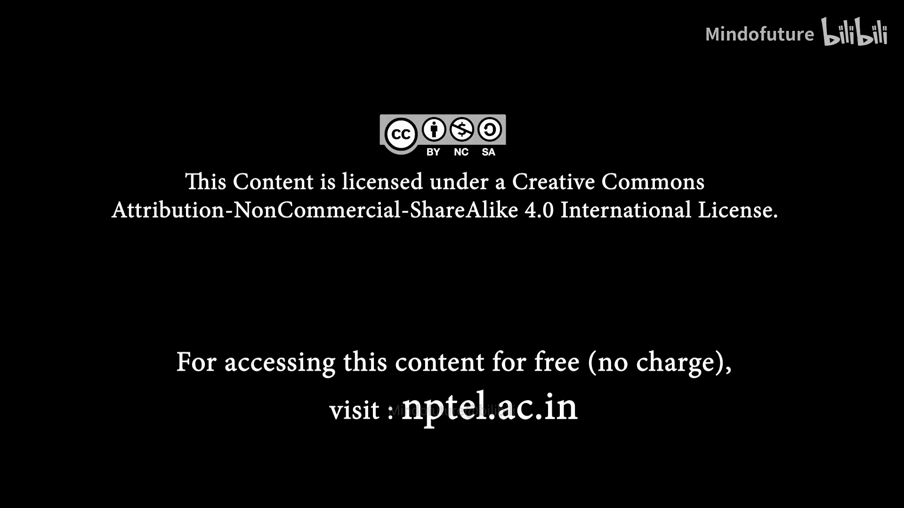
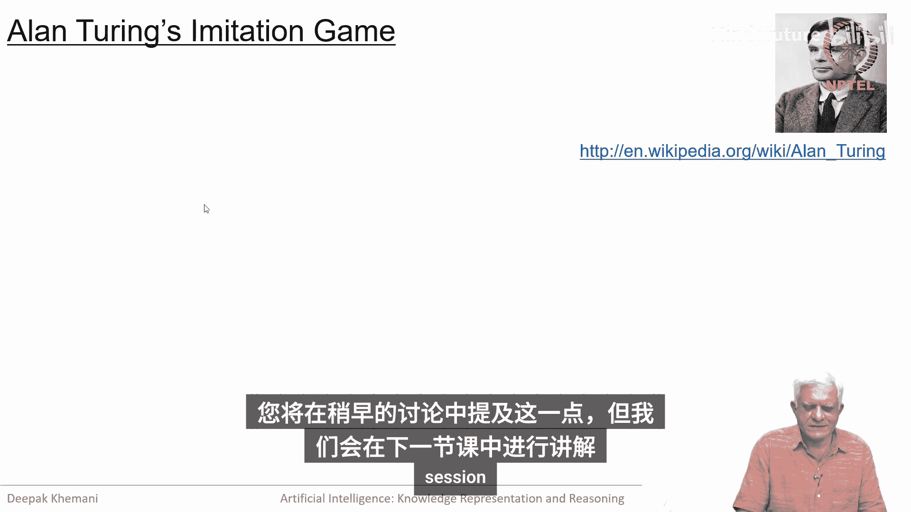

# 003：论机器学习 🧠

在本节课中，我们将探讨推理的类型、人类与机器智能的差异，以及知识表示与推理在人工智能中的核心地位。我们将看到，虽然机器学习在模式识别方面取得了巨大成功，但真正的智能还涉及更深层次的符号推理和世界建模能力。

## 推理的类型

上一节我们介绍了推理的基本概念。本节中，我们来看看三种主要的推理类型。

*   **演绎**：结论**逻辑上必然**从前提中得出。演绎过程只是将隐含在已知信息中的内容明确化。其公式可表示为：如果 **P → Q** 且 **P** 为真，则 **Q** 为真。
*   **溯因**：结论**可能**或**通常**从前提中得出。例如，牛顿看到苹果下落，溯因推理出“可能是因为重力”。
*   **归纳**：从具体观察中**生成新的普遍性结论或假设**。例如，哥德巴赫猜想（任何大于2的偶数都可表示为两个质数之和）就是基于大量观察归纳得出的，但尚未被演绎证明。

科学进步始于溯因（寻找原因），通过归纳形成假设（如万有引力理论），最终通过演绎或实验验证来确认知识。只有归纳能增加**新类型的知识**，即新的普遍性概括。

## 现实世界的复杂性与问题解决

现实世界非常复杂，尤其当存在其他具有目标、感知和行动能力的智能体时。智能体需要在其中运作，构建关于世界、自身目标和应执行动作的认知图景。

人类作为问题解决物种，主要通过两种途径：
1.  **基于第一性原理**：从基本公理或规则出发进行推理和搜索。
2.  **基于知识的方法**：知识来源于经验。这又包括：
    *   **基于记忆的经验直接利用**。
    *   **从经验中学习**，即机器学习的过程。

知识还涉及**本体论**和**领域语义**，这是进行第一性原理推理（如编写游戏搜索程序）所必需的。本课程将重点涵盖知识、本体论和推理方面。

## 人工智能的范畴：符号推理与机器学习

如今，“人工智能”常被等同于“机器学习”。这得益于计算能力的提升、数据的可获取性以及机器学习方法的有效性。但严格来说，人工智能包含更广的范畴：

*   **符号知识表示与问题解决**：这是传统AI的核心，包括逻辑、本体论、语义、自然语言理解、记忆、搜索算法、规划与建模。本课程主要关注此部分。
*   **机器学习**：作为AI的一个子领域，专注于从数据中提取信息，例如：
    *   **大数据处理与推荐系统**（如亚马逊的商品推荐）。
    *   **预测分析**。
    *   **分类**，特别是深度学习在图像和语言分类中的广泛应用。

## 人类认知架构与机器智能现状

我们可以用三个同心圆来描述认知架构：

1.  **最外层：信号处理**。处理视觉、听觉等原始信号。
2.  **中间层：神经模糊推理**。主要由神经网络等构成，负责**模式识别、分类**等任务。当前机器智能主要集中于此，如图像处理、语音识别、机器人控制。
3.  **最内层：符号推理**。这是**人类区别于其他生物或当前机器的核心**。我们以符号表示事物，并进行逻辑推理、理解语义、解决问题和规划。

当前，机器学习系统擅长**从信号到符号的映射**（如图像标注），但无法**处理这些符号本身**或基于符号进行推理。它们能识别出图像中有“树”、“草”、“天空”，但并不理解这些符号的含义。

## 机器学习的局限与智能的本质

机器学习虽强大，但存在局限：

*   **任务特定性**：需要针对每个新问题领域进行大量人工准备、专用编码、训练数据和定制学习结构，是**脆弱**且**非通用**的。
*   **缺乏理解与模型**：如罗德尼·布鲁克斯举例，一个能标注“人们在公园玩飞盘”的机器，无法回答“飞盘是什么形状？”、“人能吃掉飞盘吗？”等问题。因为它没有关于世界、物体属性和因果关系的**内部模型**。
*   **与生物能力的对比**：现代机器学习系统能做的许多事（如视觉、导航、语音识别），其他生物（如鹰、猫、狗）也能做到，甚至更好。但这些生物并不具备人类层级的认知和智能。

因此，**智能远不止模式识别**。它还包括**表示知识并进行推理的能力**、**构建环境模型并预测行动结果的能力**。马文·明斯基将“学习”这类含义丰富的词称为“ suitcase word”（ suitcase word ），机器学习只是其中一种含义。

## 如何衡量智能？

如何衡量智能是一个长期存在的辩论，自约翰·麦卡锡在达特茅斯会议提出“人工智能”概念甚至更早之前就已开始。这将是下一节讨论的内容。

---

本节课中，我们一起学习了三种推理类型（演绎、溯因、归纳），区分了符号推理与机器学习在人工智能中的不同角色，并通过人类认知架构的分析，指出了当前机器学习在深层理解和推理方面的局限性。我们认识到，真正的智能需要结合信号处理、模式识别以及核心的符号表示与推理能力。