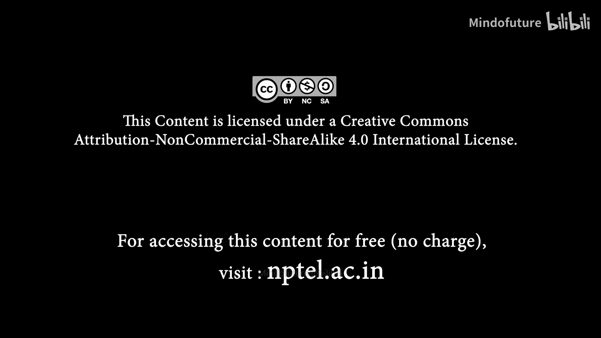
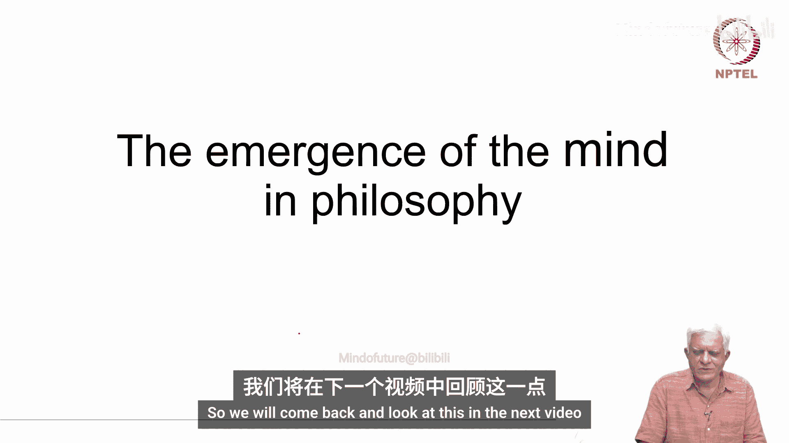

# 004：智力的新测试

在本节课中，我们将探讨如何识别智能行为，并介绍一种超越传统图灵测试的新智力测试方法——威诺格拉德模式挑战。我们将了解其设计原理、核心概念，并通过具体例子来理解它如何评估实体的推理与知识能力，而非仅仅是语言处理能力。

## 从图灵测试到新挑战

上一节我们介绍了知识表示的基本概念。本节中，我们来看看如何评估一个系统是否真正具备“智能”。

艾伦·图灵在1950年提出，直接问“机器能否思考”这个问题本身意义不大。他设计了一个测试，称为“模仿游戏”，即现在广为人知的**图灵测试**。

图灵测试的核心思想是：如果一台机器能够通过电传打字机（在现代相当于聊天界面）与人类评委对话，并且其回应让评委无法区分它到底是人还是机器，那么我们就应该承认这台机器是智能的。这个测试**完全依赖于机器处理语言的能力**。

然而，随着技术进步，特别是基于海量语料库的自然语言处理和巧妙的对话技巧，构建出能给人留下深刻印象但缺乏真正智能的聊天机器人已变得相对容易。因此，赫克托·莱韦斯克等人提出，需要一种新的测试来更有效地评估智能。

## 威诺格拉德模式挑战

这种新的测试被称为**威诺格拉德模式挑战**。它由特里·威诺格拉德最早提出，其核心是提出一个需要领域知识才能解答的多项选择题。

该测试的设计旨在“防谷歌”，即无法通过简单地在网上搜索相似问题和答案来通过测试。要想表现得比随机猜测（50%正确率）更好，被测实体必须真正理解句子描述的情景并进行推理。

威诺格拉德模式挑战的核心是**指代消解**问题，即确定句子中代词所指代的对象。

一个威诺格拉德模式包含三个部分：
1.  一个包含两个**同类名词短语**（例如，都是人、物体等）的句子或简短语篇。
2.  一个**模糊的代词**，它可能指代前面任何一个名词短语。
3.  一个**特殊词**和一个**替代词**。当使用特殊词时，代词指代第一个名词短语；当使用替代词时，代词指代第二个名词短语。

测试时，会给出使用其中一个词的句子，然后询问代词指代的是哪个名词短语。被测者需要在两个选项（即两个名词短语）中做出选择。

以下是威诺格拉德模式的一些具体例子。

### 例子分析

以下是几个经典的威诺格拉德模式例子，它们清晰地展示了知识推理如何影响指代消解。

**例子一：市议员与示威者**
*   句子A：`市议员拒绝给示威者发放许可，因为他们害怕暴力。`
*   句子B：`市议员拒绝给示威者发放许可，因为他们提倡暴力。`
*   问题：“他们”指的是谁？选项：市议员 或 示威者。

在句子A中，“害怕暴力”的是**市议员**，因此“他们”指代市议员。在句子B中，“提倡暴力”的是**示威者**，因此“他们”指代示威者。要做出正确判断，需要理解“发放许可”、“害怕”和“提倡”这些概念之间的关系。

**例子二：水壶与背包**
*   句子A：`约翰把水壶从背包里拿了出来，这样它会轻一些。`
*   句子B：`约翰把水壶从背包里拿了出来，这样它会方便取用。`
*   问题：“它”指的是什么？选项：水壶 或 背包。

在句子A中，从背包里拿出东西会使**背包**变轻，因此“它”指背包。在句子B中，拿出来是为了让**水壶**方便取用，因此“它”指水壶。这需要关于物体重量、容器以及行为目的的基本常识。

**例子三：奖杯与手提箱**
*   句子A：`奖杯放不进棕色手提箱，因为它太小了。`
*   句子B：`奖杯放不进棕色手提箱，因为它太大了。`
*   问题：“它”指的是什么？选项：奖杯 或 手提箱。

在句子A中，因为**手提箱**太小而放不进奖杯。在句子B中，因为**奖杯**太大而放不进手提箱。这需要理解物体尺寸与容器容量之间的关系，并能在脑中构建情景模型。

**例子四：律师与证人**
*   句子A：`律师问了证人一个问题，但他不愿意重复它。`
*   句子B：`律师问了证人一个问题，但他不愿意回答它。`
*   问题：“他”指的是谁？选项：律师 或 证人。

在句子A中，“重复问题”这个动作通常由提问者（**律师**）执行。在句子B中，“回答问题”这个动作通常由被提问者（**证人**）执行。这需要理解对话中不同角色的典型行为。

## 知识表示的基础：本体论

在深入讨论如何让机器进行此类推理之前，我们需要先解决知识如何被表示的问题。这一切的起点是**本体论**。

当我们思考世界时，会使用类别来划分事物：这是一棵树，那是一匹马，这是一个杯子。这种为事物命名、定义词汇来描述世界的过程，就被称为定义一个**本体论**。

在哲学中，本体论是形而上学的一个分支，研究“存在”的本质，即世界上有什么。在人工智能和知识工程中，本体论的定义更加具体：

**一个本体论是一个领域内概念和类别的集合，它明确了它们的属性及相互关系。**

这意味着我们需要定义：
*   **概念/类别**：例如“哺乳动物”、“猫”。
*   **属性**：例如“哺乳动物有毛发”、“猫会喵喵叫”。
*   **关系**：例如“猫是一种哺乳动物”、“哺乳动物是一种动物”。

通过这种层级化的分类和属性继承（例如，猫继承哺乳动物的所有属性），我们可以紧凑地表示知识，并进行推理（例如，从“猫是哺乳动物”和“哺乳动物是动物”推理出“猫是动物”）。

在现代，特别是在语义网和互联网数据交换中，本体论的作用至关重要。它提供了对概念的**显式规范**，使得不同计算机程序能够精确理解彼此交换的数据含义，例如在比价购物或电子商务集成中。

## 总结与展望

本节课中，我们一起学习了评估智能的新方法。
*   我们回顾了**图灵测试**及其对语言能力的侧重。
*   我们重点介绍了**威诺格拉德模式挑战**，它通过需要常识和推理的指代消解问题，将测试重点从语言能力转向了知识理解和逻辑推理能力。
*   最后，我们引入了**本体论**的概念，它是任何知识表示系统的基石，定义了描述世界所用的词汇、概念及其关系。

下一节，我们将更深入地探讨如何构建这些概念和类别，即如何创建用于表达知识的词汇表，并从“心智”这一概念的起源开始，探讨我们如何为世界建立模型并进行推理。