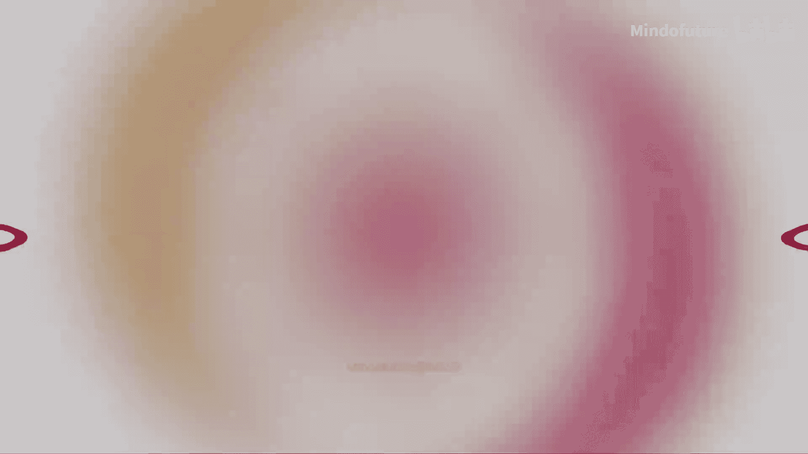
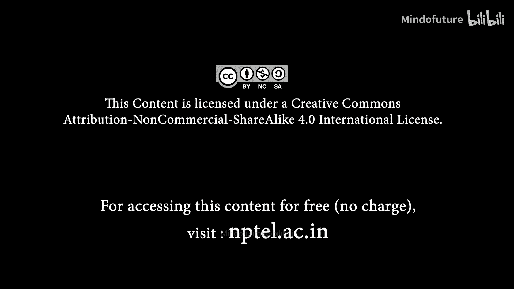
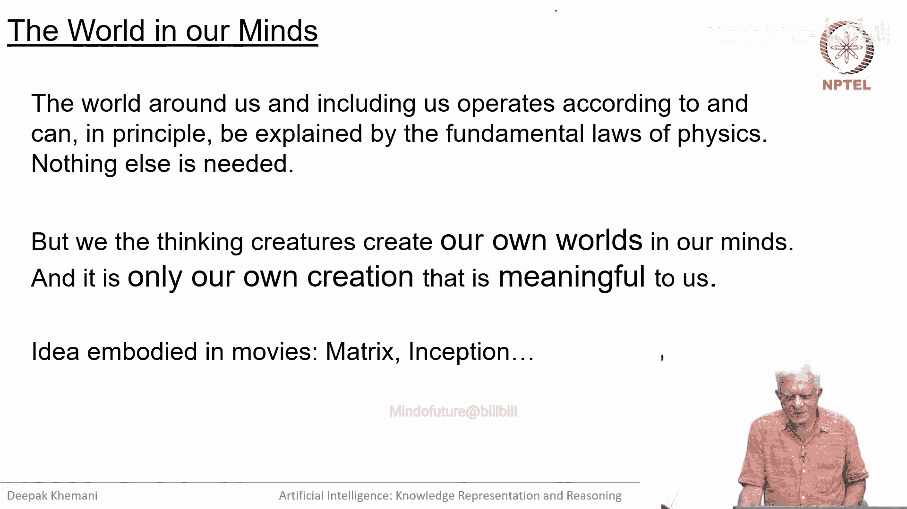

# 005：我们所理解的世界 🌍

在本节课中，我们将探讨智能体如何理解并构建其所在世界的模型。我们将从人类如何认知世界开始，逐步分析这种认知方式如何启发我们为机器构建知识表示模型。

## 概述

一个智能体要表现出智能，其核心任务之一是为其所在的操作领域创建一个世界模型，并基于此模型进行推理。这意味着智能体不仅需要知道世界上正在发生什么，还必须能够从已知信息中进行推断。此前我们简要讨论了推理的三种类型：演绎、溯因和归纳。本课程主要关注演绎推理，因为它与逻辑关系最为密切。然而，我们尚未深入探讨“表示”这一方面。我们将从人类如何表示周围世界开始，并从中汲取灵感，探索如何让机器也能表示世界，因为最终机器的表示结果也必须能被我们理解。

## 人类的世界观

我们的世界观深受西方思想影响，特别是源自中世纪欧洲对希腊思想的基督教化诠释。柏拉图认为，造物主的理念在某种意义上代表了完美，而人类的理念和现实世界则是这些神圣理念不完美的物质化体现。因此，我们常将“柏拉图式”与超越日常、纯粹的理念联系在一起。

然而，他的学生亚里士多德持有不同观点。他认为，人类的理念基本上是对我们所观察世界的反映。当我们思考苹果、狗或树，或形成这些概念时，我们的思想本质上是对外部世界事物的映射。这被称为“真理符合论”。著名哲学家路德维希·维特根斯坦也提出了语言的“图像论”，认为词语和语言就像是对所见事物的图像表征。

## 历史上的世界观

在这种观点下，世界就是我们所见的样子。地球是平的，因为我们看到它是平的；地球是宇宙的中心，因为我们感觉地球是静止的，而天空在围绕地球旋转。关于物质的早期理论认为，万物由五种元素构成：以太（构成天堂的永恒元素）、火、气、水和土。这些元素以某种密度顺序排列，并不断混合与分离，试图回到其“正确”的位置。

天文学曾是当时最先进的实证科学，因为航海等需要依靠星辰指引方向。然而，如果地球是宇宙中心，所有天体都围绕地球旋转，那么行星的“之”字形运动轨迹就难以解释。人们曾试图用复杂的齿轮模型来解释这种运动。

## 认知的转变

直到16世纪，尼古拉·哥白尼提出，我们所看到的并非真实。他认为太阳才是中心，所有行星都围绕太阳运行。哥白尼的贡献在于指出，我们心中所见与真实存在的事物是不同的。这与真理符合论不同，他认为心灵并不直接捕捉真理，而是以其特有的方式看待事物，这种方式未必与事物的真实状态一致。

这一思想引发了后续伽利略、笛卡尔等人的进一步探索，为我们理解符号与思维的联系奠定了基础。但此刻，我们只想快速回顾这一认知转变。

## 构建世界模型

接下来我们要问：我们如何在头脑中构建宇宙模型？因为智能体必须这样做——它必须在头脑中拥有关于其宇宙、领域或世界的模型，并据此进行推理，从而做出智能行为。

但客观现实究竟是什么？我们仍在努力探索这个问题。然而，有一点是明确的：物理世界中的一切都是由少数基本粒子构成的。我们曾认为质子和中子和电子是基本粒子，但后来发现它们由更小的粒子组成。我们甚至不确定构成宇宙的基本粒子究竟是什么。但无论如何，我们假设现实由某些基本粒子构成。

## 物理定律的局限性

我们进一步假设，解释这些粒子行为的物理定律足以解释这些粒子集合体的行为。或许物理定律足以理解世界，物理学家们一直在为此努力。

但如果作为个体，我们想要推理我们的环境呢？当我们思考人类时（因为大多数推理都关乎人类），我们说“苏格拉底是人，苏格拉底会死”。但一个人物理上由大约10^27个原子构成，而且这些原子并非恒定不变，它们不断更替。这就像一个城市，人来人往，但城市本身依然存在。人体也是如此，原子来来去去，但人体作为一个实体持续存在。

这10^27个原子持续与周围无数的原子相互作用，通过我们呼吸的空气、摄入的食物、听到声音时空气分子的振动、照射到我们身上的光（尽管光没有质量，但光子具有动量）等。我们能否指望写下所有这些相互作用的方程并求解，以理解为何特定人类会以特定方式行为？即使我们求解了，得到的也仅仅是原子位置和运动的预测。

10^27是一个极其庞大的数字。我们无法处理关于身体内不同原子的10^27比特信息，这完全没有意义。

## 心灵创造的世界

因此，我们本质上是在心灵中创造了世界。我们创造了属于自己的世界表征。从物理角度看，一切都是由原子、分子、细胞、组织等构成的集合体，但我们从不以那个层面看待世界。

正如我们所说，我们周围的世界（包括我们自身）原则上可以由基本物理定律解释，但谁愿意求解10^27个不同的方程呢？我们是思考的生物，因为我们在心灵中创造了属于自己的世界。

作为思考的生物，我们在心灵中创造了属于自己的世界。只有我们的创造对我们才有意义。当我看着你时，我说我看到另一个人。我并没有思考构成你的10^27个原子，而是将你视为我心灵中的一个实体——“人”。我们创造了这种印象。

当我们看云时，我们认为它是一朵云，尽管现实中云是由凝结的水分子构成的。即使云看起来是静止的，也可能是空气在穿过它，分子在那一刻凝结，然后又蒸发。我们喜欢用我们自己的创造来思考。

## 艺术中的体现

这种思想体现在《黑客帝国》、《盗梦空间》等电影中。许多科幻创意都基于我们对世界的认知以及我们认为世界是怎样的。在《黑客帝国》中，主角尼奥实际上是机器人的囚徒，机器人利用他和其他人类来发电。但尼奥认为自己是纽约的一名软件工程师。整部电影讲述了他如何从那种被囚禁的状态中挣脱出来。

我想强调的要点是：我们生活在我们心灵为我们创造的世界中。当然，我们从不怀疑我们生活在物理世界中，因为实践中我们确实如此。只是我们感知到的物理世界是我们心灵感知的方式，而现实中，它只是一大群原子以某种特定方式、因某种原因在运动。

## 总结

本节课中，我们一起学习了智能体构建世界模型的重要性。我们从人类认知世界的历史演变出发，探讨了从“所见即所得”到“心灵构建现实”的观念转变。我们认识到，由于物理世界的极端复杂性，我们无法直接处理原子层面的信息，因此必须在心灵中创建简化、有意义的高层表征。这种人类认知方式为我们设计机器的知识表示与推理系统提供了关键启示：有效的智能体也需要构建一个能被理解和操作的高层世界模型，而不是纠缠于底层的物理细节。在接下来的课程中，我们将基于这一认识，进一步探讨如何为机器设计这样的表示方法。