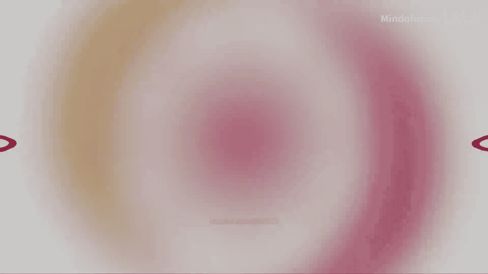
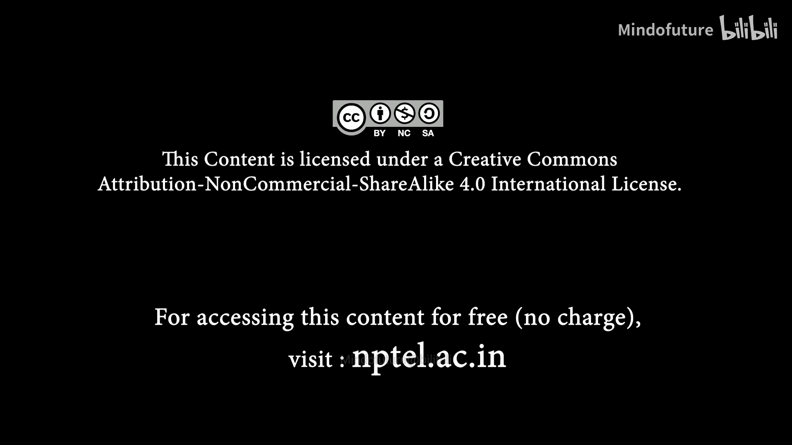
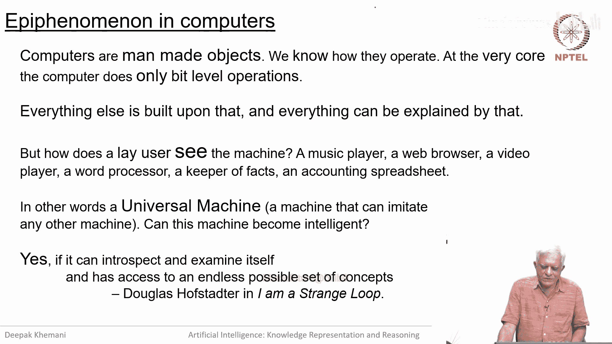

# 006：从粒子到概念 🧠➡️🌌

在本节课中，我们将探讨人类如何在不同尺度上感知和思考世界，以及这对知识表示和机器智能意味着什么。我们将从宏观宇宙一路深入到微观粒子，理解概念是如何在不同层次上形成的。

---

上一节我们讨论了思想和感知。本节中，我们来看看人类如何在不同尺度上观察和理解世界。

查尔斯·亨利·伊姆斯制作了一部名为《十的次方》的影片。这部影片通过逐级放大十倍的方式，展示了不同尺度下的世界景象。这让我们能够看到事物在不同规模下的样貌。

以下是不同尺度下对应的物体示例：

*   **1米**：一张桌子、一扇门、一个儿童的身高。
*   **10米**：一条道路、一座小房子、一棵树。
*   **100米**：一条田径跑道、一片草地、一座摩天大楼。
*   **1公里**：金门大桥的长度。
*   **10公里**：一个大村庄或小镇的直径。
*   **100公里**：印度曼迪到马纳利的大致距离。
*   **1000公里**：印度金奈到浦那的距离。
*   **10^7米**：地球直径的大致长度。
*   **10^8米**：可称为“兆米”。
*   **10^11米**：地球到太阳的距离。
*   **10^24米**：可见宇宙的尺度。

随着我们不断放大视角，可以看到越来越多的宇宙。

我们也可以从1米开始向内“缩放”观察：

*   **10厘米**：太阳鸟、一个芒果、一部手机。
*   **1毫米**：一粒芥菜籽。
*   **更微观**：花粉、细菌、病毒、DNA结构、碳原子外电子层、电子云、碳原子核、质子、夸克与胶子等。

由此可见，我们讨论的概念和事物出现在不同的尺度上。但归根结底，一切都是由一些基本粒子构成的。我们的可感知范围大致从花粉尘埃到几公里远。我们的思想正是在这个尺度范围内的事物基础上演化而来的。

科学让我们能够理解远超我们感知范围（更大或更小）的事物。我们的感知不仅受限于可见的尺寸，还受限于可处理的信号类型，例如我们只能看到可见光谱，只能听到特定频率范围的声音。因此，我们对世界的体验是有限的，我们的思想也必然受到我们所能感知的事物的影响。当然，科学让我们能够想象其他事物。

在每一个尺度或放大级别上，都演化出了相应的概念。从亚原子粒子到化学、细胞生物学、生物学、心理学、经济学、地理学、天体物理学、天文学、宇宙学，每一个研究领域都发展出了一套词汇，来讨论该尺度上的事物。

这告诉我们，我们表示事物的方式受到我们目标的影响，即我们想要进行何种推理。我们总是在一个适当的尺度层次上表示事物。

---

现在，有一个困扰了人们几个世纪的问题：如果心灵与身体不同，思想与物质彼此割裂，它们如何相互作用？这是笛卡尔提出的问题：思想如何控制行动？例如，当我决定举手时，我的想法如何让这个物理实体（手）实际举起来？

道格拉斯·霍夫斯塔特在他的著作《我是一个怪圈》中提出，我们在可感知的层面上运用概念进行操作。我们在这个层面上的思想，引发了导致行动的低层级活动。他将此称为**向下因果关系**。

他讨论了计算机中的“附带现象”。计算机是人造物，我们知道它在最底层只进行比特级的操作。计算机用0和1运行，其他一切都建立在此基础之上，并且一切都可以用0和1层面的活动来解释。

然而，普通用户并不这样看待机器。他们将计算机视为音乐播放器、网页浏览器、视频播放器、文字处理器、事实存储器或会计电子表格。我们从不同的视角来看待机器。计算机被称为“通用机器”，因为它可以模拟任何其他机器。

我们常问的问题是：这台机器能变得智能吗？霍夫斯塔特认为，**如果一台机器能够内省并审视自身，并且能够访问无限的可能概念集来表示不同事物，那么它就可以变得智能**。

机器能否思考、能否具有智能，这个问题多年来一直备受争论。有人认为计算机所做的并非原创性思考，它们可能只是从大量数据中学习并反馈给我们，但这并不意味着它们是会思考的机器。也有人争论智能是否只能存在于人脑之中。例如，诺贝尔奖得主数学家罗杰·彭罗斯认为，我们大脑中发生的某些过程对智能是必要的，但我们尚不清楚那是什么。还有人质疑，脱离我们所处世界的语境，智能是否还能存在？我们的智能体现在对世界的反应方式中。我们能否谈论一个没有语境的智能？

这些问题并非我们本课程要研究的主要问题。我们的目标是研究：**我们能否建造足够智能的机器，来对其运行环境进行建模，对其所知进行推理、做出推断、制定计划并监控计划，从而以自主的方式行动？** 至于这是否算“智能”，则是一个定义问题。我们暂不深究这个问题。

我们当前课程的目标是探索：**一个智能体如何表示它所处的世界，并基于此进行推理。** 我们甚至暂不讨论想象执行某些行动会带来什么后果（这将在其他课程中涉及）。

---

本节课中，我们一起学习了人类概念如何在不同物理尺度上形成，以及这对构建能够表示世界并进行推理的智能系统所带来的启示。我们认识到，选择合适的抽象层次对于有效的知识表示至关重要。