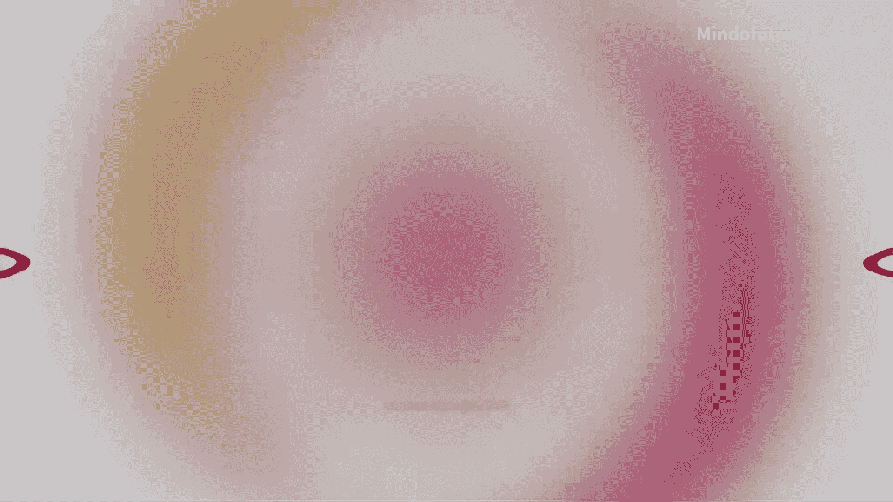
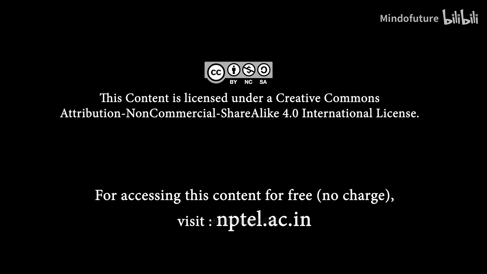
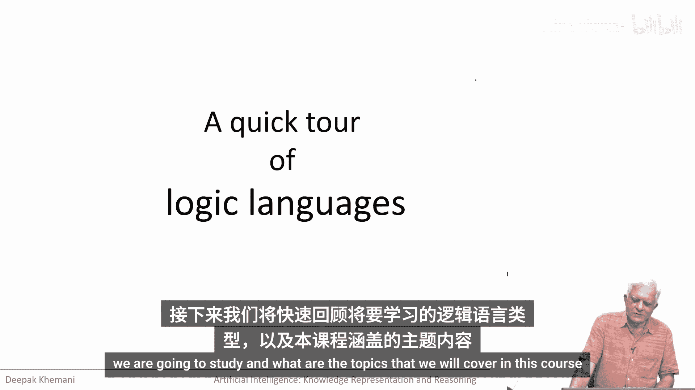

知识表示与推理：1.8：表示中的层次结构 🏗️

在本节课中，我们将要学习知识表示中的两种核心层次结构：聚合层次结构与抽象层次结构。我们将探讨如何通过这两种结构来组织复杂世界的知识，使其更易于理解和推理。

---

我们一直在讨论表示的问题，并试图解决一个核心难题：宇宙由基本粒子构成，但我们并不想在如此微观的层面上表示一切。无论是星系、森林、人类，还是细菌或病毒，它们都存在于不同的尺度上。我们希望在一个对我们而言可理解且有意义的层面上表示事物。

上一节我们讨论了复杂实体（如人类）的表示问题。人类由眼睛、鼻子、嘴巴、耳朵、手臂等部分组成。这引出了一个核心思想：某些个体是由组件或部分构成的。本质上，复杂实体由更简单的部分组成，我们需要在表示中体现这种“部分-整体”关系。

因此，我们需要对**部分聚合成整体**进行推理。回到上节课提出的问题：苏拉特是一个个体，他的手是另一个独立的个体吗？在表示中，我们希望表示抽象实体。一个具体的个体在某种意义上是我们思维中的抽象实体，尽管现实中它由无数原子构成。我们倾向于将一个人表示为一个实体，它是我们操作的概念域中的一个元素，而非物理域中的基本粒子。

在这个概念域中，我们必须允许实体拥有部分，以及部分之间的关系。这就是我们所说的**聚合**。我们认知模型中的个体不是由基本粒子构成的域元素，而是我们在头脑中创造的概念。我们创造了人、树、狗、国家、组织、足球队、政府、河流、公园、购物中心、商店、汽车、火车、自行车、蛋糕、面包、城市、星系、蛋白质分子等概念。当然，这种创造是有意义的，因为某些原子集合确实倾向于结合在一起。但本质上，我们是以自己看待世界的方式创造了它们。

我们还创造了长度、颜色等概念。长度和颜色是某个域中的个体吗？我们会发现，将它们视为抽象个体是有意义的。这样我们就可以说“物体的长度”是世界中的一种表示，从而进行比较。例如，我们可以说芒果树比苹果树高。同样，如果说“玫瑰是红色的”，这里的“红色”也可以被视为一个抽象个体。

我们还需要对时间、事件、行动进行推理，例如人们做事、事件发生、时间流逝、变化产生。这对于表示是必要的。此外，我们还会考虑空气、水、天空等实体，但很难界定它们是个体还是类别。例如，“我手里有一杯水”是什么意思？我喝了几口后，仍然会说“我手里有一杯水”。这些都是表示中需要面对的难题。

---

聚合可以被视为结构化知识中的一种层次结构。我们将看到存在两种层次结构：一种是**聚合层次结构**，另一种是**抽象层次结构**。在我的幻灯片中，聚合层次结构从左下角延伸到右上角，而抽象层次结构则从右下角延伸到左上角。这是两种不同的层次结构。

聚合层次结构展示了不同的组件如何组合形成更大的抽象实体。当然，这个实体并非完全抽象，它通常具有物理表现形式。例如，一辆汽车由方向盘、车轮、引擎盖、座椅等部件组成。这些部件本身可能由更小的部件构成。但作为推理者，我们必须选择从哪个层面开始表示，并在某个层面停止分解，因为我们没有能力一直追溯到基本粒子。这个聚合而成的实体可以再次与其他聚合实体结合，形成其他实体。因此，聚合层次结构本质上是关于事物由部分构成的。

另一种与之正交的层次结构是抽象层次结构。

---

在抽象层次结构中，我们看到所有元素都属于同一个类别。例如，所有这些个体都是猫，或者都是树。这个类别我们可能希望表示为一个抽象层面的个体。例如，“猫”是一个类别。同样，“狗”是另一个类别。然后，它们都属于“哺乳动物”这个更抽象的类别。因此，存在一个抽象层次结构。

抽象层次结构的特点是 **“是一个”** 关系。例如，猫是哺乳动物，狗是哺乳动物。这形成了我们所说的**分类法**。

聚合层次结构的特点是 **“是……的一部分”** 关系。例如，方向盘是汽车的一部分，喇叭是汽车的一部分，变速箱是汽车的一部分。

现实世界当然存在聚合关系，而其余部分在某种意义上是我们想象的世界。当我们谈论“猫”作为一个抽象实体、类或类别时，我们的意思是它是一个概念或类别，所有这些个体都属于它。并且，不仅仅是这些个体，概念本身也可以属于其他概念。因此，抽象层次结构在某种程度上是我们想象的世界，而现实世界（无论是物理世界还是网络世界）则更多地体现聚合关系。

---

以下是我喜欢的一个领域中的例子：桥牌队。这六位特定的桥牌选手在20世纪60年代左右多次获得世界冠军，被称为“蓝队”。桥牌中有搭档关系，蓝队中有三对搭档。这里存在从个体到搭档，再从搭档到团队的**聚合**。同时，也存在**抽象**：所有这些个体都是人类桥牌手，人类桥牌手是运动员，运动员是人类。这是一种“是一个”关系。此外，还有像“桥牌搭档”或“桥牌队”这样的抽象实体，例如“蓝队”就是“桥牌队”的一个实例。

因此，知识表示需要在不同尺度上运作，必须包含聚合层次结构和抽象层次结构，才能对我们所知的事物进行有意义的处理。

---

我们需要超越谓词。我们说过像 `mortal(x)` 这样的表达式是类别。但我们必须超越类别和概念。逻辑中的一个句子在原则上是真或假的，尽管我们可能不知道它实际上的真假。例如：
* “玫瑰是红色的，紫罗兰是蓝色的。”
* “一片草叶包含着整个世界的信息。”
* “巴西的一只蝴蝶扇动翅膀，可能引发德克萨斯州的一场风暴。”（这是一个被称为“蝴蝶效应”的术语）

这些都是句子，它们要么真，要么假。你可能不知道真假。我提供了后两个句子的链接，因为它们背后有一些有趣的故事，或许你可以去看看。

但正如我们所论证的，关于世界的知识超越了简单的句子。复杂的有机体只能通过收集大量句子并将其组织成有意义的结构来描述，这就是我们所说的层次结构——聚合与抽象层次结构。

特别是，我们说过，智能体或在某种情境下的主体，只有在特定领域或情境中才能展现其智能。我们进行溯因推理的一种方式，是因为我们拥有情境知识：医院里通常发生什么，火车站里发生什么，餐厅里发生什么等等。我们需要这种知识。稍后我们会看到，这被称为**情境知识**。

---

看看这个事实或观察：“阿尼莎走进了书店。” 我们即将讨论推理，那么我们能从中推断出什么？我们知道她走进了书店。现在，显然，我们可以进行一些演绎，也可以进行一些溯因。正如之前所说，在现实世界中，我们大部分时间都在进行溯因推理，即猜测“这一定是发生了什么”或“这导致了那件事的发生”。

但演绎仍然是我们技能库中非常重要的一部分。那么，当你知道阿尼莎走进了书店，你能推断出什么？如果你了解书店，你就知道她可能会浏览一些书籍，或者她可能在寻找一本特定的书。也许她会走到柜台，如果找到了书，她会付款（如果书店是这样运作的话）。她可能手里拿着一本书走出来。这是我们对于人们进入书店的典型理解。

但是，如果你知道阿尼莎是店主的妹妹，那么你可能会得出不同的溯因推理：也许她只是路过想见见姐姐；也许她打算替店主看一会儿店；当然，她也可能是在找一本特定的书。你甚至可能做出更疯狂的猜测，比如她带着枪想抢劫书店——当然，如果你生活在一个持枪抢劫常见的国家，这种猜测也可能成立。

我们讨论的是聚合、抽象和结构化知识。那么，如何表示关于书店、餐厅、牙科诊所等的知识呢？我们已经暗示过，这将通过组合不同类型的句子来完成，这些句子描述了这些实体。在某种意义上，我们收集并组织关于这些实体的典型知识的各个事实片段。这些将是聚合的表示。

耶鲁大学的罗杰·尚克在这方面做了大量工作，他将这种结构称为**脚本**，有点像电影剧本。麻省理工学院的马文·明斯基也探索了这种结构化知识的思想，并称之为**框架**。我们将了解框架和脚本，虽然不会太深入。框架的思想最终催生了**面向对象编程系统**。如果你学过面向对象编程，你会知道其中谈论的类及其结构就源于框架的思想。

---

有一个关于盲人摸象的故事：有人摸到尾巴，有人摸到鼻子，有人摸到象牙。但如果他们想理解摸到的是什么，甚至想猜出那是一头大象，他们必须能够进行这种溯因推理。他们需要知道餐厅或书店是什么，才能猜测正在发生什么。他们需要知道大象是一个复合实体，由这些部分组成。然后他们才能猜测：“哦，我摸到的这个东西可能像大象的鼻子。”有些线索可能更好，有些可能更弱。但如果不知道大象是什么，你永远猜不出来。

---

我顺便提到了分类法，让我们快速讨论一下。你不想表示一大堆句子，这有时被称为**扁平结构**，就像把所有句子放在一个容器里。进行推理的算法将不得不搜索这些句子以建立正确的连接，因为推理将是句子之间的连接。这会带来计算复杂性的代价。

相反，我们倾向于将事实组织成**分类法**。我们之前已经提到过，分类法促进了**继承**。例如，我们可以陈述“哺乳动物有两只眼睛”。这将意味着“猫有两只眼睛”，因为我们已经表示了“猫是哺乳动物”这一事实。因此，分类法促进了从超类到子类的属性继承。

一个必然结果是，它促进了表示的**紧凑性**。我们只需要在超类中存储属性（例如“哺乳动物有两只眼睛”），而不必为猫、狗、猎豹、大象等显式存储。我们可以从超类继承。这种紧凑性也是明斯基框架思想的一部分：你可以在更高层次表示事物，并在较低层次继承它们。

---

本节课中我们一起学习了知识表示中的两种核心层次结构：聚合层次结构（“是……的一部分”）和抽象层次结构（“是一个”）。我们探讨了如何通过这两种结构来组织复杂实体和概念，使知识表示更紧凑、更高效，并支持继承推理。我们还简要介绍了脚本、框架和分类法在结构化知识中的作用，为后续深入学习逻辑语言和推理机制奠定了基础。