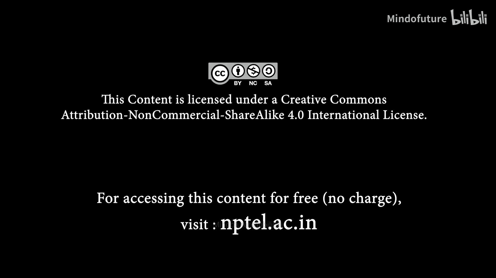
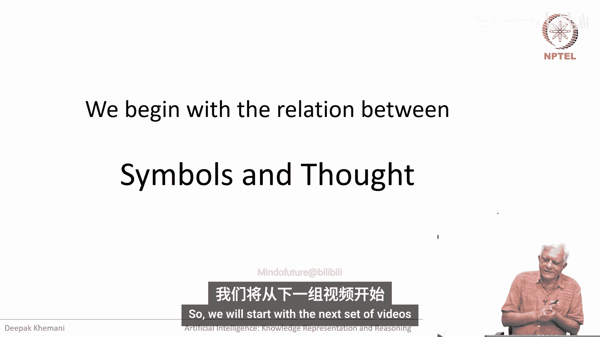

# 009：逻辑与表示快速导览 🧭

在本节课中，我们将对知识表示与推理课程中将要学习的各种逻辑和推理方法进行一次快速导览。我们将了解从最简单的命题逻辑到涉及时间、变化和知识的复杂逻辑系统，为后续深入学习奠定基础。

## 逻辑与推理概览

我们一直在讨论知识表示、推理结构、语言和逻辑。当然，在本课程中，我们将更详细地研究这些内容。现在，让我们快速浏览一下我们将要学习的不同类型的逻辑。

我们课程的核心将是推理。推理是指，给定一些事实，你能从中推断出什么。

## 命题逻辑：论证的有效性

我们将从命题逻辑开始，这是所有语言中最简单的一种。我们将研究“有效论证”的含义。

在命题逻辑（也称为句子逻辑）中，我们将句子视为独立的实体。例如，在以下两个问题中，句子“地球是球体”和“如果地球是球体，它会在月球上投下弯曲的阴影”将被视为整体并赋予符号。第一个信息是：如果第一个句子为真，那么第二个句子也一定为真。另一个信息是：地球确实在月球上投下了弯曲的阴影。由此得出的结论是：地球一定是球体。这个论证有效吗？逻辑正是关注于判断此类论证的有效性。逻辑的起源，无论是在西方还是在印度，在某种意义上都是为了发展一门关于论证的科学，以确定谁对谁错，谁的结论是正确的。逻辑的目标是理解有效的论证形式或模式，并检查给定的论证是否遵循这些模式。

我们将从命题逻辑开始，这是一种非常简单的逻辑，它不深入句子内部，而是关注是什么使论证有效。我们将探讨可靠性和完备性的概念。

## 一阶逻辑：引入域与个体

接下来，我们将转向一阶逻辑。一阶逻辑引入了“域”的概念。当我们谈论一阶逻辑时，我们必须谈论域。例如，假设域是世界上所有人的集合。在这个场景中，一阶逻辑允许我们做出像“所有人都是会死的；苏格拉底是人；因此，苏格拉底是会死的”这样的陈述。你可以看到，当我们说“所有人”时，我们谈论的是域中的所有个体。一阶逻辑允许我们谈论域、域中的个体、个体之间的关系以及类别之间的关系。

在这个例子中，我们说域中有四个实体：Tinker、Tailor、Soldier、Spy。第一个句子说其中一个是罪犯。我们可以在不知道罪犯是谁的情况下说“罪犯偷了文件”，并且我们已经说过这四个人中有一个是罪犯。然后我们还被告知Tinker和Soldier没有偷文件。显然，逻辑结论是罪犯必须是Tailor或Spy。逻辑允许你得出这些结论。然后我们被告知：如果Tailor或Spy是罪犯，那么文件一定在巴黎。给定这些事实，你能得出结论文件在巴黎吗？一阶逻辑允许我们将这种推理形式化，并证明文件在巴黎。

一阶逻辑包含变量的概念（域中的未知实体）和量词的概念（如“所有”、“有些”）。但一阶逻辑本身不涉及时间。命题逻辑是永恒不变的，有时我们说它是数学逻辑，因为数学是永恒不变的。一阶逻辑很容易处理这种领域，它是一种关系的逻辑，谓词捕捉个体之间或集合元素之间的关系。

## 描述逻辑：描述类别与概念

事实证明，一阶逻辑在计算上非常昂贵，而且通常我们想要的推理并不需要其全部能力。因此，我们会求助于这种语言的一个子集，即描述逻辑，它类似于名词短语的逻辑，我们只谈论名词短语。

在这个小例子中，我们谈论两种公司：进步的高科技公司和科技公司。科技公司是指所有员工都拥有技术学位的公司。进步的高科技公司是指董事会中至少有五名女性，且所有员工都拥有技术学位的公司（当然，这也适用于科技公司），此外，其最低工资是100,000（单位任意）。描述逻辑允许你快速得出结论：进步的高科技公司是一种科技公司。这类似于我们之前谈到的“所有猫都是哺乳动物”。在这里，我们描述实体，这种逻辑允许我们揭示这两个实体之间的关系（一个是进步的高科技公司，什么是科技公司）。描述逻辑如今非常常见，因为本体在互联网上非常活跃。

## 默认推理：开放世界与可废止推理

我之前提到过开放世界假设。在开放世界假设中，你并不了解关于世界的一切。默认推理的一个经典例子是：如果有人告诉你Tweety是一只鸟，那么你可以推断Tweety会飞。如果你没有告诉我关于Tweety的任何其他信息，你就可以得出Tweety会飞的结论。这被称为默认推理。如果我后来得知其他信息，比如Tweety是企鹅、鸵鸟、死了、被关在笼子里或受伤了，那么我可能会撤回这个结论。在默认推理中，你可以这样做，你可以做出结论然后撤回它们。我在此背景下使用了“非单调推理”这个词。新的信息可能反驳并击败结论，因此我们说这种推理是可废止的，意味着它可以被击败。

## 事件演算：处理时间与变化

我们还将讨论事件演算，因为我们想要谈论时间、变化、行动以及行动对现实世界的影响。正如我们所说，一阶逻辑是永恒的，不允许变化。当我们想谈论变化时，我们说某事在此时刻为真，但在稍后时刻可能不为真；或者如果一个智能体执行某个行动，它将使某些事实为真。所有关于变化、时间、行动和事件的内容都应该被允许，这将在我们称为事件演算的系统中完成。

这是一个例子：Jogesh泡了一杯茶并把它放在桌子上。同时，Smitha看到了这杯茶并喝掉了它。当Jogesh回来时，他看到杯子是空的。你应该能够表示这种变化的事物，并且可能希望得出结论。

## 认知逻辑：关于知识的推理

我们将在课程中学习的最后内容是认知逻辑。在这种逻辑中，智能体推理其他智能体知道什么。以Jogesh的故事为例，他泡了茶并离开，Smitha来喝掉了它，他看到杯子空了。房子里当时只有两个人。他可以得出结论Smitha喝掉了他的茶（这本质上来自事件演算）。但Smitha会知道Jogesh知道她喝了茶。这就是认知逻辑允许你做的事情。知道某事是一个事实，Jogesh知道某事，而Smitha知道的是Jogesh知道她喝了茶这个事实。

在认知逻辑中，我们将这样表示：设T代表“Smitha喝了茶”这个事实。K_J(T) 代表“Jogesh知道Smitha喝了茶”这个事实。K_S(K_J(T)) 代表“Smitha知道Jogesh知道她喝了茶”这个事实。我们将在课程末尾学习这些。

## 课程内容路线图

以上是我们将要学习的主题，大致按学习顺序排列。

我们将从谈论逻辑、语言、符号和思想等开始，引入逻辑的可靠性和完备性概念。我们将讨论逻辑何时有用：它必须是可靠的（只进行有效论证），并且应该是完备的（能够进行所有有效论证）。

然后，我们将研究一种特定的逻辑——命题逻辑。在命题逻辑中，我们将学习两种证明方法：直接证明（标准证明方式）和反证法。

接着，我们将转向一阶逻辑，这将是我们课程的主要部分。我们将学习这种语言，了解在其中能做什么、能进行何种推理。我们将从正向链接（对应于直接证明）开始，然后学习反向链接（也从结论开始向目标推进）。之后，我们会发现这两种方法还不够，并将学习一种称为“归结反驳”的方法。由此，我们将转向逻辑编程的概念，即任何编程语言能做的事情都可以用逻辑来完成。推理包含了计算。我们将一定程度地学习一种名为Prolog的逻辑编程语言。我们还将学习与高效正向链接相关的Rete网络。

然后，我们将转向表示。我们将讨论具体化。我们将看到规范的知识表示集合，它不像语言那样多样和丰富，但允许你进行大量推理。我们将学习以框架和脚本形式的结构化知识、继承、描述逻辑，以及实现分类学和描述逻辑的系统方法。

之后，我们将转向比一阶逻辑更强大的内容，特别是默认推理，其中限定是一种特定的默认推理方法。我们将学习事件演算，以捕捉时间、变化、事件和行动。最后，正如所说，我们将讨论认知逻辑。

## 总结与展望

本节课中，我们一起快速浏览了知识表示与推理课程的核心内容，从基础的命题逻辑、一阶逻辑，到描述逻辑、默认推理、事件演算，最后到认知逻辑。我们了解了每种逻辑关注的核心问题及其应用场景。

我们的基本假设是：思维，至少推理，可以是符号化的。我们可以通过用符号表示一切来进行推理。我们将建立这种联系，然后继续深入学习我提到的所有内容。我们将在下一组视频中开始。