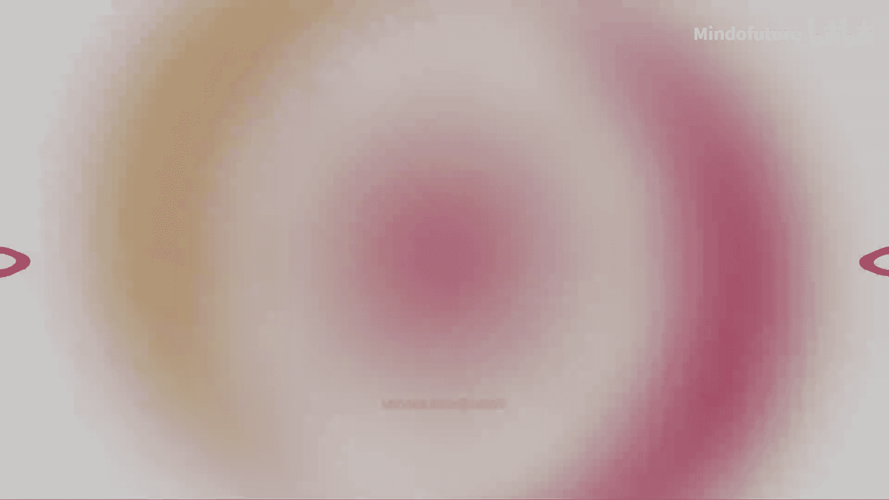
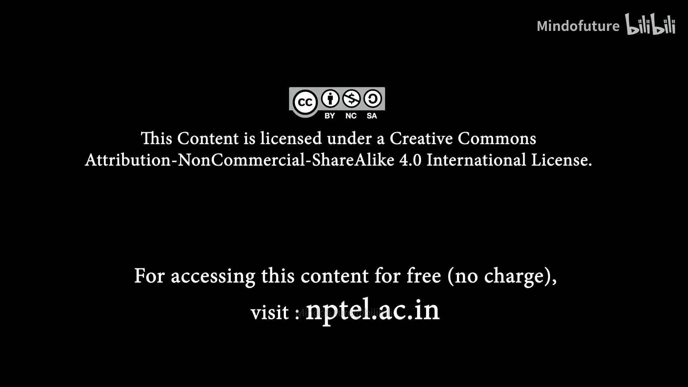
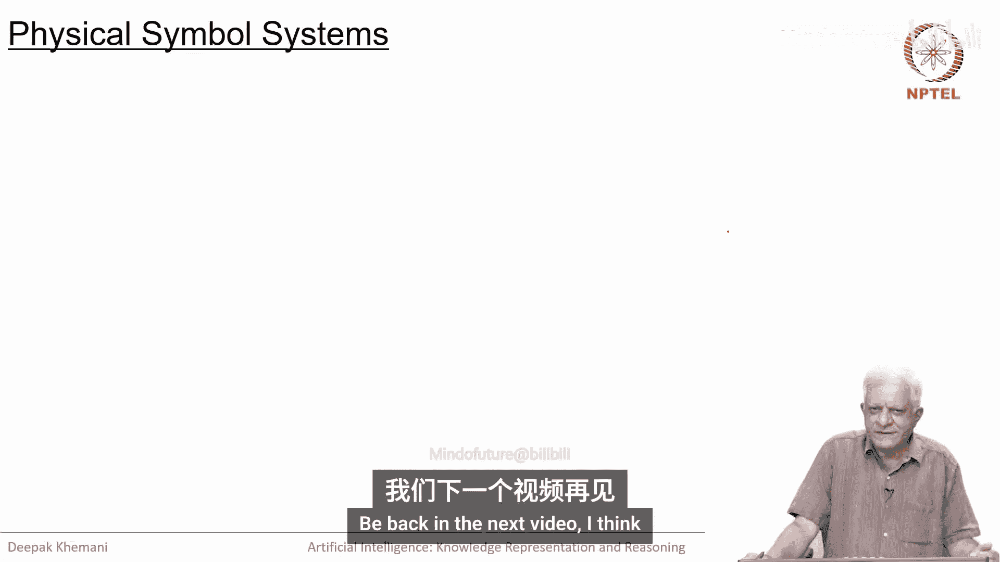

知识表示与推理：P10：符号与思维

在本节课中，我们将要学习知识表示与推理的核心基础：符号与思维的关系。我们将探讨符号如何代表事物，以及如何通过操纵符号来进行有意义的推理。课程将从人类思维与符号的历史联系开始，逐步过渡到如何在计算机中实现符号表示与推理。

---

### **概述**

符号是代表其他事物的标记。我们使用数字、文字、路标等符号来思考和交流。推理则是对这些符号进行有意义的操作，例如数学计算。本节课将探讨符号与思维之间的深刻联系，并介绍历史上一些重要思想家对此的观点，为后续学习如何在计算机中表示知识奠定基础。

---

### **符号与思维的联系**

我们常常思考语言和思维谁先出现。人们经常用词语进行思考，这引发了一个问题：语言是否为思维所必需？虽然没有明确的答案，但像诺姆·乔姆斯基这样的学者认为，人类天生具有一种内在的语法结构能力，这被称为“普遍语法”。这种能力使我们能够理解语言的结构。

当我们谈论语言时，本质上是在谈论符号。符号与思维的关系是我们课程的核心起点。在最初的几讲中，我们将更多关注人类思维，因为关于符号与思维的讨论早在计算机诞生前数百年就已开始。之后，我们将探讨如何让机器成为能够思考的智能体。

---

### **智能体与知识表示**

正如在引言中讨论的，本课程的核心是知识表示与推理。我们认为这是**智能**的核心。任何智能体都必须能够对其所处的世界或领域进行建模和想象。它需要能够设想如果采取某些行动会发生什么。

为了实现这种想象和表示，我们需要一种表示事物的方法。在计算机中，这就是我们要关注的重点。我们从一个基本问题开始：一个智能体知道什么？它对其世界和领域了解什么？

当我们谈论知识时，通常指的是**陈述性知识**，即可以用语言（如英语）写下来的知识。这有别于程序性或隐性知识，例如骑自行车或游泳的技能，这些很难用语言精确表达。我们也会接触到图像、直觉和潜意识等非符号性知识，但本课程将主要聚焦于可以用符号写下来的陈述性知识。

这种知识表示不仅适用于人类，也适用于其他智能体，如动物。但人类特别擅长的是，基于已知信息进行推理，从而获知新信息。这正是我们课程想要捕捉的核心：如何表示已知信息，并利用这些表示来计算或推导出新的信息。

---

### **符号表示与神经网络的对比**

我们所说的符号表示，是指用符号来代表事物。在数字计算机中，一切最终都建立在符号之上，因为计算机最基本的层面只能区分0和1这两个符号。所有其他事物，包括连续现象，都被数字化和离散化地近似表示。

当我们说一个符号代表其他事物时，需要区分它与神经网络等表示方式的差异。神经网络也能“知道”事物，例如识别图像中的马、云或树。然而，神经网络并不显式地使用“马”这个符号及其属性。它的“知识”体现在网络连接的**权重**中。这些权重决定了信息如何在神经元之间传播。虽然近期有研究称深度神经网络的中间层可能学习到类似符号的表示，但本课程关注的是**显式地使用符号**来代表事物的系统。

一个符号本身可能没有意义，是我们对它的**解释**赋予了其意义。研究符号如何获得意义的科学被称为**符号学**。

---

### **符号的普遍性**

我们在生活中处处使用符号。例如，数字 **7** 可以用多种方式书写：阿拉伯数字“7”、罗马数字“VII”、英文单词“seven”。尽管书写形式不同，但它们都指向同一个抽象概念——数字七。这个数字概念本身是什么？我们稍后会深入探讨。

其他符号包括路标，它们用图形表示前方有弯道、人行横道、学校等。所有语言，无论是口语还是书面语，都是符号系统。我们如何将意义赋予符号？这通常是一种社会共识。例如，我们约定俗成地将一种特定的电器称为“风扇”。

在**生物符号学**中，我们研究自然界生物系统如何通过信号（符号）交互产生复杂行为。例如，大脑中神经元通过电化学信号传递信息，思维由此涌现。另一个经典例子是蚂蚁。蚂蚁在爬行时会留下**信息素**痕迹，其他蚂蚁倾向于跟随气味强烈的路径。在这里，信息素就成了一种符号，用于蚁群间的通信。

---

### **什么是推理？**

**推理**指的是以有意义的方式操纵符号。当然，你可以写下操纵符号的规则。在数学中，我们学习各种算法，这些就是推理算法或符号操纵规则。例如，加法和乘法。

儿童很早就学习如何将两个数字相加。这个过程是有意义的，因为如果我们有7个苹果和21个苹果，把它们放在一个篮子里再数，就会得到28个苹果。从符号“7”和“21”通过加法规则得到符号“28”，这个过程准确地对应了现实世界中的合并操作。

因此，推理是以有意义的方式操纵符号。本课程将始终关注这一点。我们在数学中学到的其他技能，如长除法、解线性方程组、傅里叶变换等，都是复杂的符号推理过程。

---

### **历史视角：从伽利略到霍布斯**

符号与思维关系的思考源远流长，可以追溯到16世纪甚至更早。尼古拉·哥白尼在某种程度上将**心灵**与**外部真实世界**区分开来。他著名的日心说表明，我们“看到”太阳东升西落，但“实际发生”的是地球在自转。这暗示了心灵对世界的感知与世界本身可能不同。

伽利略·伽利莱进一步探讨了感知。他认为，味道、气味、颜色等属性并非物体本身固有，而是存在于我们的意识中。我们称玫瑰是“红色”的，蛋糕是“甜”的，但这些品质与我们感知和表示它们的方式有关。

1623年，伽利略有一个著名论断：“**哲学（自然之书）是用数学语言写成的，其字符是三角形、圆和其他几何图形。**” 他用几何图形来表示和推理运动。例如，他用一个直角三角形的面积来表示匀加速运动的距离公式 `s = 1/2 * a * t²`（三角形的底边是时间t，高是速度v=a*t）。伽利略是用几何，而非代数符号进行推理的。

接下来是托马斯·霍布斯，他常被称为“人工智能的祖父”。霍布斯认为，**思维就是对符号的操纵**。我们头脑中有符号，思考就是操纵这些符号。他受到伽利略的影响：既然几何可以表示运动，那么思维也可以通过操纵心理符号来完成。

霍布斯说：“**所谓推理，我理解为计算。**” 在17世纪，“计算机”指的是进行数学计算的人。霍布斯将推理等同于数学计算，认为推理就像是做加法或减法。

---

### **笛卡尔与身心问题**

勒内·笛卡尔以笛卡尔坐标系闻名。他认为动物是奇妙的机器，而人类也是机器，但**拥有心灵**。这种将动物和人类视为机器的观点后来受到很多质疑，但我们可以广义地理解“机器”为按照固定规则运作的系统。从这个角度看，人类和计算机都是机器。

笛卡尔推进了符号思想。他说，**符号**和**符号所代表的事物**是两回事。符号是可以被操纵的（对应思考），而符号所代表的事物是思考的对象（存在于真实世界）。他明确提出了**心灵**与**身体（物质世界）** 的区分。

这就引出了著名的**身心问题**：如果推理是按照规则对有意义符号进行的机械操纵，那么**谁**在进行这个操纵？是“意志”吗？是“超验的自我”吗？还是头脑中的“小人”（侏儒）？如果说是“小人”在操纵符号，那么“小人”自己又是如何思考的呢？这就陷入了无限循环。

这个悖论在于：如果某个过程是纯粹机械的（按规则运行），它如何同时又是**有意义**的？笛卡尔及其批评者未能解决这个问题。

---

### **总结**

本节课我们一起探讨了符号与思维的基本联系。我们了解到，符号是代表其他事物的标记，而推理是对这些符号进行有意义的操作。我们从人类思维的历史视角出发，回顾了伽利略、霍布斯和笛卡尔等人的观点，他们为“思维即符号操作”这一理念奠定了基础，同时也留下了“身心问题”的哲学难题。

在接下来的课程中，我们将暂时放下这些哲学讨论，开始具体学习如何**使用符号来表示知识**，并构建能够进行自动化推理的计算系统。