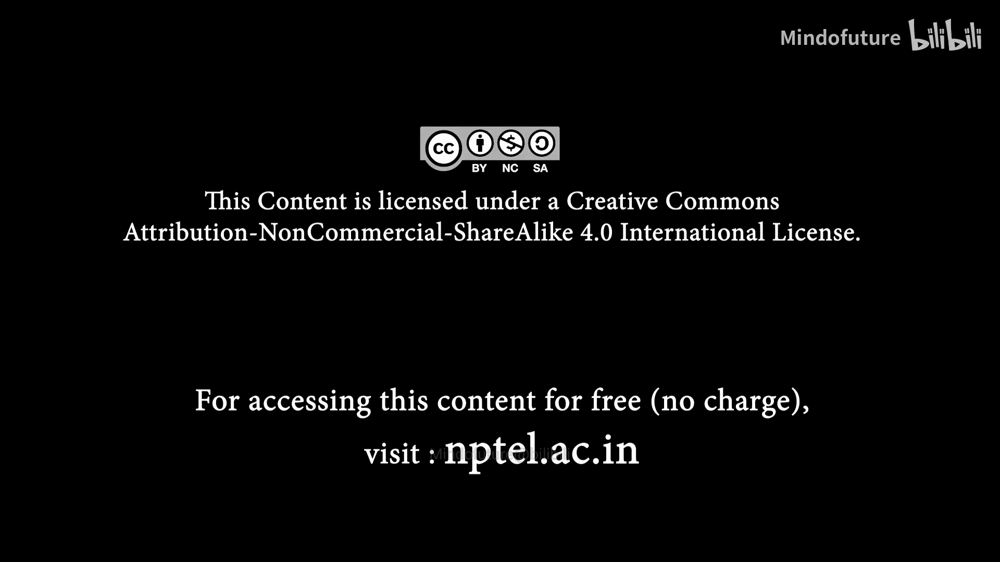
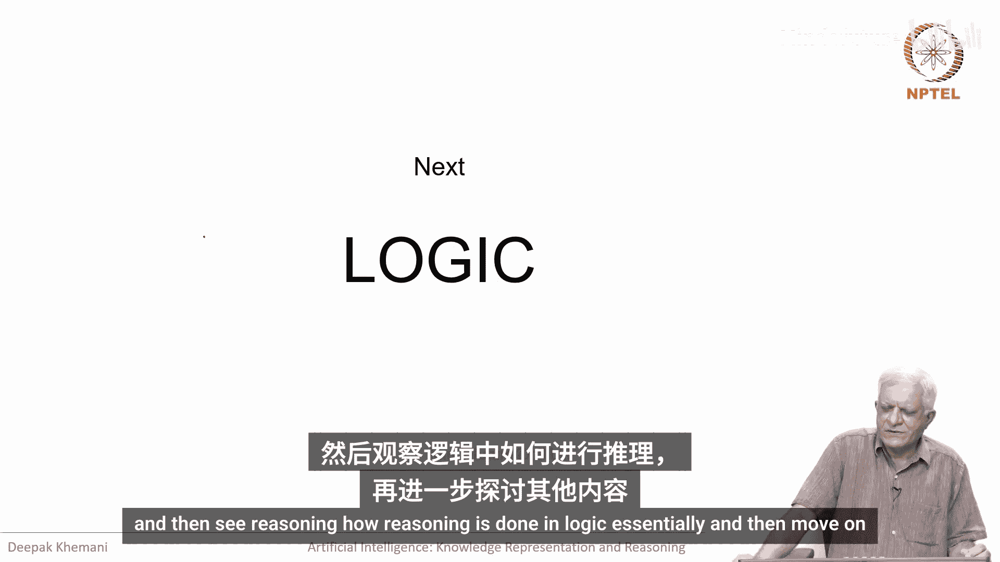

# 011：从齿轮到符号

## 概述
在本节课中，我们将要学习符号系统与思维的关系，并追溯从早期机械计算设备到现代符号人工智能的发展历程。我们将探讨符号如何成为表示和传递信息的基础，以及物理符号系统假说如何为人工智能奠定了理论基础。

---

## 符号与思维的关系

在上一节视频中，我们探讨了符号与思维之间的关系。我们看到，即使在16和17世纪，哲学家们就已经在假设，思维本质上是我们头脑中对符号的操纵。

我们将沿着这个思路继续前进，并尝试定义“物理符号系统”的含义。这个概念由上世纪两位科学家艾伦·纽厄尔和赫伯特·西蒙提出。

我们已经说过，符号是代表其他事物的东西。现在我们可以进一步明确：符号是一种可感知的事物，是交流的基本单元。你创造一个符号，其他人感知它。

*   一个符号是代表其他事物的东西，例如字母、数字、路标、乐谱等。
*   一个符号系统是这些符号元素的集合模式。单词、数组、列表甚至一首乐曲都可以被视为一个符号系统。

当我们说“物理符号系统”时，我们的意思是，就像物理世界遵循某些定律一样，符号系统也遵循某些操纵定律。例如，如何进行加法运算，或者如何进行逻辑推理。

---

## 物理符号系统假说

有一个被称为“物理符号系统假说”的理论，归功于卡内基梅隆大学的先驱人工智能研究者艾伦·纽厄尔和赫伯特·西蒙。他们合著了一本非常有影响力的书《人类问题解决》，试图研究人类如何解决问题。

他们的观点是：**物理符号系统对于一般智能行为是必要且充分的**。这意味着，如果你能使用符号表示事物，并能用某些算法操纵它们，那么这就足以创造我们如今所说的人工智能。根据纽厄尔和西蒙的说法，这是必要的（没有符号表示就无法创造智能），也是充分的（有了符号表示和操纵就足够了）。

这种操纵符号的能力被称为**符号人工智能**或**经典人工智能**。霍格兰德称之为“老式人工智能”，这与现代主要基于机器学习的人工智能形成对比。

---

## 符号的起源与演变

符号用于交流。交流在生物中很普遍，不仅仅是人类。鸟类有各种各样的鸣叫，鲸鱼能进行长距离交流，狗会摇尾巴并对陌生人吠叫。这些行为背后可能都有交流的意图。

然而，人类是唯一有意识地使用符号来表示信息的物种。其他生物可能无意识地使用符号（如蚂蚁的信息素痕迹），但人类是自觉为之。

谈到书面符号，已知最早在粘土上雕刻符号的人类是古代美索不达米亚的苏美尔人。最早的雕刻是象形文字，在世界许多地方都有发现，但很快演变成更抽象的实体，如字母表中的符号。

一个关键的突破发生在符号不仅用于代表物体和事件（如狩猎场景），还开始代表抽象实体，如**声音**。A、B、C、D 这些字母代表声音，组合起来形成单词，单词再组成句子。书写字母的能力极大地推动了语言、文学和科学的发展。

---

## 从机械计算到符号计算

我们的兴趣在于计算机器。人工智能的目标是让机器思考，使其智能化。这一追求由来已久。

最早用于计算或“运算”的机器是**非符号性**的，它们不明确地表示符号。它们使用像齿轮这样的部件。齿轮本身具有数字元素（齿数），可以间接表示数字，但并非明确使用符号。

被誉为“计算机之父”的查尔斯·巴贝奇是一位机械工程师。他著名的“差分机”在某种意义上使用了符号，因为它使用了**打孔卡片**。打孔卡片并非巴贝奇发明，但被他用于输入指令，这带来了“存储程序”概念的雏形，即同一台机器可以通过加载不同的指令集来完成不同的任务，这就是通用机器的思想。

在现代，电子机器变得越来越数字化，越来越擅长操纵符号。我们理所当然地认为数字计算机在0和1上运行。我们的目标是超越0和1的层面，让机器在我们熟悉的表示层面（如自然语言）上操作，这正是计算机科学和人工智能的目标。

---

## 机械算术的发展

语言和逻辑先于计算机出现。我们的目标是赋予机器处理语言和逻辑的能力。我们从一些历史开始。

**机械算术**：如何让机器完成人类“计算员”所做的运算？

*   **帕斯卡计算器**：布莱兹·帕斯卡在1642年发明了使用 lantern 齿轮的机械计算器，称为“算术机”或“Pascaline”。它可以直接进行加减法，并通过重复操作进行乘除法。他获得了在法国制造和销售计算器的独家权利，但制造成本高昂，最终停产。
*   **莱布尼茨阶梯鼓轮**：戈特弗里德·威廉·莱布尼茨在帕斯卡之后继续推进机械计算。他在1673年发明了“莱布尼茨轮”或“阶梯鼓轮”，这项发明被使用了三个多世纪，直到电子计算器出现。其核心是一个带有阶梯状齿的鼓轮，通过调整齿轮的位置来控制其转动的次数，从而实现不同的计数。
*   **莱布尼茨步进计算器**：莱布尼茨基于阶梯鼓轮发明的“步进计算器”是一种数字机械计算器，大约始于1672年，于1694年完成。它可以通过重复加法进行乘法，通过重复减法进行除法，并能处理8位数。

---

## 通用计算机的雏形

谈到机械计算，不能不提查尔斯·巴贝奇和他的发明。

*   **分析机**：这是现代通用计算机的前身。巴贝奇在1837年描述的分析机，具备了现代数字计算机的所有特征：类似算术逻辑单元的运算器、控制流（包括条件分支和循环）、以及集成存储器。这使其成为第一个可被描述为“图灵完备”的通用计算机设计。图灵完备意味着它能完成任何图灵机能完成的计算。

---

## 总结与过渡

本节课中，我们一起学习了符号与思维的关系，回顾了哲学家和科学家（如莱布尼茨、巴贝奇）如何尝试将符号处理和计算能力实现在他们时代的机械机器中。数字计算机的概念直到上世纪才真正出现。

我们已经看到符号与思维之间存在联系（至少在人类中）。但对于像数字计算机这样的机器，我们别无选择，只能以某种方式（最终是0和1）来表示符号，并以更抽象的方式解释它们。

接下来，我们将转向**逻辑**。我们将研究逻辑，看看在逻辑中是如何进行推理的，然后再探讨其他知识表示与推理的方法。