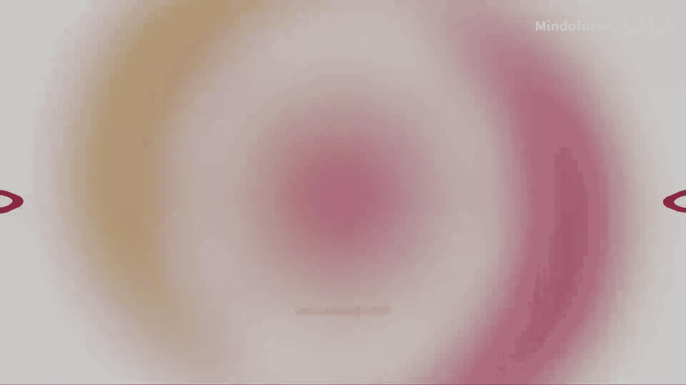
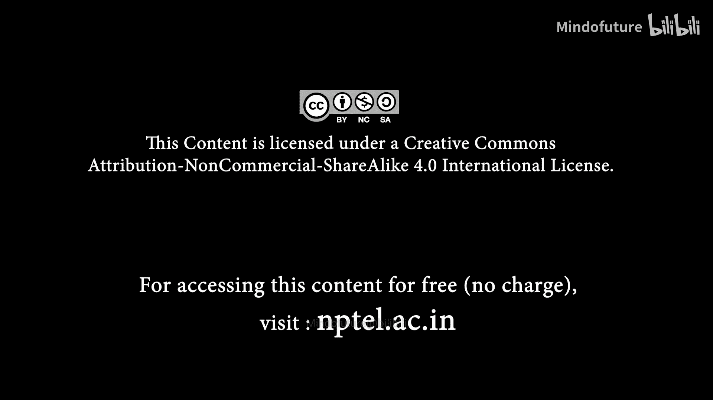
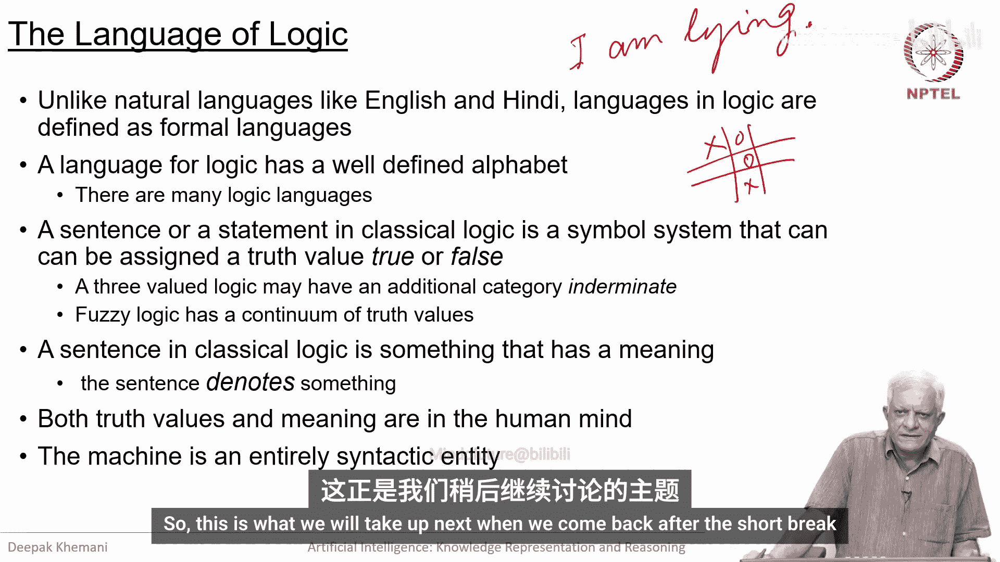

# 012：真值、逻辑与可证性

## 概述
在本节课中，我们将要学习逻辑学的基础概念，特别是真值、逻辑语句以及可证性。我们将探讨逻辑如何作为一种形式语言，用于知识表示和推理，并理解其与计算和人工智能的关系。

---

## 从符号到逻辑
上一节我们讨论了符号与思维的关系。本节中，我们来看看逻辑如何作为符号操作的一种形式，为构建智能机器提供基础。

逻辑学已经被研究了几千年，它主要关注论证的有效性。也就是说，如果你知道一些事情，并通过推理得出另一些结论，逻辑关心的是如何确保这些结论是有效的。因此，逻辑的核心是研究有效的推理形式。

当我们谈论逻辑时，通常会从真值开始。我们感兴趣的是：如果某事为真，那么还有什么也为真？本质上，我们关心所有为真的事物。逻辑被提出作为一种机制，用于在给定一些现有真陈述的前提下，得出新的真陈述。这个过程被称为**证明**或**可证性**。

逻辑学聚焦于**演绎推理**，这种推理能为我们提供有效的论证。在计算机和人工智能出现之前，逻辑学家就已专注于推理。随着数字计算机和AI兴趣的增长，焦点转向了**表示**，因为我们需要表示机器或智能体所需知道的所有知识。当然，表示是本课程的重点，但我们将从逻辑开始，并看看可以构建何种机制来进行演绎推理。

我们也会简要提及非演绎推理，例如**归纳推理**（机器学习的基础），即“跳跃式结论”。

---

## 莱布尼茨的愿景
让我们回到戈特弗里德·威廉·莱布尼茨的时代。他不仅对计算机器感兴趣，也热衷于用这些机器进行逻辑推理。

莱布尼茨相信，人类的许多推理可以归结为某种计算，而这种计算可以解决许多意见分歧。逻辑发展的动机之一就是：当人们争论时，如何决定谁对谁错？他提出的方法是，让我们的推理像数学一样具体有形，这样就能一眼发现错误。在争论中，我们可以简单地说“让我们计算一下”，从而决定谁是正确的。

他的目标是找到一种万无一失的机制，可以在人们争论时明确地决定谁是正确的。印度逻辑学（如17世纪阿南跋陀的《思择论》）也独立发展了一套论证形式体系，但本课程没有时间深入探讨。

莱布尼茨遵循两个原则，并将其应用于他的整个哲学思想：
1.  我们所有的思想都是由少数简单思想组合而成，这些简单思想构成了人类思维的“字母表”。
2.  复杂思想由这些简单思想通过一种均匀、对称的组合产生，类似于算术乘法。

他有一个非常深奥的想法：用**质数**来表示概念。例如，用3代表“红色”，7代表“花”，那么21（3×7）就代表“红色的花”。这样，描述一个元素只需要一个数字，通过分解这个数字就能找出其属性。这就是莱布尼茨从少量简单思想构建一切的想法，尽管它有趣但难以实现。

---

## 形式逻辑
现在，让我们关注**形式逻辑**，这是我们感兴趣并将开始学习的内容。我们将把逻辑作为一种表示语言，而逻辑也将为我们提供推理的机制。

逻辑是具有明确定义规则的形式语言，用于操作表示。我们将使用术语**知识库**来指代在给定逻辑语言中的一组语句。目前我们不关心具体使用何种形式语言，后续会逐步定义。知识库基本上就是用某种逻辑语言表达的一组语句。

从我们的角度来看，逻辑语言家族在**表达能力**上有所不同。表达能力越强的语言，处理它、用它进行推理所需的计算能力和复杂度通常也越高。

---

## 逻辑语句与真值
逻辑语言与英语、印地语等自然语言不同，它是**形式化定义**的。对于学过形式语言的同学来说，逻辑语言就是通过一套规则枚举出所有合法句子的集合。

我们从一个明确定义的**字母表**开始，然后使用严格的规则构造出可以用该逻辑表达的句子集合。逻辑中的句子、陈述或命题的关键在于，我们可以说它是**真**的或是**假**的。它可以被赋予一个**真值**。当我们只处理两个真值时，我们称这种逻辑为**经典逻辑**。

原则上，任何能被赋予真或假值的陈述，都是逻辑中的句子。例如：
*   “德里正在下雨。” 这是一个句子，因为它非真即假。
*   “在国际象棋中，白方总是获胜。” 这也是一个句子（假设双方都完美发挥），尽管我们不知道它是否为真，但原则上它可以被赋予真值。

然而，有些陈述即使在原则上也无法被赋予真值，因此不是逻辑句子。例如：
*   “我正在说谎。” 这是一个悖论（如罗素悖论），无法一致地赋予真值。
*   “你叫什么名字？” 这是一个疑问句或命令，不是可以判断真假的陈述。

在经典逻辑中，真值只有两个：**真（1）** 和 **假（0）**。但也存在其他逻辑：
*   **三值逻辑**：除了真和假，还有“不确定”或“可能”等值。
*   **模糊逻辑**：真值是在0到1之间的连续值，用于处理“高”、“矮”这类不精确的概念。

---

## 句子的意义与逻辑机制
逻辑或任何逻辑中的句子都有**含义**，它指代某些东西。例如，“乌云密布”这个英文句子有其含义。

但是，**真值和含义都存在于人的思维中**。当我相信“乌云密布”为真时，这个真值在我心中；当我理解它的含义时，这个含义也在我心中。

重要的是，我们将要看到的**逻辑机制本身**，既不关心含义，也不关心真值。它是一个完全**句法**的实体，只处理模式。逻辑机器处理的是符号的形式规则，而不是它们的意义或真实世界的真假。这是我们接下来将要探讨的核心要点。

---

## 总结
本节课中，我们一起学习了逻辑学的基础。我们了解了逻辑关注有效推理，从莱布尼茨用计算解决争论的愿景，到形式逻辑作为表示和推理工具的角色。我们明确了逻辑语句是那些原则上可赋予真值的陈述，并区分了经典逻辑与其他逻辑（如三值逻辑、模糊逻辑）。最后，我们指出了逻辑推理机制的本质是句法操作，它独立于语句的含义和实际真值。下一节，我们将深入探讨这种句法机制是如何工作的。