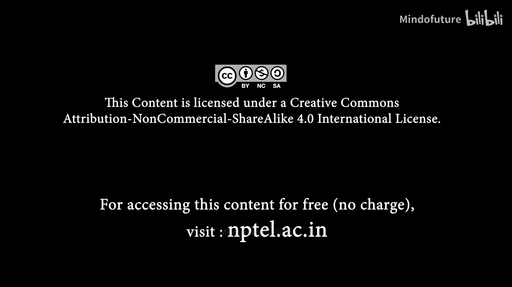
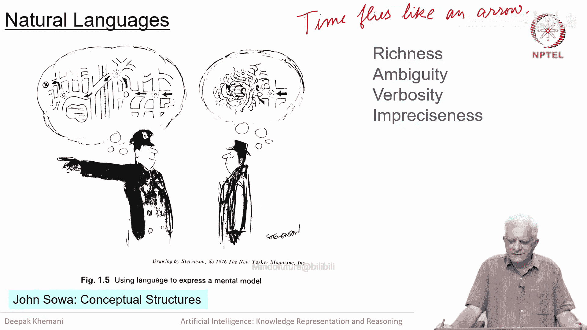

**知识表示与推理：P13：句法机器**

在本节课中，我们将探讨逻辑的“机器”部分，即句法机器。我们将了解逻辑如何作为一种形式系统运作，它关注论证的形式而非内容，并讨论这种形式化方法在计算机科学和人工智能中的意义。

---

### **逻辑的形式本质**

上一节我们介绍了逻辑作为处理论证和推理的工具。本节中我们来看看逻辑的核心特征：它是一种**形式系统**。

逻辑本质上处理的是**句子**。在经典逻辑中，句子要么为真，要么为假。句子有其含义和真值，但逻辑的“机器”部分并不直接处理这些。它更像是一个**句法机器**，只关心**形式**，而不关心**内容**。

当我们说“形式”时，指的是论证的结构或模式。逻辑关注的是**有效的论证形式**。一个论证是否有效，取决于其形式结构，而不是其具体谈论的内容（例如，是谈论“人”还是“城市”）。因此，逻辑被称为**形式逻辑**。

> 核心概念：逻辑的有效性取决于论证的**形式**，而非其**内容**。

---

### **机器能“理解”吗？**

既然逻辑机器只进行形式操作，一个自然的问题是：这样的机器能“理解”它在处理的内容吗？这个问题与机器智能的本质相关。

目前，我们尚无定论，因为这取决于如何定义“理解”。对于人类，我们通过测试来判断理解。图灵提出了著名的**图灵测试**：如果一台机器通过文本交互（如聊天框）与人对话，而人无法区分对方是机器还是人类，那么这台机器就可以被认为是智能的。

哲学家约翰·塞尔提出了**中文屋论证**，这是一个思想实验：
*   想象一个不懂中文的人被关在一个房间里。
*   外面的人将写有中文问题的纸条递进去。
*   房间里的人有一本巨大的规则手册，手册指示他：**如果看到某个中文模式（问题），就输出某个对应的中文模式（答案）**。
*   对屋外的人而言，他们得到了一个看似合理的中文答案，会认为屋里的人懂中文。
*   但实际上，屋里的人只是在进行**句法模式匹配**，完全不理解中文的含义。

这个思想实验挑战了“仅通过句法操作就能产生理解”的观点。然而，对于逻辑和当前的人工智能，我们设定了一个更务实的目标：**我们并不强求机器必须“理解”，而是希望它能通过形式规则，自动化地完成对我们有意义的推理任务，并得出有用的结论。**

---

### **有效的论证形式：三段论**

逻辑旨在捕捉有效的推理形式。最著名的例子是希腊的**三段论**。

以下是体现同一有效形式的三个例子：

1.  **所有**人都是会死的。
    *   苏格拉底是人。
    *   **因此**，苏格拉底是会死的。
2.  **所有**城市都是拥挤的。
    *   金奈是一个城市。
    *   **因此**，金奈是拥挤的。
3.  **所有**政治家都是诚实的。
    *   泽塔是政治家。
    *   **因此**，泽塔是诚实的。

**有效论证的核心属性是**：如果前提为真，那么结论**必然**为真。在上述例子中，论证的有效性源于“所有A都是B”和“x是A”这一**形式**，它必然推出“x是B”。无论A和B具体指代什么（人/城市/政治家），只要前提被接受为真，结论就成立。

> 核心概念：在有效论证中，`如果 (所有 A 都是 B) 且 (x 是 A)，那么 (x 是 B)`。

逻辑本身不关心前提在现实世界中是否**实际为真**（例如，“所有政治家都是诚实的”），它只保证：**如果**前提为真，则结论为真。

---

### **为何需要形式逻辑？**

既然自然语言（如英语、汉语）如此丰富，我们为何还需要形式逻辑呢？原因在于自然语言的特性也带来了挑战：

*   **歧义性**：句子可能有多种解释。
    *   例如：“He shot the girl with the camera.”（他用相机拍了那个女孩。/ 他拍了那个拿相机的女孩。）
*   **模糊性**：含义不精确。
*   **冗长性**：为了追求精确，可能变得非常啰嗦（如法律文件）。

一个经典的例子是句子“**Time flies like an arrow.**”（光阴似箭）。对人类而言，其含义清晰。但对缺乏背景知识的机器（尤其是在早期）来说，解析它却非常困难，可能产生多种句法结构：
1.  “time” 作为名词，“flies” 作为动词（我们通常的理解）。
2.  “time” 作为形容词，“flies” 作为名词（“时间苍蝇喜欢一支箭”）。
3.  “time” 作为动词，“flies” 作为名词（“给苍蝇计时，就像你给箭计时一样”）。

正是由于自然语言的这些复杂性（丰富性、歧义性、冗长性），尽管我们希望机器能用自然语言与我们交互，但目前仍难以完美实现。因此，我们需要**形式语言**和**形式逻辑**。它们明确、无歧义、结构良好，非常适合被计算机处理，用于自动化推理。

---

### **总结**

本节课中我们一起学习了：
1.  **逻辑作为句法机器**：逻辑是一个形式系统，专注于论证的**形式结构**而非具体内容。
2.  **理解与形式操作**：我们探讨了机器“理解”的哲学问题（如图灵测试、中文屋论证），并明确了当前逻辑更关注于通过形式规则进行**有用的自动化推理**。
3.  **有效论证形式**：以**三段论**为例，学习了有效论证的核心——如果前提为真，则结论必然为真，且这种有效性由形式保证。
4.  **形式逻辑的必要性**：由于自然语言存在歧义、模糊和冗长等问题，我们需要精确、无歧义的**形式逻辑**来让计算机可靠地进行知识表示和推理。

下一节，我们将开始深入探讨一种特定的形式逻辑系统。