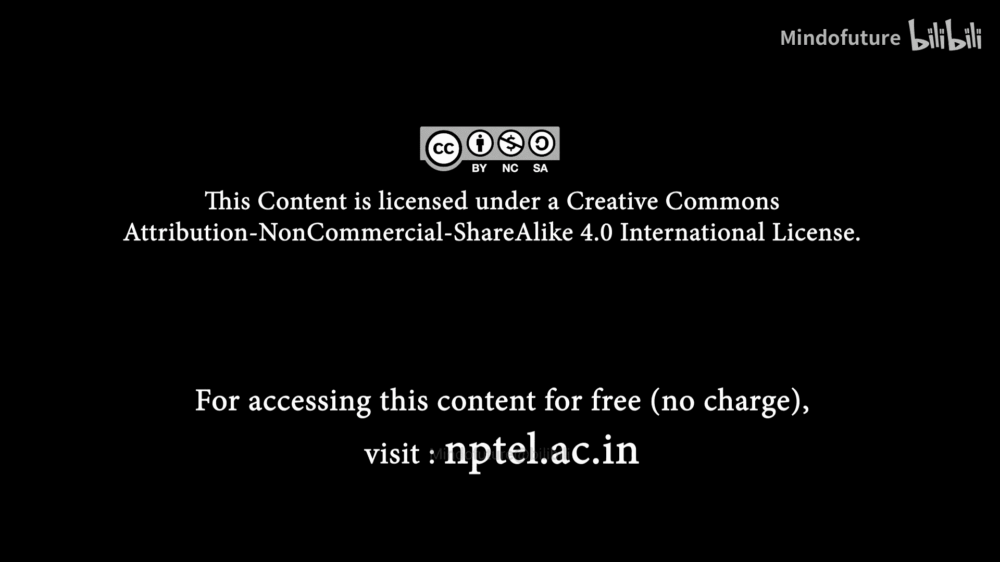
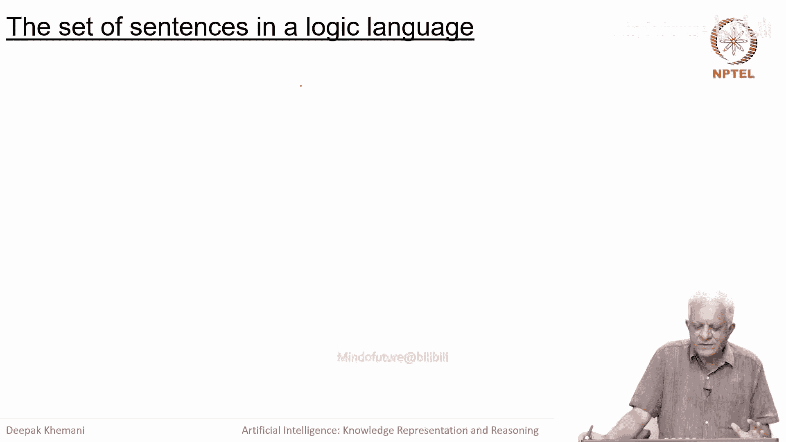

# 014：蕴含与证明

## 概述

在本节课中，我们将学习逻辑推理中的两个核心概念：**蕴含**与**证明**。我们将理解为什么需要形式化的逻辑语言，以及如何通过推理规则从已知知识中机械地推导出新知识。

上一节我们讨论了为什么需要命题逻辑这样的数学化语言来进行推理，而不是依赖自然语言。本节中，我们来看看逻辑如何形式化“有效论证”这一概念。

## 逻辑与真值

逻辑是数学的一个分支。在形式系统中，当我们谈论逻辑、推理和论证时，我们说某个陈述是真或假。从数学角度看，这些真值只是**一个二元集合的成员**。在经典逻辑中，每个句子都被映射到这个集合的第一个元素或第二个元素。

例如，这个集合可以是：
*   `{真, 假}`
*   `{T, F}`
*   `{1, 0}`

对我们而言，它们本质相同，都是一个包含两个元素的集合。我们的目标是将逻辑中的句子划分到这两个集合中：真或假。

## 知识库与蕴含

在知识表示与推理中，我们关心的是：一个智能体知道什么？以及作为其已知知识的**后果**，它还知道什么？一旦我们将给定的知识或陈述集（即知识库）映射为真，我们就有兴趣知道还有什么是真的。

不同的逻辑语言具有不同的表达能力，这是一种权衡。逻辑关注**有效论证**，我们感兴趣的是哪些论证形式、推理模式是有效的，哪些是无效的。语言是其次要考虑的。

以下是逻辑家族的一个概览：
*   **经典二值逻辑**位于中心。
*   **命题逻辑**是最简单的。
*   **一阶逻辑**表达能力更强，足以描述几乎所有的数学，计算机程序所做的一切本质上都可以直接关联到一阶逻辑。本课程的重点将是一阶逻辑。
*   我们也会简要提及**二阶逻辑**，但它对我们而言表达力过强，计算上难以处理。
*   为了应对计算复杂性的挑战，我们会研究一阶逻辑的子集，如**霍恩子句逻辑**和**描述逻辑**。
*   我们还会关注更具表达力的语言，如**事件演算**和**缺省逻辑**。
*   我们也会花一点时间在**认知逻辑**上，它关注一个智能体对另一个智能体所知内容的认知。
*   **时态逻辑**关注时间。
*   **模态逻辑**讨论可能性和必然性。
*   还有一些逻辑（如模糊逻辑、粗糙集）我们不会深入探讨。

“有效论证”这一概念通过**蕴含**的形式化来体现。我们从一个知识库开始，它是一组最初被设定为真的前提或公理。前提是你假设为真的陈述，公理是我们确信为真的陈述。在逻辑上，两者区别不大，但公理是已知为真的陈述。我们将这个句子集合S或知识库KB视为真，当且仅当知识库中的所有句子都为真。

蕴含的概念定义如下：给定一个为真的知识库（即一组真陈述），语言中所有其他句子的真值由知识库决定或**蕴含**。一旦你说知识库为真，原则上，对于该语言中的任何其他句子，你都能判断它是否被蕴含。

因此，如果知识库为真，那么语言中还有哪些句子为真，就是蕴含的概念。我们有时使用“蕴含”这个术语，但更常用“真”。我们会说：给定这个知识库，句子α是真的吗？这意味着它是否被知识库蕴含。

形式化地，一个句子α（我们用α, β, γ代表句子）被称为被一个句子集合S（或知识库KB）**蕴含**，当且仅当**每当知识库为真时，该句子也必然为真**。

我们用以下符号表示知识库KB蕴含α：
`KB ⊨ α`

我们可以这样想象：我们有一个形式语言，它是一个句子的集合。我们有一个知识库（用中心阴影圆表示）。我们接受知识库并说，好的，你给我们的所有内容都是真的。然后，存在一组被蕴含的句子（图中用较小的集合表示）。原则上，被蕴含的句子集合是无限的。

## 可证明性

蕴含讨论的是**真**。**可证明性**讨论的是**证明**或**可推导性**。

逻辑机器有一套**推理规则**。推理规则是一种规则，它指明在何种条件下可以将一个新句子添加到知识库中。

我们之前已经见过三段论。三段论说：如果你给我句子“所有人都是会死的”，再给我句子“苏格拉底是人”，那么推理规则（即有效的推理形式）说：你可以将句子“苏格拉底是会死的”也添加到知识库中。这就是推理规则的作用：它查看模式，并决定还能向句子集合中添加什么。

逻辑机器拥有从旧句子推导出新句子的算法。就像我们看到的那样，我们可以从“所有人都是会死的”和“苏格拉底是人”推导出“苏格拉底是会死的”。我们可以反复应用这些推理规则，添加越来越多的句子。最终，我们得到的就是一个**证明**。

因此，给定一个知识库，通过反复应用推理规则，可以将一个新句子α添加到知识库中。假设我们对某个特定句子α感兴趣，一旦我们能将其添加到知识库，我们就可以停止证明，并说α在给定知识库下是**可证明的**。

我们使用一个略有不同的符号来表示α可从知识库推导或证明：
`KB ⊢ α`

我们想要构建的逻辑机器的目标是：通过这种推导模式，机械地产生**所有且仅**为真的句子（即所有被蕴含的陈述）。如果你能做到这一点，如果你能建造一台机器，它能产生所有真陈述，并且只产生真陈述，那么我们就无需担心真值和蕴含等问题。我们可以简单地依赖逻辑机器来查看它是否能产生你感兴趣的句子。如果能，你就接受它为真。

## 可靠性与完备性

让我们更深入地探讨这个概念。给定一个知识库，我们有两个集合：一个是**可证明陈述**的集合（图中用彩色圆圈表示），另一个是**被蕴含陈述**的集合（图中用方块表示）。这是两个不同的集合。

我们希望构建的机器是这两个集合**完全相同**的机器，即一个集合中的内容恰好也在另一个集合中，反之亦然。这就是**可靠性**和**完备性**的概念。

*   给定一个知识库和推理算法（我们用于添加新句子或生成证明的某种算法），**蕴含**指出语言中还有哪些句子**必然为真**。
*   **可证明性**指出语言中还有哪些句子可以通过推理算法**实际产生**。

我们这样定义：
*   我们的推理算法是**可靠的**，如果它**只产生真陈述**。即，如果它产生了某个东西，我们可以接受它为真。
*   我们的推理算法是**完备的**，如果**一个陈述为真，那么我们的逻辑机器就能证明它**。即，如果它能推导或证明所有真陈述。

因此，我们基本上感兴趣的是产生一个**既可靠又完备**的逻辑机器。这意味着，如果给定一个知识库，我们想知道某个其他句子α是否为真，我们只需将其交给这台机器。如果机器能产生（证明）它，那么我们就说“是，它为真”；如果机器不能产生它，那么我们就说“不，它不是真”。这就是一个可靠且完备的逻辑系统的好处。

## 总结

本节课中，我们一起学习了逻辑推理的核心基础。我们理解了**蕴含**（KB ⊨ α）描述了知识库为真时，其他句子必然为真的逻辑关系。而**证明**（KB ⊢ α）则是通过应用推理规则，从知识库机械地推导出新句子的过程。理想的逻辑系统应同时具备**可靠性**（只产生真结论）和**完备性**（能证明所有真结论），这样我们就可以完全依赖证明过程来判断陈述的真假。

接下来，我们将探讨如何定义这种包含句子集合的形式化逻辑语言。