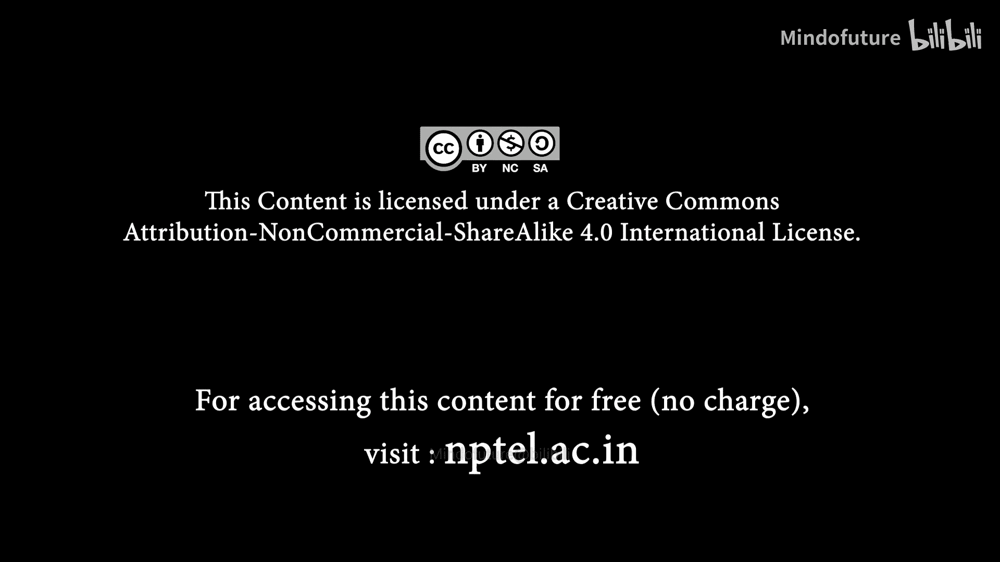
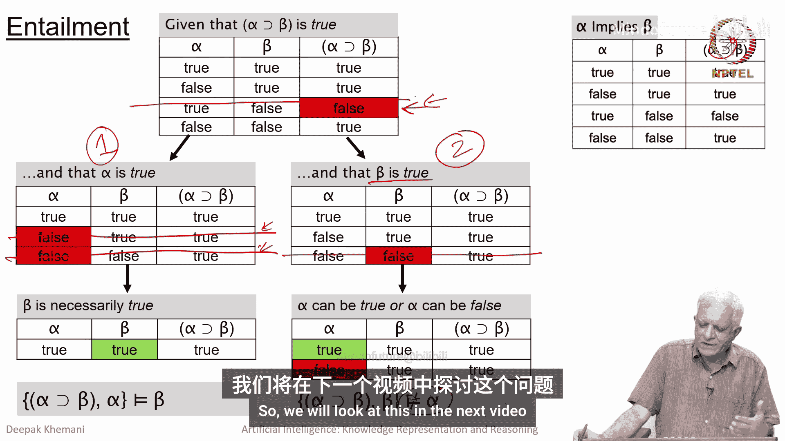

# 015：逻辑的语言

## 概述
在本节课中，我们将学习如何构建形式语言，定义语言中的句子，并理解逻辑连接词如何用于构造复合句。我们还将探讨逻辑连接词的语义，即如何通过真值表确定复合句的真值，并初步介绍逻辑推理的核心概念——蕴涵。

---

## 原子句与逻辑连接词

上一节我们介绍了形式语言的基本概念。本节中，我们来看看如何具体构建这种语言。

我们首先需要定义哪些句子属于该语言。构建过程从一组**原子句**开始。原子句是语言中最基本的、不可再分的句子。不同的逻辑语言可能有不同的方式来定义其原子句集合。

然后，我们使用**逻辑连接词**来构造**复合句**。逻辑连接词是逻辑学的核心，它用于将多个句子组合成一个新的句子。例如，“地球是圆的”和“月亮是美丽的”是两个句子，用连接词“并且”组合起来，就构成了复合句“地球是圆的并且月亮是美丽的”。

以下是构建形式语言句子的规则：
1.  所有原子句都是句子。
2.  如果α是一个句子，那么 **¬α**（非α）也是一个句子。
3.  如果α和β是句子，那么 **α ∧ β**（α且β）、**α ∨ β**（α或β）、**α → β**（α蕴涵β）等也是句子。

给定任意一组原子句和一组逻辑连接词，语言中的句子集合是无限的，因为我们可以不断地使用连接词构造出更复杂的句子。

---

## 逻辑连接词的种类

我们已经知道逻辑连接词用于构造新句子。现在，我们来详细看看有哪些常见的连接词。

逻辑连接词接受一个或多个句子作为输入，并输出一个新的句子。所有经典逻辑系统都共享一组基本的连接词，而表达能力更强的语言可能包含更多连接词。

*   **一元连接词**：接受一个输入。
    *   **否定**：符号为 **¬**。如果α是句子，那么¬α也是句子，读作“非α”。

*   **二元连接词**：接受两个输入。理论上存在16种可能的二元连接词，以下是三种最核心的：
    *   **合取**：符号为 **∧**。如果α和β是句子，那么α ∧ β也是句子，读作“α且β”。
    *   **析取**：符号为 **∨**。如果α和β是句子，那么α ∨ β也是句子，读作“α或β”。
    *   **蕴涵**：符号为 **→**。如果α和β是句子，那么α → β也是句子，读作“α蕴涵β”或“如果α，则β”。

我们不需要三元或更高阶的连接词，因为任何用它们表达的意思，都可以通过组合多个二元连接词来表达。例如，一个三元的“与”连接词 `Tand(α, β, γ)`，等价于 `(α ∧ β) ∧ γ`。

---

## 连接词的语义与真值表

前面我们讨论了连接词如何构造句子。本节中，我们来看看如何确定这些句子的**含义**，即其语义。

在形式语言中，连接词本身只是一个用于构造复合句的符号。当我们谈论逻辑连接词的语义时，我们指的是如何确定复合句的**真值**。复合句的真值由其组成部分的真值以及所使用的连接词的定义共同决定。

逻辑连接词通常通过**真值表**来定义。真值表列出了所有可能的输入组合下，输出句子的真值。

以下是两个基本连接词的真值表：

*   **否定**的真值表：
    | α | ¬α |
    |---|---|
    | T | F |
    | F | T |

    定义：当α为真时，¬α为假；当α为假时，¬α为真。

*   **合取**的真值表：
    | α | β | α ∧ β |
    |---|---|---|
    | T | T | T |
    | T | F | F |
    | F | T | F |
    | F | F | F |

    定义：仅当α和β同时为真时，α ∧ β才为真。这符合我们对“并且”的常识理解。

---

## 更多连接词及其真值表

除了“非”和“且”，还有其他重要的连接词。它们的语义同样由真值表精确定义。

以下是另外三个常见连接词及其真值表：

*   **蕴涵**：
    | α | β | α → β |
    |---|---|---|
    | T | T | T |
    | T | F | F |
    | F | T | T |
    | F | F | T |

    定义：只有当α为真且β为假时，α → β才为假。其他情况下均为真。

*   **异或**：
    | α | β | α ⊕ β |
    |---|---|---|
    | T | T | F |
    | T | F | T |
    | F | T | T |
    | F | F | F |

    定义：当α和β的真值**不同**时，α ⊕ β为真。这对应自然语言中“要么…要么…”的排他性含义。

*   **等价**：
    | α | β | α ↔ β |
    |---|---|---|
    | T | T | T |
    | T | F | F |
    | F | T | F |
    | F | F | T |

    定义：当α和β的真值**相同**时，α ↔ β为真。可以看出，它在所有情况下的真值正好与异或相反。

---

## 计算复合句的真值

理解了单个连接词的语义后，我们可以将其扩展到任意复杂的复合句。复合句的语义源于其组成部分的连接词定义，同样可以通过构造真值表来确定。

真值表的行数取决于基础原子变量的数量。对于n个变量，有 2^n 行，列出所有可能的真值组合。

让我们通过一个例子来说明。考虑句子：**(α → β) ↔ (¬α ∨ β)**。
1.  首先，列出α和β所有可能的真值组合（4行）。
2.  根据定义，计算`α → β`列的真值。
3.  根据定义，计算`¬α`列的真值。
4.  根据`∨`的定义，利用`¬α`和`β`列计算`¬α ∨ β`列的真值。
5.  最后，根据`↔`的定义，比较`α → β`和`¬α ∨ β`两列，得到最终复合句的真值。

通过这个过程，我们可以验证，无论α和β取何值，这个复合句的真值始终为**真**。这种在任何情况下都为真的句子具有特殊重要性。

---

## 蕴涵与逻辑推理

我们之前引入了“知识库蕴涵句子”的概念。现在，我们利用真值表来形式化地理解**蕴涵**，这是逻辑推理的核心。

假设我们的知识库包含句子：`α → β`。这意味着我们被告知这个句子为真。
1.  从`α → β`的完整真值表开始。
2.  由于已知`α → β`为真，我们可以**删除**它为假的那一行（即α真β假的情况）。剩下的三行构成了当前知识库允许的可能性。

**情况一**：知识库新增信息`α`为真。
1.  在剩下的三行中，进一步删除`α`为假的行。
2.  最终只剩下一行，其中`β`**必然**为真。
3.  因此，我们说知识库 `{α → β, α}` **蕴涵** β。记作：`α → β, α ⊨ β`。

**情况二**：知识库新增信息`β`为真（而不是α）。
1.  在`α → β`为真的三行中，删除`β`为假的行。
2.  剩下两行，其中`α`可能为真，也可能为假。
3.  因此，`α`的真值不是必然的。我们说知识库 `{α → β, β}` **不蕴涵** α。记作：`α → β, β ⊭ α`。

这个过程展示了“蕴涵”连接词在推理中的关键特性：如果已知“如果α则β”并且已知α成立，那么可以必然推出β成立（这被称为**肯定前件**）。但是，如果只知道β成立，则不能反推出α必然成立。

---

## 总结
本节课中，我们一起学习了逻辑语言的构建方法。
1.  我们从**原子句**出发，使用**逻辑连接词**（如¬, ∧, ∨, →）递归地构造出无限的句子集合。
2.  我们通过**真值表**精确定义了每个逻辑连接词的**语义**，从而能够计算任何复合句的真值。
3.  我们利用真值表分析了**蕴涵**关系，形式化地展示了如何从给定的知识库（一组已知为真的句子）中推导出必然为真的新结论，这是逻辑推理的基础。

下一节，我们将探讨如何通过**句法证明**的过程来实现这种推理，而不仅仅依赖于真值表计算。