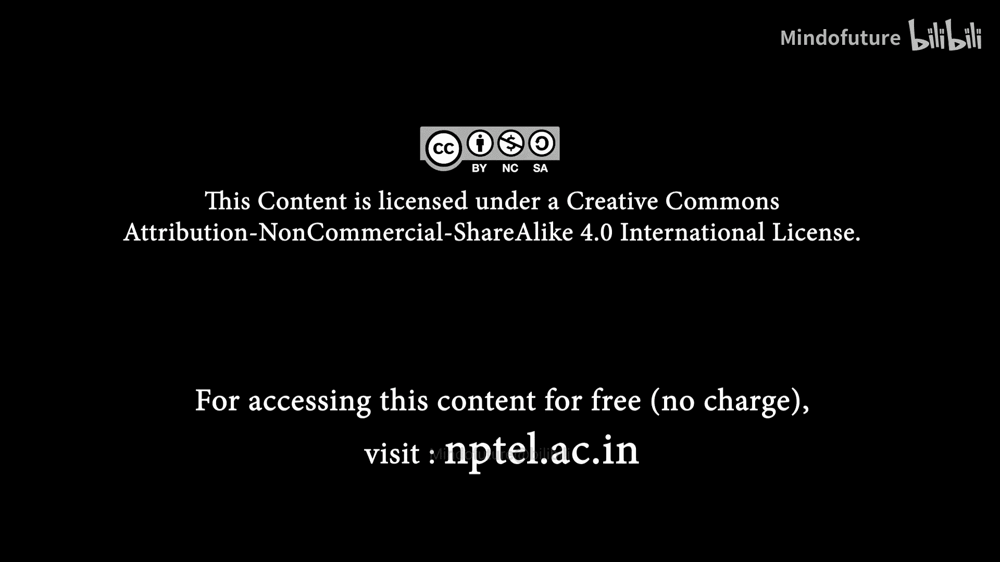
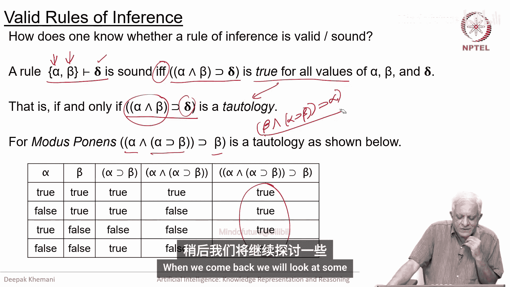

# 016：论证模式




## 概述
在本节课中，我们将学习逻辑中的论证模式。我们将探讨如何通过推理规则和证明机制，从已知为真的陈述中，推导出其他必然为真的陈述。我们将重点介绍一种称为“肯定前件”的有效推理规则，并区分它与另一种虽常用但并非必然有效的推理模式——“溯因推理”。

## 逻辑回顾
上一节我们介绍了逻辑的形式语言、逻辑连接词的语义以及复合句的语义。我们了解到，通过连接词组合句子可以生成无限多的复合句。我们还引入了“蕴涵”的概念，即给定一些为真的陈述，我们可以决定哪些其他陈述也为真。

我们通过一个例子看到，给定 `α ⇒ β` 和 `α`，可以必然推出 `β`。但给定 `α ⇒ β` 和 `β`，却不能必然推出 `α`。本节中，我们将探讨如何用论证模式来形式化地捕捉这种推理过程。

## 论证模式
就像三段论是一种论证模式一样，我们希望在命题逻辑中寻找类似的模式。以下是我们在蕴涵关系中观察到的两种模式：

1.  **有效模式**：从 `α ⇒ β` 和 `α`，可以推断出 `β`。
2.  **无效模式**：从 `α ⇒ β` 和 `β`，推断出 `α`。

注意，这里的 `α` 和 `β` 是变量，可以代入任何句子（无论是复合句还是原子句）。我们从有效蕴涵中提取出的模式是第一种。

## 肯定前件
这种有效推理模式在逻辑学中被称为 **肯定前件**。我们通常用缩写 **MP** 来表示它。

其模式如下：
```
α ⇒ β
α
-----
∴ β
```
这种模式是**可靠的推理规则**，因为只要前提 `α ⇒ β` 和 `α` 为真，结论 `β` 就必然为真。我们之前通过真值表分析确认了这一点。

这种基于模式的推理系统本质上是**句法层面**的操作：如果能在知识库中匹配到 `α ⇒ β` 和 `α`，就可以将 `β` 添加到知识库中。它不涉及真值，因此可以被自动化。

## 为何需要推导与证明？
你可能会问，既然可以通过构造真值表来确立有效性，为什么还需要推导和证明呢？原因如下：

*   **可扩展性**：真值表的行数随变量数量呈指数增长（n个变量对应 2^n 行），对于复杂问题效率低下。
*   **通用性**：真值表方法不适用于更具表达力的逻辑系统（如一阶逻辑），而推导证明的方法更具普适性。

因此，基于有效推理规则的**演绎推理**是更强大和通用的工具。

## 溯因推理
现在，让我们看看第二种模式，它被称为**溯因推理**。

其模式如下：
```
α ⇒ β
β
-----
∴ α
```
我们已通过真值表分析确认，这条推理规则**并不可靠**。因为即使前提 `α ⇒ β` 和 `β` 都为真，结论 `α` 也不一定为真。

### 现实中的例子
以下是一个经典的例子来说明这一点：
*   令 `α` 代表“你给花园浇水”。
*   令 `β` 代表“草坪是湿的”。
*   显然，“如果你给花园浇水，那么草坪会湿”（`α ⇒ β`）为真。

现在，假设有人告诉你“草坪是湿的”（`β`）。如果你据此推断“你给花园浇水了”（`α`），那么这个推断是无效的，因为草坪湿也可能是由于下雨了。

### 溯因推理的实用性
尽管溯因推理在逻辑上不可靠，但它在现实生活中非常有用，人类经常使用它。一个关键领域是**医疗诊断**：

*   通常，疾病会导致症状。这形成了一个因果蕴含关系：`疾病 ⇒ 症状`。
*   医生观察到症状（`β`），然后推断可能的疾病（`α`）。这是一种溯因。
*   这种推断并非确定性的（因为不同疾病可能导致相同症状），但它能缩小可能性范围，指导后续的确认性检查。

所以，溯因是一种从结果推测可能原因的、非常有用的推理方式，但它得出的结论不是必然的。

## 如何判断推理规则是否可靠？
我们如何形式化地判断一条推理规则是否可靠呢？一个简单的方法是回到真值表。

一条推理规则通常写成如下形式：
```
前提1: α
前提2: β
---------
结论: δ
```
我们说这条规则是**可靠的**，当且仅当对应的蕴含式 `(α ∧ β) ⇒ δ` 是一个**重言式**（即在所有真值赋值下都为真）。

*   对于**肯定前件**，我们需要检查 `((α ⇒ β) ∧ α) ⇒ β` 是否为重言式。通过真值表可以验证它是。
*   对于**溯因推理**，我们需要检查 `((α ⇒ β) ∧ β) ⇒ α` 是否为重言式。通过真值表可以验证它不是。

## 总结
本节课中，我们一起学习了逻辑中的论证模式。
1.  我们引入了**肯定前件**作为一种可靠、有效的演绎推理规则，它允许我们从 `α ⇒ β` 和 `α` 必然地推导出 `β`。
2.  我们探讨了**溯因推理**模式，它允许我们从 `α ⇒ β` 和 `β` 推测 `α`，但这种推理并不可靠，结论不是必然的，尽管它在现实问题求解中非常实用。
3.  我们了解了判断推理规则可靠性的标准：看其对应的蕴含式是否为重言式。



下一节，我们将继续学习更多有用的推理规则。