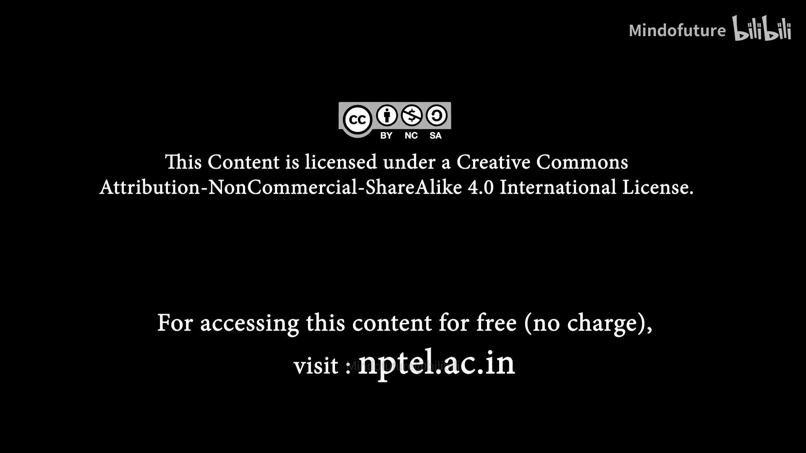
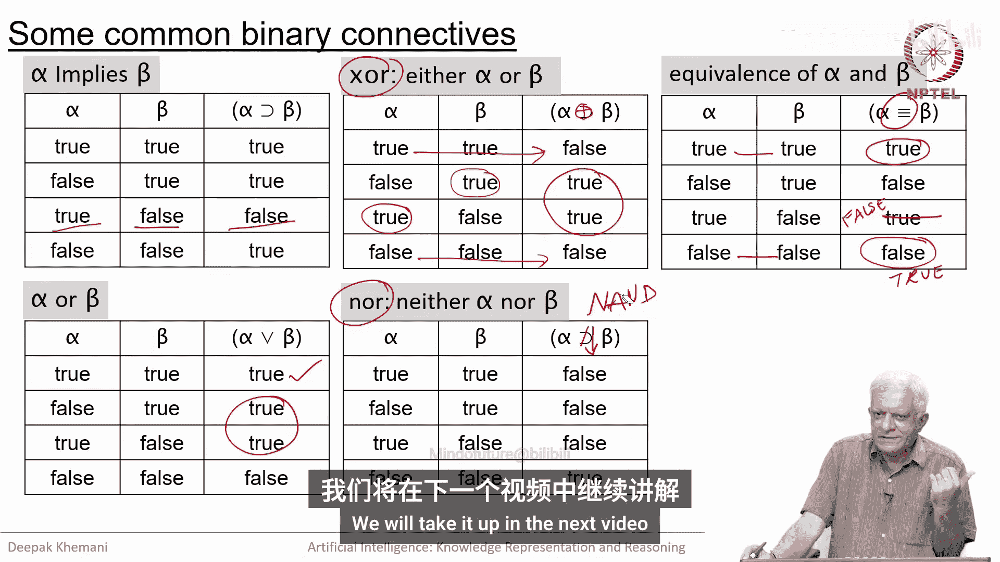

# 017：推理规则

## 概述
在本节课中，我们将学习逻辑推理中的核心概念——推理规则。我们将探讨什么是有效的推理模式，如何判断一个推理规则是否可靠，并了解一些常用的推理与替换规则。最后，我们将讨论逻辑连接词的“完备性”概念，即用最少的连接词表达所有逻辑陈述的可能性。

---

## 推理模式回顾
上一节我们介绍了推理模式，即有效的推理形式或可靠的推理规则。我们已经见过两个规则：肯定前件（Modus Ponens）和溯因推理（Abduction）。我们可以通过构造真值表来证明肯定前件是可靠的，因为它是一个永真式。而溯因推理则被证明是不可靠的。

逻辑学中使用了多种推理规则，让我们快速了解其中一部分。

## 常用推理规则
以下是几个基本的推理规则：

*   **肯定前件 (Modus Ponens)**
    *   **公式**: 如果 `α → β` 为真且 `α` 为真，则可推出 `β` 为真。
*   **否定后件 (Modus Tollens)**
    *   **公式**: 如果 `α → β` 为真且 `¬β` 为真，则可推出 `¬α` 为真。这也是一条有效规则，你可以通过构造真值表验证其为永真式。
*   **合取引入 (Conjunction)**
    *   **公式**: 如果 `α` 为真且 `β` 为真，则可推出 `α ∧ β` 为真。
*   **附加律 (Addition)**
    *   **公式**: 如果 `α` 为真，则可推出 `α ∨ β` 为真。根据“或”的逻辑定义，只要有一个为真，整个析取式就为真。
*   **化简律 (Simplification)**
    *   **公式**: 如果 `α ∧ β` 为真，则可推出 `α` 为真。这是合取引入的逆过程。

此外，还有构造性二难、破坏性二难、选言三段论、假言三段论等规则。建议你学习这些规则，并通过构造真值表来证明它们都是有效的推理规则。这意味着你可以使用其中任何一条来推导新的语句。

## 替换规则
推理规则允许我们在给定前提的情况下增加新的结论。而替换规则则允许我们用另一个逻辑等价的公式替换原公式。

例如，因为 `α → β` 与 `¬α ∨ β` 逻辑等价，所以你在任何地方看到 `α → β`，都可以用 `¬α ∨ β` 替换，反之亦然。逻辑等价意味着两者真值始终相同。

为什么替换规则是可靠的？我们可以构造真值表来证明涉及的等价式是永真式。对于推理规则，我们需要的是永真的蕴含式（单向推导）；而对于替换规则，我们需要的是永真的等价式（双向可替换）。

## 为何需要这些规则？
我们需要这些规则来构建推理机制。系统只需识别特定的模式，就能据此进行替换或推导新公式。一切都基于模式匹配：如果匹配到这个模式，就可以替换为那个模式，依此类推。因此，熟悉一些基本模式非常重要。

以下是一些简单的替换规则模式：

*   **交换律**
    *   **析取交换律**: `α ∨ β` 等价于 `β ∨ α`。
    *   **合取交换律**: `α ∧ β` 等价于 `β ∧ α`。
*   **幂等律**
    *   `α` 等价于 `α ∧ α`。
    *   `α` 等价于 `α ∨ α`。
*   **结合律**
    *   适用于合取与析取。
*   **分配律**
    *   `α ∧ (β ∨ γ)` 等价于 `(α ∧ β) ∨ (α ∧ γ)`。
    *   `α ∨ (β ∧ γ)` 等价于 `(α ∨ β) ∧ (α ∨ γ)`。
*   **德·摩根定律**
    *   `¬(α ∧ β)` 等价于 `¬α ∨ ¬β`。
    *   `¬(α ∨ β)` 等价于 `¬α ∧ ¬β`。
    这两条定律说明，当否定作用于一个复合公式时，可以将其深入，但连接词会翻转。
*   **归谬律**
    *   如果 `α → β` 为真，且 `α → ¬β` 为真，那么 `α` 不可能为真，即 `α` 为假。
*   **恒真/恒假简化**
    *   `α ∧ True` 等价于 `α`。
    *   `α ∧ False` 等价于 `False`。

如果你要手动构建证明，就需要熟悉各种推理规则和替换规则来简化任务。

## 连接词的完备性 🧩
现在，我们来探讨一个有趣的问题：我们是否需要之前讨论过的全部16种二元连接词？答案是否定的。

我们已经知道，`α → β` 可以用 `¬α ∨ β` 替换，从而消除蕴含连接词。那么，我们最少需要多少个连接词呢？这引出了“完备集”的概念。

可以证明，以下连接词集合是完备的，即任何使用其他连接词表达的公式，都可以仅用该集合中的连接词逻辑等价地表达出来：

1.  `{∧, ¬}` （合取与否定）
2.  `{∨, ¬}` （析取与否定）
3.  `{→, ¬}` （蕴含与否定）。历史上弗雷格发展的公理系统就使用了这个集合。

实践中，我们通常偏好使用三个连接词（如 `∧`, `∨`, `¬`），尽管其中一个是冗余的，但这有助于更直观地表达思想。

更有趣的是，存在**单个**连接词就是完备的：

*   **与非 (NAND, ↑)**: 定义为 `α ↑ β = ¬(α ∧ β)`。它本身就是一个完备集。
*   **或非 (NOR, ↓)**: 定义为 `α ↓ β = ¬(α ∨ β)`。它本身也是一个完备集。

在电路设计中，与非门就是“与非”连接词的物理实现，可以用来构建所有逻辑电路。

## 总结
本节课我们一起学习了逻辑推理的核心工具。我们回顾了推理模式，介绍了一系列可靠的推理规则（如肯定前件、否定后件）和替换规则（如德·摩根定律）。我们了解到，并非所有16种逻辑连接词都是必需的，并探讨了连接词的“完备集”概念，知道像 `{∧, ¬}` 这样的集合就足以表达所有逻辑关系，甚至存在“与非”或“或非”这样的单个完备连接词。

在下节课中，我们将把“完备性”的概念延伸到推理规则本身，探讨需要多少条推理规则才能让一个逻辑系统足够强大，能够推导出所有被蕴含的真命题。