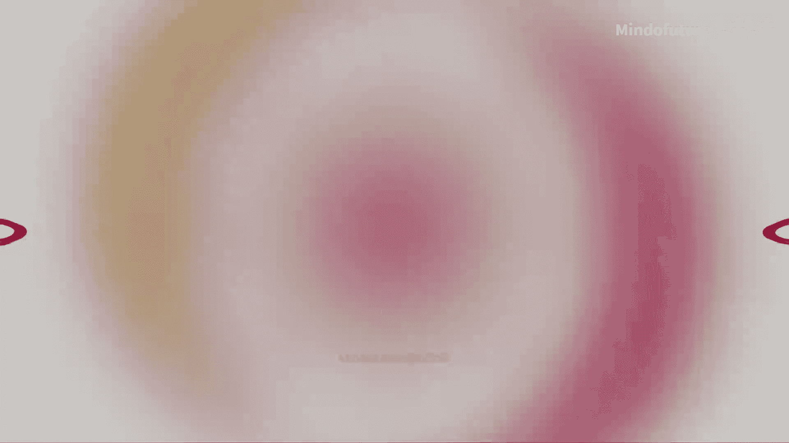
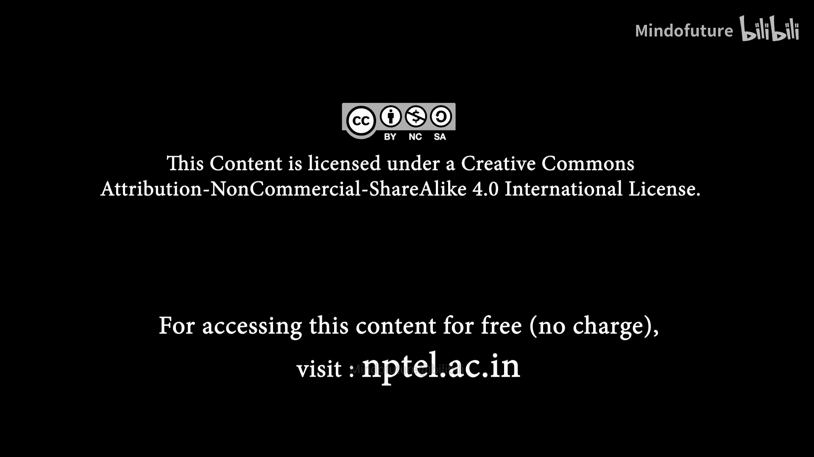
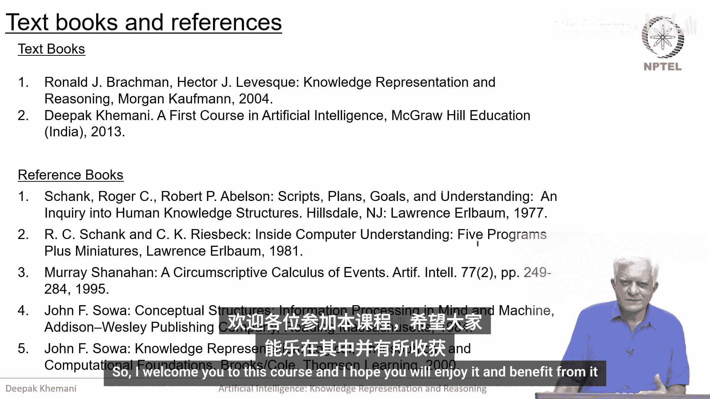

# 018：课程介绍 🧠

在本节课中，我们将要学习《人工智能知识表示与推理》这门课程的核心内容与整体框架。课程将聚焦于智能体如何**表示**其所在环境的知识，并基于已有知识进行**推理**。

---

## 课程概述

大家好，我是迪帕·凯马尼，在此向大家介绍我的课程《人工智能知识表示与推理》。这门课程已开设五年有余，本次我们进行了全新的录制，希望为大家带来一次内容提升的课程体验。

正如标题所示，本课程关注人工智能的一个关键方面：智能体如何认知其环境和领域。随着智能体获取更多信息和知识，它们如何利用已知信息进行推理，将是本课程的重点。

---

## 智能体与推理场景

设想一个足球场上的智能体球员。她必须**表示**自己所处的局势，并基于此进行**推理**。例如，如果这位球员正带球冲向球门，而对方球员正在逼近，同时她的队友也在前插，她应该怎么做？她必须感知局势、**推理**正在发生的情况，并据此制定计划。

当我们谈论“推理”时，指的是进行**推断**。即，基于已知信息，你还能**推导出**什么？本课程将聚焦于这两个核心：如何**表示**事物，以及作为结果，你能**推断出**什么。

---

## 人类认知架构与课程焦点

观察人类认知架构，可以将其视为一个三层结构：
*   最外层（图中灰色部分）负责信号处理，例如我们用眼睛看、用耳朵听。
*   中间是神经模糊系统层，它将**信号**转换为**符号**。

本课程关注的重点正是**符号**，尤其是基于符号的**推理**。因此，我们将涵盖逻辑、知识表示、本体论、语义学等主题，也会涉及少量自然语言理解。而感知层（最外层）主要负责感知信息信号并将其转换为信号，模糊系统则将其转化为符号，但**推理本身是符号化的**。我们的核心将是研究基于符号表示的推理算法。

---

## 逻辑的本质

我们将重点学习**逻辑**。逻辑最古老的体现之一是希腊三段论，它蕴含了逻辑的本质：推理是**形式化**的。一个论证是否有效，关键在于其是否遵循有效的**形式**，而非过分关注内容本身。

这是一个经典例子：
*   所有人都是会死的。
*   苏格拉底是人。
*   因此，苏格拉底是会死的。

你可以看到，重要的是**形式**。你可以替换内容，例如：
*   所有城市都很拥挤。
*   金奈是一个城市。
*   因此，金奈很拥挤。

只要论证具有**有效的形式**，那么如果前提为真，结论必然为真。这就是逻辑演绎背后的核心理念。

---

## 课程大纲

以下是本课程将涵盖的教学大纲：

我们将从介绍逻辑和符号化表示开始，讨论可靠性与完备性。首先学习最简单的**命题逻辑**，并研究一些证明方法，如直接证明和表推演法。

随后进入课程主要部分：**一阶逻辑**。我们将学习前向链接、后向链接、归结原理等算法，探讨它们与逻辑编程、声明式编程思想的联系，并以Prolog语言为例。同时，我们也会使用Datalog语言来学习作为声明式语言的前向链接。

接着，我们将转向**知识表示**。学习具体化的概念，即在头脑中创建概念；探讨CD理论（谓词选择理论）；研究如何将谓词组织成框架、脚本、分类法，以及描述逻辑和OWL。

然后，我们将学习**基于不完全信息的推理**，包括默认推理（即做出一些可能后续需要撤回的结论）。我们将了解限定推理这一著名范例，并学习**事件演算**，以讨论时间与变化，因为世界中的行动会导致事物在不同时间点具有不同的真值。

最后，我们将涵盖**认知逻辑**，即关于智能体如何推理其他智能体所知内容的逻辑。

---

## 参考教材

本课程将主要使用以下两本教材：
1.  Brachman和Levesque所著的《知识表示与推理》（2004年出版）。
2.  我本人后来撰写的一本更全面的AI教材《人工智能初级课程》，其中包含了我们感兴趣的相关内容。

此外，课程进行中也会提供大量的其他参考文献。

---

## 总结

本节课我们一起学习了《人工智能知识表示与推理》课程的总体介绍、核心关注点（知识表示与推理）、逻辑的基础地位以及详细的教学大纲。欢迎加入本课程，希望大家能享受学习过程并从中获益。

我们课堂上见。