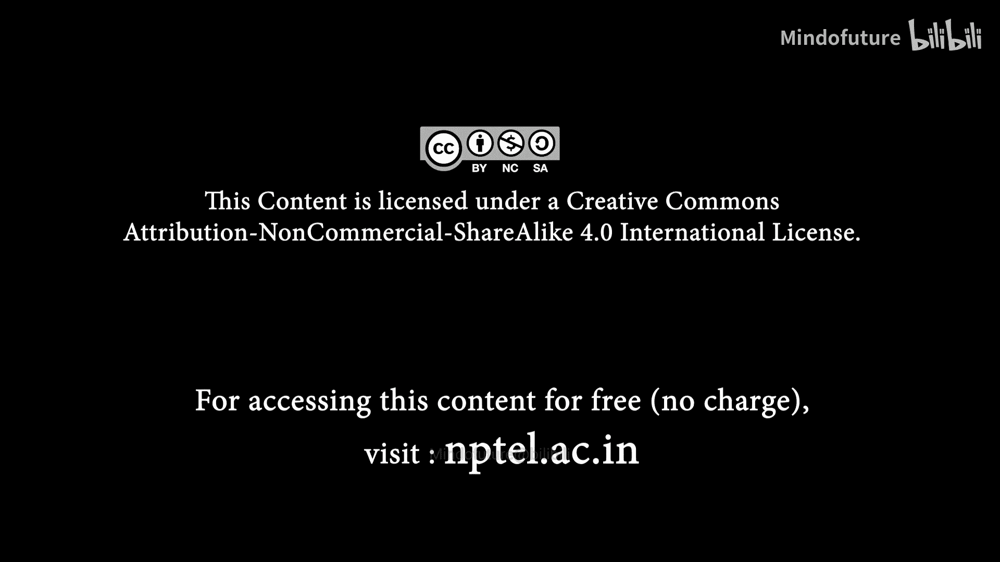
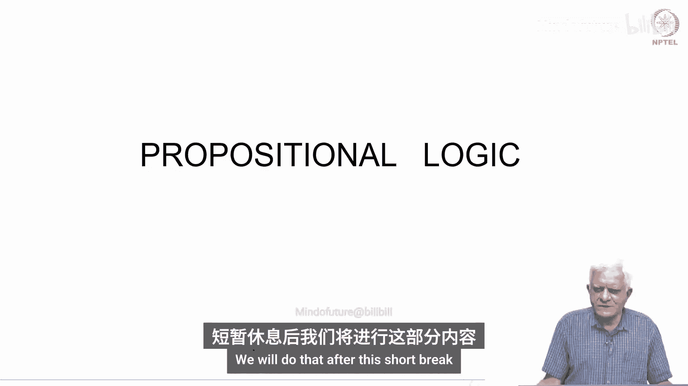

# 019：命题逻辑

## 概述

在本节课中，我们将要学习命题逻辑的基础知识。我们将从逻辑连接词的完备集概念开始，探讨如何用最少的连接词表达所有可能的逻辑陈述。接着，我们将介绍弗雷格的命题演算系统，这是一个仅使用一个推理规则（肯定前件）和一组公理的完备系统。最后，我们将正式定义命题逻辑的语言。

## 逻辑连接词的完备集

上一节我们介绍了逻辑连接词。本节中我们来看看什么是连接词的“完备集”。

一个连接词集合是完备的，意味着使用该语言中所有连接词所能表达的任何内容，都可以仅用这个最小集合来表达。这样我们就不必处理所有连接词。

以下是三个完备的连接词集合示例：
*   `{¬, ∧, ∨}`
*   `{¬, ∨}`
*   `{¬, →}`

弗雷格在大约340年前提出的逻辑系统，就只使用了蕴含（→）和否定（¬）这个集合，并证明了其完备性。当我们转向更具表达力的逻辑（如一阶逻辑）时，最常用的连接词集合是 `{¬, ∧, ∨}`，尽管存在冗余，但它能使知识表示更自然、更紧凑。

**核心概念**：用其他连接词替换蕴含（→）的公式。
`α → β` 等价于 `(¬α ∨ β)`

问题在于，当我们尝试移除其他连接词时，公式的长度可能会变得越来越长。由于我们需要编写程序来处理这些公式，公式的长度也会成为一个影响因素。

## 单一完备连接词

存在一些单一连接词集合也是完备的。

**核心概念**：与非（NAND）连接词，也称为谢费尔竖线（Sheffer stroke）。
`α ↑ β` 等价于 `¬(α ∧ β)`

与非门的真值表与“与”门相反。有趣的是，在命题逻辑中，任何你想表达的内容都可以仅使用这个“与非”连接词来表达。这在构建逻辑电路时有重要意义，因为如果仅使用一种与非门就能实现所有电路功能，会带来许多好处。

另一个单一完备连接词是“或非”（NOR），也称为皮尔斯箭头（Peirce arrow）或联合否定（joint denial）。

**核心概念**：或非（NOR）连接词。
`α ↓ β` 等价于 `¬(α ∨ β)`

联合否定意味着这个句子仅在α和β都被否定（即都为假）时才为真。你可以验证，这等价于 `(¬α ∧ ¬β)`。

## 弗雷格的命题演算

现在，我们简要探讨一下逻辑推理。逻辑推理的工作方式是拥有一套蕴含规则，如肯定前件、否定后件、假言三段论、合取、附加等。这些规则允许你将新公式添加到知识库中。证明过程完全是一个句法过程：你寻找匹配的模式，然后据此添加新内容。

弗雷格证明，仅使用一条推理规则就足以实现完备性。这与连接词的完备性概念不同。我们现在讨论的完备性是指：给定一组公理和前提，需要多少条规则才能推导出所有被蕴含的结论？在逻辑中，一个逻辑系统是完备的，当且仅当所有被语义蕴含的结论都能被句法证明。

弗雷格证明，仅凭肯定前件（modus ponens）这一条规则就足够了。

**核心概念**：肯定前件（Modus Ponens）推理规则。
如果知识库中存在 `α` 和 `α → β`，则可以推断出 `β`。

他证明了，只要接受他指定的一组公理，仅凭这一条规则和一小套逻辑连接词，系统就是完备的。弗雷格的逻辑被称为公理系统，因为知识库始于一组公理。公理是数学家指定并接受为基础真理的陈述。

以下是弗雷格命题演算的六条公理（随后其他逻辑学家证明第三条是冗余的）：
1.  `α → (β → α)`
2.  `(α → (β → γ)) → ((α → β) → (α → γ))`
3.  `(α → (β → γ)) → (β → (α → γ))`
4.  `(α → β) → (¬β → ¬α)`
5.  `¬¬α → α`
6.  `α → ¬¬α`

你应该为所有六条公理构造真值表，以验证它们确实是永真式（重言式）。公理是无论为α、β、γ代入什么命题都为真的陈述。

弗雷格证明了其命题演算是完备的。在公理系统中，我们从一组已知为真的陈述（公理）开始。由于系统是完备的，我们可以推导出所有被蕴含的陈述，因此所有被推导出的陈述也必定为真。换句话说，我们可以推导出所有重言式。

## 演绎定理与完备性

回想一下演绎定理：如果从前提A, B, C, D可以推出E，那么这等价于可以证明 `(A ∧ B ∧ C ∧ D) → E` 是一个重言式。

如果 `(A ∧ B ∧ C ∧ D) → E` 是一个重言式（即无需任何前提即可证明为真），并且由于弗雷格的系统是完备的（所有重言式都可被推导），那么我们应该能够推导出它。这意味着，如果给定前提A, B, C, D，我们就能推导出E。

这说明了弗雷格系统不仅足以推导出所有重言式，而且意味着如果你被给予一些前提（例如A, B, C, D），并且如果E是从这些前提中蕴含出来的，那么你也可以在系统中推导出E。在这个意义上，该逻辑是完备的。

## 总结

本节课中我们一起学习了命题逻辑的核心概念。我们首先探讨了逻辑连接词完备集的意义，知道了可以用最小的连接词集合（如 `{¬, →}` 或甚至单一连接词如“与非”）表达所有逻辑关系。接着，我们深入了解了弗雷格的公理化命题演算系统，该系统仅使用肯定前件这一条推理规则和一组公理，就能实现逻辑完备性，即所有语义蕴含的结论都能被句法证明。最后，我们通过演绎定理理解了这种完备性的实际含义。接下来，我们将正式定义命题逻辑这门具体的语言。