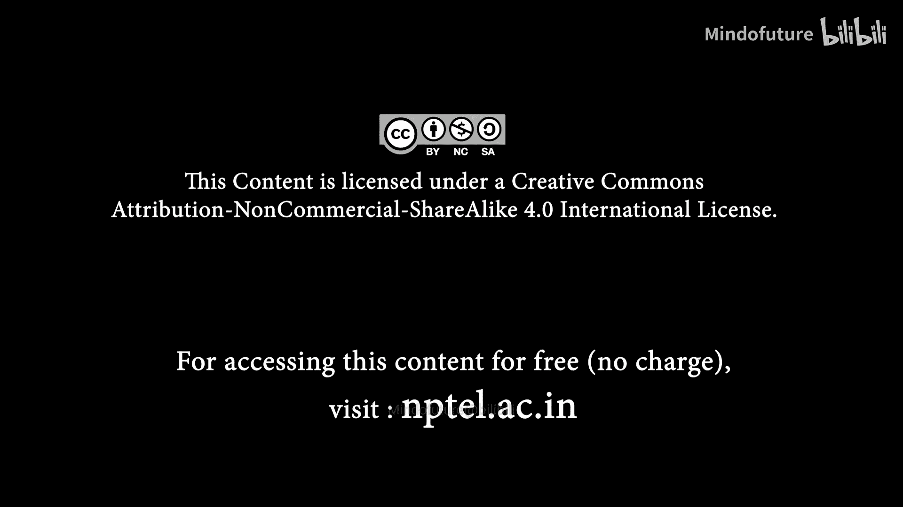
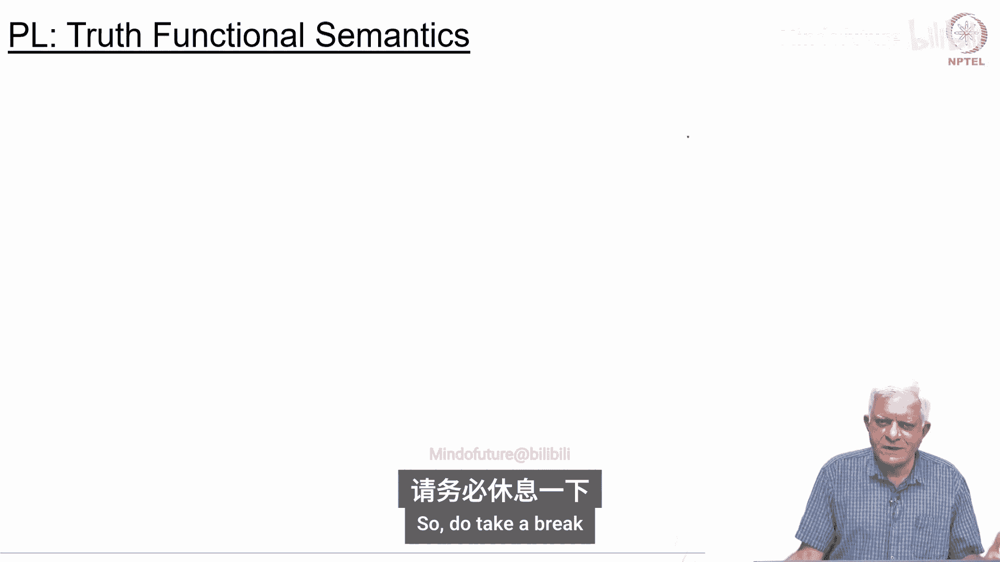

# 020：命题逻辑语法

在本节课中，我们将学习命题逻辑的语法。我们将了解如何定义命题逻辑这种形式语言，包括其基本构成元素（如原子命题和逻辑连接词）以及如何通过这些元素构建合法的句子（即合式公式）。

## 概述

命题逻辑，通常简称为 **PL**，是最简单的逻辑语言。它为我们提供了理解证明或推导计算算法的基础。本节我们将专注于定义命题逻辑的语法，即如何构造合法的逻辑语句。

## 原子命题

原子命题是最基本的句子，它不包含任何逻辑连接词。在命题逻辑中，原子命题就是一个符号，例如 **P**、**Q** 或 **R**。我们说 **P** 是一个句子，意味着在原则上，**P** 可以被赋予一个真值：**真** 或 **假**。

一个符号可以代表任何陈述句。以下是一些原子命题的例子：
*   **P**：所有人都是会死的。
*   **Q**：月亮是由绿奶酪制成的。
*   **R**：地球是圆的。
*   **S**：地球是平的。
*   **T**：番茄是蔬菜。
*   **U**：番茄是水果。

这些句子本身是原子且不可分割的。在命题逻辑中，我们**不**深入分析句子内部的结构或含义。例如，对于“所有人都是会死的”，我们不会将其分解为“人”、“所有”和“会死的”等概念。我们只将其视为一个整体单元 **P**，并关注其真值。

显然，这具有很强的限制性。例如，仅凭“所有人都是会死的”（**P**）和“苏格拉底是人”（**Q**），我们无法在命题逻辑中推导出“苏格拉底是会死的”（**R**）。这需要一种更具表达力的逻辑（如一阶逻辑），我们将在后续课程中学习。

逻辑本身并不关心**意义**。它只关心**有效的推理模式**。例如，如果 **P** 为真，且 **P → Q** 为真，那么 **Q** 为真。这是一个有效的推理模式，无论 **P** 和 **Q** 具体代表什么。

## 命题逻辑的词汇表

一种形式语言就是一组句子的集合。在命题逻辑中，我们通过一些简单规则来定义这组句子，这就是语法。

构建逻辑时，词汇表包含逻辑部分和领域特定部分。

**逻辑部分**的常量（在所有逻辑语言中基本都存在）包括：
1.  **逻辑连接词符号**：¬ (非)，∧ (与)，∨ (或)，→ (蕴含)。在语法层面，这些只是符号，尚未与真值表关联。¬ 是一元连接词，其余是二元连接词。
2.  **辅助符号**：(，) 括号。
3.  **常量符号**：⊥ (假)，⊤ (真)。在定义语义时，它们将始终分别对应真值 **假** 和 **真**。

**领域特定部分**的变量是**命题符号集**，记作 **P**。这是一个可数的符号集合，例如 {P, Q, R, ...} 或 {P1, P2, P3, ...}。当我们用逻辑编码特定问题时，需要选择一组命题符号。

以上构成了命题逻辑的**字母表**。

## 合式公式

逻辑关注的是句子（或称公式），即可以判断真假的陈述。在形式语言中，我们称之为**合式公式**。

以下是命题逻辑中合式公式的归纳定义规则：

1.  **基础**：每个命题符号 **P ∈ P** 都是一个（原子）公式。
2.  **归纳步骤**：
    *   如果 **α** 是一个公式，那么 **¬α** 也是一个公式。
    *   如果 **α** 和 **β** 是公式，且 **◊** 代表任一二元连接词（如 ∧, ∨, →），那么 **(α ◊ β)** 也是一个公式。
3.  **闭合**：所有公式都只能通过有限次应用上述规则生成。

这意味着，**公式集 F** 是满足上述规则的最小集合。例如，**P ∧ Q** 是公式，但 **P ∧ ∨ Q** 不是公式，因为它不符合任何生成规则。

## 关于“命题”演算的说明

我们说这是“命题”演算，并不是指公理（如排中律 α ∨ ¬α）中的 α 必须是原子命题。这里的 α、β、γ 是**元变量**，可以代入**任何**合式公式，包括复合公式。

例如，在公理 **(α → (β → γ)) → ((α → β) → (α → γ))** 中，我们可以代入：
*   α = P → Q
*   β = ¬R
*   γ = P ∨ Q
代入后得到的公式仍然是一个重言式。因此，“命题”指的是该逻辑的基本构件（原子句子）是不可再分的命题，但逻辑规则适用于所有由它们构建的复合公式。

## 总结

本节课我们一起学习了命题逻辑的语法。我们定义了原子命题作为逻辑的基本单元，介绍了逻辑连接词和常量符号，并给出了合式公式的严格归纳定义规则。我们了解到，命题逻辑的语法规定了如何从一组简单的符号开始，通过逻辑连接词构建出所有合法的逻辑语句，为下一步定义这些语句的**语义**（即它们的真值含义）奠定了基础。在下一个视频中，我们将探讨命题逻辑的语义。