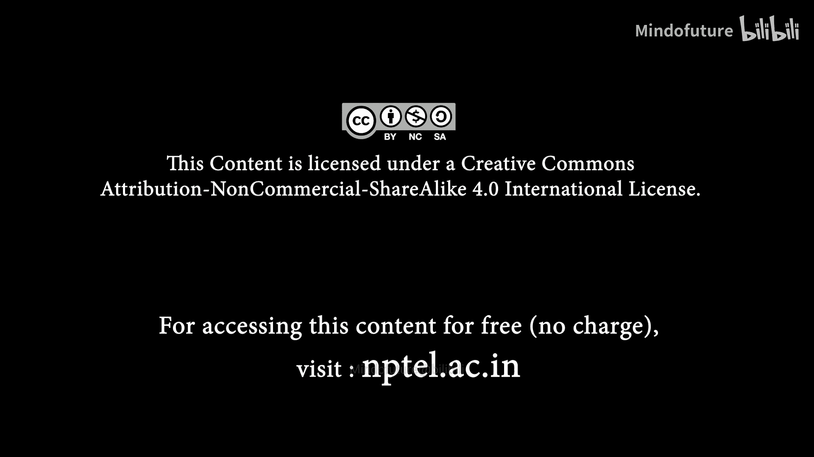
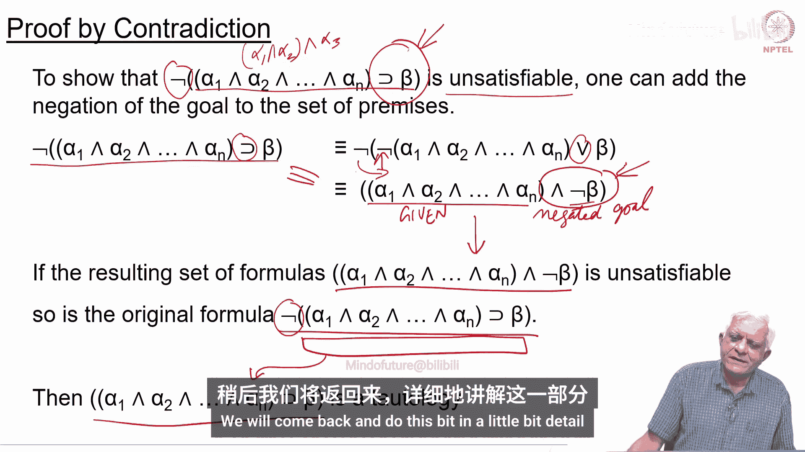

知识表示与推理：P21：模型与反证法

在本节课中，我们将学习模型的概念，并介绍一种重要的证明方法——反证法。我们将看到如何通过寻找公式的模型来理解其真值，以及如何通过证明一个公式的否定不可满足来间接证明原公式是永真式。

上一节我们介绍了直接证明的一些方法。本节中，我们来看看间接证明。

间接证明并非从事实出发，通过推理规则直接得出结论，而是采用一种更迂回的方式。

### 模型的概念

首先，我们来回顾模型的概念。对于一个公式，任何给原子语句赋值的解释（例如，P为真，Q为假，R为真等）都称为一个**解释**。如果一个解释使得公式为真，那么这个解释就被称为该公式的一个**模型**。寻找这种解释的过程也称为**模型检测**。

### 模型与永真式的关系

现在，考虑以下逻辑关系：
*   如果公式 **¬α** 有一个模型（即存在一个解释使其为真），那么 **α** 本身可能也有模型，也可能没有。
*   如果公式 **¬α** 没有模型（即它是**不可满足的**），那么 **α** 必定是一个**永真式**。

因此，证明一个公式 **α** 是永真式的一种方法是：尝试为 **¬α** 寻找一个模型。如果找不到这样的模型，就可以断定 **α** 是永真式。这就是我们将要探讨的反证法思路。

### 反证法示例

为了说明这一点，让我们证明一个熟悉的推理规则是永真式：**((P ∧ (P → Q)) → Q)**。

为了证明它是永真式，我们尝试为其否定式 **¬((P ∧ (P → Q)) → Q)** 寻找一个模型（即令其为真）。

根据蕴含式的否定规则，一个蕴含式为假，当且仅当其前件为真而后件为假。因此：
1.  要使 **¬((P ∧ (P → Q)) → Q)** 为真，需令 **((P ∧ (P → Q)) → Q)** 为假。
2.  这要求其后件 **Q** 为假，且其前件 **(P ∧ (P → Q))** 为真。
3.  **(P ∧ (P → Q))** 为真，要求 **P** 为真，且 **(P → Q)** 为真。
4.  但我们已经设定 **Q** 为假。当 **P** 为真，**Q** 为假时，**(P → Q)** 为假。
5.  这导致了矛盾：我们无法同时满足 **(P ∧ (P → Q))** 为真（要求 **(P → Q)** 为真）和 **Q** 为假（导致 **(P → Q)** 为假）这两个条件。

因此，我们无法为 **¬((P ∧ (P → Q)) → Q)** 找到任何模型。根据之前的结论，这证明了原公式 **((P ∧ (P → Q)) → Q)** 是一个永真式。

### 反证法的一般形式

更一般地，反证法对应于**归结定理**。假设我们有一些前提 **α₁, α₂, ..., αₙ**，想要证明结论 **β**。

这等价于证明公式 **(α₁ ∧ α₂ ∧ ... ∧ αₙ) → β** 是永真式。根据反证法，这又等价于证明其否定式 **¬((α₁ ∧ α₂ ∧ ... ∧ αₙ) → β)** 是不可满足的。

通过逻辑等价变换（将蕴含式转化为析取式，并应用德摩根定律），我们可以将上述否定式转化为：
**(α₁ ∧ α₂ ∧ ... ∧ αₙ ∧ ¬β)**

因此，证明 **β** 可以从前提 **α₁, α₂, ..., αₙ** 中推出的反证法流程如下：
1.  将你想要证明的结论 **β** 取反，得到 **¬β**。
2.  将 **¬β** 加入到前提集合中，形成一个新的合取式：**α₁ ∧ α₂ ∧ ... ∧ αₙ ∧ ¬β**。
3.  尝试为这个新公式寻找一个模型（即一个使其为真的解释）。
4.  如果你**无法**找到任何模型（即该公式是不可满足的），那么你就可以断定原结论 **β** 是有效的，可以从前提中推出。

简而言之，反证法就是：否定结论，将其加入前提，然后证明这组新的断言是矛盾的（没有模型）。

### 总结

本节课中我们一起学习了：
1.  **模型**是一个使公式为真的解释。
2.  证明公式 **α** 是永真式的一种有效方法是证明其否定 **¬α** 是**不可满足的**（即没有模型）。
3.  **反证法**是一种基于此原理的间接证明技术。要证明结论 **β** 能从前提推出，只需将 **¬β** 加入前提集，并证明这组新的公式集合存在矛盾（不可满足）。

在接下来的课程中，我们将深入探讨一种实现反证法的系统化方法——**表推演方法**。