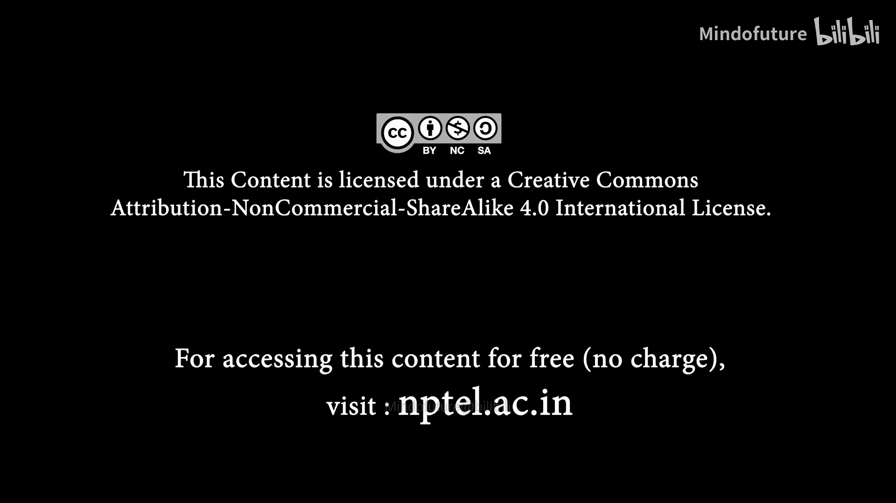
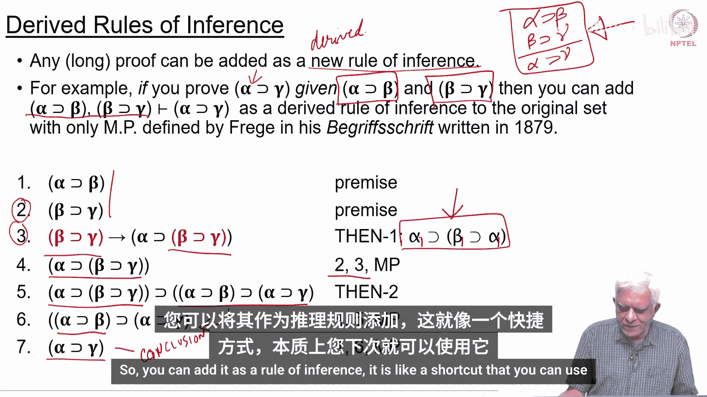

# 022：演绎定理

在本节课中，我们将学习演绎定理。演绎定理是命题逻辑中一个重要的概念，它为我们提供了一种证明蕴含式的新方法。我们将探讨其定义、应用，以及如何利用它来简化证明过程。

## 演绎定理的定义

上一节我们介绍了自然演绎法。本节中我们来看看演绎定理。

演绎定理指出：给定一组公式 **Γ** 和一个特定公式 **α**，如果 **Γ ∪ {α}** 可推出 **β**，那么 **Γ** 本身就可推出 **α → β**。反之亦然。

对于一个可靠且完备的逻辑系统，这可以形式化地表示为：
**Γ ∪ {α} ⊢ β** 当且仅当 **Γ ⊢ α → β**。

这意味着，与其将 **α** 作为前提添加到知识库中并尝试证明 **β**，我们可以直接证明 **α → β** 是一个永真式。

## 应用演绎定理进行证明

以下是应用演绎定理的一个例子。

假设我们有四个前提公式，结论是 **t**。根据演绎定理，证明这四个前提能推出 **t**，等价于证明以下公式是永真式：
**(前提1 ∧ 前提2 ∧ 前提3 ∧ 前提4) → t**

这样，我们就不再需要额外的前提，只需专注于证明这个蕴含式本身是永真的。

## 使用假设框证明永真蕴含式

有时，为了证明一个公式 **α → β** 是永真蕴含式，我们可以采用一种称为“假设框”的技术。

具体方法是：我们创建一个假设框，在框内假设 **α** 为真，然后利用已有的公理和推理规则，尝试在框内推导出 **β**。如果能成功推导出 **β**，那么根据演绎定理，我们就证明了 **α → β** 是永真的。

例如，要证明 **(p → q) → (¬q → ¬p)** 是永真式。

1.  我们首先假设 **p → q** 为真。
2.  然后，利用一个公理：**(p → q) → (¬q → ¬p)**。
3.  通过肯定前件规则，我们可以推断出 **¬q → ¬p**。

由于我们在假设 **p → q** 的前提下推导出了 **¬q → ¬p**，根据演绎定理，这等价于证明了 **(p → q) → (¬q → ¬p)** 是永真式。

## 嵌套假设框的复杂证明

对于更复杂的蕴含式，可能需要使用嵌套的假设框。

例如，证明 **((p ∧ q) → r) → (p → (q → r))** 是永真式。

以下是证明步骤：

1.  首先，假设 **((p ∧ q) → r)**。
2.  然后，在第一个假设框内，再假设 **p**。
3.  接着，在第二个假设框内，再假设 **q**。
4.  在第二个假设框内，由 **p** 和 **q** 可以得到 **p ∧ q**。
5.  由 **p ∧ q** 和第一个假设 **((p ∧ q) → r)**，通过肯定前件规则得到 **r**。
6.  退出第二个假设框。根据演绎定理，由假设 **q** 推出了 **r**，这等价于证明了 **q → r** 在第一个假设框内成立。
7.  退出第一个假设框。根据演绎定理，由假设 **p** 推出了 **q → r**，这等价于证明了 **p → (q → r)** 在最外层成立。
8.  最后，退出最外层的假设框。根据演绎定理，由最初的假设 **((p ∧ q) → r)** 推出了 **p → (q → r)**，这等价于证明了整个公式 **((p ∧ q) → r) → (p → (q → r))** 是永真式。

## 导出推理规则

另一种简化证明的方法是引入导出推理规则。虽然弗雷格系统认为肯定前件规则就足够了，但对于某些常见模式，证明可能很长。

如果我们能证明一个模式是有效的，就可以将其作为一个新的（导出的）推理规则加入，以后遇到相同模式时可以直接使用，无需重复冗长的证明。

例如，假言三段论就是一个导出规则：
如果给定 **α → β** 和 **β → γ**，那么可以推出 **α → γ**。

我们可以用基本规则证明这一点，证明完成后，就可以将假言三段论作为一个快捷的推理规则来使用：
**α → β, β → γ ⊢ α → γ**

## 总结

本节课中我们一起学习了演绎定理。我们了解了它的定义，即 **Γ ∪ {α} ⊢ β** 等价于 **Γ ⊢ α → β**。我们学习了如何应用它，通过创建“假设框”来证明永真蕴含式，包括处理嵌套的复杂情况。最后，我们还探讨了如何利用已证明的有效模式来创建导出推理规则，从而简化未来的证明过程。演绎定理为我们提供了更灵活、有时更简洁的证明构造方法。