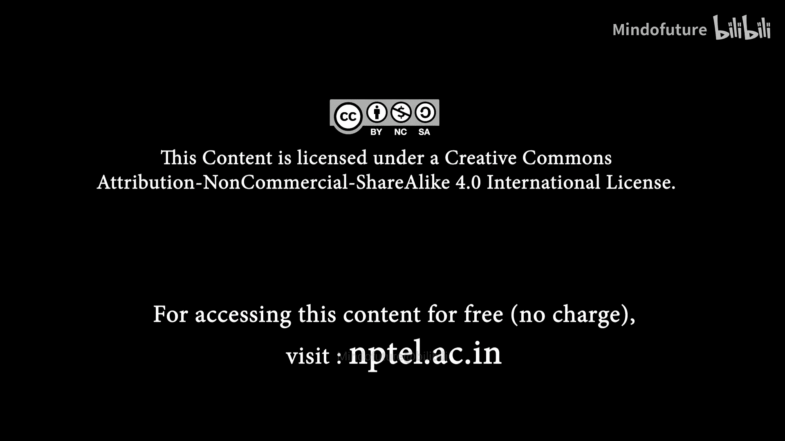
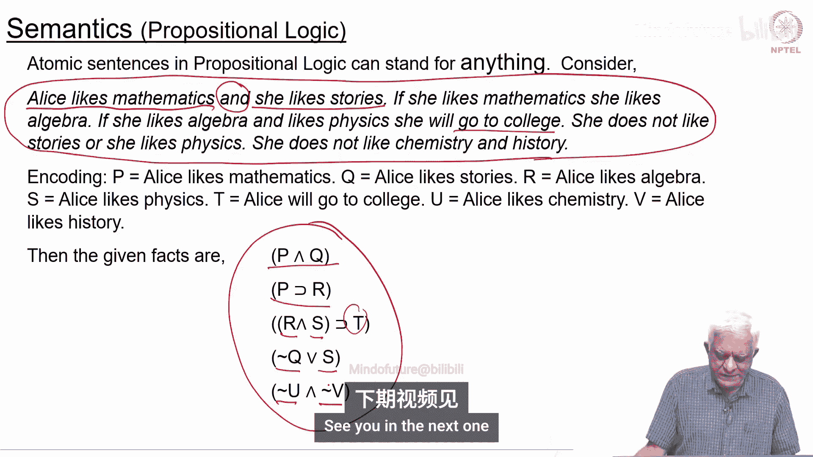

# 023：命题逻辑语义 🧠

在本节课中，我们将学习命题逻辑的语义，即如何确定一个命题公式的真值。我们将从赋值函数开始，探讨公式的三种类型，并通过一个关于爱丽丝的简单故事来实践知识的表示。

## 赋值函数与真值

上一节我们介绍了命题逻辑的语法，即如何构造合式公式。本节中，我们来看看如何为这些公式赋予意义，也就是确定它们的真值。

我们通过一个**赋值函数**来实现这一点。赋值函数 `v` 将每个原子命题符号映射到真值集合 `{True, False}` 中的一个值。

**公式**：`v(P) = True` 或 `v(Q) = False`

这意味着，对于每一个命题符号（如 `P`, `Q`, `R`），我们都可以指定它是真还是假。用户通常不会直接指定所有符号的真值，而是提供一个由原子公式和复合公式组成的知识库（或前提集、公理集）。逻辑推理的任务是：给定这些前提为真，判断其他特定命题是否也为真。

## 连接词的语义

复合公式的真值由其组成部分的真值以及逻辑连接词的语义共同决定。连接词的语义本质上定义了真值表。

例如，对于合取式 `α ∧ β`，其真值规则如下：
*   如果 `α` 为真且 `β` 为真，则 `α ∧ β` 为真。
*   否则，`α ∧ β` 为假。

这简洁地描述了合取的真值表。需要注意的是，我们使用的符号 `∧` 与日常语言中的“且”概念相对应，这纯粹是为了方便。在形式语言中，我们可以定义任何符号，只要为其赋予“两者皆真则真”的语义即可。

## 公式的三种类型

基于在所有可能赋值下的真值表现，命题逻辑中的所有公式可以分为三类。

以下是这三类公式的定义：

1.  **永真式（重言式）**：在所有可能的赋值下都为真的公式。
    *   **示例**：`P ∨ ¬P`
2.  **可满足式**：至少存在一种赋值使其为真的公式。
    *   **示例**：`P ∧ Q`（当 `P` 和 `Q` 同时为真时，该公式为真）。
3.  **矛盾式（不可满足式）**：在所有可能的赋值下都为假的公式。
    *   **示例**：`P ∧ ¬P`

这三类公式的关系如下：
*   永真式集合是可满足式集合的子集。
*   可满足式与矛盾式是互斥的。
*   对于任意永真式 `α`，其否定 `¬α` 就是一个矛盾式。

关于无限集合的大小比较是一个有趣的话题。虽然永真式和矛盾式都是无限集，并且可以通过否定建立一一对应关系，但可满足式集合是永真式集合的真超集。例如，对于任何永真式 `α` 和任意命题 `β`，公式 `α ∧ β` 是可满足的（只要 `β` 为真），但它不是永真式（当 `β` 为假时，它为假）。

## 知识表示实例

现在，让我们通过一个简单的故事来实践如何用命题逻辑表示知识。

假设我们有以下关于爱丽丝的陈述：
1.  爱丽丝喜欢数学，也喜欢故事。
2.  如果她喜欢数学，那么她就喜欢代数。
3.  如果她喜欢代数并且喜欢物理，那么她就会去上大学。
4.  她不喜欢故事，或者她喜欢物理。
5.  她不喜欢化学，也不喜欢历史。

我们首先定义原子命题：
*   `P`：爱丽丝喜欢数学。
*   `Q`：爱丽丝喜欢故事。
*   `R`：爱丽丝喜欢代数。
*   `S`：爱丽丝喜欢物理。
*   `T`：爱丽丝会上大学。
*   `U`：爱丽丝喜欢化学。
*   `V`：爱丽丝喜欢历史。

接下来，将自然语言陈述编码为命题公式：

以下是知识库的命题逻辑表示：

1.  `P ∧ Q`
2.  `P → R`
3.  `(R ∧ S) → T`
4.  `¬Q ∨ S`
5.  `¬U ∧ ¬V`

给定这个知识库（所有公式都为真），我们可以提出推理问题，例如：爱丽丝会去上大学吗？即，在当前设定下，`T` 是否为真？我们将在后续课程中学习如何进行这样的推理。

## 总结

本节课中我们一起学习了命题逻辑的语义核心。我们定义了**赋值函数**，它决定了原子命题的真值。基于此，我们利用**逻辑连接词的语义**（如 `∧`, `∨`, `→`, `¬`）来计算复合公式的真值。最后，我们根据公式在所有可能赋值下的行为，将其分为**永真式、可满足式和矛盾式**三类，并通过一个实例演示了如何将现实世界知识用命题逻辑进行形式化表示。这为后续进行逻辑推理奠定了坚实的基础。