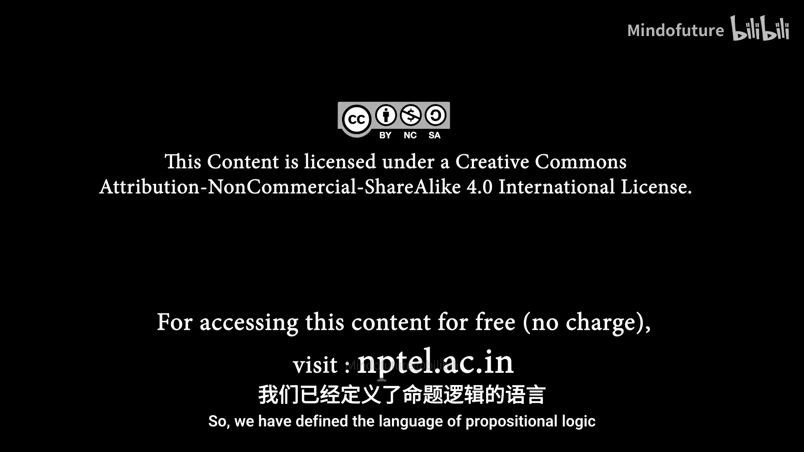
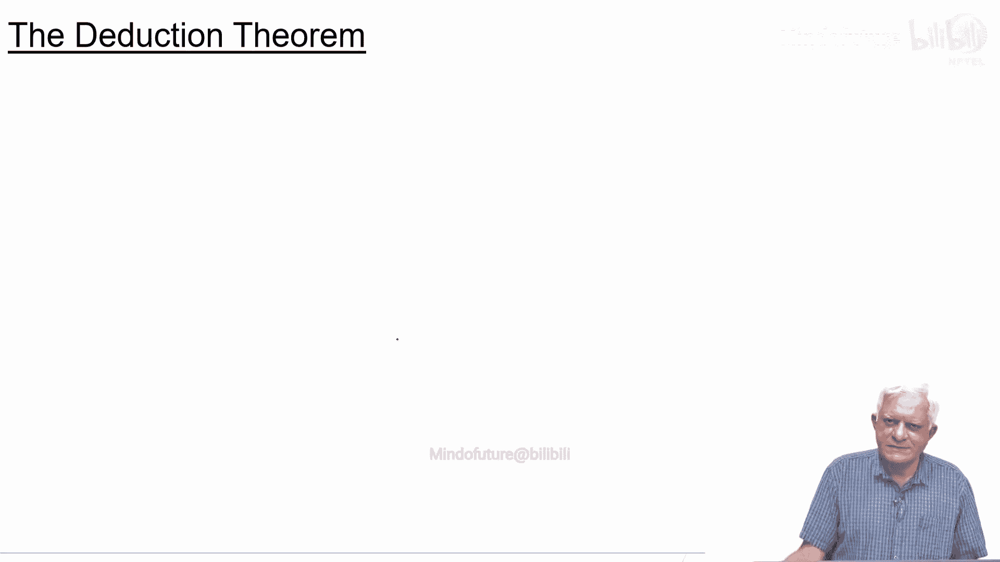

**知识表示与推理：P24：证明与自然演绎**

在本节课中，我们将学习逻辑证明的基本概念，特别是命题逻辑中的自然演绎方法。我们将了解如何从已知前提出发，通过一系列推理规则，最终推导出目标结论。

---

我们已经定义了命题逻辑的语言，讨论了其语法和语义，并看到了如何将知识库表示为命题逻辑公式。现在，我们将重点讨论**证明**。我们将在命题逻辑的背景下探讨证明，这能为我们理解更丰富语言中的证明提供基础。

在逻辑学中，我们通常将已知为真的陈述称为**定理**。例如，毕达哥拉斯定理之所以被称为定理，是因为我们知道它为真。逻辑学家的任务就是能够从一组**公理**出发，推导出这个定理。建立某个陈述是定理的过程，就称为**定理证明**。

定理证明是一个**句法过程**，它关注的是构建证明的句法操作，本质上是一种模式匹配：你看到一个模式，就被允许向知识库或句子集合中添加新的内容。定理证明有多种算法和风格。在本课程中，我们将学习其中几种：
*   第一种是**直接证明**，也称为**自然演绎**或希尔伯特风格证明，这类似于我们在学校书写证明的方式。
*   第二种是**间接证明**，主要是**反证法**。
*   我们还将学习两种方法：**表推演法**和**归结反驳法**。不过，我们不会在命题逻辑中讨论归结法，因为它在一阶逻辑中才真正展现出威力。

我们将从自然演绎或直接证明开始。回想一下我们之前关于爱丽丝的知识库编码，其中包含多个原子命题，例如：
*   `P`：爱丽丝喜欢数学
*   `Q`：爱丽丝喜欢故事
*   `R`：爱丽丝喜欢代数
*   `S`：爱丽丝喜欢物理
*   `T`：爱丽丝将去上学

我们被告知以下公式为真：`P ∧ Q`（爱丽丝喜欢数学和故事），`P → R`（如果爱丽丝喜欢数学，那么她喜欢代数）等。我们的查询目标是：命题 `T`（爱丽丝将去上学）是否为真？换句话说，我们想知道爱丽丝是否会去上学。

让我们看看在学校里通常会如何证明，即不断添加新句子。在直接证明中，我们选择**推理规则**，决定使用哪条规则，并将其结论添加到知识库中。

以下是证明步骤：
1.  从 `P ∧ Q`（前提1），通过**合取简化**规则，可以推导出 `P`（步骤4）。
2.  同样从 `P ∧ Q`，通过合取简化（并理解合取的交换律），可以推导出 `Q`（步骤5）。
3.  我们有 `P → R`（前提2）和刚推导出的 `P`（步骤4）。应用**肯定前件**规则，可以推导出 `R`（步骤6）。
4.  我们有 `¬Q ∨ S`（前提4）和刚推导出的 `Q`（步骤5）。由于 `Q` 为真，`¬Q` 为假，因此根据析取式的语义，`S` 必须为真。这本质上是**析取三段论**的一种形式，推导出 `S`（步骤7）。
5.  现在我们有了 `R`（步骤6）和 `S`（步骤7）。应用**合取引入**规则，得到 `R ∧ S`（步骤8）。
6.  最后，我们有 `(R ∧ S) → T`（前提3）和刚推导出的 `R ∧ S`（步骤8）。再次应用**肯定前件**规则，最终推导出目标 `T`（步骤9）。

这就是自然演绎或直接证明的风格，也是我们自学校以来一直在使用的证明方式。

证明也可以用一个**有向无环图**来形象化表示。顶层的节点是给定的前提，箭头展示了如何推导出新句子。这种视图清晰地展示了从前提（数据）到结论（目标）的推理链条。

关于数学或逻辑证明，一个有趣的点是：当你阅读一个已发表的证明（例如毕达哥拉斯定理的证明）时，你看到的是最终的**产品**。它展示了“因为这些为真，所以那个为真，因此另一个为真……”的链条。然而，**找到**这个证明则是另一回事。这需要数学家或逻辑学家付出努力，本质上是一个**搜索**过程：决定采用哪条推理规则，与哪些事实进行匹配，以及做出什么推断。我们感兴趣的是将这个搜索过程自动化。

证明 `α` 是定理的**证明**，是证明 `α` 为真的最终**成果**和理由。它代表了一系列将给定事实与期望结论连接起来的推理链条。正如我们所见，证明本身是通过搜索过程找到的。

例如，著名的**四色定理**指出：任何画在纸上的平面地图，只需四种颜色就足以使所有相邻区域颜色不同。这个定理的证明花费了很长时间，并且最终是由一个定理证明程序完成的，这正说明了自动化证明搜索的价值。

自然演绎这个过程也可以称为**前向推理**。它是一种数据驱动的推理链。所谓数据驱动，是指我们从数据（已知前提）出发，不断进行推断，直至将目标添加到知识库中。它不展示尝试和错误的过程，只展示最终的证明路径。

这个过程的关键问题当然是：**选择哪条规则？匹配哪些事实？**

---

在本节课中，我们一起学习了命题逻辑中的证明概念，重点介绍了自然演绎（直接证明）方法。我们通过一个具体例子，展示了如何从已知前提一步步应用推理规则（如合取简化、肯定前件等）推导出目标结论。我们还了解到，证明的呈现是最终成果，而找到证明的过程本质上是一个需要自动化处理的搜索过程。接下来，我们将转向其他证明方法，如下节课将介绍的归谬定理。