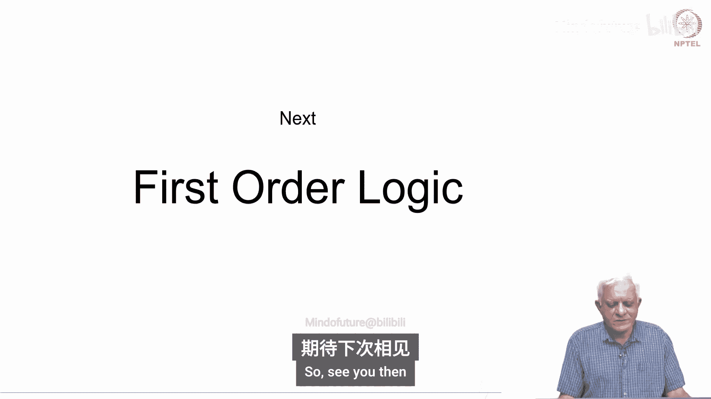

# 025：表方法 📋

在本节课中，我们将学习一种称为“表方法”的间接证明技术。我们将了解如何通过寻找公式否定的模型来证明一个公式是永真式，并学习构建表的具体规则和步骤。

## 概述

表方法是一种用于证明公式是否为永真式的间接证明技术。其核心思想是：若要证明公式 α 是永真式，则尝试为 ¬α 寻找一个模型。如果找不到这样的模型（即 ¬α 不可满足），那么 α 必然是永真式。该方法通过系统地消解逻辑连接词，构建一个树状图（即“表”）来探索所有可能的模型。

## 表方法的构建规则

上一节我们介绍了表方法的基本思想，本节中我们来看看构建表的具体规则。这些规则指导我们如何消解不同的逻辑连接词。

以下是针对四个基本连接词的消解规则：

*   **否定（¬）**：
    *   若遇到 ¬¬X，可将其替换为 X。
    *   若遇到 ¬p（p 为原子命题），则其本身就是一个文字，无需进一步消解。
*   **合取（∧）**：
    *   若要满足 X ∧ Y，则必须在当前分支中同时包含 X 和 Y。公式可标记为已使用。
    *   若要满足 ¬(X ∧ Y)，则必须在当前分支中包含 ¬X 或 ¬Y。这会创建新的分支。
*   **析取（∨）**：
    *   若要满足 X ∨ Y，则必须在当前分支中包含 X 或 Y。这会创建新的分支。
    *   若要满足 ¬(X ∨ Y)，则必须在当前分支中同时包含 ¬X 和 ¬Y。
*   **蕴含（→）**：
    *   若要满足 X → Y，则必须在当前分支中包含 ¬X 或 Y。这会创建新的分支。
    *   若要满足 ¬(X → Y)，则必须在当前分支中同时包含 X 和 ¬Y。

## 表的构建与终止条件

了解了连接词的消解规则后，我们来看看如何具体构建一个表并判断其终止。

构建表的步骤如下：
1.  将待证明公式的否定（¬α）作为表的起点。
2.  选取表中一个尚未标记为“已使用”的复合公式。
3.  根据其主连接词，应用上述规则进行消解。消解后，将该公式标记为“已使用”。
4.  将消解后得到的新公式添加到当前分支（或创建新分支）。
5.  重复步骤 2-4。

每个分支代表一个潜在的模型（即一组使所有公式为真的文字集合）。分支的终止有两种情况：

*   **封闭**：如果某个分支中同时包含某个原子命题及其否定（例如 P 和 ¬P），则该分支存在矛盾，不可能是一个模型。我们用一个叉号（✗）标记该分支为“封闭”。
*   **饱和**：如果某个分支中所有公式都已是文字（原子命题或其否定），且没有矛盾，则该分支提供了一个使 ¬α 为真的模型。

如果所有分支都封闭，则 ¬α 不可满足，从而证明 α 是永真式。如果存在至少一个饱和分支，则找到了 ¬α 的模型，α 不是永真式。

## 示例应用：肯定前件律与肯定后件律

现在，让我们通过两个例子来实践表方法，验证常见的推理规则。

**示例1：证明肯定前件律（Modus Ponens）是可靠的**
我们要证明的公式是：`((P ∧ (P → Q)) → Q)`。假设它是永真式。
1.  我们取其否定作为起点：`¬(((P ∧ (P → Q)) → Q))`。
2.  消解主连接词（否定蕴含）：得到 `(P ∧ (P → Q))` 和 `¬Q`。
3.  消解合取词：得到 `P` 和 `(P → Q)`。
4.  消解蕴含词 `(P → Q)`：产生两个分支。
    *   分支一：包含 `¬P`。该分支同时包含 `P` 和 `¬P`，因此封闭。
    *   分支二：包含 `Q`。该分支同时包含 `Q` 和 `¬Q`，因此也封闭。
5.  所有分支均封闭。因此，原公式的否定不可满足，原公式是永真式。肯定前件律是可靠的推理规则。

**示例2：检验肯定后件律（Affirming the Consequent）**
我们要检验的公式是：`((Q ∧ (P → Q)) → P)`。
1.  取其否定：`¬(((Q ∧ (P → Q)) → P))`。
2.  消解后得到：`(Q ∧ (P → Q))` 和 `¬P`。
3.  消解合取词：得到 `Q` 和 `(P → Q)`。
4.  消解蕴含词 `(P → Q)`：产生两个分支。
    *   分支一：包含 `¬P`。该分支文字集合为 `{Q, ¬P, ¬P}`，无矛盾。
    *   分支二：包含 `Q`。该分支文字集合为 `{Q, ¬P, Q}`，无矛盾。
5.  两个分支都达到饱和且无矛盾，为 `¬α` 找到了模型（例如 `{Q=True, P=False}`）。因此，原公式不是永真式，肯定后件律不是可靠的推理规则。

## 连接词处理顺序的启发式策略

在构建表时，处理公式的顺序会影响表的复杂度和大小。一个有效的启发式策略是：**优先消解不产生分支的连接词**。

*   **不产生分支的操作**：处理合取（∧）以及消解否定形式的析取（¬∨）和否定形式的蕴含（¬→）时，只是向当前分支添加文字。
*   **产生分支的操作**：处理析取（∨）、蕴含（→）以及消解否定形式的合取（¬∧）时，会创建新的分支。

优先处理不产生分支的公式，可以延迟分支的产生，使得表结构在早期保持紧凑，有可能更快地发现矛盾并封闭分支，从而得到更短的证明。

## 总结

本节课中我们一起学习了表方法。这是一种通过为公式的否定寻找模型来进行间接证明的图形化方法。我们掌握了消解 `¬`、`∧`、`∨`、`→` 等连接词的规则，了解了如何通过分支的封闭或饱和来判断证明结果。我们还认识到，在处理公式时，采用“先处理非分支连接词”的启发式策略，可以有效优化证明过程，得到更简洁的表。表方法为我们理解命题逻辑的证明机制提供了直观的工具，其思想也将延续到后续更复杂的一阶逻辑中。