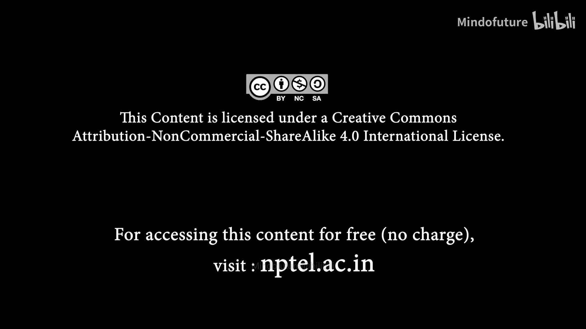
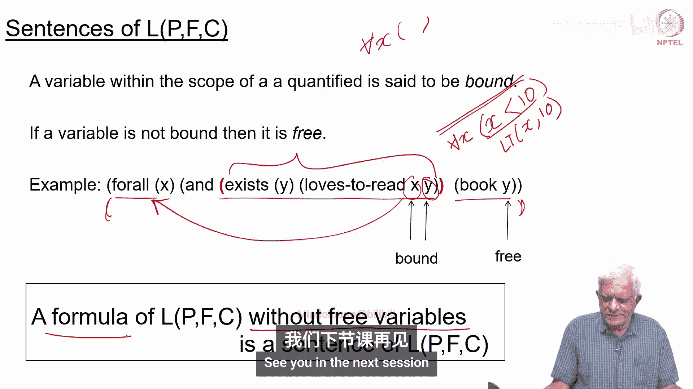

# 027：一阶逻辑语法

## 概述
在本节课中，我们将学习一阶逻辑的语法。我们将从定义构成一阶逻辑语言的基本词汇开始，然后学习如何用这些词汇构建项和公式，并最终定义什么是句子。理解语法是理解一阶逻辑含义和推理的基础。

---

## 逻辑词汇
与命题逻辑类似，一阶逻辑的词汇也分为逻辑部分和非逻辑部分。逻辑词汇是固定的，不依赖于具体讨论的领域。

逻辑词汇包括：
*   **连接词**：`∧` (与)， `∨` (或)， `¬` (非)， `→` (蕴含)。
*   **括号**：`(` 和 `)`。
*   **变量符号**：一个变量符号的集合 `V`，例如 `x`, `y`, `z`, `v1`, `v2` 等。变量用于代表尚未确定的个体。
*   **量词**：有两个新的符号。
    *   **全称量词** `∀`，读作“对于所有”。
    *   **存在量词** `∃`，读作“存在”。
*   **等号**：有时会引入一个特殊的等号符号 `=`。包含等号的一阶逻辑称为“带等式的一阶逻辑”，它赋予了我们额外的推理能力。

---

## 非逻辑（领域特定）词汇
一阶逻辑的非逻辑词汇由三个集合构成，它们定义了具体讨论的领域。

以下是这三个集合：
1.  **谓词符号集合 `P`**：这是一组符号，如 `Man`, `Mortal`, `GreaterThan`。每个谓词符号有一个**元数**，表示它接受多少个参数。它们代表个体之间的关系。
2.  **函数符号集合 `F`**：这也是一组符号，如 `successor`, `sum`, `f`, `g`。每个函数符号也有一个元数。函数代表从个体到个体的映射。
3.  **常量符号集合 `C`**：这是一组代表领域中已知特定个体的符号，如 `0`, `Socrates`, `Delhi`。

语言由这三个集合共同定义。

---

## 项
在构建句子之前，我们需要先构建**项**。项代表领域中的个体。

项集合 `T` 递归定义如下：
*   **基础**：所有变量和常量都是项。
*   **归纳**：如果 `t1, t2, ..., tn` 是项，且 `f` 是一个 `n` 元函数符号，那么 `f(t1, t2, ..., tn)` 也是一个项。

**示例**：
*   `x` (变量)， `7` (常量) 是项。
*   如果 `plus` 是二元函数符号，那么 `plus(7, 13)` 也是一个项，它代表个体 `20`。

---

## 公式与原子公式
公式是我们感兴趣的，因为只有公式（句子）才有真值。项（如 `7`）没有真值。

首先，我们定义**原子公式**，它们是构成复杂公式的基本单位。

原子公式包括：
1.  逻辑常量 `⊥` (假) 和 `⊤` (真)。
2.  **等式原子公式**：如果 `t1` 和 `t2` 是项，那么 `t1 = t2` 是一个原子公式。
3.  **谓词原子公式**：如果 `P` 是一个 `n` 元谓词符号，且 `t1, t2, ..., tn` 是项，那么 `P(t1, t2, ..., tn)` 是一个原子公式。

---

## 合式公式
有了原子公式，我们就可以像在命题逻辑中一样，使用逻辑连接词和量词来构建更复杂的公式。

合式公式集合 `F` 递归定义如下：
*   **基础**：所有原子公式都是公式。
*   **连接词规则**：
    *   如果 `α` 是公式，那么 `¬α` 是公式。
    *   如果 `α` 和 `β` 是公式，那么 `(α ∧ β)`, `(α ∨ β)`, `(α → β)` 都是公式。
*   **量词规则**：
    *   如果 `α` 是公式，且 `x` 是一个变量，那么 `∀x α` 和 `∃x α` 都是公式。

**示例**：
*   `∀n (GreaterThan(n, minus(n, 1)))` 是一个公式，表示“对于所有 n，n 大于 n-1”。
*   `∃x (Man(x) ∧ Bright(x))` 是一个公式，表示“存在一个 x，x 是人且 x 是聪明的”。

---

## 变量：自由与约束
在公式中，变量可以处于两种状态：
*   **约束变量**：如果一个变量出现在量词的**作用域**内，并且与该量词指定的变量同名，则称该变量被该量词**约束**。量词的作用域是紧跟在量词后面的公式部分（通常由括号界定）。
*   **自由变量**：如果一个变量没有被任何量词约束，则称它是**自由**的。

**示例**：
在公式 `∀x (P(x, y) ∧ ∃y (Q(y)))` 中：
*   第一个 `x` 和 `Q(y)` 中的 `y` 被各自的量词约束。
*   `P(x, y)` 中的 `y` 是自由的。

---

## 句子
并非所有合式公式都是句子。只有那些**没有自由变量**的公式才被称为**句子**。

**原因**：包含自由变量的公式的真值无法确定，因为我们不知道自由变量代表什么。例如，`LessThan(x, 10)` 的真假取决于 `x` 的值。而 `∀x (LessThan(x, 10))` 是一个句子，它有确定的真值（在这个例子中为假）。

因此，一阶逻辑的**句子**是**不含任何自由变量的合式公式**。我们主要对句子进行推理。

---

## 总结
本节课我们一起学习了一阶逻辑的语法。
1.  我们首先区分了逻辑词汇（连接词、量词、变量）和非逻辑词汇（谓词、函数、常量）。
2.  接着，我们定义了**项**，它代表领域中的个体。
3.  然后，我们定义了**原子公式**，包括等式和谓词应用。
4.  利用原子公式、连接词和量词，我们递归地定义了**合式公式**。
5.  最后，我们区分了**自由变量**和**约束变量**，并明确了只有不含自由变量的公式才是**句子**，这是我们进行真值赋值和逻辑推理的对象。

下一节，我们将探讨一阶逻辑的语义，即如何为这些句子赋予含义和真值。