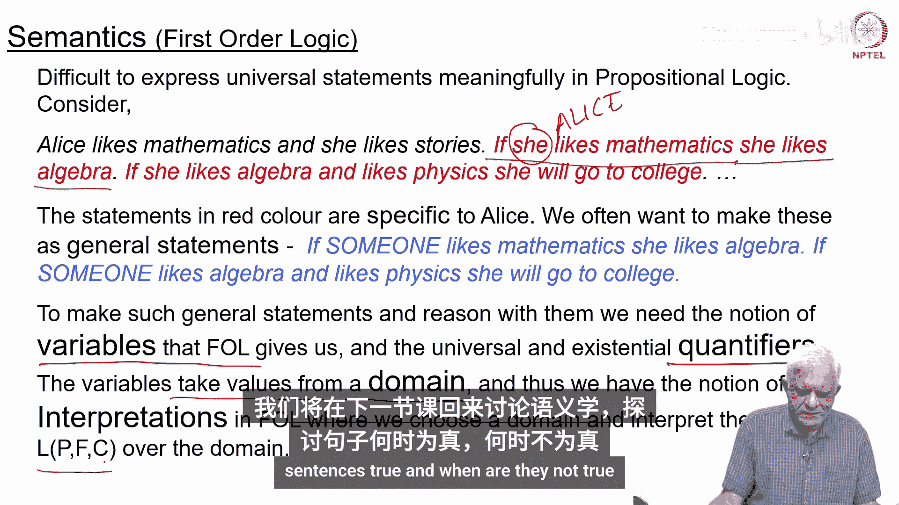

**知识表示与推理：P28：一阶逻辑全称实例化**

在本节课中，我们将学习一阶逻辑中的两个核心推理规则：全称实例化与存在概括。我们将了解它们的定义、作用，并通过例子说明如何使用它们进行推理。同时，我们也会初步探讨量词与逻辑连接词之间的关系，为后续学习语义学打下基础。

上一节我们介绍了一阶逻辑的语法结构，包括项、原子公式、逻辑连接词和量词。本节中，我们来看看如何利用量词进行形式化推理。

### 推理规则：全称实例化与存在概括

由于引入量词，我们需要新的推理规则。最常用的两条规则是全称实例化与存在概括。

**全称实例化** 的规则如下：如果公式 **∀x P(x)** 为真，那么对于定义域中的任意一个特定个体常量 **a**，公式 **P(a)** 也必然为真。这符合我们的直观：如果某个性质对“所有”个体都成立，那么它对“任何一个”具体个体也成立。

**存在概括** 的规则如下：如果对于某个特定的个体常量 **a**，公式 **P(a)** 为真，那么我们可以推出 **∃x P(x)** 为真。这同样直观：如果某个性质对“至少一个”具体个体成立，那么“存在”个体具有该性质。

这两条规则是可靠的，它们为一阶逻辑的形式化推理提供了基础。

### 规则应用示例

以下是应用这些规则的例子。

*   **全称实例化应用**：我们有前提“所有人都是会死的”，形式化为 **∀x (Man(x) → Mortal(x))**。应用全称实例化规则，取个体常量为“苏格拉底”，我们可以推出：**Man(Socrates) → Mortal(Socrates)**，即“如果苏格拉底是人，那么苏格拉底是会死的”。

*   **存在概括应用**：如果我们知道 **Man(Socrates) → Mortal(Socrates)** 为真，那么应用存在概括规则，可以推出 **∃x (Man(x) → Mortal(x))**。请注意，这个句子表达的含义是“存在某个个体，如果它是人，那么它会死”，这与“有些人会死”在逻辑上并不完全等同，此处主要用于展示规则的应用。

### 量词与逻辑连接词的关系

理解量词与命题逻辑中连接词的关系有助于掌握一阶逻辑。我们可以将全称量词 **∀** 视为一个“广义的合取（∧）”，将存在量词 **∃** 视为一个“广义的析取（∨）”。

基于这种视角，德摩根定律在一阶逻辑中有了对应的形式。以下是量词的德摩根定律：

*   **¬∀x P(x) ≡ ∃x ¬P(x)**。并非所有个体都具有性质P，等价于存在某个个体不具有性质P。
*   **¬∃x P(x) ≡ ∀x ¬P(x)**。不存在具有性质P的个体，等价于所有个体都不具有性质P。

这类似于命题逻辑中将否定号移入括号内并翻转连接符号的规则。

此外，对于同种量词，顺序可以交换而不改变含义，例如 **∀x ∀y P(x,y) ≡ ∀y ∀x P(x,y)**。但是，**不同种类量词的顺序不能随意交换**，**∀x ∃y P(x,y)** 与 **∃y ∀x P(x,y)** 的含义通常不同，我们将在后续课程中详细探讨。

### 从命题逻辑到一阶逻辑

在命题逻辑中，我们只能陈述关于特定对象的事实，例如“如果Alice喜欢数学，那么她喜欢代数”。这类似于说“如果苏格拉底是人，那么苏格拉底会死”。

为了表达更一般的规律，例如“所有喜欢数学的人都喜欢代数”，我们需要一阶逻辑。它通过引入**变量**和**量词**，使我们能够陈述关于整个类别或全体个体的普遍性知识，例如 **∀x (LikesMaths(x) → LikesAlgebra(x))**。

变量从定义域中取值，这引出了一阶逻辑的**语义学**概念，即我们需要为一个语言选择一个定义域并解释其中的符号。

本节课中我们一起学习了一阶逻辑的两个基本推理规则——全称实例化与存在概括，并通过例子了解了它们的应用。我们还探讨了量词与逻辑连接词的类比关系，以及量词的德摩根定律。下一节，我们将深入探讨一阶逻辑的语义学，即如何判断一个句子在给定解释下是真还是假。