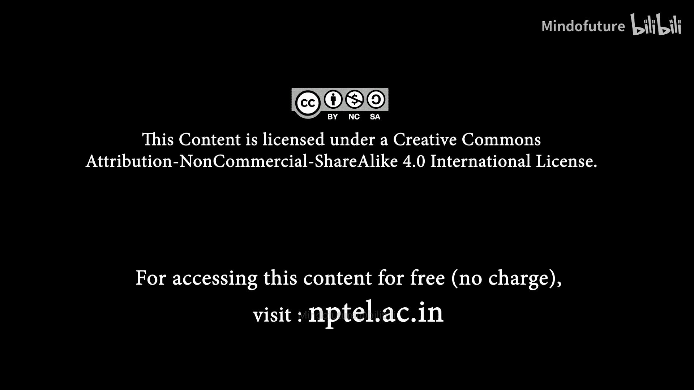
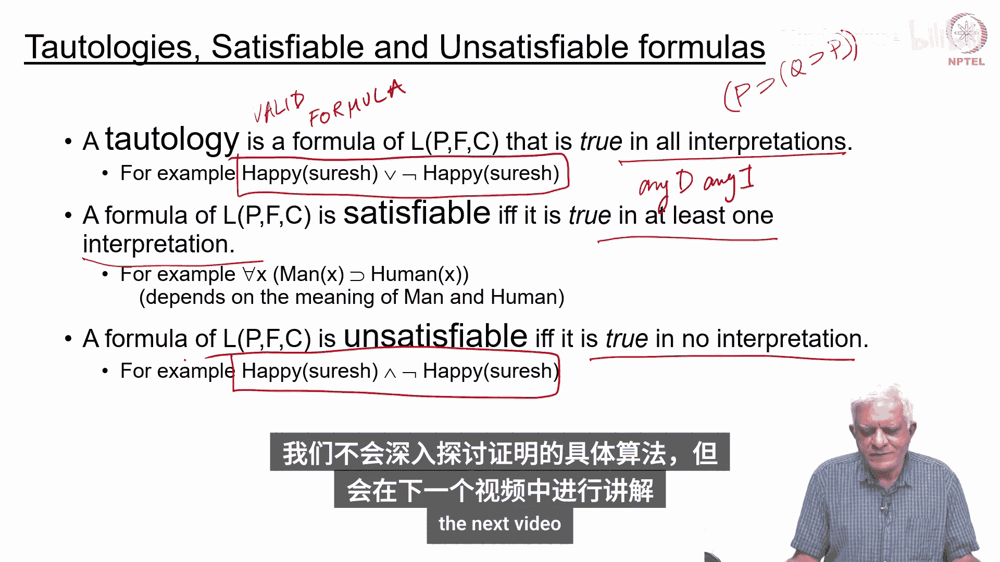

# 030：一阶逻辑真值指派

## 概述
在本节课中，我们将学习一阶逻辑的语义核心——真值指派。我们将了解如何为一个给定的解释和赋值，确定一阶逻辑公式（特别是句子）的真值。这包括处理原子公式、逻辑连接词以及最重要的量词公式。

## 从语法到语义
上一节我们介绍了一阶逻辑的语法和解释。现在，我们来看看如何为一个公式赋予真值。在命题逻辑中，我们使用赋值函数。在一阶逻辑中，我们同样需要一个函数来将公式映射到真值集合 {真， 假}。我们称这个函数为**真值指派函数**。

## 原子公式的真值
我们从最简单的句子开始定义真值。

**真（⊤）** 根据定义永远为真。
**假（⊥）** 根据定义永远为假。

对于使用等号的原子公式，其真值取决于项在解释和赋值下的映射结果。

以下是判断原子公式真值的规则：

*   **等式原子公式**：形如 `t1 = t2` 的公式（其中 `t1` 和 `t2` 是项）在解释 `I` 和赋值 `a` 下为真，当且仅当这两个项在 `I` 和 `a` 下映射到论域中的**同一个元素**。公式表示为：`V_{I,a}(t1 = t2) = 真` 当且仅当 `[t1]_{I,a} = [t2]_{I,a}`。
*   **谓词原子公式**：形如 `Q(t1, ..., tn)` 的公式（其中 `Q` 是谓词符号，`t1, ..., tn` 是项）在解释 `I` 和赋值 `a` 下为真，当且仅当项映射后得到的元素元组，属于谓词 `Q` 在解释 `I` 下对应的关系。公式表示为：`V_{I,a}(Q(t1, ..., tn)) = 真` 当且仅当 `([t1]_{I,a}, ..., [tn]_{I,a}) ∈ I(Q)`。

### 原子公式真值示例
为了更清晰地理解，我们来看几个例子：

*   `color(lily) = white` 为真，如果函数 `color` 将 `lily` 映射到的颜色，与常量 `white` 所指的颜色是论域中的同一个颜色元素。
*   `president(USA) = commander(USA_Army)` 为真，如果这两个函数项映射到同一个人（例如，当前都映射到拜登）。
*   `lessThan(5, 17)` 为真，如果有序对 `(5, 17)` 属于谓词 `lessThan` 所表示的小于关系。
*   `brother(So, Ramish)` 为真，如果有序对 `(So, Ramish)` 属于谓词 `brother` 所表示的兄弟关系。

## 连接词公式的真值
对于由逻辑连接词（如 ¬, ∧, ∨, →）构成的复合公式，其真值指派与命题逻辑中的定义完全一致，基于其子公式的真值通过真值表计算。

例如：
*   如果 `α` 为真，则 `¬α` 为假。
*   `α → β` 只有在 `α` 为真且 `β` 为假时才为假，其他情况均为真。

## 量词公式的真值
处理量词公式是真值指派的核心。我们需要理解“存在”和“所有”的含义。

首先，我们引入一个关键概念：**x-变体赋值**。给定一个赋值 `a`，另一个赋值 `b` 被称为 `a` 的 x-变体，如果 `b` 与 `a` 在所有变量上的赋值都相同，除了可能对变量 `x` 的赋值不同。记作 `b =_x a`。

基于此，我们可以定义量词公式的真值：

以下是量词公式的真值判断规则：

*   **存在量词公式**：形如 `∃x α` 的公式在解释 `I` 和赋值 `a` 下为真，当且仅当**存在**一个 `a` 的 x-变体赋值 `b`，使得子公式 `α` 在解释 `I` 和赋值 `b` 下为真。这捕捉了“存在某个x的值使α成立”的直观含义。例如，在自然数论域中，`∃x Even(x)` 为真，因为我们可以找到赋值 `b`（例如将 `x` 赋值为6），使得 `Even(6)` 为真。
*   **全称量词公式**：形如 `∀x α` 的公式在解释 `I` 和赋值 `a` 下为真，当且仅当**对于所有** `a` 的 x-变体赋值 `b`，子公式 `α` 在解释 `I` 和赋值 `b` 下都为真。这捕捉了“对于所有x的值α都成立”的直观含义。

## 句子与模型
一个重要的概念是**句子**，即不含自由变量的公式。由于句子中所有变量都被量词约束，其真值**不依赖于具体的赋值函数**，而只依赖于解释 `I`。例如，`∃x Even(x)` 的真值只取决于论域和 `Even` 的解释，与初始赋值 `a` 无关。

基于句子的这一特性，我们可以定义**模型**。给定一个句子集合 `Γ`（可称为一个理论），一个解释 `M = (D, I)` 是 `Γ` 的一个模型，当且仅当 `M` 使 `Γ` 中的**每一个**句子都为真。

## 公式的分类
与命题逻辑类似，一阶逻辑公式也可以根据其在所有解释下的真值情况进行分类：

*   **永真式（或有效式）**：一个公式是永真的，如果它在**所有**可能的解释下都为真。例如，`Happy(So) ∨ ¬Happy(So)` 无论 `So` 指代什么、`Happy` 表示什么关系，这个句子总是真的。
*   **可满足式**：一个公式是可满足的，如果它在**至少一个**解释下为真。例如，`∀x (Man(x) → Human(x))` 在我们的常识解释下是可满足的。
*   **不可满足式（或矛盾式）**：一个公式是不可满足的，如果它在**所有**解释下都为假。例如，`Happy(So) ∧ ¬Happy(So)`。

在知识表示中，我们更关心的是为我们的知识库（一组句子）找到一个模型，即一个使其所有句子都为真的解释。

## 总结
本节课我们一起学习了一阶逻辑真值指派的核心内容。我们首先定义了如何为原子公式（包括等式和谓词）赋予真值。接着，我们回顾了连接词的真值计算方式。然后，我们深入探讨了量词公式的真值定义，引入了“x-变体赋值”这一关键工具来形式化“存在”和“所有”的含义。最后，我们区分了句子与一般公式，并基于句子定义了“模型”的概念，以及公式的永真性、可满足性和不可满足性。至此，我们已经掌握了一阶逻辑的语义基础，为后续进行逻辑推理和证明做好了准备。