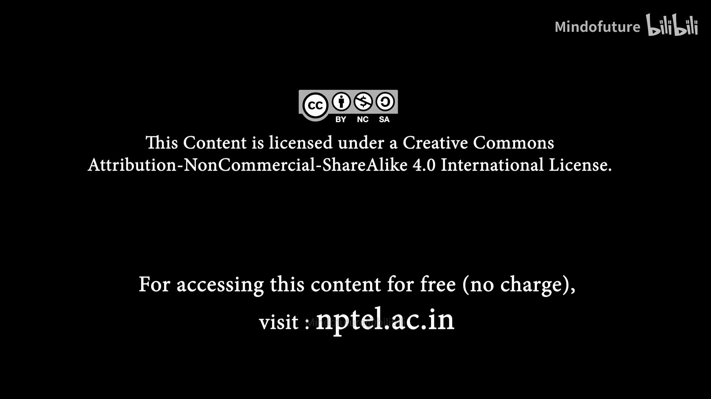
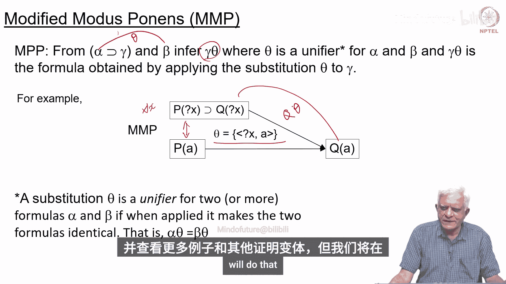

# 031：修正的肯定前件




## 概述

在本节课中，我们将学习一阶逻辑中的推理规则，特别是如何将“全称实例化”和“肯定前件”两个步骤合并为一个更高效的推理规则，即“修正的肯定前件”。我们将通过一个具体的例子来理解这个过程，并介绍“隐式量词记号”和“合一”这两个核心概念，以简化推理的算法实现。

---

## 回顾一阶逻辑

上一节我们介绍了一阶逻辑的语言、语法和语义。语义基于一个**域**和一个**解释映射**。真值函数语义也依赖于域，因为一个原子公式为真，当且仅当它在所描述的域中为真。例如，陈述“Suta是Ambiika的姐妹”为真，当且仅当在现实世界中，这个姐妹关系确实存在。

我们的主要目标是研究如何为公式寻找**证明**，并关注如何将这个过程**自动化**，即寻找能够实现自动推理的算法。

---

## 爱丽丝问题示例

让我们从熟悉的“爱丽丝问题”开始，并用一阶逻辑来表达它。

1.  **前提1**：`∀x (Likes(x, math) → Likes(x, algebra))`
    *   含义：对于所有x，如果x喜欢数学，那么x喜欢代数。
2.  **前提2**：`Likes(alice, math)`
    *   含义：爱丽丝喜欢数学。
3.  **前提3**：`∀x ((Likes(x, algebra) ∧ Likes(x, physics)) → GoesToCollege(x))`
    *   含义：对于所有x，如果x喜欢代数并且喜欢物理，那么x会上大学。
4.  **前提4**：`Likes(alice, stories) ∨ Likes(alice, physics)`
    *   含义：爱丽丝喜欢故事或者喜欢物理。
5.  **前提5**：`¬Likes(alice, stories)`
    *   含义：爱丽丝不喜欢故事。

**目标**：证明 `GoesToCollege(alice)`，即爱丽丝会上大学。

---

## 标准推理过程

以下是使用标准推理规则（包括全称实例化）的证明步骤：

1.  从前提4和前提5，通过**析取三段论**，推出：`Likes(alice, physics)`。
2.  从前提1，通过**全称实例化**（将x替换为alice），推出：`Likes(alice, math) → Likes(alice, algebra)`。
3.  从前提2和步骤2的结论，通过**肯定前件**，推出：`Likes(alice, algebra)`。
4.  从步骤3和步骤1的结论，通过**合取引入**，推出：`Likes(alice, algebra) ∧ Likes(alice, physics)`。
5.  从前提3，通过**全称实例化**（将x替换为alice），推出：`(Likes(alice, algebra) ∧ Likes(alice, physics)) → GoesToCollege(alice)`。
6.  从步骤4和步骤5的结论，通过**肯定前件**，最终推出目标：`GoesToCollege(alice)`。

这个过程表明，**肯定前件**规则要求前提必须**精确匹配**。我们不能直接将 `Likes(alice, math)` 与 `∀x (Likes(x, math) → Likes(x, algebra))` 匹配，因为后者包含变量x。因此，我们需要先使用**全称实例化**规则生成一个具体的命题（如 `Likes(alice, math) → Likes(alice, algebra)`），然后再应用肯定前件。

---

## 隐式量词记号

为了简化算法实现，我们希望避免显式地书写和处理量词。为此，我们引入**隐式量词记号**。

以下是其转换规则：
*   **全称量词变量**：在每个全称量词变量前加上问号 `?`。这表示该变量是隐式全称量化的。
*   **存在量词变量**：对于不在任何全称量词范围内的存在量词变量，用一个**斯柯伦常量**（如 `Sk1`, `Sk2`）替换。这是一个新发明的常量名，不属于原始语言。

应用此规则，我们的示例前提变为：

1.  `Likes(?x, math) → Likes(?x, algebra)`
2.  `Likes(alice, math)`
3.  `(Likes(?x, algebra) ∧ Likes(?x, physics)) → GoesToCollege(?x)`
4.  `Likes(alice, stories) ∨ Likes(alice, physics)`
5.  `¬Likes(alice, stories)`

**注意**：量词 `∀x` 和 `∃x` 不再显式写出，但其含义通过变量标记得以保留。

---

## 合一与替换

为了合并推理步骤，我们需要两个核心概念：**替换**和**合一**。

**替换** 是一个将变量映射到项（常量、变量或函数）的操作。形式上，一个替换 `θ` 是一组形如 `{v1/t1, v2/t2, ...}` 的集合，表示将变量 `vi` 替换为项 `ti`。将替换 `θ` 应用于公式 `α` 的结果记为 `αθ`。

**合一** 是寻找一个替换，使得两个或多个公式在应用该替换后变得**句法完全相同**。如果存在一个替换 `θ` 使得 `αθ = βθ`，则称 `θ` 是 `α` 和 `β` 的**合一子**。

例如，公式 `Likes(?x, math)` 和 `Likes(alice, math)` 可以通过替换 `θ = {?x/alice}` 进行合一，因为应用后两者都变成 `Likes(alice, math)`。

---

## 修正的肯定前件规则

现在，我们可以引入核心规则——**修正的肯定前件**。它将全称实例化和肯定前件合并为一步。

**规则形式**：
从 `α → γ` 和 `β`，可以推出 `γθ`。
其中，`θ` 是 `α` 和 `β` 的**最一般合一子**，`γθ` 是将替换 `θ` 应用于 `γ` 得到的结果。

**用公式表示**：
```
如果存在合一子 θ 使得 αθ = βθ，
那么从 (α → γ) 和 β 可以推出 γθ。
```

**用代码/伪逻辑表示**：
```
function modified_modus_ponens(alpha_implies_gamma, beta):
    theta = unify(alpha_implies_gamma.antecedent, beta)
    if theta is not None:
        return apply_substitution(alpha_implies_gamma.consequent, theta)
    else:
        return None
```

---

## 应用修正的肯定前件

让我们用隐式量词记号和修正的肯定前件规则，重新推导爱丽丝问题的结论。

**知识库（隐式形式）**：
1.  `Likes(?x, math) → Likes(?x, algebra)`
2.  `Likes(alice, math)`
3.  `(Likes(?x, algebra) ∧ Likes(?x, physics)) → GoesToCollege(?x)`
4.  `Likes(alice, stories) ∨ Likes(alice, physics)`
5.  `¬Likes(alice, stories)`

**推导过程**：
1.  从前提4和5，通过析取三段论，推出：`F1: Likes(alice, physics)`。
2.  **应用修正的肯定前件**：
    *   规则：`α → γ` = `Likes(?x, math) → Likes(?x, algebra)`
    *   事实：`β` = `Likes(alice, math)`
    *   合一：`α` (`Likes(?x, math)`) 和 `β` (`Likes(alice, math)`) 的合一子 `θ` 是 `{?x/alice}`。
    *   推导：将 `θ` 应用于 `γ` (`Likes(?x, algebra)`)，得到 `F2: Likes(alice, algebra)`。
3.  从 `F2` 和 `F1`，通过合取引入，推出：`F3: Likes(alice, algebra) ∧ Likes(alice, physics)`。
4.  **再次应用修正的肯定前件**：
    *   规则：`α → γ` = `(Likes(?x, algebra) ∧ Likes(?x, physics)) → GoesToCollege(?x)`
    *   事实：`β` = `F3` (`Likes(alice, algebra) ∧ Likes(alice, physics)`)
    *   合一：`α` 和 `β` 的合一子 `θ` 同样是 `{?x/alice}`。
    *   推导：将 `θ` 应用于 `γ` (`GoesToCollege(?x)`)，得到最终目标：`GoesToCollege(alice)`。

可以看到，通过使用**修正的肯定前件**，我们无需显式地进行“全称实例化”这一步。算法通过**合一**操作自动找到了合适的替换（`?x/alice`），从而直接完成了推理。

---

## 总结

本节课中，我们一起学习了：
1.  **回顾了一阶逻辑的语义和证明目标**。
2.  通过**爱丽丝问题**，分析了标准推理中“全称实例化”与“肯定前件”分开使用的过程。
3.  引入了**隐式量词记号**来简化公式表示，将全称变量标记为 `?x`，并用斯柯伦常量处理存在变量。
4.  定义了**替换**和**合一**这两个关键概念，它们是自动化推理的基石。
5.  重点学习了**修正的肯定前件**规则，它通过**合一**操作，将两个推理步骤合并为一步，从而更高效地从一般规则和具体事实推导出新结论。



这种方法为构建自动定理证明器和前向链推理引擎提供了核心机制。在接下来的课程中，我们将探讨更复杂的例子和推理策略。