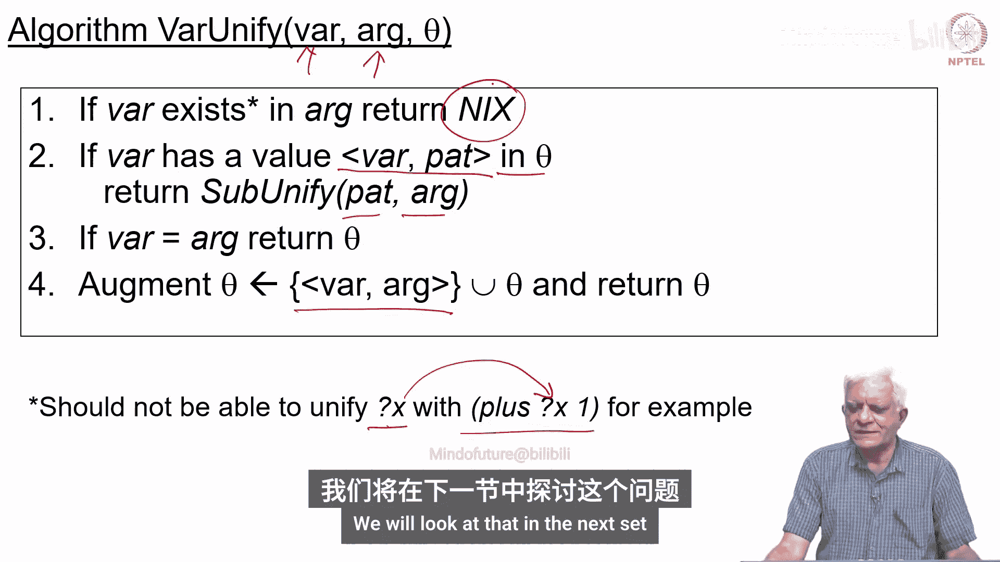

# 032：合一算法 🧩


在本节课中，我们将学习一阶逻辑中一个核心的推理算法——合一算法。我们将了解它如何通过匹配和替换变量，将通用的逻辑规则与具体事实相结合，从而高效地进行推理，而无需进行繁琐的猜测。

---

## 改进的肯定前件规则

上一节我们讨论了需要先进行全称实例化才能应用肯定前件规则的局限性。本节中，我们来看看一个改进的规则，它可以直接处理使用隐式量词表示的一阶逻辑公式。

这个改进的规则将变量替换过程内置其中，称为**改进的肯定前件规则**。其核心思想是：当规则的前提 `P(x)` 与已知事实 `P(a)` 匹配时，我们不是先猜测 `x` 的值，而是直接寻找一个**合一子**，使得 `P(x)` 和 `P(a)` 变得相同。然后，将这个合一子应用到规则的结论 `Q(x)` 上，一步完成推理。

**公式表示**：
给定规则 `P(x) → Q(x)` 和事实 `P(a)`，通过合一子 `θ = {x/a}`，我们可以直接推导出 `Q(a)`。

让我们看一个例子。

以下是应用该规则的一个具体示例：
*   **已知事实 α**：`Sport(tennis) ∧ Likes(alice, tennis)`
*   **已知规则 β**：`∀x∀y [Sport(y) ∧ Likes(x, y) → Watches(x, y)]`
*   **目标**：推断 `Watches(alice, tennis)`

推理过程如下：
1.  寻找事实 α 与规则 β 前件的合一子。我们需要匹配 `Sport(y)` 与 `Sport(tennis)`，以及 `Likes(x, y)` 与 `Likes(alice, tennis)`。
2.  得到合一子 `θ = {x/alice, y/tennis}`。
3.  将 θ 应用到规则 β 的结论 `Watches(x, y)` 上，得到 `Watches(alice, tennis)`。

这个过程比先进行全称实例化再进行肯定前件更直接，也更容易在程序中实现。

---

## 处理合取前提与合一的概念

现实世界中的规则前提常常是多个条件的合取，例如 `P1(x) ∧ P2(x) → Q(x)`。如果这些条件作为独立的事实给出，理论上我们需要先用合取规则将它们组合，再应用改进的肯定前件规则。

然而，我们可以进一步优化推理过程。我们可以设计规则，使其能够直接匹配多个独立的事实，而无需显式地生成合取式。这本质上是将合取规则与改进的肯定前件规则合并为一步。

现在，我们有了这个内置了匹配（合一）过程的改进推理规则。这个寻找合一子的算法，就叫做**合一算法**。在深入算法之前，我们需要理解几个相关概念。

### 公式的“更一般”关系

我们说一个句子 **α** 比句子 **β** 更一般，如果存在一个**非空**的替换 λ，使得应用 λ 到 α 后能得到 β。

**公式表示**：
`α` 比 `β` 更一般，当且仅当存在非空替换 `λ`，使得 `αλ = β`。

例如：
*   “每个人都喜欢好老师” 比 “每个人的父亲都喜欢好老师” 更一般。（替换：将“人”替换为“人的父亲”）
*   “每个人都喜欢好老师” 比 “苏雷什喜欢好老师” 更一般。（替换：将“每个人”替换为“苏雷什”）

基于此，我们可以定义**广义全称实例化**：在实例化全称量词变量时，我们不仅可以将其替换为常量，还可以替换为包含函数的项，只要该替换保持逻辑有效性。

### 前向链接推理与最一般合一子

让我们看一个在前向链接推理中使用合一的例子。

假设知识库中有以下两个公式：
1.  **规则 R1**：`∀y∀z [GreaterThanOrEqual(y, z) → LessThanOrEqual(z, y)]`
2.  **事实 F1**：`∀x [GreaterThanOrEqual(x, 0)]`

我们可以进行如下推理：
*   一个可能的替换是 `{y/7, z/0, x/7}`。应用后，R1 变为 `GreaterThanOrEqual(7, 0) → LessThanOrEqual(0, 7)`，F1 变为 `GreaterThanOrEqual(7, 0)`，从而推出 `LessThanOrEqual(0, 7)`。
*   另一个替换是 `{y/x, z/0}`。应用后，R1 变为 `GreaterThanOrEqual(x, 0) → LessThanOrEqual(0, x)`，与 F1 匹配，从而推出 `LessThanOrEqual(0, x)`。这个结论意味着“0小于或等于任何数”。

第二种替换产生的结论 `LessThanOrEqual(0, x)` 比第一种产生的 `LessThanOrEqual(0, 7)` **更一般**。我们称这种能产生最一般结论的合一子为**最一般合一子**。

**最一般合一子非常有用**，因为它能得出知识库所能支持的最具普遍性的结论。之后，我们可以通过全称实例化，从这个一般性结论中推导出任何需要的具体实例。

---

## 合一算法详解 🛠️

合一算法接收两个（或多个）公式作为输入，并返回它们的**最一般合一子**。在实现中，公式通常用列表结构表示。

公式中的基本元素有三类：
1.  **变量**：如 `x`, `y`, `z`。
2.  **常量**：如 `alice`, `tennis`, `0`。
3.  **列表**：表示谓词、函数或复合逻辑公式，如 `(P x)`, `(Plus 1 2)`。

算法通过递归地比较两个公式的结构来构建替换 θ。

### 算法的核心匹配规则

1.  **常量匹配**：两个常量只有当它们完全相同时才能合一。
2.  **列表匹配**：两个列表通过逐元素递归地合一其内部成员来匹配。前提是它们长度必须相同。
3.  **变量匹配**：一个变量可以与另一个变量、一个常量或一个列表匹配。但有一个重要限制：变量不能与任何**包含它自身**的项合一（例如，`x` 不能与 `(f x)` 合一），否则会导致无限循环。

### 一个重要前提：变量标准化分离

在应用合一算法前，有一个至关重要的步骤：**变量标准化分离**。即确保知识库中不同公式使用的变量名称互不相同。

例如，规则 `∀x [P(x) → Q(x)]` 和事实 `∀x [P(x)]` 都使用了变量 `x`。如果直接合一，我们无法为 `x` 同时分配两个不同的值。解决方法是在引入每个公式时，对其变量进行重命名，例如将事实重写为 `∀x1 [P(x1)]`。这样，合一 `{x/x1}` 就不会产生冲突。

### 算法伪代码描述

以下是合一算法的高层描述，采用函数式风格：

```lisp
function UNIFY(arg1, arg2):
    return SUB-UNIFY(arg1, arg2, {}) // 初始替换为空集

function SUB-UNIFY(arg1, arg2, theta):
    if arg1 和 arg2 都是相同的常量:
        return theta
    else if arg1 是变量:
        return VAR-UNIFY(arg1, arg2, theta)
    else if arg2 是变量:
        return VAR-UNIFY(arg2, arg1, theta) // 确保第一个参数是变量
    else if arg1 和 arg2 都是列表:
        if 两个列表长度不同:
            return FAIL
        else:
            for i 从 1 到 列表长度:
                theta = SUB-UNIFY(arg1[i], arg2[i], theta)
                if theta == FAIL: return FAIL
            return theta
    else:
        return FAIL

function VAR-UNIFY(var, x, theta):
    if var 出现在 x 中: // 发生检查
        return FAIL
    else if (var/value) 已存在于 theta 中:
        return SUB-UNIFY(value, x, theta) // 与已绑定的值合一
    else if var == x:
        return theta // 无需操作
    else:
        return theta ∪ {var/x} // 将新的绑定加入替换集
```

### 算法的通用性

需要注意的是，这个合一算法并不局限于一阶逻辑。只要能够区分“函子”（组织结构的符号，如谓词、函数、连接词，在列表中体现）和“原子项”（变量和常量），该算法就可以用于任何基于模式的合一任务。

---

## 总结

本节课中，我们一起学习了以下核心内容：

1.  **改进的肯定前件规则**：通过内置的合一过程，该规则能够直接对一阶逻辑公式进行一步推理，避免了先实例化再匹配的繁琐和猜测。
2.  **合一与最一般合一子**：合一是使两个公式变得相同的替换过程。最一般合一子能产生最一般性的结论，是高效推理的关键。
3.  **变量标准化分离**：在自动化推理前，必须重命名不同公式中的变量，以避免命名冲突，这是算法正确运行的前提。
4.  **合一算法**：我们详细剖析了递归的合一算法，它通过比较常量、变量和列表结构，并遵守“发生检查”等规则，来计算出最一般合一子。



掌握合一算法是理解一阶逻辑自动推理的基础。在下一节中，我们将探讨当存在量词出现在全称量词范围内时，应如何处理。