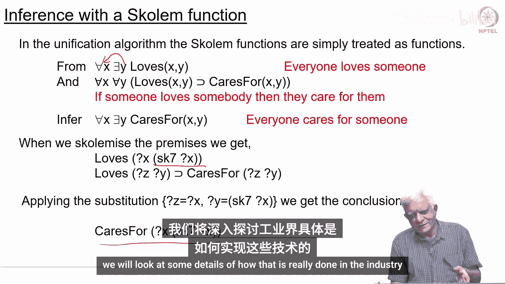

# 033：斯科伦化

在本节课中，我们将要学习斯科伦化的概念。这是将一阶逻辑公式转换为不含存在量词的标准形式的关键步骤，对于后续的推理算法至关重要。我们将学习其规则，并通过多个例子来理解如何正确应用斯科伦化，特别是处理量词嵌套和否定时需要注意的细节。

上一节我们介绍了用于推理的合一算法。在隐式量词表示法中，我们使用该算法进行推理。

我们在前向链接的上下文中看到了它，但正如我们将要看到的，在任何其他形式中，我们也将使用隐式量词形式。因此，我们不会使用量词符号。

我们之前说过，对于全称量化的变量，你在变量名前加上问号，以标记它是全称量化的。这意味着在公式的最左边隐含地存在一个全称量词，但我们没有把它写下来。

那么存在量化的变量呢？我们在这里提到了一些情况，现在让我们来详细讨论。

## 斯科伦化规则

当存在量词不在任何全称量词的辖域内时，该存在量化变量被替换为一个斯科伦常量。

斯科伦是一位首先提出这个想法的逻辑学家或数学家。

请看以下例子。

第一个例子是“有些学生是聪明的”或“某个学生是聪明的”，我们将其写作 `∃z (Student(z) ∧ Bright(z))`。

红色表达式是数学符号，黑色表达式是列表符号，但它们本质上说的是同一件事。

第二个例子是“存在一个女孩，所有男孩都喜欢她”。这是一个非常受欢迎的女孩。

你可以这样说。这些将被斯科伦化，因为存在量词不在任何全称量词的辖域内。

我们只需用斯科伦常量替换它们。

在第一个例子中，我们简单地将 `z` 替换为 `Sk1`。

在第二个例子中，我们将那个女孩 `y`（`∃y`）替换为 `Sk2`。

注意我们选择了第二个常量名 `Sk1` 和 `Sk2`。而 `x` 是全称量化的，它在我们的公式中保持全称量化，我们使用隐式量词表示法，在其下方加上问号。

那么，当存在量词在一个或多个全称量词的辖域内时呢？

当存在量词在一个或多个全称量词的辖域内时，该存在量化变量成为相应全称量化变量的斯科伦函数。

这个例子应该能清楚地说明这一点。

第一个例子是 `∀x ∀y ∃z (x < z ∧ y < z)`。

我们显然在谈论数字之类的东西。意思是，你给我任意两个数 `x` 和 `y`，我都能给你一个比它们都大的数 `z`。

这里，变量 `z` 在两个变量 `x` 和 `y` 的辖域内。你可以看到，顶行的 `∀x ∀y` 是整个句子的辖域。

在这种表示法中，你写下变量名，然后在括号内写下该变量的辖域内容。

还要注意，这里我们把 `x` 和 `y` 组合在一起，而不是写成 `∀x ∀y`。两种写法都是允许的，你也可以写成 `∀x, y`。

这里有另一个例子：`∀x (Boy(x) → ∃y (Girl(y) ∧ Likes(x, y)))`。

这也可以说明如何书写一阶逻辑句子。

第一个句子是“存在一个所有男孩都喜欢的女孩”。我们在前面的例子中看到过这个。

现在我们看到一些不同的东西。我们说“每个男孩都喜欢某个女孩”。在英语中，这可能令人困惑。你可以简单地说“每个人都喜欢某个女孩”之类的话。它的真正含义是什么？当我们用逻辑书写时，含义就很清楚了。

在一种情况下，存在一个所有人都喜欢的女孩。这也可以用英语说成“每个人都喜欢某个女孩”。

在第二种情况下，对于每个男孩，存在一个该男孩喜欢的女孩。我们也可以用英语说成“每个男孩都喜欢一个女孩”。

那么，这个女孩是特定于这个男孩的，还是对所有人都一样的？这在英语中不清楚。英语就是这样有歧义的，但逻辑使其非常清晰。

无论如何，在本页的这个例子中，两个句子都有一个存在量化变量在全称量化变量的辖域内。

在这个例子中，`y` 在 `x` 的辖域内；在另一个例子中，`z` 在 `x` 和 `y` 的辖域内。因此，必须适当地构造斯科伦函数。

在第一个例子中，`z` 在 `x` 和 `y` 的辖域内，它变成了一个斯科伦函数。我们为函数使用类似的名字，因为上下文使其清晰。这个函数被称为 `Sk57`，它是 `x` 和 `y` 的函数。在某种意义上，我们说 `z` 的值取决于 `x` 和 `y` 的值，在这个意义上，它是一个函数。它不是一个像 `2+4` 总是等于 `6` 那样的函数。这里的函数是一种依赖关系，即能使这个句子为真的值取决于 `x` 和 `y` 的值，所以它是两者的函数。

在第二个例子中，我们有 `Sk16`，它是 `x` 的函数。因为那个女孩是特定于那个男孩的。

## 量词与否定

现在，快速回顾一下我们之前讨论过的替换规则。我们有德摩根定律，它指出你可以将否定符号向内推。你可以将它推过量词，但它会改变量词的性质。

当你将否定向内移动时，全称量词变为存在量词，存在量词变为全称量词。我建议你，如果你把全称量词看作一个很长的“与”运算，它对域中的第一个元素、第二个元素、第三个元素都为真，但把它看作一个命题公式，那么德摩根定律在这里也做同样的事情。

我们说过，你总是可以交换相同量词的书写顺序。

我们已经通过这个男孩女孩的例子看到，如果量词不同，改变顺序会改变含义。所以，如果我说 `∀x ∃y P(x, y)`，这不等于 `∃y ∀x P(x, y)`。在第二种情况下，`y` 首先被固定，然后我们说对于每个 `x` 都为真；在第一种情况下，我们说对于每个 `x`，存在某个 `y`。显然含义不同。

因此，你不能交换表达式中不同类型的量词，但如果它们是相同的，如这里给出的例子，那么你可以交换它们，这不会改变任何东西。

有时，一个变量是全称量化的还是存在量化的并不那么清楚。让我们看几个例子来帮助我们澄清这部分。

## 仔细判断量词类型

这里我说，必须非常仔细地决定一个变量是全称量化的还是存在量化的。必须记住，否定符号会影响量词的性质，这就是我们回顾德摩根定律的原因。如果你将否定向内推，它将改变量词。

想想这个句子。我们想说“没有人是不朽的”或“不朽的人不存在”，这是一回事，也就是“所有人都会死”的另一种说法。

当你说“所有人都会死”时，它的否定是“没有人会死”或“存在一个人不会死”。

所以当你想说“一个不朽的人不存在”时，我们将“不朽”视为“不会死”。这就是这里写的方式。所以“不朽”与“不会死”相同。

我们想说一个不朽的人不存在。我们说：并非存在一个 `x`，使得 `x` 是人且 `x` 不会死。

这里 `x` 的性质是什么？从语法上看，那里似乎有一个存在量词 `∃x`。所以表面上它被一个存在量词约束；这就是我在这里说的。因此，人们可能会错误地将其斯科伦化为一个斯科伦常量。但这只谈论一个特定的（尽管未指定的）个体。这个带有斯科伦常量的句子说，这不是真的。本质上，这个句子将存在量词放在外面：存在一个 `x`，使得这两件事都不成立。

斯科伦化公式的正确方法是首先将否定符号向内推。一旦你将这个否定符号推过量词，它将变成全称量词。然后你可以看到，它是一个全称量化变量。你在说：对于每个 `x`，这是真的：`x` 是人且 `x` 不会死，这不是真的。

简单的教训是：在决定变量是全称还是存在之前，必须先将否定向内推。

看这个句子：“如果存在一个既是偶数又是奇数的数，那么地球被淹没了。”

现在我们把它写成：`(∃x (Number(x) ∧ Even(x) ∧ Odd(x))) → EarthFlooded`。这是一个前件：如果存在一个数 `x` 是偶数且是奇数，那么后果是地球被淹没了，这与 `x` 完全没有联系。

我们现在可以在这里使用一些替换规则。通过说这个蕴含式，我们将用 `¬(∃x ...) ∨ EarthFlooded` 替换它。记住我们说过 `p → q` 等价于 `¬p ∨ q`。这就是我们在这里所做的。然后我们将否定向内推，得到的结果再进行一些处理，最终我们得到相同的句子：`x` 是一个数且 `x` 是偶数且 `x` 是奇数，这蕴含地球是平的，但量词变成了全称。

这似乎暗示了以下内容：因为在这个前件中有一个存在量词，所以前件是 `p`。但那里已经隐含了一个否定。如果我们进行我们刚刚看到的这个过程，你可以看到这实际上是一个全称量化的陈述。所以当我们说“如果存在一个数...”，或者说“如果存在一个独角兽，那么...”，我们同样是在说：对于所有既是奇数又是偶数的数（或对于所有独角兽），它们将蕴含地球是平的。

另一个例子将最终使其清晰。我希望如此。

这个句子说：“没有搭档的侦探是成功的。”如果你看过侦探系列，他们总是有一个搭档，比如福尔摩斯和华生。每个人身边都有一个人。这也表明，蕴含语句前件中的量词必须小心处理。

这个句子说：对于所有 `x`，如果 `x` 是侦探且存在一个 `y` 是 `x` 的搭档，那么 `x` 是成功的。

我们现在要小心。这个存在量词在蕴含符号的前件中。因此，那里已经隐含了一个否定。所以要小心你如何思考 `y` 是全称的还是存在的？表面上，它看起来是存在的。但是，如果你现在简化这个公式，我们又做了同样的事情：我们用 `¬(...) ∨ ...` 替换了这个东西，并在前面加了一个否定。然后我们简化了这个，将否定向内推，然后将全称量词提出来（这总是可以做到的，稍后当我们做这个时会看一个过程），然后我们基本上得到了一个全称量化变量。

所以这说的是：对于所有 `x` 和所有 `y`，如果 `x` 是侦探且 `y` 是 `x` 的搭档，那么 `x` 是成功的。这正是我们一开始说的：对于所有 `x`，如果 `x` 是侦探且存在一个 `y` 是 `x` 的搭档，那么 `x` 是这个。

因此，要吸取的教训是：每当有一个量词在前件中，它通常意味着，如果你设法把它提出来，它会变成另一种量词。

## 在证明中使用斯科伦项

很快地，假设我们的知识库中有斯科伦常量，因为我们有存在语句。我们能在证明中使用它们吗？

这里有一个例子。第一个句子是：存在一个 `x`，使得 `x` 是偶数。第二个句子是：对于所有 `x`，如果 `x` 是偶数，那么 `x` 不是奇数。你想推断出：存在一个不是奇数的数。

我们将它们斯科伦化如下。第一个说：某个偶数。所以不用 `Sk` 名字，我就用这样的名字。所以有一个斯科伦常量 `a`，它是一个偶数。这个斯科伦常量是一个常量，我们不知道它指向什么，它只是说域中有某个东西满足这个性质。这是因为在存在量化中，我们不知道你在谈论哪个 `x`。

第二个当然是全称的，它说：对于每个 `x`，如果 `x` 是偶数，那么 `x` 不是奇数。

我们可以简单地继续使用我们的标准替换和合一，推断出存在某个不是奇数的偶数。所以，这是可行的。

一个斯科伦常量也可以被看作是一个零元函数。但这不是重点。斯科伦函数也简单地被视为函数。

这里有一个例子。第一个句子是：对于所有 `x`，存在一个 `y`，使得 `x` 爱 `y`（每个人都爱某人）。第二个句子是：对于所有 `x` 和所有 `y`，如果 `x` 爱 `y`，那么 `x` 关心 `y`（如果某人爱某人，那么他们关心他们）。

由此我们想推断出每个人都关心某人。显然，这在逻辑上是成立的，是被蕴含的。因为你首先说每个人都爱某人，然后你说你爱你关心的人，所以显然每个人都关心某人。但斯科伦化不应妨碍我们进行这种推断，这就是我们想在这里展示的。

第一个句子有一个斯科伦函数，因为 `y` 在这个全称量词的辖域内，所以它被转换为 `Sk7(x)`，这是 `x` 的斯科伦函数。第二个完全是全称的。然后我们使用这个替换，可以得出想要的结论：每个人都关心某人。而那个人不是任意的，实际上是他们爱的某个人。

## 总结与过渡

好的，在某种意义上，我们完成了前向链接，完成了隐式量词形式的斯科伦化。当我回来时，我想谈谈前向链接在现实工业世界中的应用。我们将从这里的一个小介绍开始，然后在课程后面，我们将看看这在工业中是如何真正完成的细节。

本节课中我们一起学习了斯科伦化，这是将一阶逻辑公式转换为不含存在量词形式的关键过程。我们明确了其基本规则：不在全称量词辖域内的存在变量替换为常量，在辖域内的则替换为相应全称变量的函数。我们特别强调了处理否定和蕴含前件时需要先将否定内移，以正确判断量词类型。最后，我们看到了斯科伦化后的项如何在推理证明中使用。理解斯科伦化为我们后续学习高效的自动推理算法奠定了重要基础。