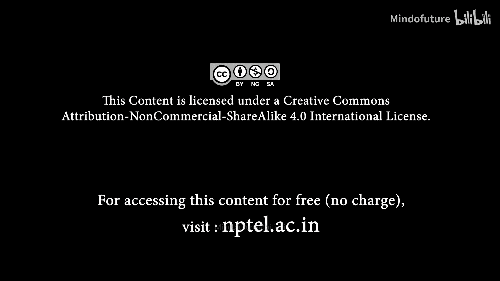
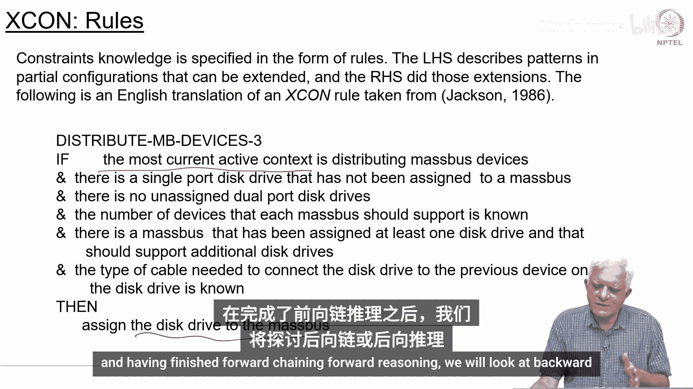

# 034：专家系统 👨‍💼




在本节课中，我们将学习专家系统，这是人工智能在20世纪80年代的一个重要应用领域。专家系统基于规则进行推理，其核心思想是从人类专家那里获取知识，并将其编码为一系列规则，使计算机能够模拟专家的决策过程。

上一节我们介绍了前向推理的逻辑基础，本节中我们来看看这一思想如何催生了实用的专家系统。

## 专家系统的兴起

在20世纪80年代，人工智能领域兴起了专家系统的热潮。其核心理念是，可以将人类专家的知识以规则的形式捕获。这些规则本质上就是我们之前讨论的蕴含式，用于进行推理。人们希望通过从专家那里提取规则，构建出能够像人类专家一样做出决策的程序。这种方法在某些领域取得了成功，尽管有时难以提取专家们隐式使用的知识。

## 规则与产生式系统

规则是专家系统的核心。在最抽象的形式中，一条规则或“产生式”是一个形如 **`左部 -> 右部`** 的语句，类似于逻辑中的蕴含式。计算流程从左部流向右部，这正是我们所说的前向链。如果你知道左部为真，就可以推导出右部为真。

在实践中，产生式规则既可以用于前向推理，也可以用于后向推理。在我们完成基于规则的介绍后，将转向后向推理或后向链，并看到另一种具有自身优势的推理方式。

## 前向链与系统运作

在专家系统的前向链上下文中，产生式看起来像是 **`模式 -> 动作`**。系统检查数据库中的模式，如果匹配，则执行相应的动作。动作可以是添加新语句，甚至删除语句。允许删除语句会导致更复杂的逻辑，有时被称为“非单调逻辑”，因为已证明为真的陈述后来可能不再成立。

以下是规则系统运作的简要描述：
*   系统查看状态的一部分。
*   当某个模式被匹配时，触发一些动作。
*   这个过程持续进行。

## 规则示例：排序

让我们通过一个例子来理解规则。这个例子使用了一种名为OPS5的语言（“官方产生式系统”语言）。

规则名为 `interchange`，其任务是排序一个数组。

**规则描述（英文）**：如果索引 `i` 处有一个值为 `n` 的元素，并且存在一个索引 `j`（`j > i`），其处的值为 `m`（`m < n`），那么就交换这两个元素。

**规则本质**：找出两个位置错误的数字并交换它们。可以想象，反复应用这一条规则最终就能对整个数组进行排序，尽管效率不高。

**OPS5语言表示**：
```
(p interchange
  (array ^index i ^value n)
  (array ^index j ^value m)
  (test (< j i))
  (test (< m n))
  -->
  (modify 1 ^value m)
  (modify 2 ^value n)
)
```
这段代码表示：如果数组在索引 `i` 处值为 `n`，在索引 `j`（`j > i`）处值为 `m`，且 `m < n`，那么修改第一个位置为 `m`，第二个位置为 `n`。

## 成功案例：XCON系统

一个非常成功的专家系统例子是R1/XCON系统。XCON意为“专家配置系统”，专为Digital Equipment Corporation（DEC）的VAX计算机系列开发。

**系统功能**：帮助客户配置他们订购的计算机系统。在20世纪80年代，计算机是大型机器，配置涉及众多组件和约束。

**成就**：该系统处理了超过80,000份订单，准确率超过95%。它使用前向链规则系统，从需求出发，无需回溯地生成最终配置。

**知识构成**：
1.  **组件知识**：存储在不同数据库中，描述每个组件的规格。
2.  **约束知识**：以规则形式存在，描述组件之间如何配合。

**规则示例**：以下是一条简化规则，展示了其“如果-那么”形式。
```
如果 当前上下文是分配内存设备，
且 系统是VAX-11/780，
且 需要更多内存，
且 有可用的内存板，
那么 添加一块特定的内存板到配置中。
```
系统使用“上下文”来引导计算，确保在特定阶段只考虑相关的规则。

## 匹配-解析-执行循环

专家系统的核心运行机制是一个循环，称为“匹配-解析-执行”循环：
1.  **匹配**：将数百条规则与当前数据库中的数据进行匹配。
2.  **解析**：从所有匹配的规则中，决定具体执行哪一条（或哪几条）。
3.  **执行**：执行选定规则的动作，从而改变数据库。
4.  循环回到第一步，重新开始匹配。

我们将在后续课程中更详细地探讨这个循环，特别是Rete算法，该算法使用一种称为Rete网络的高效数据结构来加速匹配过程，至今仍在工业界广泛应用。

## 总结与展望

本节课中我们一起学习了专家系统的基本概念。我们了解到，专家系统是基于规则的AI程序，旨在模拟人类专家的决策。其核心是 **`如果-那么`** 形式的规则，并通过前向链进行数据驱动的推理。我们看了一个排序规则的例子，并了解了成功的XCON配置系统。最后，我们简介了系统运行所依赖的匹配-解析-执行循环。



现在，我们对基于规则的前向推理系统有了初步认识。接下来，我们将暂时告别专家系统，回到逻辑推理本身。在完成了前向推理的学习后，我们将进入下一部分：**后向推理或后向链**，并会介绍一种名为Prolog的专门用于后向推理的语言。