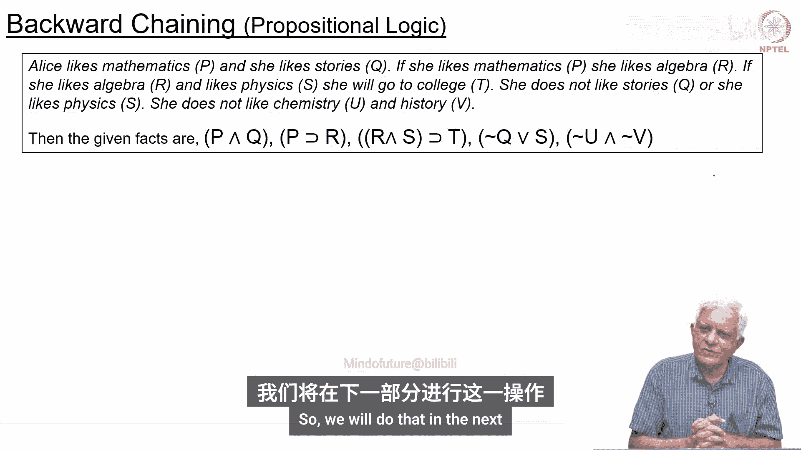

# 035：反向链接系统 🔄

在本节课中，我们将要学习反向链接系统。这是一种与正向链接不同的推理方法，它从目标出发，反向寻找支持目标的事实，从而更高效地进行逻辑推导。

## 概述

上一节我们介绍了正向链接系统。本节中我们来看看反向链接系统。正向链接从已知事实出发，不断应用规则，直到推导出目标。但这种方法存在一个问题：搜索的分支因子可能非常大，导致效率低下。反向链接则从目标出发，反向寻找支持它的规则和事实，从而缩小搜索范围，提高效率。

## 正向链接的局限性

正向链接算法的工作原理是：只要规则的前提条件被满足，就将规则的结论添加到知识库中。知识库会不断膨胀。

这种方法存在两到三个问题。第一，分支因子非常高。如果盲目地不断添加事实，那么在得到你感兴趣的目标 `alpha` 之前，最终添加的事实数量可能非常庞大，并呈指数级增长。这是导致效率低下的原因之一。因此，很难实现一个高效的搜索算法。

## 反向链接的基本思想

反向链接的做法是从目标回溯到事实。如果我们有目标 `alpha`，可能有两到三种不同的规则能推导出 `alpha`。例如，`beta1 -> alpha`，`beta2 -> alpha`，`beta3 -> alpha`。我们只需要从这三条可能的规则开始搜索。可以看到，由于我们专注于特定目标，这里的搜索分支因子会更小。

有人认为，反向推理或目标导向推理是人类思考的方式，因为它更高效。这主要是因为它的分支因子较小。正向链接更像是天马行空地遐想，不断向知识库中添加新事实，直到偶然发现想要的目标。反向链接则更具目标导向性，在许多领域更高效。

## 反向链接的机制

现在我们来看看反向链接的机制。给定一条规则 `alpha -> gamma`，以及一个目标 `beta`。我们想要证明 `beta` 为真。

何时可以使用这条规则？如果能够通过某个替换 `theta`（或称合一子 `theta`）将目标 `beta` 与规则的结论 `gamma` 匹配起来，那么我们就可以进行推理。此时，要证明目标 `beta` 为真，可以将其转化为一个新的目标：证明 `alpha` 为真。但不仅仅是 `alpha`，而是应用了替换 `theta` 之后的 `alpha`。这就是反向链接的过程。

为了区分事实和目标，我们用标记来区分它们。目标是我们要证明为真的陈述，事实是我们已知为真的陈述。可以将它们保存在不同的文件或数据库中，以避免混淆。

这个过程必须有一个终点。当你要证明的目标与知识库中的某个事实匹配时，过程就停止了。这就是链接过程终止的原因。之所以称为“链接”，是因为我们在蕴含语句的两端之间移动。从左端移动到右端，称为正向链接；从右端移动到左端，称为反向链接。

## 逻辑等价性

从逻辑上看，反向链接与正向链接进行的是同样有效的推理。例如，反向链接规则是：从目标 `Q(a)` 出发，应用规则 `P(x) -> Q(x)` 和替换 `{x/a}`，得到新目标 `P(a)`。如果在知识库中找到 `P(a)`，则过程停止。

现在，假设我们不是从目标 `Q(a)` 开始，而是假设其否定 `¬Q(a)`。这类似于我们在讨论反证法时的做法：假设目标的否定，然后进行推理。

我们的原始规则是 `P(x) -> Q(x)`。根据替换规则，`P(x) -> Q(x)` 等价于 `¬Q(x) -> ¬P(x)`。如果我们从假设 `¬Q(a)` 出发，并应用规则 `¬Q(x) -> ¬P(x)`，那么通过肯定前件式，可以推断出 `¬P(a)`。

因此，反向链接在某种程度上类似于进行肯定前件式推理。你也可以将其视为进行否定后件式推理，因为如果我们使用新规则 `¬Q(x) -> ¬P(x)`，那么 `¬Q(a)` 将匹配前件，就像在进行否定后件式推理，最终得到 `¬P(a)`。

无论我们如何看待它，无论是将其视为正向链接中的肯定前件式，还是反向链接中的肯定前件式，我们都在假设目标的否定（即 `¬Q(a)`），并得出一个结论 `¬P(a)`。但这是一个假设。如果我们假设 `¬Q(a)` 为真，那么可以证明 `¬P(a)` 为真。但这显然是一个矛盾。发现这个矛盾的结果是，我们必须断定我们的假设是错误的。因此，假设 `Q(a)` 为假是错误的，所以 `Q(a)` 必须为真，而这正是你心目中的目标。

因此，从逻辑上讲，两者之间存在相似性。肯定前件式更接近于反向链接，因为你从 `Q` 回溯到 `P`。但也可以将其视为否定后件式，因为我们不说 `P -> Q`，而是说 `¬Q -> ¬P`，这就有点像正向链接了。但请记住，你只从所做的假设出发进行反向工作，而不会从知识库的其他部分进行正向链接推理，那才是真正的正向链接。但从逻辑上讲，两者进行的都是有效推理。

## 反向链接的优势

反向推理是目标导向的，我们只寻找那些结论与目标匹配的规则。这导致搜索树的分支因子较低，参与竞争的规则数量较少。事实上，它是整个逻辑编程领域的基础。

反向链接的一个有趣之处在于，我们可以进行所谓的演绎检索。这里的“检索”指的是数据库检索，即你想提出一个查询。但在数据库中，你只能检索数据库中已有的内容。而在演绎检索中，你还可以检索可以从数据库推断出来的内容，这就是逻辑发挥作用的地方。这是一个非常强大的机制。

当我们说“检索”时，意味着目标不必是一个特定的命题。你不仅可以问“`Q(a)` 是否为真？”，还可以问“是否存在某个 `x` 使得 `Q(x)` 为真？”。这使得查询变得通用。在演绎检索中允许提出这种通用查询，这是一个非常有趣的特点。

## 变量在目标中的使用

你可以在查询中使用变量，带有变量的公式显然可以匹配事实。以下是一个例子。

如果你想有一个目标 `Z`，你不仅想证明苏格拉底是会死的，还想问：是否存在某个会死的人？因此，如果你写一个带有变量的目标，表面上看起来像一个全称量词变量，但它是一个目标，那么它必须被视为存在量词。所以，目标中的问号应被视为存在量词。

当你将其写为一个目标时，你是在问：是否存在一个 `Z`，使得“`Z` 会死”为真？这仍然是一个关于死亡性的查询，但不是关于苏格拉底或亚里士多德等人的查询，而是在问：是否存在某个会死的人？以隐式量词形式表达这一点，就是使用问号。

如果你仔细思考一下，你会发现这是有道理的，特别是在我们刚刚讨论的上下文中，我们说目标也可以被认为是假设其反面，然后进行推理。所以，如果我想证明存在一个会死的 `Z`，我就在这里写 `Z`。但如果我使用另一种方法，我说让我假设这是假的，这意味着什么？否定目标。假设“不存在会死的 `Z`”。这是一个假设，你添加了否定目标，就像我们在看到表方法时所做的那样：添加目标的否定，然后证明这是不可能的，存在矛盾，整个系统不一致，没有模型，没有解释会为真，因此你不能做出这个假设。这是反证法的一般思想。

因此，如果你要假设目标的否定，并且这个目标是存在性的（即存在一个 `Z` 使得 `M(Z)` 为真），那么你将添加其否定，即在其前面加上否定符号。但请记住，你必须小心处理量词作用域。所以你要做的是将其转化为 `∀Z ¬M(Z)`，然后将其作用域化。因为根据我们看到的量词作用域规则，这里有一个全称量词，因此整个事物必须被量化为全称变量。

另一种看待它的方式是，我们对查询和目标有不同的规则，对事实也有不同的规则。事实上，问号在全称语句中的全称量词变量下方。在目标或查询中，问号出现在存在量词变量中，这就是我们在这里写的内容。如果我们有一个目标 `Mortal(Z)`，其中 `Z` 是一个变量，这基本上是在说它是一个存在性查询，即询问“存在一个 `Z` 使得 `Mortal(Z)`”这个陈述是否为真？但在隐式形式中，我们会将其写成一个问号，所以你必须小心这一点。如果你将其视为一个目标，那么你必须将其视为存在性的；如果你说你要添加目标的否定，那么它就变成了一个事实，但这个事实会导致矛盾，因此它是一个全称性的。

## 演绎检索的示例

在目标中使用变量进行检索（这是我们在数据库中所做的）的一个有趣之处在于，除了回答“是”或“否”（即“是，它为真”或“不，它不为真”）之外，如果它为真，它还会给你一个值，这就是你在检索中感兴趣的内容。在数据库中，你只能检索数据库中已有的内容。在演绎检索（即逻辑编程）中，除了已经存在的内容，你还可以检索可以推断出来的内容。因此，它也可以返回一个值，这使得它非常有趣。

让我们看几个例子。

我们的目标是：是否存在某个会死的人？请记住，这是一个存在性目标。当然，我们的规则是所有人都会死。我们在这里进行反向链接。将 `x` 替换为 `z`，我们得到一个新的目标：是否存在某个人？然后，当然，这会在我们的知识库或数据库中找到：是的，柏拉图是人，所以你可以返回柏拉图是会死的。是的，苏格拉底是人，所以你可以返回苏格拉底是会死的。亚里士多德是人，你可以返回亚里士多德是会死的。目标关乎死亡性；事实关乎是人。但我们能够将“柏拉图是人”、“苏格拉底是人”、“亚里士多德是人”这些事实，与“所有人都会死”这条规则联系起来。当我们问“是否存在某个会死的人？”时，我们能够以反向链接的形式进行这种逻辑演绎，并对这个查询回答“是”，同时为变量 `Z` 提供一个名称或值：是的，`Z` 可以是柏拉图，或苏格拉底，或亚里士多德。这是进行反向链接的额外优势：你可以使用存在性查询，并为这些查询检索答案。

## 总结

本节课中我们一起学习了反向链接系统。我们了解到，与正向链接相比，反向链接从目标出发进行推理，具有目标导向性强、搜索分支因子小的优点。它允许使用带有变量的存在性查询进行演绎检索，不仅能判断查询的真假，还能返回具体的绑定值，是逻辑编程的重要基础。下一节，我们将通过具体例子来观察反向链接的搜索过程。