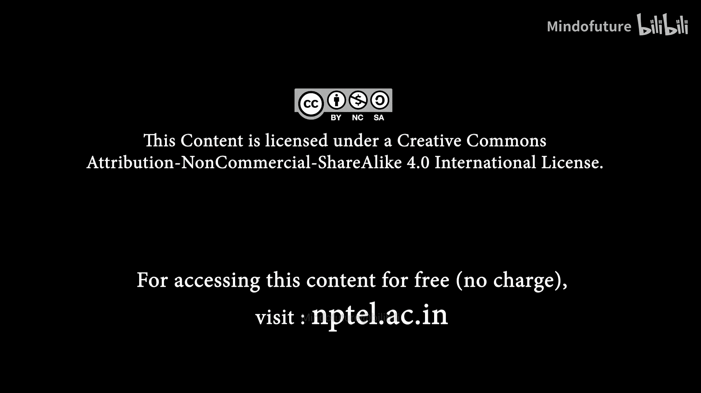
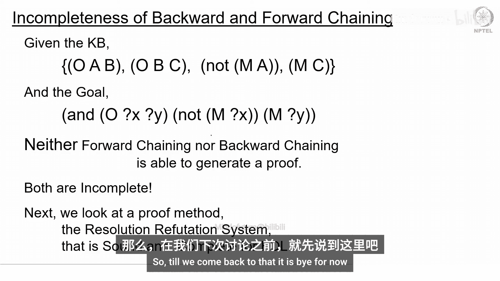

知识表示与推理：P36：演绎检索

在本节课中，我们将学习逻辑中的反向链或反向推理过程，特别是在一阶逻辑中。我们将看到，这种反向推理可以被视为一种检索机制，用于寻找满足特定属性的实体。这本质上是一种检索，但也涉及搜索。我们将探讨如何实现反向链，并通过示例理解其作为搜索过程的工作原理。最后，我们将看到一个简单的查询，它虽然被知识库所蕴含，但无法通过前向或反向链证明，从而引出对更完备证明方法的需求。

---

### 反向链的实现

上一节我们介绍了反向推理的概念。本节中，我们来看看如何具体实现反向链。

给定一个知识库。例如，我们有一个关于Alice的标准知识库，包含以下语句：
*   P
*   Q
*   P → R
*   R ∧ S → T
*   ¬Q ∨ S
*   ¬Q ∧ ¬W

为了便于处理，我们对知识库稍作转换：
1.  将 `¬Q ∨ S` 替换为等价的 `Q → S`。
2.  将 `¬Q ∧ ¬W` 拆分为两个独立的公式 `¬Q` 和 `¬W`。

我们的目标是验证陈述 `T` 是否为真。在反向链中，我们维护一个**目标集**，其中包含我们希望证明为真的陈述。当目标集变为空时，意味着所有目标都已证明，推理终止。

以下是反向链的步骤：
1.  初始目标集为 `{T}`。
2.  由于有规则 `R ∧ S → T`，我们将目标 `T` 替换为其前提 `R` 和 `S`。现在目标集变为 `{R, S}`。
3.  处理目标 `R`。发现规则 `P → R`。因此，要证明 `R`，只需证明 `P`。由于 `P` 是知识库中的事实，目标 `R` 被移除。
4.  处理剩余目标 `S`。发现规则 `Q → S`。因此，要证明 `S`，只需证明 `Q`。由于 `Q` 是知识库中的事实，目标 `S` 被移除。
5.  此时目标集为空，推理终止，结论是 `T` 为真。

这个过程展示了反向链如何通过将目标分解为子目标，并利用知识库中的事实和规则来逐步证明目标。

---

### 一阶逻辑中的反向链与搜索

上一节我们看了命题逻辑中的反向链。现在，我们将其扩展到一阶逻辑，并理解其背后的搜索机制。

考虑一个一阶逻辑规则：`P(x) ∧ Q(x) → R(x)`。我们的目标是存在性查询：`∃x R(x)`，即是否存在一个 `x` 使得 `R(x)` 为真。

反向链从目标 `R(x)` 开始。根据规则，要证明 `R(x)`，必须同时证明 `P(x)` 和 `Q(x)`。这可以可视化为一个**与节点**，因为必须同时解决两个子目标。

为了更具体，我们来看一个玩具分类的例子。

**知识库：**
*   规则1：`Green(x) ∧ Circular(x) → NiceToy(x)`
*   规则2：`Red(x) ∧ Square(x) → NiceToy(x)`
*   事实：
    *   `Green(A)`
    *   `Green(B)`
    *   `Circular(C)`
    *   `Red(C)`
    *   `Red(D)`
    *   `Square(D)`
    *   `Circular(E)`

**目标：** `∃x NiceToy(x)`（是否存在一个“好玩具”？）

这个推理过程可以表示为一个**与或树**：
*   根节点是目标 `NiceToy(x)`。要解决它，可以**或**选择规则1，也**或**可以选择规则2。
*   如果选择规则1，则进入一个**与节点**，必须同时证明 `Green(x)` 和 `Circular(x)`。
*   要证明 `Green(x)`，可以尝试 `x = A`（事实）或 `x = B`（事实），这是一个**或**选择。
*   要证明 `Circular(x)`，需要检查对应 `x` 的值是否在圆形事实列表中。

以下是搜索过程：
1.  从目标 `NiceToy(x)` 开始，尝试规则1。
2.  子目标1：`Green(x)`。尝试 `x = A`，成功。
3.  子目标2：`Circular(A)`。检查知识库，`A` 不是圆形，失败。
4.  **回溯**：尝试 `Green(x)` 的另一个选项 `x = B`，成功。
5.  子目标2：`Circular(B)`。检查知识库，`B` 不是圆形，失败。
6.  规则1的所有分支失败，**回溯**到根节点，尝试规则2。
7.  子目标1：`Red(x)`。尝试 `x = C`，成功。
8.  子目标2：`Square(C)`。检查知识库，`C` 不是方形，失败。
9.  **回溯**：尝试 `Red(x)` 的另一个选项 `x = D`，成功。
10. 子目标2：`Square(D)`。检查知识库，`D` 是方形，成功。
11. 所有子目标解决，目标集为空。找到解 `x = D`。

通过这个例子，我们看到反向链涉及深度优先搜索和回溯。它不仅证明了存在一个好玩具，还通过逻辑演绎检索出了具体的玩具 `D`。这体现了逻辑编程的思想：利用逻辑推理进行计算和检索。

---

### 逻辑编程示例：Prolog 预览

上一节我们看到了反向链如何用于检索。本节中，我们通过一个 Prolog 程序预览来进一步理解逻辑编程的威力。

假设我们正在制定一个出游计划，包含晚上活动、看电影和晚餐。我们用逻辑规则来描述：

**Prolog 程序规则：**
*   `outing_plan(X, Y, Z) :- evening_plan(X), movie_plan(Y), dinner_plan(Z).`
    *   含义：如果 `X` 是晚上计划，`Y` 是电影计划，`Z` 是晚餐计划，那么 `(X, Y, Z)` 就是一个出游计划。
*   `dinner_plan(Z) :- restaurant(Z), friend_likes(Z).`
    *   含义：如果 `Z` 是餐厅且朋友喜欢 `Z`，那么 `Z` 可以作为晚餐计划。
*   （其他规则如 `evening_plan`、`movie_plan` 类似定义）

**事实（知识库）：**
*   `restaurant(saravana).`
*   `restaurant(barbeque_nation).`
*   `movie(the_matrix).`
*   `movie(ai).`
*   `movie(seven_samurai).`
*   `outing(mall).`
*   `outing(beach).`
*   `friend_likes(beach).`
*   `friend_likes(the_matrix).`
*   `friend_likes(saravana).`

**目标查询：** `?- outing_plan(X, Y, Z).`
*   含义：是否存在一个三元组 `(X, Y, Z)` 构成一个出游计划？

Prolog 引擎会进行反向链搜索：
1.  从目标 `outing_plan(X, Y, Z)` 开始。
2.  根据规则，分解为三个子目标：`evening_plan(X)`、`movie_plan(Y)`、`dinner_plan(Z)`。
3.  尝试解决 `evening_plan(X)`，这需要找到 `outing(X)` 且 `friend_likes(X)`。通过尝试事实，可能找到 `X = beach`。
4.  接着解决 `movie_plan(Y)`，尝试事实，可能找到 `Y = the_matrix`。
5.  最后解决 `dinner_plan(Z)`，这需要找到 `restaurant(Z)` 且 `friend_likes(Z)`。通过尝试事实，可能找到 `Z = saravana`。
6.  所有子目标解决，返回一个解：`X = beach, Y = the_matrix, Z = saravana`。

Prolog 不仅会回答“是”，还会返回具体的变量绑定值，实现了规划和检索。这展示了逻辑推理如何用于通用计算。

---

### 一个引人深思的查询

现在，我们来看一个之前提到过的知识库和查询，它揭示了前向链和反向链的局限性。

**知识库（命题逻辑层面的事实）：**
1.  `O(A, B)`
2.  `O(B, C)`
3.  `M(C)`
4.  `¬M(A)`

**查询（一阶逻辑存在性查询）：**
`∃x ∃y (O(x, y) ∧ ¬M(x))`
即：是否存在一对 `(x, y)`，使得 `x` 与 `y` 有 `O` 关系，并且 `x` 不具有 `M` 属性？

我们可以考虑两种解释：
*   **积木世界解释**：`O` 表示“在...之上”，`M` 表示“是褐色的”。查询意为：是否存在一个非褐色的积木在一个褐色的积木之上？
*   **人际关系解释**：`O` 表示“注视”，`M` 表示“已婚”。查询意为：是否存在一个未婚的人注视着一个已婚的人？

根据给定的知识库，这个查询的答案是 **“是”**。例如，在人际关系解释中，`A`（未婚）注视着 `B`（虽然 `B` 的婚姻状况未知，但 `A` 注视 `B` 是事实，且 `A` 未婚）。然而，关键在于：**使用标准的前向链或反向链方法，无法从给定的命题知识库中构造出这个一阶逻辑查询的证明**。

这说明了前向链和反向链对于一阶逻辑是**不完备**的。存在一些被知识库蕴含的查询，它们无法通过这些方法得到证明。

---

### 总结与展望

本节课中，我们一起学习了反向推理（反向链）的核心思想及其实现。
*   我们看到了反向链如何作为一种目标导向的检索机制，通过将目标分解为子目标并与知识库匹配来工作。
*   我们了解到在一阶逻辑中，反向链涉及构建与或搜索树，并需要进行深度优先搜索和回溯。
*   通过 Prolog 的示例，我们预览了逻辑编程如何利用反向链进行问题求解和答案检索。
*   最后，我们遇到了一个关键问题：前向链和反向链对于一阶逻辑是不完备的。存在一些真实的语句，它们无法通过这些方法得到证明。

这引出了我们对更强大、完备的证明方法的需求。下一节，我们将学习**归结反驳法**，这是一种完备的证明方法，能够证明所有被知识库蕴含的一阶逻辑语句。