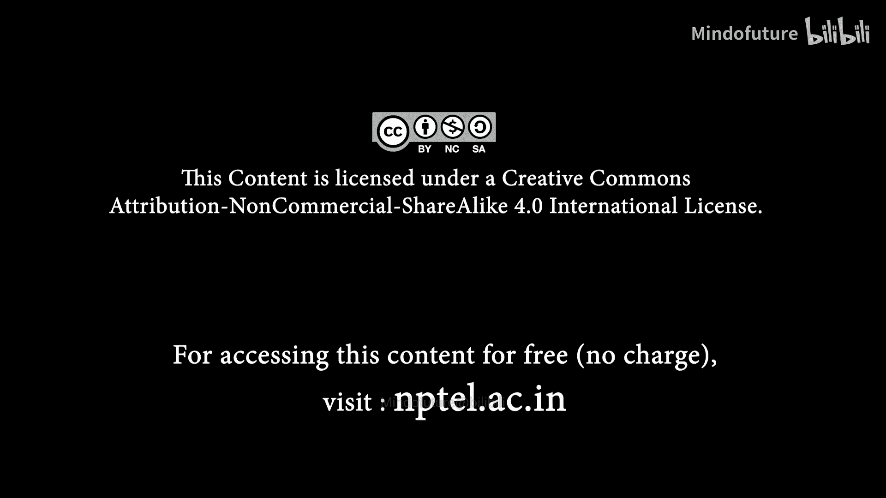
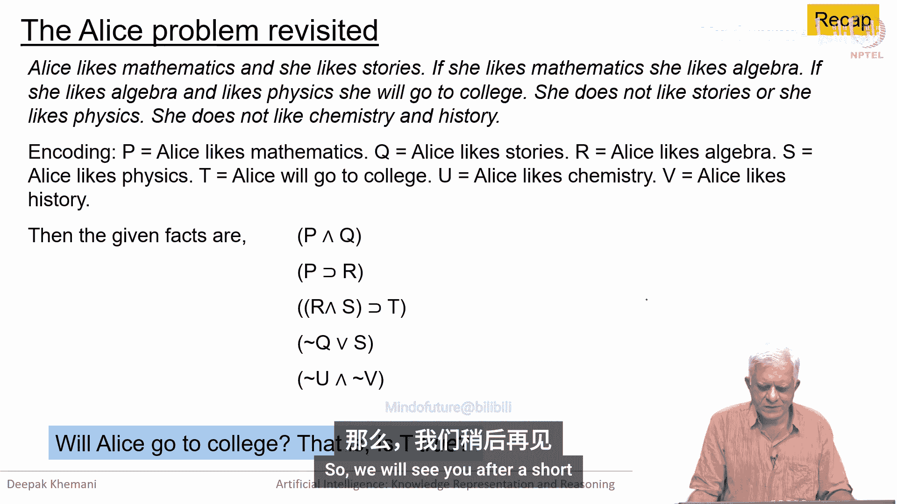

知识表示与推理：P37：归结反驳法 🔍

在本节课中，我们将学习一种名为“归结反驳法”的证明方法。这是一种在命题逻辑和一阶逻辑中都被证明是**完备**的推理方法。我们将从回顾前向链接和后向链接的局限性开始，然后详细介绍归结法的原理、步骤，并通过示例展示其应用。

---

### 回顾：前向与后向链接的局限性

上一节我们介绍了前向链接（数据驱动）和后向链接（目标驱动）两种证明算法。然而，这两种方法都不是完备的，这意味着存在一些逻辑上可证明的结论，它们无法推导出来。

我们来看一个具体的例子。假设我们有一个知识库，包含以下四个公式：
1.  `O(A, B)` （A在B上）
2.  `O(B, C)` （B在C上）
3.  `¬M(A)` （A不是Maroon色）
4.  `M(C)` （C是Maroon色）

其中，`O` 是一个二元谓词（例如“在...上”或“看着”），`M` 是一个一元谓词（例如“是Maroon色”或“已婚”），`A`、`B`、`C` 是常量符号。

我们的目标是证明：**存在一个非Maroon色的物体在一个Maroon色的物体上**。用逻辑公式表示就是：`∃x ∃y (¬M(x) ∧ M(y) ∧ O(x, y))`。

通过逻辑分析可知，无论 `B` 是否具有属性 `M`，这个结论都为真。然而，无论是前向链接还是后向链接算法，都无法从给定的知识库中自动推导出这个结论。这引出了我们对更强大、完备的证明方法的需求。

---

### 归结反驳法简介

本节中，我们将介绍**归结反驳法**。这是一种基于**反证法**的推理方法。其核心思想是：为了证明一个目标公式 `β` 可以从前提 `α₁, α₂, ..., αₙ` 中逻辑推出，我们将其转化为证明公式 `α₁ ∧ α₂ ∧ ... ∧ αₙ ∧ ¬β` 是**不可满足的**（即存在矛盾）。

如果这个合取式被证明是不可满足的，那么原推理 `α₁ ∧ α₂ ∧ ... ∧ αₙ ⇒ β` 就是有效的。

---

### 步骤一：转化为合取范式

归结法要求所有公式都必须是**合取范式**。

**合取范式** 是指一个公式具有以下结构：
`F = C₁ ∧ C₂ ∧ ... ∧ Cₙ`
其中，每个 `Cᵢ` 称为一个**子句**，而每个子句又是若干**文字**的析取：
`Cᵢ = L₁ ∨ L₂ ∨ ... ∨ Lₖ`
这里，每个**文字** `Lⱼ` 要么是一个原子命题（或其常量/谓词形式），要么是其否定形式（`¬`）。

**任何命题逻辑或一阶逻辑公式都可以通过逻辑等价变换（如分配律、德摩根定律等）转化为CNF形式。** 转换后，知识库和待证目标的否定将被表示为一组子句的集合。

---

### 步骤二：应用归结规则

**归结规则** 是归结法的核心推理规则。它作用于两个包含互补文字的子句。

规则定义如下：
如果有两个子句：
*   `C₁ = P ∨ A`
*   `C₂ = ¬P ∨ B`
其中 `P` 是一个原子命题，`A` 和 `B` 代表其他文字的析取（可能为空）。

那么，我们可以推导出一个新的子句，称为**归结式**：
`R = A ∨ B`

**公式描述**：`(P ∨ A) ∧ (¬P ∨ B) ⇒ (A ∨ B)`

**直观理解**：如果 `P` 为真，则根据 `C₂`，`B` 必须为真；如果 `P` 为假，则根据 `C₁`，`A` 必须为真。因此，在任何情况下，`A ∨ B` 都为真。

一个特例是当 `A` 和 `B` 都为空时，我们从 `P` 和 `¬P` 可以归结出**空子句**（记为 `□` 或 `[]`），它代表**假**。

---

### 步骤三：归结反驳过程

以下是归结反驳法的算法流程：

1.  **初始化**：将知识库中的所有前提 `α₁, α₂, ..., αₙ` 以及待证目标 `β` 的否定 `¬β`，全部转化为合取范式，得到一组初始子句集合 `S`。
2.  **循环归结**：
    a. 从子句集 `S` 中选择两个包含互补文字的子句（例如，一个包含 `P`，另一个包含 `¬P`）。
    b. 对这两个子句应用归结规则，生成归结式 `R`。
    c. 如果 `R` 是**空子句** `□`，则停止，证明完成（找到了矛盾）。
    d. 否则，将 `R` 加入到子句集 `S` 中。
3.  **结果判定**：
    *   如果生成了空子句 `□`，则说明初始的子句集 `S`（即 `α₁ ∧ α₂ ∧ ... ∧ αₙ ∧ ¬β`）是**不可满足的**。这等价于证明了原结论 `β` 可以从前提中逻辑推出。
    *   如果无法再生成新的子句（且未得到空子句），则说明原公式是可满足的，即 `β` 不能从前提中必然推出。

**关键性质**：
*   **可靠性**：如果归结法推导出空子句，则原推理必定有效。
*   **完备性**（Robinson， 1965）：如果原推理是有效的，那么使用归结法一定可以通过有限步归结推导出空子句。

---

### 总结

本节课我们一起学习了**归结反驳法**。我们首先回顾了前向与后向链接算法的局限性，然后引入了这种完备的证明方法。归结法的核心步骤包括：
1.  将所有公式转化为**合取范式**。
2.  不断应用**归结规则**，从两个包含互补文字的子句中消去该文字，生成新的子句。
3.  目标是推导出代表矛盾的**空子句**，从而通过反证法证明原目标成立。

归结法是自动定理证明和逻辑编程的基石之一。在接下来的课程中，我们将通过具体例子来演示其应用，并探讨如何将其扩展到一阶逻辑。