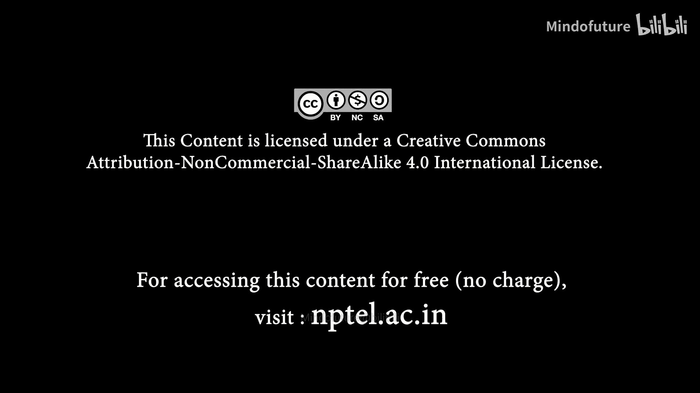
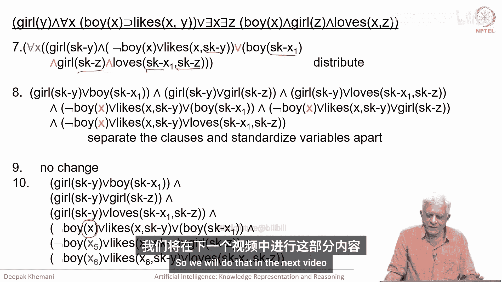

# 038：一阶逻辑子句形式

在本节课中，我们将学习如何将一阶逻辑公式转换为子句形式，这是应用归结推理方法的关键步骤。我们将回顾命题逻辑中的归结规则，然后详细探讨一阶逻辑中子句形式的定义、转换算法，并通过一个具体例子来演示整个过程。

## 回顾命题逻辑的归结规则

上一节我们介绍了归结方法及其规则。在命题逻辑中，归结规则指出：如果你有两个子句集，一个包含子句 **¬Q**，另一个包含子句 **Q**，那么你可以移除 **¬Q** 和 **Q**，并将这两个子句集的并集作为一个新的子句。

让我们将其应用到我们熟悉的“爱丽丝问题”中。给定的知识库是：`P ∧ Q`， `P → R`， `R ∨ S → T`， `¬Q ∨ S`， `¬U ∨ ¬V`。首先，我们需要将其转换为子句形式。

以下是转换步骤：
*   `P ∧ Q` 转换为两个子句：`P` 和 `Q`。
*   `P → R` 转换为子句：`¬P ∨ R`。
*   `R ∨ S → T` 转换为子句：`¬R ∨ T` 和 `¬S ∨ T`。
*   `¬Q ∨ S` 已经是子句形式。
*   `¬U ∨ ¬V` 转换为两个子句：`¬U` 和 `¬V`。
*   最后，我们添加目标的否定 `¬T` 作为一个子句。

最终我们得到8个子句。归结方法要求我们反复选取两个可以归结的子句进行归结，并将归结式加入知识库，直到推导出空子句（null clause）。这证明原始公式集是不可满足的。

以下是针对该问题的一个归结证明序列：
1.  从子句4 (`¬R ∨ T`) 和子句8 (`¬T`) 归结，得到 `¬R`。
2.  从子句1 (`P`) 和子句3 (`¬P ∨ R`) 归结，得到 `R`。
3.  从步骤1的结果 (`¬R`) 和步骤2的结果 (`R`) 归结，得到 `¬S`。
4.  从步骤3的结果 (`¬S`) 和子句5 (`¬Q ∨ S`) 归结，得到 `¬Q`。
5.  从步骤4的结果 (`¬Q`) 和子句2 (`Q`) 归结，得到空子句 `□`。

推导出空子句意味着包含目标否定的公式集是不可满足的，从而证明了原目标 `T` 为真。这个证明过程也可以用有向无环图更直观地表示。

## 一阶逻辑的子句形式

现在，让我们将目光转向一阶逻辑。在一阶逻辑中，我们说一个公式是子句形式，如果它具有特定的结构：所有量词都在公式左侧，并且只有全称量词。

一个子句形式的知识库由一组子句构成。每个子句 `C_i` 是一些文字的析取，每个文字是一个原子公式或其否定。由于所有量词都是全称量词，我们在处理时可以将其忽略，使用隐式量词形式，这使得程序实现更为简单。

可以证明，任何一阶逻辑公式都可以转换为子句形式，这个过程称为**斯科伦化**。

## 转换为子句形式的算法

以下是将任意一阶逻辑公式转换为子句形式的标准化步骤：

1.  **变量标准化**：确保不同量词辖域内的变量使用不同的名称，避免后续合一操作出现问题。
2.  **消去蕴含**：使用等价关系 `(A → B) ≡ (¬A ∨ B)` 消去所有 `→` 和 `↔` 连接词。
3.  **内移否定**：使用德摩根定律将否定符号 `¬` 向内移动，直到只作用于原子公式。
4.  **变量标准化（量词前）**：再次标准化变量，为下一步做准备。
5.  **前束化**：将所有量词移到公式最左边。
6.  **斯科伦化**：消去存在量词。为每个存在量词引入一个新的**斯科伦函数**或**斯科伦常量**来替换其约束变量。
7.  **全称量词左移**：将所有全称量词移到最左侧，此时公式中只剩下全称量词。
8.  **合取范式化**：将公式转化为合取范式，即一系列子句的合取。
9.  **变量标准化（子句级）**：为每个子句内的变量重命名，使不同子句的变量名不同。
10. **分离子句**：将合取范式中的每个合取项作为一个独立的子句。

## 转换示例

让我们通过一个具体例子来演示这个算法。考虑以下公式：
`∃y (Girl(y) ∧ ∀x (Boy(x) → ∃z (Loves(x, z) ∧ Girl(z))))`

以下是详细的转换步骤：

**步骤1 & 2：标准化变量与消去蕴含**
我们将存在量词内的 `x` 重命名为 `x1`，并消去蕴含。
*   原式：`∃y (Girl(y) ∧ ∀x (Boy(x) → ∃z (Loves(x, z) ∧ Girl(z))))`
*   重命名后：`∃y (Girl(y) ∧ ∀x (Boy(x) → ∃z (Loves(x, z) ∧ Girl(z))))` （此例中 `x` 未重复，无需重命名，此处为演示保留步骤）
*   消去蕴含：`∃y (Girl(y) ∧ ∀x (¬Boy(x) ∨ ∃z (Loves(x, z) ∧ Girl(z))))`

**步骤3-5：内移否定与前束化**
此公式中否定已作用于原子公式，无需内移。将所有量词前移。
*   前束化：`∃y ∀x ∃z (Girl(y) ∧ (¬Boy(x) ∨ (Loves(x, z) ∧ Girl(z))))`

**步骤6：斯科伦化**
消去存在量词 `∃y` 和 `∃z`。
*   `∃y` 引入斯科伦常量，例如 `a`。
*   `∃z` 引入斯科伦函数，因为它依赖于 `x`，例如 `f(x)`。
*   斯科伦化后：`∀x (Girl(a) ∧ (¬Boy(x) ∨ (Loves(x, f(x)) ∧ Girl(f(x)))))`

**步骤7-9：全称量词左移与合取范式化**
此时只剩全称量词 `∀x`。将公式转化为合取范式。
*   分配 `∧` 对 `∨`：`∀x ( (Girl(a) ∧ ¬Boy(x) ∨ Loves(x, f(x))) ∧ (Girl(a) ∧ ¬Boy(x) ∨ Girl(f(x))) )`
*   注意：为了清晰，这里展示了分配后的结果。严格步骤是先将 `∀x` 提至最前，然后对内部公式进行分配。

**步骤10：分离子句并最终标准化**
将合取范式拆分为独立子句，并为每个子句的变量标准化（此例中每个子句只有变量 `x`，且已标准化）。
最终得到的子句集为：
1.  `Girl(a)`
2.  `¬Boy(x) ∨ Loves(x, f(x))`
3.  `¬Boy(x) ∨ Girl(f(x))`

这里，`a` 是斯科伦常量，`f` 是斯科伦函数。

## 总结

本节课中，我们一起学习了一阶逻辑中子句形式的核心概念。我们首先回顾了命题逻辑的归结规则，然后定义了一阶逻辑的子句形式。接着，我们详细介绍了将一个任意一阶逻辑公式转换为子句形式的十个步骤算法，并通过一个具体例子完整演示了转换过程。掌握这个转换方法是使用归结原理进行一阶逻辑自动推理的基础。在下一节中，我们将利用子句形式，在一阶逻辑中应用归结规则来解决更复杂的推理问题。