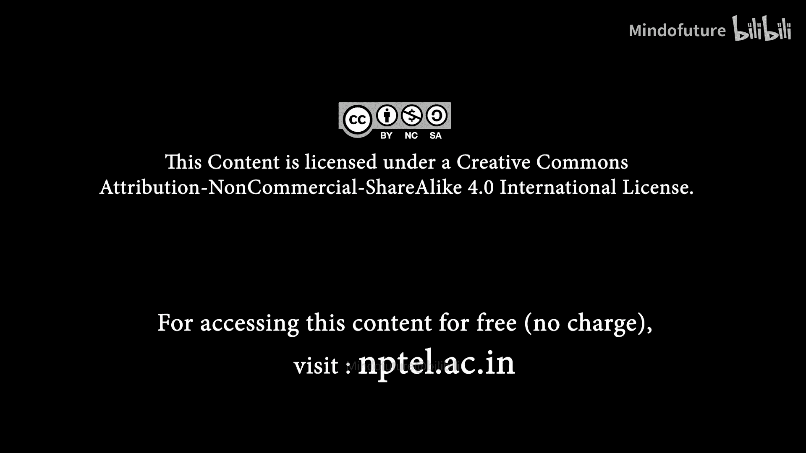
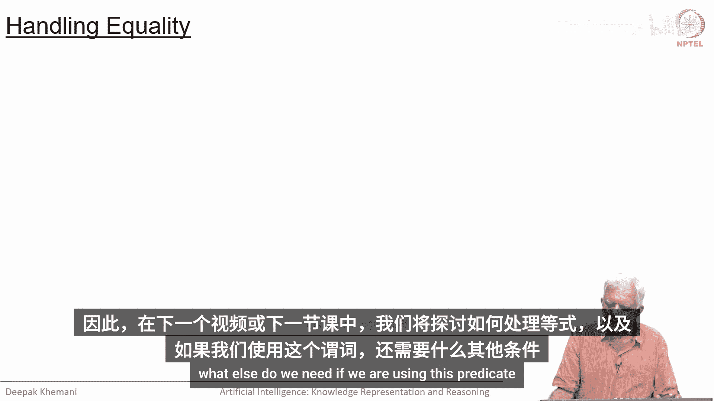

知识表示与推理：P39：一阶逻辑中的归结反驳

在本节课中，我们将学习一阶逻辑中的归结反驳方法。我们将看到，该方法与命题逻辑中的过程类似，但需要处理变量和量词。我们将通过具体例子，理解如何将公式转换为子句形式，应用归结规则，并最终推导出空子句以完成证明。

---

上一节我们介绍了归结反驳方法在命题逻辑中的应用，本节中我们来看看它在一阶逻辑中的形式。

一阶逻辑中的证明过程与命题逻辑相似。首先，将每个前提公式转换为子句形式。接着，否定目标公式并将其也转换为子句形式。现在，我们得到一个子句的集合。将否定的目标子句加入这个集合。然后，选择两个子句，使得其中存在可以合一的正文字和负文字。如果某个原子公式在一个子句中以肯定形式出现，在另一个子句中以否定形式出现，则可以将它们消去。使用最一般合一子对这两个子句进行归结，并将归结式加入集合。重复步骤4和5，直到产生空子句。

这与命题逻辑中的过程非常相似，区别在于我们需要处理这里的变量和量词。

为了完整性，我们给出**一阶逻辑的归结规则**。假设有两个子句 C1 和 C2：
C1: **L1 ∨ L2 ∨ ... ∨ Lk**
C2: **¬A1 ∨ ¬A2 ∨ ... ∨ ¬Am ∨ Q1 ∨ ... ∨ Qn**
其中，L1...Lk 是正文字，A1...Am 是负文字。如果存在一个最一般合一子 θ，使得 **{L1θ, ..., Lkθ} = {A1θ, ..., Amθ}**，那么我们可以消去这些文字，得到归结式：
**(P1θ ∨ ... ∨ Prθ ∨ Q1θ ∨ ... ∨ Qnθ)**
这里，P 和 Q 是子句中未被消去的其他文字。

---

现在，让我们从一个熟悉的推理模式开始：苏格拉底论证。

我们有以下子句：
C1: **¬Man(x) ∨ Mortal(x)** （所有人都是会死的）
C2: **Man(Socrates)** （苏格拉底是人）
C3: **¬Mortal(Socrates)** （否定的目标：苏格拉底不会死）

以下是推导空子句的步骤：
1.  对 C1 和 C2 应用归结。将 C1 中的 x 替换为 Socrates，得到 **¬Man(Socrates) ∨ Mortal(Socrates)**。与 C2 **Man(Socrates)** 归结，消去 ¬Man(Socrates)，得到归结式 R1: **Mortal(Socrates)**。
2.  将 R1 **Mortal(Socrates)** 与 C3 **¬Mortal(Socrates)** 归结，直接得到空子句 **□**。

这个证明过程可以看作一个**有向无环图**。从 `Man(Socrates)` 和 `¬Man(x) ∨ Mortal(x)` 推出 `Mortal(Socrates)`，这模拟了**前向链接**。同时，从否定目标 `¬Mortal(Socrates)` 出发，为了证明它，我们需要证明 `Man(Socrates)`，这模拟了**后向链接**。因此，归结方法在某种意义上概括了前向链接和后向链接的能力。

---

接下来，我们看一个更复杂的例子：爱丽丝问题。

以下是转换为子句形式的前提和否定目标：
1.  **¬Likes(Alice, stories) ∨ ¬Likes(Alice, physics) ∨ GoesToCollege(Alice)**
2.  **Likes(Alice, stories)**
3.  **¬Likes(Alice, maths) ∨ Likes(Alice, algebra)**
4.  **Likes(Alice, maths)**
5.  **¬Likes(Alice, algebra) ∨ GoesToCollege(Alice)** （否定目标：爱丽丝不去上大学）

以下是推导步骤：
1.  使用子句2和子句1归结。消去 `Likes(Alice, stories)`，得到 R1: **¬Likes(Alice, physics) ∨ GoesToCollege(Alice)**。
2.  使用子句4和子句3归结。消去 `Likes(Alice, maths)`，得到 R2: **Likes(Alice, algebra)**。
3.  使用 R2 和子句5归结。消去 `Likes(Alice, algebra)`，得到 R3: **GoesToCollege(Alice)**。
4.  最后，将 R3 与最初的否定目标（子句5的原始形式，但注意我们已使用其一部分）结合，实际上我们通过归结已经推导出了目标 `GoesToCollege(Alice)` 的肯定形式，这与否定目标矛盾，从而在逻辑上完成了反驳。在实际的归结步骤中，这体现为最终得到了空子句。

在这个例子中，我们最后才使用了否定目标。但有一种策略建议尽早使用否定目标或其衍生子句。

---

这种策略称为**支持集策略**。该策略指出，在归结过程中，应优先选择那些包含否定目标或其衍生结果的子句进行归结。因为证明中的矛盾必然源于加入的否定目标，尽早使用它们可以提高搜索效率。

另一个有用的策略是**单元子句策略**。该策略建议优先使用**单元子句**（即只包含一个文字的子句）。因为单元子句与另一个子句归结时，可以直接消去一个文字，从而缩短子句长度，有助于更快地推导出空子句。

---

现在，让我们解决一个之前用前向或后向链接无法解决的问题。

已知知识库（已转换为子句形式）：
1.  **O(a, b)**
2.  **O(b, c)**
3.  **¬M(a)**
4.  **M(c)**
5.  **¬O(x, y) ∨ ¬M(x) ∨ M(y)** （这是否定目标 `∃x ∃y (¬M(x) ∧ M(y) ∧ O(x, y))` 的子句形式）

目标是证明存在 x 和 y，满足 x 不是 M，y 是 M，并且 O(x, y)。

以下是应用归结反驳的步骤：
1.  使用子句4和子句5归结。将子句5中的 y 替换为 c，消去 M(c)，得到 R1: **¬O(x, c) ∨ ¬M(x)**。
2.  使用子句3和子句5归结。将子句5中的 x 替换为 a，消去 ¬M(a)，得到 R2: **¬O(a, y) ∨ M(y)**。
3.  使用子句1和 R2 归结。将 R2 中的 y 替换为 b，消去 O(a, b)，得到 R3: **M(b)**。
4.  使用子句2和 R1 归结。将 R1 中的 x 替换为 b，消去 O(b, c)，得到 R4: **¬M(b)**。
5.  最后，将 R3 **M(b)** 和 R4 **¬M(b)** 归结，得到空子句 **□**。

这个例子表明，**归结方法能够解决前向链接和后向链接无法处理的某些问题**，因为它能更灵活地处理包含析取和存在量词的公式。在这个证明中，否定目标在早期步骤中就发挥了关键作用。

---

本节课中我们一起学习了一阶逻辑中的归结反驳方法。我们回顾了其基本步骤：将知识和否定目标化为子句集，通过寻找可合一的文字对子句进行归结，直至产生空子句。我们通过苏格拉底论证、爱丽丝问题和一个更复杂的例子，演示了这一过程。我们还介绍了支持集策略和单元子句策略来提高证明效率。最后，我们看到了归结方法比单纯的前向或后向链接更强大，能够处理更复杂的逻辑推理问题。

在接下来的课程中，我们将探讨如何处理一阶逻辑中的**相等关系**这一特殊谓词。