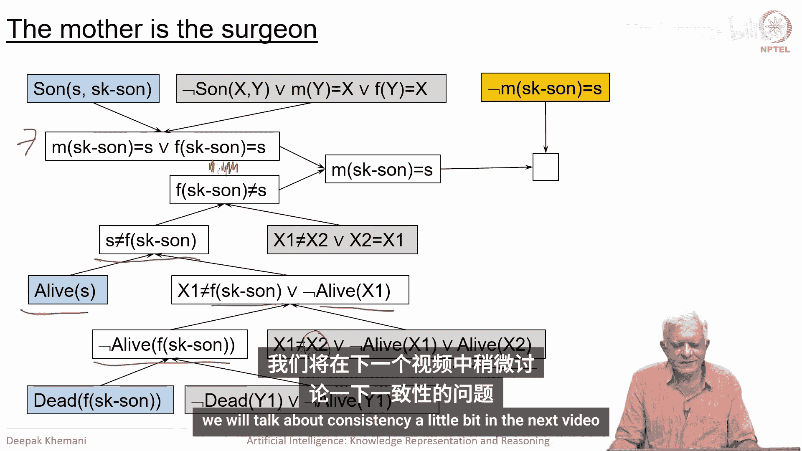

# 041：外科医生是谁之谜

在本节课中，我们将学习如何运用一阶逻辑与等式来解决一个经典的逻辑谜题。我们将通过形式化的方法，证明一个看似简单的故事中隐含的结论。

## 概述

我们一直在学习一阶逻辑及其归结反驳法。随后，我们引入了等式公理，并看到有些结论必须借助等式才能证明。在深入探讨之前，我们先来看一个有趣的故事谜题，并尝试用逻辑推理来解答。

## 谜题故事

故事内容如下：
> 一对父子正在过马路时遭遇了车祸。父亲当场不幸身亡，儿子被紧急送往医院手术室。然而，外科医生看了一眼男孩后说：“我不能给这个男孩做手术，他是我的儿子。”

我们的问题是：**这位外科医生是谁？**

请先暂停视频，思考一下答案。

## 逻辑形式化

现在，我们回到视频。希望你已经思考过答案。对于一些人来说，答案显而易见；但对另一些人来说，可能需要一些推理。为了帮助理解，我们将使用一阶逻辑（带等式）来形式化并解答这个问题。

这是一个存在性查询（“外科医生是谁？”），类似于我们之前用逻辑推导答案的练习。我们需要定义事实、背景知识，并进行推导。

### 定义谓词与函数

首先，我们定义逻辑表示所需的元素：
*   我们给外科医生一个常量名：`S`。
*   谓词 `Surgeon(S)` 表示 S 是外科医生。
*   谓词 `Son(x, y)` 表示 `y` 是 `x` 的儿子（即 `x` 是 `y` 的父母之一）。
*   函数 `M(y)` 表示 `y` 的母亲。
*   函数 `F(y)` 表示 `y` 的父亲。
*   谓词 `Alive(x)` 表示 `x` 活着。
*   谓词 `Dead(x)` 表示 `x` 死亡。

### 陈述已知事实与背景知识

以下是故事中明确给出或隐含的事实，我们将用逻辑公式表示：

1.  **存在一位外科医生**：`Surgeon(S)`
2.  **外科医生是活着的**（因为他说了话）：`Alive(S)`
3.  **男孩的父亲去世了**：`Dead(F(boy))` （这里 `boy` 是一个常量，代表故事中的男孩）
4.  **外科医生声称男孩是他的儿子**：`Son(S, boy)`

我们还需要一些关于家庭关系和生死状态的背景知识：

5.  **“儿子”关系的含义**：如果 `y` 是 `x` 的儿子，那么 `x` 一定是 `y` 的母亲或父亲。
    *   公式：`∀x ∀y [Son(x, y) → (x = M(y) ∨ x = F(y))]`
    *   转换为子句形式后，我们会用到其中一部分：`¬Son(x, y) ∨ (x = M(y)) ∨ (x = F(y))`
6.  **生死状态互斥**：如果一个人死了，他就不活着；反之亦然。
    *   公式：`∀y [Dead(y) → ¬Alive(y)]` 且 `∀y [Alive(y) → ¬Dead(y)]`
    *   这可以简化为：`¬Dead(y) ∨ ¬Alive(y)`
7.  **等式公理（代入公理）**：这是带等式的一阶逻辑的核心，允许我们用相等的项进行替换。
    *   公式：`∀x1 ∀x2 [(x1 = x2) → (P(x1) ↔ P(x2))]` 对于任意谓词 `P` 成立。
    *   在证明中，我们将使用其子句形式的一种实例：`(x1 ≠ x2) ∨ ¬Alive(x1) ∨ Alive(x2)`

### 构建证明

我们的目标是证明：**外科医生 S 是男孩的母亲**，即 `S = M(boy)`。

我们将使用归结反驳法进行推导。思路如下：

1.  从“男孩的父亲去世了”（`Dead(F(boy))`）和生死互斥知识，可以推出“男孩的父亲不活着”：`¬Alive(F(boy))`。
2.  从“外科医生声称男孩是他的儿子”（`Son(S, boy)`）和“儿子”关系的定义，可以推出：`S = M(boy) ∨ S = F(boy)`。
3.  现在，我们使用**代入公理**。我们知道 `¬Alive(F(boy))`（父亲不活），而外科医生 `S` 是活着的 `Alive(S)`。如果 `S` 等于 `F(boy)`，那么通过代入，`Alive(S)` 将意味着 `Alive(F(boy))`，这与 `¬Alive(F(boy))` 矛盾。
4.  因此，`S` 不能等于 `F(boy)`，即 `S ≠ F(boy)`。
5.  结合第2步的结论 `S = M(boy) ∨ S = F(boy)`，并排除掉 `S = F(boy)` 的可能性，我们必然得到：`S = M(boy)`。

以下是关键推导步骤的示意（使用归结规则）：

*   **步骤A**：由 `Dead(F(boy))` 和 `¬Dead(y) ∨ ¬Alive(y)`，归结得到 `¬Alive(F(boy))`。
*   **步骤B**：使用代入公理子句 `(x1 ≠ x2) ∨ ¬Alive(x1) ∨ Alive(x2)`。令 `x1 = S`, `x2 = F(boy)`，得到子句：`(S ≠ F(boy)) ∨ ¬Alive(S) ∨ Alive(F(boy))`。
*   **步骤C**：将步骤B的子句与已知事实 `Alive(S)` 归结，消去 `¬Alive(S)`，得到：`(S ≠ F(boy)) ∨ Alive(F(boy))`。
*   **步骤D**：将步骤C的子句与步骤A的结论 `¬Alive(F(boy))` 归结，消去 `Alive(F(boy))`，最终得到：`S ≠ F(boy)`。
*   **步骤E**：从“儿子”关系定义我们有子句：`¬Son(S, boy) ∨ (S = M(boy)) ∨ (S = F(boy))`。
*   **步骤F**：结合已知 `Son(S, boy)`，消去 `¬Son(S, boy)`，得到：`(S = M(boy)) ∨ (S = F(boy))`。
*   **最终步骤**：将步骤F的结论 `(S = M(boy)) ∨ (S = F(boy))` 与步骤D的结论 `S ≠ F(boy)` 归结。为了匹配，我们需要使用等式的对称性（`S ≠ F(boy)` 等价于 `F(boy) ≠ S`），然后进行归结，消去 `(S = F(boy))`，最终得到目标结论：`S = M(boy)`。

## 总结

本节课中，我们一起学习了一个生动的例子，展示了如何运用一阶逻辑与等式公理进行严谨推理。我们通过以下步骤解决了“外科医生是谁”的谜题：

1.  **形式化**：将故事叙述转化为精确的逻辑谓词、函数和公式。
2.  **识别知识**：区分明确的事实（如“父亲去世”）和必要的背景知识（如“儿子”的定义、生死互斥）。
3.  **应用等式**：关键地使用了等式公理（特别是代入公理）来链接“活着”这一属性在不同个体（外科医生与男孩父亲）间的传递。
4.  **逻辑推导**：通过一系列归结步骤，最终从已知条件中推导出唯一符合逻辑的结论：**外科医生是男孩的母亲**。

这个例子有力地说明了，即使对于直觉上可能有些困惑或受偏见影响的问题，形式化逻辑也能提供一个清晰、无可辩驳的解决方案。同时，它也凸显了等式公理在处理涉及同一性推理的问题时的重要性。在接下来的课程中，我们将继续探讨逻辑表示的一致性与其它相关主题。