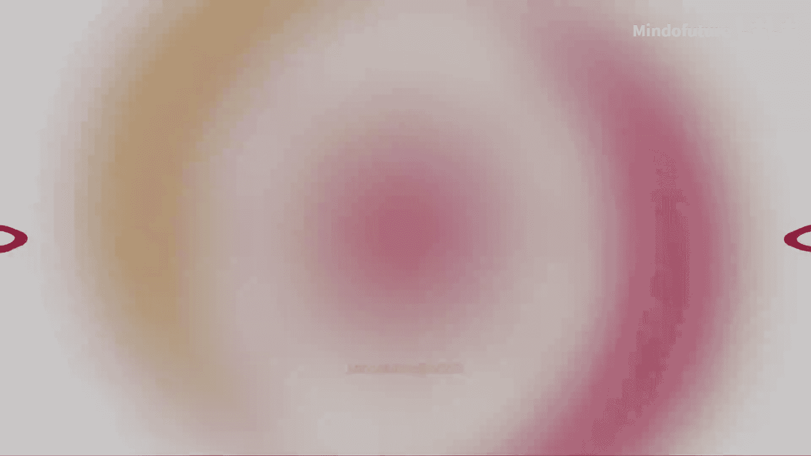
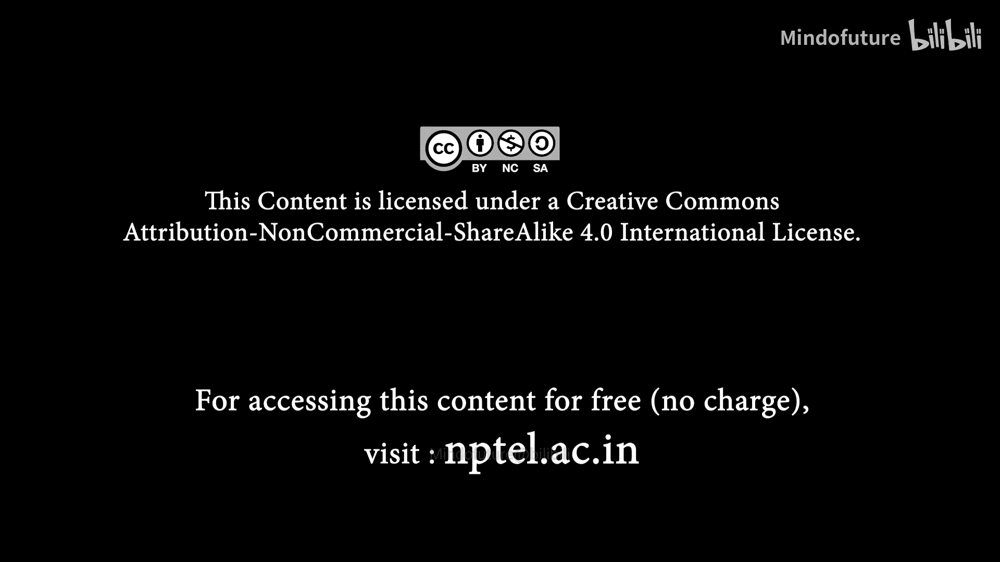
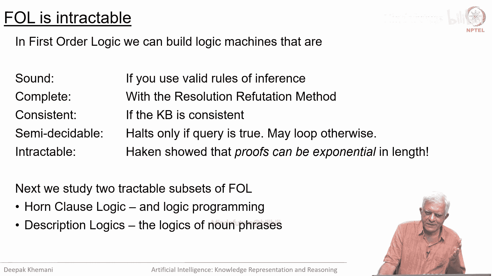

# 042：一致性与完备性 📚

在本节课中，我们将探讨逻辑系统中的两个核心概念：一致性与完备性。我们将了解为什么保持知识库的一致性至关重要，并介绍哥德尔不完备性定理对形式化数学系统的影响。最后，我们将简要概述一阶逻辑及其相关扩展。

---

## 一致性的重要性

上一节我们讨论了推理规则，本节中我们来看看知识库的一致性。逻辑学家非常重视一致性。如果一个句子集合不一致，那么基本上可以放弃它。让我们看看原因。

幸运的是，我们确信苏格拉底的故事是一致的。因此，从中得出的任何结论都是可信的。

一个知识库被称为不一致的，如果你能同时推导出 **α** 和 **¬α**。这意味着你有一个 **α** 的证明，同时也有一个 **¬α** 的证明。这只有在知识库不一致时才会发生。

关键在于，如果你能推导出一个矛盾，即 **α** 为真且 **¬α** 也为真，那么你实际上可以说任何话并使其成立。我们可以从一个不一致的知识库中推导出任何东西。让我们看看这个过程有多简单。

假设我们的知识库推导出了句子 **P ∧ ¬P**。这意味着知识库本质上是不可满足的。在这个推导过程中，我们推导出了 **P**，也推导出了 **¬P**。

以下是推导任意命题 **Q** 的步骤：
1.  已知 **P ∧ ¬P**。
2.  使用简化规则，得到 **P** 为真，且 **¬P** 为真。
3.  使用附加规则，由 **¬P** 为真，可以推出 **¬P ∨ Q** 也为真（因为析取式只要有一个部分为真，整个命题就为真）。
4.  现在我们有 **P** 为真，以及 **¬P ∨ Q** 为真。
5.  使用假言推理（或构造性二难推理），可以推导出 **Q** 为真。

因此，人们说，你可以从一个不一致的句子集合或不一致的知识库中推导出任何东西。所以我们必须非常小心，确保我们的知识库是**一致的**。

---

## 哥德尔不完备性定理 🧩

现在，让我们谈谈逻辑学中的一个里程碑事件。1931年，德国逻辑学家、哲学家、数学家库尔特·哥德尔发表了他的不完备性定理。这个定理粉碎了将所有数学知识形式化为一个单一形式系统的希望。

在此之前，人们思考如何将所有数学形式化，并将其纳入一个庞大的公理系统。哥德尔的出现给这个领域带来了沉重打击，他指出这是不可能实现的：你无法拥有一个能推导出所有数学真命题的大型形式系统。

我们没有时间深入不完备性定理的细节，首先因为它不适用于一阶逻辑，而我们主要关注一阶逻辑。它适用于比一阶逻辑更具表达力或更强大的系统。

该定理指出，你无法将所有东西形式化为一个庞大的公理系统。我在此引用一段话（稍后会给出出处）：
> “这个定理确立了，对于任何包含算术的数学分支，不可能使用公理化方法构建一个能囊括其所有真理的形式系统。”

这意味着你无法构建一个能**蕴含**所有真理的公理系统（即证明系统），也就是说，它不会是**完备的**。换句话说，没有有限的一组公理能够产生所有可能的真数学陈述。因此，任何机械的或类似计算机的方法都无法穷尽数学的深度。

哥德尔时代，计算机才刚刚萌芽。他的第二不完备性定理表明，一个包含算术的形式系统无法证明自身的一致性。

哥德尔本质上是在说，对于足够强大的系统（我们指的是公理系统或逻辑系统），你无法同时拥有**一致性**和**完备性**。关键词是“足够强大”，它不适用于命题逻辑和一阶逻辑。在这两种逻辑中，我们可以构建既一致又完备的系统（完备性指所有真命题都能被推导出来）。但哥德尔指出，对于更强大的系统，这是做不到的。

你可以查阅我引用的这个不列颠百科网站。还有另一个网站的引用，如果你对哥德尔不完备性定理更感兴趣，也可以去看看。

正如我所说，有两个定理。第一定理指出：
> “任何一致的、能在其中进行一定量初等算术运算的形式系统 **F** 都是不完备的。存在 **F** 语言中的语句，它们在 **F** 中既不能被证明，也不能被证伪。”

当说一个语句既不能被证明也不能被证伪时，并不是说你取该语句的否定就能证明它。两者都不可能。这就是不完备性。

不完备性主要是自指的结果。哥德尔证明了，对于任何足够强大的公理系统，都存在不可判定的语句。这些语句与自指有关。哥德尔通过哥德尔编号给出了一种构造方法，他展示了如何为任何足够强大的公理系统构造一个语句，该语句是不可判定的——你既不能证明它为真，也不能证明它为假。

这些语句与自指有关，这就是为什么它们需要足够强大的表达能力。在表达能力较弱的语言中，你无法谈论自指。

我经常提到侯世达和他的书《哥德尔、埃舍尔、巴赫》。这本书是对自指的深刻探索。书名就暗示了这一点，它谈论数学（哥德尔）、艺术（埃舍尔）和音乐（巴赫）。埃舍尔的版画具有自指的特性，比如“无尽阶梯”和“瀑布”，它们看起来是循环的、永无止境的。当然，这些在现实世界中不可能存在，但埃舍尔创作了许多这种自指的作品。根据侯世达的说法，巴赫的音乐作品中也包含了许多自指和递归的元素。

我们没有太多时间深入探讨，但我鼓励你去看看侯世达的书。这不是一本小书，但值得你花精力去读。他更近期的著作《我是一个怪圈》以更紧凑的方式探讨了自指。“怪圈”指的是自指，而“我”则指我们拥有的自我概念。

伯特兰·罗素也认识到了自指问题。罗素是试图形式化所有数学的人之一，他撰写了《数学原理》。但他也认识到，某些事情会导致矛盾。他提出了一个悖论，表明任何包含无限制概括原则的集合论都会导致矛盾，例如“一个集合能否是自身的成员？”这类陈述很难处理，本质上会导致矛盾。

我之前提到过，“我正在说谎”不是一个有真值的句子，因为如果你说它是真的，那就意味着你在说谎，因此这个陈述必须是假的。与罗素相关的还有理发师悖论（尽管他说是别人告诉他的，但它源自罗素悖论，我们通常将其与罗素联系起来）。理发师悖论是说：
> “理发师只给那些不自己刮胡子的人刮胡子。那么，理发师给自己刮胡子吗？”

你可以看到这里微妙的自我指涉。如果他给自己刮胡子，那么根据理发师的定义（只给不自己刮胡子的人刮胡子），他就不应该给自己刮胡子。如果他不给自己刮胡子，那么他就属于“不自己刮胡子的人”，因此理发师应该给他刮胡子（也就是他自己）。这是一个非常有趣的悖论，值得你花点时间思考。

---

## 自指与形式系统的问题 🤔

我想给你一些关于自指如何在形式系统中引发问题的直观感受。

想象有一台机器，它能推导出所有真命题。当然，这是我们的目标：我们想要构建一个既可靠又完备的逻辑机器。完备性意味着它能推导出所有真命题。

我要举的例子是由雷蒙德·斯穆里安给出的。我强烈推荐你去看看他的书，比如《逻辑迷宫》。他写了许多关于逻辑谜题的有趣书籍。

在斯穆里安的例子中，他使用了“打印”这个词。他说，想象一台能打印所有真命题的机器。这就像说“推导所有真命题”。我们将使用“推导”这个词，尽管在他的例子中他用了“打印”，可能是为了避免与更形式化的“推导”含义混淆。

他从定义开始。他定义了一个句子的**共轭**，并用 **C(α)** 表示（C代表共轭）。一个句子的共轭基本上是 **α-α** 这种形式的句子。他称之为共轭句。

然后他推导出以下公式：
*   **D(α)**：如果这个句子为真，那么 **α** 最终会被推导出来。所以，如果 **D(α)** 为真，那么 **α** 最终会被推导。
*   **N(α)**：如果 **N(α)** 为真，那么 **α** 永远不能被推导出来。

你可以看到，这是在谈论哪些句子可以被推导，哪些不能。然后他说：
*   **DC(α)**：如果 **DC(α)** 为真，那么 **α** 的共轭（即 **α-α**）最终会被推导。
*   **NC(α)**：如果 **NC(α)** 为真，那么 **α** 的共轭（即 **α-α**）永远不能被推导。

给定这些句子，如果你接受这是你的形式系统，它会告诉你哪些句子会被打印，哪些不会。所以你看一个句子，如果 **D(α)** 为真，你就知道它会被打印；如果 **N(α)** 为真，你就知道它不会被打印。对于句子的共轭也是如此。

现在，我们要说的是对哥德尔所讨论内容的一种洞察。在形式系统中，你可以构造出某些让你束手无策的东西。

问题是：**N(N)** 会怎样？
记住，**N(α)** 表示 **α** 的共轭永远不会被打印。当 **α** 是 **N** 时呢？毕竟，**N** 只是一组字符。

思考一下：**N(N)** 表示 **N** 的共轭永远不能被打印。**N** 的共轭是 **N-N**。所以 **N(N)** 在说：“**N-N** 这个句子永远不能被打印。”

如果 **N(N)** 这个句子本身为真，那么它声称自己（的共轭形式）永远不能被打印或推导。这意味着这个系统不是完备的——这里有一个真命题，但它不能被打印，因为该命题本身就说它不能被推导。

这只是让你感受一下侯世达、斯穆里安所谈论的，以及最初由库尔特·哥德尔在其不完备性定理中提出的那种“怪圈”。它为试图将数学一切形式化的宏大努力画上了句号。

---

## 超越一阶逻辑：其他逻辑系统概览 🔭

我们已经讨论了命题逻辑，正在讨论一阶逻辑。在本课程中，我们还会接触一些其他逻辑。

以下是对其他存在逻辑的一瞥：
*   **二阶逻辑**：允许我们对谓词进行量化。在一阶逻辑中，我们可以量化变量（如 ∀x）。在二阶逻辑中，你可以量化谓词符号（如 ∀P）。一个有趣的、必须归类为二阶逻辑的句子是**数学归纳法原理**。其形式为：
    > ∀P [ (P(0) ∧ ∀x (P(x) → P(s(x)))) → ∀x P(x) ]
    这里，我们是在说“对于**所有**谓词 **P**，如果……成立，则……”。这使用了某种高阶逻辑。
*   **模态逻辑**：句子带有**模态**，即必然性或可能性。有两种模态：
    *   **□α**：表示 **α** 是必然为真/确定为真。
    *   **◇α**：表示 **α** 是可能为真。
    真值仍然是二值的（真或假），但这些模态表达了我们对命题真值状态的认识程度。
*   **认知逻辑与信念逻辑**：在多智能体系统中特别有用。它使用两种模态：
    *   **Kα**：表示智能体 **a** **知道** **α**。
    *   **Bα**：表示智能体 **a** **相信** **α**。
    从逻辑角度看，知识只能关于真事实（如果你知道某事，那它必须为真），而信念可以关于非真的事实。例如，“我相信地球是平的”并不意味着地球真是平的。
*   **时态逻辑**：谈论时间模态，表示 **α** 在某个时间 **t** 为真。
*   **事件演算**：一种高阶逻辑，用于谈论时间、行动和变化。我们将在本课程后面部分稍作了解。
*   我们也会在本课程后面部分了解一些认知逻辑。

---

## 回到一阶逻辑及其性质 ⚙️

让我们回到一阶逻辑，正如我一直所说，这将是我们课程的主要部分。

在一阶逻辑中：
*   我们可以构建**可靠的**逻辑机器（前提是使用有效的推理规则）。
*   我们可以构建**完备的**系统。我们尚未证明归结反驳法是完备的，但我们接受了罗宾逊在1963年给出的证明，即它是完备的。
*   只要知识库是一致的，你就可以构建一致的系统。从中推导出的任何结论都将是一致的，你永远不会同时推导出 **α** 和 **¬α**。当然，我们没有给出证明，但一门课程无法涵盖所有内容。

我们将看到，一阶逻辑是**半可判定的**。这是什么意思？
我们说命题逻辑在某个意义上是可判定的。这意味着，给定一个知识库和一个查询，算法会终止并回答“是”或“否”。

当我们说“半可判定”时，这是一阶逻辑的情况（从逻辑编程的角度看例子会更清楚）。定理证明算法（即证明定理的算法）在查询为真时会停机。从这个意义上说，它是完备的。但是，如果你询问的查询不为真，那么它可能永远不会停机，而进入无限循环。这是一阶逻辑的一个性质，你不应感到惊讶，因为你总是可以编写出无限循环的程序，而程序（我们将会看到）本质上就是用逻辑语言写的句子（尽管看起来不一定像）。任何你能用过程式语言做的事情，也可以用逻辑来完成。

更重要的是，一阶逻辑是**难处理的**。即使我们能找到证明（我们说它是半可判定的，意味着如果存在证明，它就能找到），但由于语言的丰富性，有时证明本身的长度可能是指数级的。试想，如果证明长度是指数级的，那么寻找该证明的过程将是双倍指数级的。

因此，在本课程稍后部分，我们将研究一阶逻辑的两个易处理子集：
1.  **霍恩子句逻辑**：这是我们接下来要学习的内容。霍恩子句逻辑引出了**逻辑编程**，进而引出了像 Prolog 这样的语言。Prolog 是逻辑编程的一种实现，它对于称为霍恩子句的子集效果很好。
2.  **描述逻辑**：本质上是名词短语的逻辑。描述逻辑如今非常流行，因为它们用于构建**本体**。本体基本上是名词短语的集合，用于描述类别和子类别等。描述逻辑有非常高效的规则来检查一个类别是否是另一个类别的子集。我们稍后将花时间了解描述逻辑和本体。

我们将在此结束对一阶逻辑的讨论，然后回到它的一个子集（霍恩子句），并提请注意：在逻辑中所做的事情，等同于在计算中所能做的事情。

---

## 总结 📝

本节课中，我们一起学习了：
1.  **一致性**：知识库不一致会导致可以推导出任何命题，因此保持一致性至关重要。
2.  **哥德尔不完备性定理**：对于足够强大的形式系统，无法同时满足一致性和完备性，这源于自指问题。
3.  **自指的威力与问题**：通过斯穆里安的例子，我们直观感受了自指如何导致形式系统中的不可判定语句。
4.  **其他逻辑系统**：简要了解了二阶逻辑、模态逻辑、认知逻辑、时态逻辑等更丰富的逻辑系统。
5.  **一阶逻辑的性质**：一阶逻辑是可靠、完备、半可判定但难处理的。我们将在后续课程中关注其易处理的子集，如霍恩子句逻辑和描述逻辑。

这就是本节课的全部内容。我们下次再见。