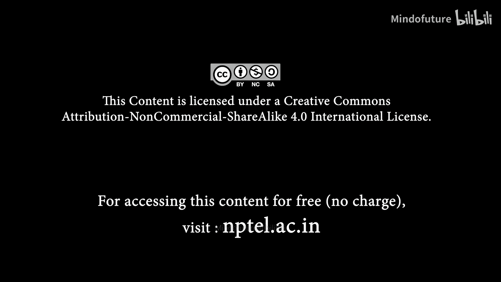
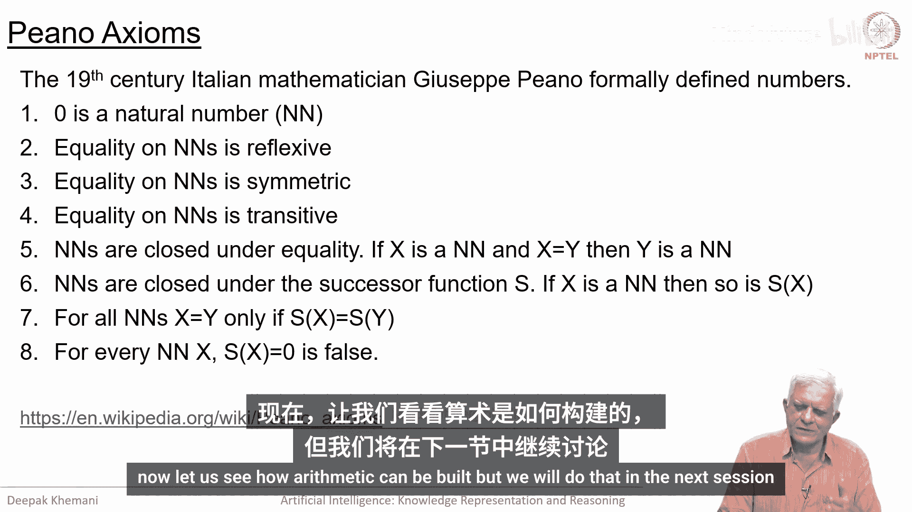

**知识表示与推理：P43：逻辑编程** 🧠

在本节课中，我们将学习逻辑编程的核心思想，即逻辑本身可以作为一种编程语言。我们将探讨如何通过逻辑推理来替代传统的计算过程，并了解如何从证明过程中提取答案。最后，我们将初步接触如何用逻辑来定义和表示“数”这一基本概念。

---

上一节我们介绍了归结应用方法，它是一种用于一阶逻辑推理的可靠且完备的方法。本节中，我们来看看逻辑编程。

逻辑编程的核心思想是，逻辑推理可以替代通用的计算。这意味着，任何在其他编程语言中能完成的任务，都可以用逻辑来实现。因此，逻辑本身也可以被视为一种编程语言。

这一思想在很大程度上归功于罗伯特·科瓦尔斯基。他提出，逻辑和计算可以用单一的形式体系来统一，并且逻辑包含了计算。这不仅仅是另一种编程语言，它还提出了逻辑编程的一个核心理念：程序员只需专注于输入和输出之间的逻辑关系，而计算流程的控制则应交给一个被称为“推理引擎”的计算机程序。

在C语言等命令式语言中，程序员需要编写一系列语句（包括赋值和控制流语句）来明确指定计算步骤的顺序。科瓦尔斯基认为，程序员（或用户）应更关心输入与输出之间的关系是否为真，而将控制流留给机器（即推理引擎，通常是一个定理证明器）来处理。这种编程范式被称为**声明式编程**。

逻辑编程是声明式编程的基础，也是Prolog等编程语言以及我们稍后将详细讨论的**基于规则的专家系统**的基础。在基于规则的专家系统中，用户输入的知识本质上就是规则。我们将首先了解Prolog中的逻辑编程（它主要使用**反向链**推理），然后了解使用**正向链**推理的基于规则的专家系统。我们会看到，反向链推理是归结方法的一个特例。

---

我们之前提到过，可以从归结过程中使用的替换里提取出答案。例如，我们可以问“是否存在一个会死的人？”，系统通过反向链推理可以告诉我们“是的，苏格拉底（或柏拉图，或领域中的任何一个人）会死”。

为了使提取答案的过程更明确，我们可以使用一种称为**答案谓词**的机制。让我们以“所有人都会死”这个例子来说明。

以下是相关的子句：
*   C1: `¬man(x) ∨ mortal(x)` （即 `∀x (man(x) → mortal(x))`）
*   C2: `man(Socrates)` （事实）
*   C3: `¬mortal(z)` （目标的否定，即查询 `∃z mortal(z)` 的否定）

现在，我们添加第四个包含答案谓词的子句：
*   C4: `¬mortal(z) ∨ answer(z)`

归结推理过程如下：
1.  首先，C1和C2归结，得到 `mortal(Socrates)`。
2.  然后，`mortal(Socrates)` 与 C3 (`¬mortal(z)`) 归结。通过替换 `{z/Socrates}`，我们得到空子句的雏形，但此时我们应用了C4。
3.  实际上，我们通过归结 `mortal(Socrates)` 与 C4 (`¬mortal(z) ∨ answer(z)`)，并应用替换 `{z/Socrates}`，得到子句 `answer(Socrates)`。

此时，我们修改终止条件：当推导出的子句中**只包含答案谓词**时，即可终止。这里，`answer(Socrates)` 告诉我们，查询 `∃z mortal(z)` 的答案是 `z = Socrates`。

有趣的是，答案谓词在答案不唯一的情况下也能工作。考虑以下知识库：
*   C1: `¬man(x) ∨ mortal(x)`
*   C2: `man(Socrates) ∨ man(Plato)` （苏格拉底或柏拉图至少有一人是人）
*   C3: `¬mortal(z)` （查询 `∃z mortal(z)` 的否定）
*   C4: `¬mortal(z) ∨ answer(z)`

推理过程会推导出 `answer(Socrates) ∨ answer(Plato)`。这表示，根据现有知识，我们只能得出结论：苏格拉底和柏拉图**至少有一人**会死，但无法确定具体是哪一位。这准确地反映了知识库所蕴含的内容。

---

在深入逻辑表示之前，我们需要思考一个基础问题：在一阶逻辑中，我们处理一个论域以及从语言到论域的映射（即解释）。但论域中什么可以被称为“数”？这是一个长期困扰许多人的问题。

沃伦·麦卡洛克（以神经网络研究闻名）曾讲述他大学入学时的故事，他当时渴望回答一个问题：“数是什么？一个人可以认识数，但数本身是什么？”这引出了我们对数的基础定义的探讨。

数与集合的大小（即基数）有关。我们可以通过建立两个集合间的一一对应关系来比较它们的大小。如果两个集合能一一对应，它们就有相同的基数，我们用一个共同的“数”来标识这个基数。

弗雷格和罗素各自提出，可以将一个自然数 *n* 定义为所有具有 *n* 个元素的集合的集合。这是一个非常抽象的概念。我们的定义将与此类似，但会定义一个标准的集合序列来代表数。

显然，我们需要从0开始定义。0作为一个数字的概念并非自古就有，它最初常被用作占位符（例如在会计中表示平衡）。将0视为一个独立的数字，通常归功于印度数学家**婆罗摩笈多**，他在公元628年的著作中首次明确阐述了0的概念。

接下来，我们使用**策梅洛-弗兰克尔集合论**来递归地定义自然数集合：
*   令 `0 = ∅`（空集）。
*   定义后继函数：`S(n) = n ∪ {n}`。
*   因此：
    *   `1 = S(0) = ∅ ∪ {∅} = {∅} = {0}`
    *   `2 = S(1) = {∅} ∪ {{∅}} = {∅, {∅}} = {0, 1}`
    *   `3 = S(2) = {0, 1} ∪ {{0, 1}} = {0, 1, {0, 1}} = {0, 1, 2}`
    *   以此类推。

关键之处在于，我们用作集合名称的“数”（如3），同时也等于该集合的基数（即集合中元素的个数，`|3| = 3`）。自然数集 **N** 就是包含0并在后继函数下闭合的最小集合。

这个结构是**皮亚诺公理**的一个模型。皮亚诺公理形式化地定义了自然数，包括：
1.  0是自然数。
2.  每个自然数都有且仅有一个后继，且该后继也是自然数。
3.  0不是任何自然数的后继。
4.  不同的自然数有不同的后继。
5.  （归纳公理）若一个性质对0成立，且当它对某个自然数成立时也对其后继成立，则该性质对所有自然数成立。

自然数是整个数学体系的基石，整数、有理数、实数等均在此基础上构建。

---

本节课中，我们一起学习了逻辑编程的基本理念，即通过声明逻辑关系并由推理引擎控制计算。我们介绍了如何使用答案谓词从证明中提取答案，并初步探讨了如何在逻辑和集合论中定义“自然数”这一根本概念。这为我们后续学习如何在逻辑编程中进行算术运算打下了基础。