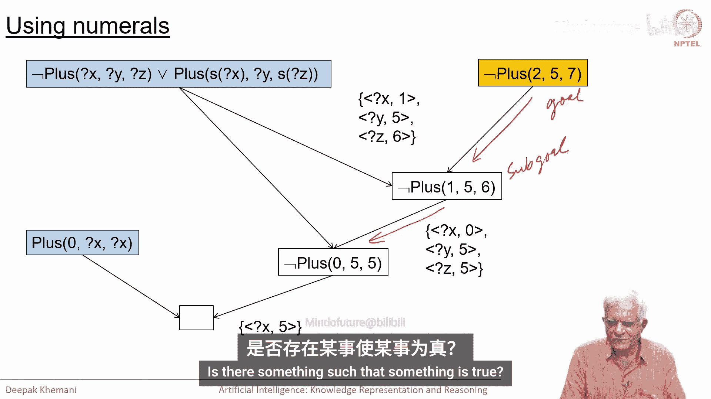

# 044：算术

在本节课中，我们将学习如何在逻辑中表示自然数，并定义最基本的算术运算——加法。我们将看到，通过简单的逻辑语句，可以完整地描述加法运算，并且这些定义本身就可以作为程序来执行计算。

## 自然数的逻辑表示

上一节我们介绍了如何在逻辑中思考数字。我们通过定义一个基础数字 **0** 和一个后继函数 **S** 来构建自然数集。

考虑一个无限域，它包含一个我们称为 **0** 的常量和一个一元后继函数 **S**。这个函数的作用是：对于域中的任何元素，它给出该元素的下一个数字。从 **0** 开始，我们得到 **S(0)**（即1），从 **S(0)** 开始，我们得到 **S(S(0))**（即2），依此类推。

因此，自然数域可以表示为：**{0, S(0), S(S(0)), S(S(S(0))), ...}**。在这个表示中，符号 **S** 出现的次数就是该数字的值。例如，**S(S(0))** 表示数字2。

这个有序集合是数学归纳法第一原理的基础。我们从一个基础元素 **0** 开始，然后通过后继函数得到所有后续元素。

## 定义加法运算

现在，我们希望在逻辑中定义加法。加法是最基本的算术运算之一。

在我们的域中，加法被定义为一个三元谓词 **plus(X, Y, Z)**。这个谓词表示关系：**X** 加 **Y** 等于 **Z**。我们不需要显式地列出这个无限的关系表，而是用两条逻辑语句来定义它。

以下是定义加法的两条核心公理：

1.  **加零公理**：对于任何自然数 **X**，**0** 加 **X** 等于 **X**。
    *   用逻辑公式表示为：**∀X (plus(0, X, X))**
2.  **后继加法公理**：如果 **X** 加 **Y** 等于 **Z**，那么 **X** 的后继数加 **Y** 就等于 **Z** 的后继数。
    *   用逻辑公式表示为：**∀X ∀Y ∀Z (plus(X, Y, Z) → plus(S(X), Y, S(Z)))**

这两条语句共同定义了自然数域上的整个加法概念。第一条公理处理了加数为 **0** 的情况。第二条公理则告诉我们，如果知道了一个加法事实，如何推导出下一个更大的加法事实。

## 将定义用作程序

我们定义了加法的概念，但并没有说明如何具体计算两个数的和。逻辑编程的观点是：一旦定义了这个关系，我们就可以将其用作程序。接下来，我们看看如何通过证明查询来“计算”加法。

我们将使用归结法。首先，需要将公理转换为子句形式。

以下是转换后的知识库（KB）：
*   **C1:** `plus(0, X, X)`
*   **C2:** `¬plus(X, Y, Z) ∨ plus(S(X), Y, S(Z))`

现在，我们来看两个查询，以理解如何证明这些语句。

### 查询一：证明具体事实

第一个查询是证明一个具体事实：**2 + 5 = 7**。

在我们的表示中，数字2是 **S(S(0))**，数字5是 **S(S(S(S(S(0)))))**, 数字7是 **S(S(S(S(S(S(S(0)))))))**。因此，我们的目标是证明：
`plus(S(S(0)), S(S(S(S(S(0))))), S(S(S(S(S(S(S(0))))))))` 为真。

在归结法中，我们通过反证法来证明。我们否定目标，并将其添加到知识库中，试图推导出矛盾（空子句）。

**证明过程简述如下：**

1.  我们从否定目标开始：`¬plus(S(S(0)), S5, S7)` （这里用S5和S7简写）。
2.  将这个否定目标与知识库中的第二条子句 **C2** 进行归结。通过合适的代换（例如，令 **X = S(0), Y = S5, Z = S6**），我们可以将 **C2** 的后件与目标合一。
3.  归结后，我们得到一个新的子目标：`¬plus(S(0), S5, S6)`。这相当于要求证明 **1 + 5 = 6**。
4.  我们重复这个过程。再次将新的子目标与 **C2** 归结，通过代换（**X = 0, Y = S5, Z = S5**），得到下一个子目标：`¬plus(0, S5, S5)`。
5.  这个最后的子目标 `¬plus(0, S5, S5)` 正好与知识库中的第一条子句 **C1** （`plus(0, X, X)`）相矛盾。
6.  通过归结，我们得到了空子句 **□**，这表示矛盾产生。因此，我们最初的假设（2+5≠7）是错误的，从而证明了 **2+5=7** 为真。

这个证明过程具有**反向链接**的风格：我们从想要证明的目标开始，反复将其与知识库中的规则（子句）匹配，从而生成一系列更简单的子目标，直到子目标与已知事实直接匹配。

### 查询二：求解未知和

第二个查询更有趣：**是否存在一个 X，使得 2 + 5 = X 成立？** 这是一个存在性查询。

用逻辑公式表示为：**∃X (plus(S(S(0)), S(S(S(S(S(0))))), X))**。

为了回答这个查询，我们再次使用归结法。我们否定这个存在性语句，得到：**∀X (¬plus(S(S(0)), S5, X))**。我们的目标是证明这个全称否定与知识库矛盾。

**证明过程与第一个查询类似，但有一个关键区别：**

1.  我们以否定目标 `¬plus(S(S(0)), S5, X)` 开始，其中 **X** 是一个变量。
2.  与 **C2** 归结，通过代换，我们得到子目标 `¬plus(S(0), S5, X1)`，其中 **X1** 是 **S(X)** 的实例（即 **X = S(X1)**）。
3.  再次与 **C2** 归结，得到子目标 `¬plus(0, S5, X2)`，此时关系变为 **X1 = S(X2)**，因此 **X = S(S(X2))**。
4.  这个子目标 `¬plus(0, S5, X2)` 与 **C1** `plus(0, X, X)` 归结。为了使它们合一，我们需要令 **X2 = S5**。
5.  归结产生空子句，证明矛盾。更重要的是，在整个代换过程中，变量 **X** 被一步步实例化：**X = S(X1) = S(S(X2)) = S(S(S5))**。
6.  因此，证明不仅告诉我们存在这样的 **X**，还通过代换过程告诉我们 **X** 的具体值是 **S(S(S(S(S(S(S(0)))))))**，即数字 **7**。

这样，我们就用逻辑程序“计算”出了 **2** 和 **5** 的和。

## 总结

本节课中，我们一起学习了如何在谓词逻辑中表示自然数和定义加法运算。

*   我们使用常量 **0** 和后继函数 **S** 定义了自然数集。
*   我们通过两条简单的公理定义了加法谓词 **plus(X, Y, Z)**：
    1.  **plus(0, X, X)**
    2.  **plus(X, Y, Z) → plus(S(X), Y, S(Z))**
*   我们看到，这些逻辑定义不仅仅是静态的描述，它们可以被视为一个程序。通过逻辑推理（特别是归结法），我们可以：
    *   **证明**具体的加法事实（如 2+5=7）。
    *   **计算**未知的加法结果（如求解 2+5=?）。
*   证明过程展示了**反向链接**的推理模式，这是许多逻辑编程语言（如Prolog）的基础。

通过这种方式，我们将算术的语义（数字和运算的含义）与计算过程（如何得到结果）在逻辑框架下统一了起来。