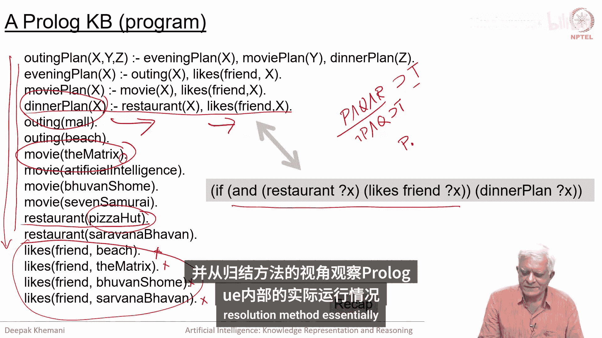

# 045：霍恩从句与Prolog 🧠


在本节课中，我们将学习如何使用逻辑进行算术运算，并深入探讨霍恩从句（Horn Clauses）及其在逻辑编程语言Prolog中的应用。我们将看到，虽然理论上可以用定理证明进行加法等计算，但这在实际中并不高效。课程还将解释一阶逻辑的半可判定性，并介绍Prolog程序的基本结构和执行原理。

## 从算术到通用计算

上一节我们看到了如何使用逻辑证明“2加5等于7”。本节中，我们来看看如何回答一个包含变量的查询。

考虑查询：是否存在一个 `x`，使得 `2 + 5 = x`？这个查询包含一个存在量化的变量。证明过程与之前类似，我们从目标 `plus(2, 5, U)` 开始，通过归结（Resolution）逐步推导。

以下是关键的归结步骤和变量替换：
1.  目标 `plus(2, 5, U)` 与子句 `plus(s(X), Y, s(Z)) :- plus(X, Y, Z).` 归结，产生新子目标 `plus(1, 5, V)`，并得到替换 `{U/s(V)}`。
2.  子目标 `plus(1, 5, V)` 与同一子句归结，产生新子目标 `plus(0, 5, W)`，并得到替换 `{V/s(W)}`。
3.  子目标 `plus(0, 5, W)` 与事实 `plus(0, Y, Y).` 归结，产生空子句，并得到替换 `{W/5}`。

通过组合这些替换，我们最终得到答案 `U = s(s(5))`，即 `7`。这个过程展示了逻辑系统如何回答存在性查询。

然而，这种方法对于大规模计算（如20000加11500）效率极低，因为它需要递归20000步。因此，逻辑编程并不用于此类基础算术，但其意义在于奠定了数学基础，并使得**程序正确性验证**比在命令式编程中更容易实现。

## 一阶逻辑的半可判定性

在深入霍恩从句之前，我们需要理解一个重要的理论概念：一阶逻辑的半可判定性。

罗宾逊证明了归结反驳法是**可靠且完备的**。这意味着，如果知识库蕴含一个句子 `α`，那么将 `¬α` 加入知识库后，使用归结法最终必然能推导出空子句（矛盾）。

但完备性不等于算法总能**终止**。一阶逻辑是**半可判定的**：
*   **如果结论被蕴含**：存在证明。我们可以设计搜索策略（如广度优先搜索）来找到这个证明并终止。
*   **如果结论不被蕴含**：不存在证明。此时，定理证明器可能会陷入**无限循环**。

以下是一个导致无限循环的例子：
*   **知识库（仅一条语句）**：`∀x ∀y (Less(s(x), y) → Less(x, y))` （如果 `x` 的后继小于 `y`，则 `x` 小于 `y`）。其子句形式为：`¬Less(s(x), y) ∨ Less(x, y).`
*   **查询**：`Less(0, 0)`？ （0小于0吗？）
*   **反驳过程**：将 `¬Less(0, 0)` 加入知识库。
    1.  `¬Less(0,0)` 与 `¬Less(s(x), y) ∨ Less(x, y)` 归结，替换 `{x/0, y/0}`，得到 `¬Less(s(0), 0)`，即 `¬Less(1, 0)`。
    2.  `¬Less(1,0)` 与同一条子句归结，替换 `{x/1, y/0}`，得到 `¬Less(s(1), 0)`，即 `¬Less(2, 0)`。
    3.  此过程将无限继续，产生 `¬Less(3, 0)`, `¬Less(4, 0)`... 永远无法终止。

这个例子说明，当目标不可证时，反向链式推理可能无限回溯，无法停止。

## 霍恩从句简介

为了获得高效的推理，我们转向一阶逻辑的一个子集——**霍恩从句**。

一个**霍恩从句**是**至多包含一个正文字**的子句。它有两种主要形式：
1.  **事实**：只有一个正文字，没有负文字。例如：`Movie(matrix).`
2.  **定子句（规则）**：恰好一个正文字，以及一个或多个负文字。在标准逻辑中，它写作蕴含形式：`P ∧ Q ∧ R → T`。其中 `P, Q, R` 是前提，`T` 是结论。

霍恩从句不能表达像 `S ∨ V` 这样的析取式（因为它包含两个正文字）。虽然表达能力受限，但换来的是推理的**高效性**。普通的归结证明可能指数级复杂，而霍恩从句逻辑能大幅提升效率。

## Prolog：基于霍恩从句的逻辑编程

Prolog程序本质上就是一系列**正向定子句（霍恩从句）**的集合。

以下是Prolog语法与一阶逻辑的对应关系：
*   **变量与常量**：以大写字母开头的词是**变量**（如 `X`, `Restaurant`），以小写字母开头的词是**常量**（如 `matrix`, `pizzaHut`）。
*   **规则表示**：Prolog将蕴含式“结论 ← 前提”写作 `结论 :- 前提.`。符号 `:-` 读作“如果”，逗号 `,` 读作“且”。
    *   **一阶逻辑**：`∀x (Restaurant(x) ∧ Likes(friend, x) → DinnerPlan(x))`
    *   **Prolog**：`dinnerPlan(X) :- restaurant(X), likes(friend, X).`
*   **事实表示**：没有前提的结论直接以句点结束。例如：`restaurant(pizzaHut).`

一个完整的Prolog知识库示例：
```
restaurant(pizzaHut).
restaurant(saravanaBhavan).
likes(friend, matrix).
likes(friend, benHur).
likes(friend, saravanaBhavan).
dinnerPlan(X) :- restaurant(X), likes(friend, X).
```

## Prolog的执行策略：深度优先搜索

Prolog通过执行**深度优先搜索**来回答查询。它遵循两个固定顺序：
1.  **子句顺序**：从上到下匹配知识库中的子句。
2.  **目标顺序**：在一条规则内，从左到右尝试证明各个子目标。

以查询 `?- dinnerPlan(X).` 为例，Prolog的执行流程如下：
1.  从上到下寻找 `dinnerPlan`，找到规则 `dinnerPlan(X) :- restaurant(X), likes(friend, X).`。
2.  尝试证明右侧第一个子目标 `restaurant(X)`。从上到下匹配，`X` 首先被实例化为 `pizzaHut`。
3.  接着证明第二个子目标 `likes(friend, pizzaHut)`。从上到下扫描 `likes` 事实，发现没有匹配项。
4.  **回溯**：第二个子目标失败，Prolog回溯到第一个子目标 `restaurant(X)`，尝试下一个匹配值 `saravanaBhavan`。
5.  再次证明 `likes(friend, saravanaBhavan)`，这次成功找到匹配事实。
6.  查询成功，输出 `X = saravanaBhavan`。

这种确定的搜索顺序意味着**程序员可以通过编排子句和子目标的顺序来控制程序行为**。例如，通常将**基础子句放在递归子句之前**，以避免无限递归。这给Prolog带来了一些“过程性”控制，不同于纯逻辑编程将一切交给机器决定，但这在实践中是保证效率的必要手段。

---

本节课中我们一起学习了：
1.  如何使用逻辑推理进行算术运算并回答存在性查询，尽管实际效率不高。
2.  一阶逻辑的**半可判定性**：定理证明器在目标可证时能找到证明，但在不可证时可能永不终止。
3.  **霍恩从句**的定义及其高效性，它是一阶逻辑中至多含一个正文字的子集。
4.  **Prolog** 作为霍恩从句的逻辑编程实现，其语法规则和执行所采用的**深度优先搜索加回溯**策略。



下一节，我们将继续深入Prolog的内部机制，从归结原理的角度分析其运行过程。