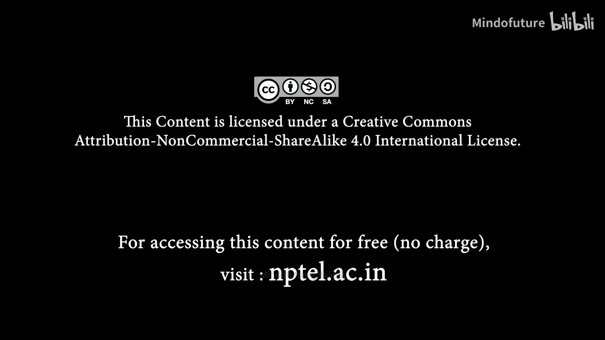
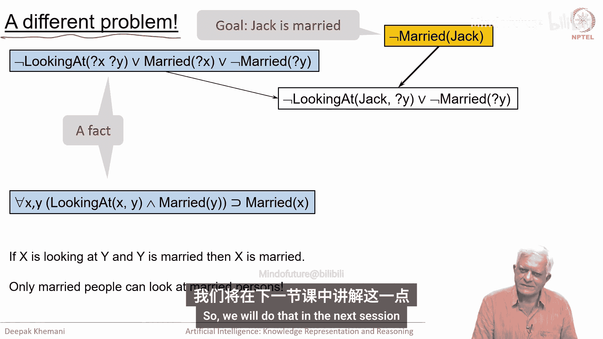

# 046：SLD推导与反向链接

## 概述
在本节课中，我们将学习一阶逻辑的一个子集——霍恩子句逻辑，并深入探讨一种名为SLD推导的特定推理方法。我们将看到SLD推导如何与反向链接推理等价，并理解其在逻辑编程（如Prolog）中的应用。

---

## 霍恩子句回顾
上一节我们介绍了霍恩子句。霍恩子句是**至多包含一个正文字**的子句，可以包含任意数量的负文字。

一个**程序**是正定霍恩子句的集合，这意味着每个句子中**至少有一个正文字**。

---

## 负霍恩子句与目标
那么，没有正文字的霍恩子句是什么意思？根据定义，一个**没有正文字**的霍恩子句就是一个**负子句**。

在Prolog这样的逻辑编程中，这类负子句**仅来自于被否定的目标或查询**。程序本身由正定霍恩子句组成，但**目标是负的**。当我们进行归结推理时，我们会否定目标，并将其视为一个事实添加到知识库中。如果能推导出空子句，则证明完成。

空子句根据定义也是负子句（没有正文字），其值为假。一旦能推导出空子句，就表明整个知识库变得不一致。

---

## 归结规则的可能性
归结规则有以下几种可能的情况：两个子句可以都是正的、都是负的，或者一正一负。

以下是各种情况的分析：
*   **正子句与正子句归结**：将得到另一个**正子句**。因为在归结步骤中，取一个子句中的正文字与另一个子句中匹配的负文字相消，剩下的文字组成新子句。两个正子句中各有一个正文字，一个被消去，另一个保留到结果中。
*   **正子句与负子句归结**：将得到一个**负子句**。因为负子句中没有正文字，正子句中唯一的正文字会被消去，剩下的全是负文字。
*   **负子句与负子句归结**：**无法进行归结**，因为需要正文字来与负文字相消。

---

## SLD推导详解
我们的推导被称为**SLD推导**。Prolog程序是一组正定霍恩子句。

SLD的含义是：
*   **S**： 选择文字
*   **L**： 线性结构
*   **D**： 定子句（即正定霍恩子句）

当使用定子句并选择特定类型的文字进行推导时，会得到一个线性的推导结构，这就是SLD推导。

在SLD推导中，第一步归结的**两个父辈子句**分别来自：
1.  目标（负子句）
2.  程序（正定子句）

因此，归结结果是一个**负子句**。这个新产生的负子句将成为下一次归结的父辈子句之一，这是线性结构的特性。

**所以，推导中的每一个归结结果都是负子句。** 因为这相当于在用正子句与负子句进行归结。这个过程**等同于进行反向链接推理**，即从目标到子目标，再到更深层的子目标。

因此，**对霍恩子句进行SLD归结等价于反向链接推理**。

---

## SLD推导的结构
以下是SLD推导与霍恩子句的结构示意图：
*   灰色子句代表**正子句**（来自程序）。
*   空白方框代表**负子句**（推导中产生的中间子句）。
*   橙色子句代表**初始目标子句**。

推导过程产生一系列负子句，这就像反向链接：从目标到子目标，再从子目标到下一个子目标，依此类推。

---

## 正向归结的可消除性
可以证明，对于霍恩子句，任何包含**正向归结**（即两个正子句归结）的推导，都可以被转化为一个**等价的、不包含任何正向归结**的推导。

换句话说，**推导一个负子句（或空子句）总是可能的，并且在此过程中生成的所有中间子句都是负的**。这强化了SLD推导（仅产生负子句）的完备性。

---

## 示例：Alice问题
以下是Alice问题的SLD推导示例。我们只关注知识库中的正定霍恩子句。被否定的目标是一个负子句。

推导过程从目标 `T` 开始，通过归结逐步得到 `not R or not S`，然后是 `not P or not S` 等等。这个模式与我们之前进行的反向链接完全一致。在反向链接中，我们从目标 `T` 开始，将其归约为 `R and S`，进而归约为其他子目标。

图中粗箭头显示，你所做的实质上等同于反向链接，但实际进行的是SLD归结。

---

## 一个关键问题的探讨
让我们回顾一个之前见过的问题（关于人的领域）。知识库包含：
*   John已婚。
*   Jack未婚。
*   Anne看着John。
*   Jack看着Anne。

需要证明的目标是：**存在一个未婚的人看着一个已婚的人**。其否定形式是一个负子句。

我们之前看到，对于这个查询，**反向链接推理是不完备的**（它无法找到证明），但**归结方法是完备的**（可以推导出空子句）。

现在，如果我们仔细观察，可以为同一个知识库和查询构建一个**看起来像SLD的推导**。这个推导从负子句开始，产生一系列负子句，最终得到空子句，结构上很像反向链接。

**这是否与我们“反向链接不完备”的陈述相矛盾？**

不矛盾。原因如下：
1.  **这不是标准的SLD推导**：在标准的SLD推导中，必须从**目标的子句形式**（即被否定后的负子句）开始。而这里对知识库和目标的解释略有不同。
2.  **不符合Prolog程序规范**：例如，`not married(Jack)` 作为一个“事实”在Prolog中是不允许的，因为程序必须由正定子句组成。同样，原始目标在Prolog中应是一个正文字，其否定才是负文字。
3.  **它解决了一个不同的问题**：这个类SLD推导实际上对应一个**不同的解释和不同的目标**。如果我们将其视为反向链接，那么隐含的“目标”变成了“证明Jack已婚”，并且知识库中的一条子句被解释为“只有已婚的人才能看着已婚的人”。这完全**不同于**我们最初要解决的“存在一个未婚者看着已婚者”的问题。

**结论**：两个不同的问题（不同的原始目标和不同的知识库解释）可能导致相同的“扩充知识库”（原始知识库加上否定后的目标）。两者都能有推导过程，这并不奇怪。但这**并不能证明**反向链接可以解决我们最初感兴趣的那个问题。它只表明反向链接可以解决其他某些问题。

因此，我们关于“反向链接在一般霍恩子句逻辑中不完备，而归结法完备”的论断依然成立。

---

## 总结
本节课我们一起学习了：
1.  **负霍恩子句**的来源和意义，它们主要来自被否定的查询。
2.  **归结规则**在正-正、正-负子句组合下的结果。
3.  **SLD推导**的精确定义（选择文字、线性、定子句）及其工作原理，它总是从负目标子句开始，并产生一系列负子句。
4.  **SLD推导等价于反向链接推理**，这是逻辑编程（如Prolog）的基础。
5.  通过示例和分析，我们澄清了**看似像SLD的推导并不改变反向链接在一般情况下的不完备性**，完备的推理需要依靠完整的归结方法。

在接下来的课程中，我们将继续探索逻辑编程如何用于执行更通用的计算任务，而不仅仅是算术运算。