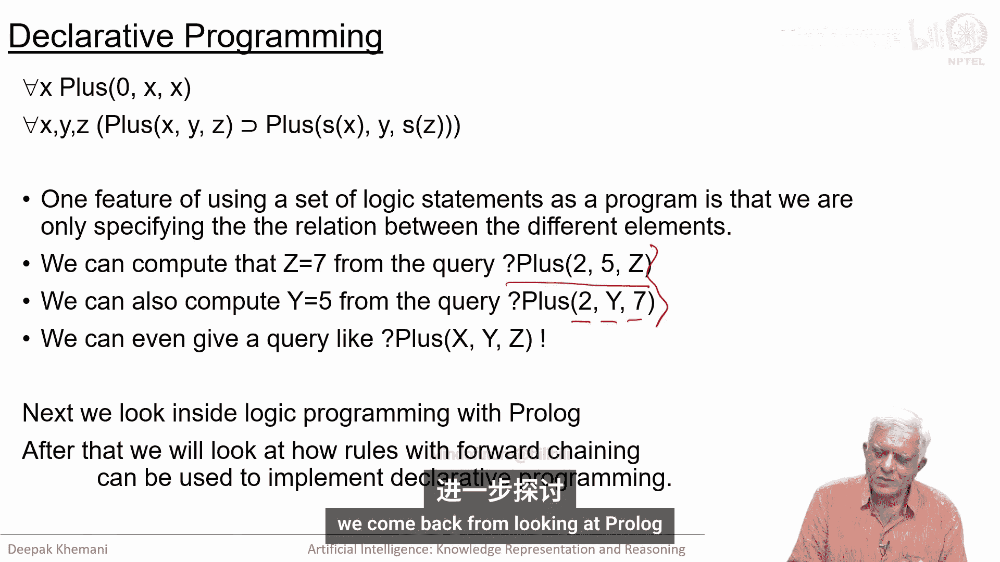

# 047：逻辑程序设计


## 概述
在本节课中，我们将学习如何在逻辑编程中表示和处理列表。我们将看到列表如何被表示为二叉树，并学习一个核心操作——将两个列表连接（`append`）在一起。通过这个例子，我们将进一步理解逻辑编程如何通过定义关系而非指定步骤来执行计算。

---

## 列表的表示

上一节我们介绍了如何在逻辑中表示自然数并进行算术运算。本节中，我们来看看另一种常见的数据结构——列表。

在早期的编程语言（如Lisp）中，列表是核心数据结构。列表可以表示任意长度的序列，甚至可以嵌套，这为表示复杂数据提供了灵活性。在逻辑编程中，列表通常被表示为“点对”（dotted pair）或“构造对”（cons pair），这本质上是一种二叉树结构。

以下是三种列表的表示方式：

1.  **简单列表 `[A, B]`**： 它被表示为 `cons(A, cons(B, nil))`。最外层的 `cons` 的“头”是 `A`，“尾”是剩余列表 `cons(B, nil)`。
2.  **较长列表 `[A, B, C, D]`**： 它遵循相同的模式：`cons(A, cons(B, cons(C, cons(D, nil))))`。
3.  **嵌套列表 `[[A, B], C]`**： 它的第一个元素本身是一个列表 `[A, B]`，因此表示为 `cons(cons(A, cons(B, nil)), cons(C, nil))`。

这种表示方法将列表视为二叉树，其中每个内部节点（`cons`）的左子节点是列表的当前元素（头），右子节点是列表的剩余部分（尾）。

---

## 列表连接（Append）程序

理解了列表的表示后，我们现在可以定义一个逻辑程序来连接两个列表。这个程序与我们之前定义加法的方式非常相似。

以下是定义 `append` 关系的逻辑子句：

*   **基础子句**： 将一个空列表连接到任何列表 `Y`，结果仍然是 `Y`。
    ```
    append(nil, Y, Y).
    ```
*   **递归子句**： 如果将列表 `X` 连接到列表 `Y` 得到 `Z`，那么将 `cons(A, X)` 连接到 `Y` 将得到 `cons(A, Z)`。
    ```
    append(cons(A, X), Y, cons(A, Z)) :- append(X, Y, Z).
    ```

请注意，我们并没有明确写出“`X` 是一个列表”这样的条件。在纯逻辑视角下，我们定义的是 `append(X, Y, Z)` 这个关系何时成立。从编程角度看，我们期望 `X` 和 `Y` 是列表。

---

## 执行查询

让我们通过一个具体查询来理解这个程序如何工作。假设我们想将列表 `[A, B]` 和 `[C, D]` 连接起来。

我们的查询是：
```
?- append(cons(A, cons(B, nil)), cons(C, cons(D, nil)), X).
```

执行过程与加法证明的模式完全相同：
1.  递归子句首先匹配，将 `A` 添加到结果列表的头部，然后对剩余的列表 `[B]` 和 `[C, D]` 进行递归调用。
2.  第二次递归调用再次应用递归子句，将 `B` 添加到结果列表的头部，然后对空列表 `nil` 和 `[C, D]` 进行递归调用。
3.  第三次调用匹配基础子句，直接将 `[C, D]` 作为结果返回。
4.  回溯并组合结果，最终得到 `X = cons(A, cons(B, cons(C, cons(D, nil))))`，即列表 `[A, B, C, D]`。

这个过程清晰地展示了逻辑程序如何通过关系定义和回溯搜索来“计算”出结果。

---

## 逻辑编程的多向性

使用逻辑语句作为程序的一个关键优势在于其声明性。我们只指定了输入和输出之间的关系，而没有指定具体的计算步骤。

这带来了强大的灵活性，同一个 `append` 程序可以用于多种查询模式：

*   **正向计算（连接）**： `append([a,b], [c,d], X).` 会得到 `X = [a,b,c,d]`。
*   **反向计算（拆分）**： `append([a,b], Y, [a,b,c,d]).` 会得到 `Y = [c,d]`。
*   **寻找所有前缀/后缀**： `append(X, Y, [a,b,c,d]).` 会依次给出所有可能的列表 `X` 和 `Y`，使得它们的连接是 `[a,b,c,d]`（例如 `X=[]`, `Y=[a,b,c,d]`；`X=[a]`, `Y=[b,c,d]` 等）。
*   **验证关系**： `append([a,b], [c,d], [a,b,c,d]).` 会返回 `true`。

这种“多向性”是过程式编程语言难以实现的。它体现了逻辑编程的核心思想：你描述“是什么”，系统负责找出“如何做”。

---

## 总结

本节课中我们一起学习了：
1.  列表在逻辑编程中可以表示为二叉树（`cons` 结构）。
2.  如何通过定义基础子句和递归子句来编写列表连接的逻辑程序。
3.  逻辑程序的执行过程依赖于合一和回溯，与证明定理的过程类似。
4.  逻辑编程的声明式特性使得同一个程序可以用于计算、验证和生成多种答案，展现了强大的灵活性和表达能力。



通过将列表和 `append` 操作与之前的自然数加法进行类比，我们进一步巩固了“逻辑即程序”这一核心概念。接下来，我们将更深入地探讨逻辑编程的细节，并随后从正向推理的角度重新审视声明式编程的思想。