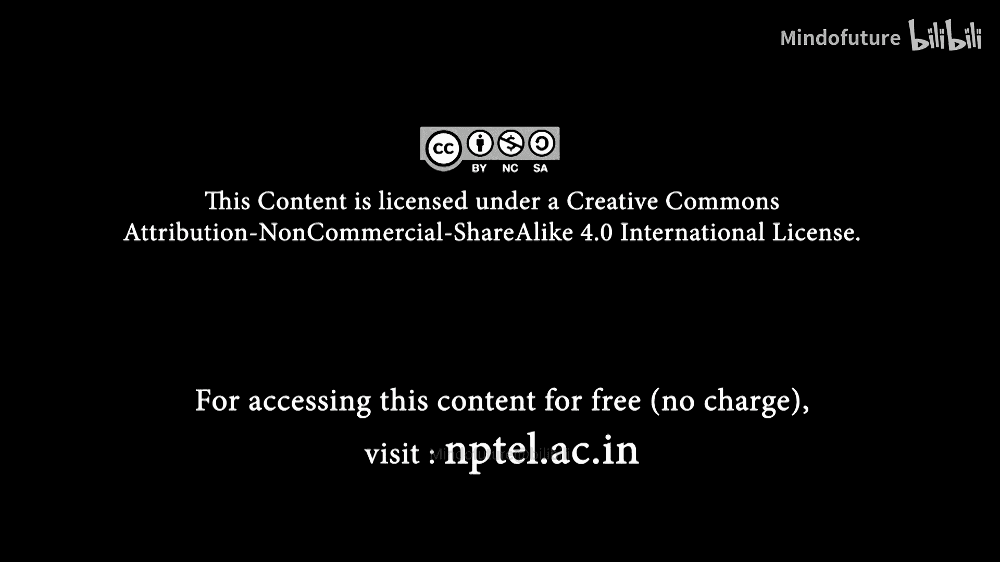
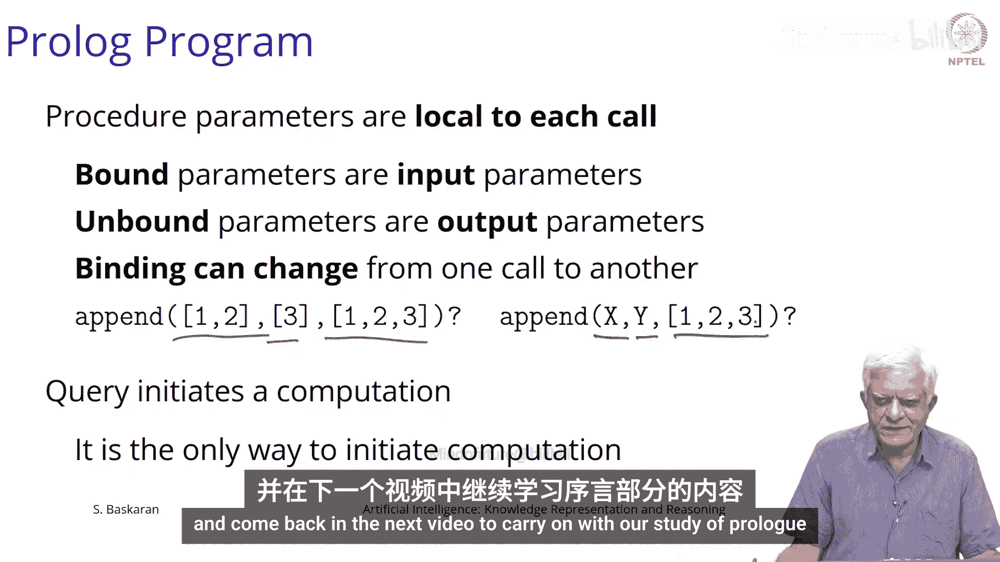

# 048：Prolog逻辑程序设计 🧠




在本节课中，我们将学习Prolog逻辑程序设计语言。我们将了解Prolog的编程模型、基本元素，并通过示例演示如何在解释器中运行。Prolog将逻辑与计算相结合，是一种基于一阶逻辑子集的声明式编程语言。

---

## 编程模型：逻辑 + 控制

上一节我们介绍了逻辑与归结方法。本节中我们来看看Prolog的编程模型。

传统的算法模型是一步一步解决问题的指令，这更接近命令式编程（如C语言）。在逻辑编程这种声明式编程风格中，我们希望将算法的两个部分——**逻辑**和**控制**——分离开来。

*   **逻辑**部分：由用户提供，是关于问题的事实和规则。
*   **控制**部分：由运行时系统（解释器或推理引擎）处理，负责制定执行计划并执行。

Prolog采用**霍恩子句**逻辑，因为它更高效。它将霍恩子句解释为**过程声明**，将SLD归结解释为**过程执行**。

---

## 基本术语与概念

以下是理解Prolog所需的核心概念：

*   **项**：指代论域中对象的引用。例如：常量、变量、复合项。
*   **谓词**：关于这些对象的原子陈述，是对象之间的关系。例如：`on(a, b)`。
*   **霍恩子句**：关于对象的语句，包含原子谓词和连接它们的逻辑连接词。形式为 `头 :- 体.`，其中“体”是多个原子谓词的合取。
*   **合一**：用于匹配两个项的过程。这是Prolog中传递输入和输出的核心机制。
*   **否定**：在Prolog中，否定被处理为**否定即失败**。这意味着，如果你无法证明某事物为真，则假定它为假。这基于封闭世界假设。
*   **截断**：一个过程性工具（`!`），用于提高程序效率，避免不必要的搜索。它是一个“超逻辑”特性。

---

## Prolog实践：启动与查询

现在，我们来看看如何在实践中使用Prolog。我们将使用SWI-Prolog实现。

启动SWI-Prolog解释器后，你会看到欢迎信息。要加载知识库（程序文件），使用 `consult(‘文件名’).` 命令。

假设我们有一个名为 `blocks_world.pl` 的文件，内容如下：
```prolog
% 事实
on(a, table).
on(a, b).
on(b, c).
on(c, table).
color(c, maroon).

% 规则
above(X, Y) :- on(X, Y).
above(X, Z) :- on(X, Y), above(Y, Z).
below(X, Y) :- above(Y, X).
```
加载后，你可以输入查询。解释器将查询视为待证明的目标。

例如，查询 `on(X, Y).` 会寻找所有满足 `on` 关系的 `X` 和 `Y`。解释器可能返回：
```
X = a, Y = b ;
X = b, Y = c ;
false.
```
分号 `;` 用于请求下一个解。查询结束后，可以使用 `halt.` 命令退出。

---

## 算法视角：逻辑程序

从不同视角看，Prolog程序有不同的含义：

*   **用户视角**：程序是一个由**事实**和**规则**组成的知识库。
*   **程序员视角**：程序是一组**过程声明**。
*   **逻辑/数学视角**：程序是一组正定子句的合取。

在过程调用中，输入和输出通过**合一**完成。过程参数在每个调用中是局部的。

*   绑定了值的参数被视为**输入**。
*   未绑定的参数被视为**输出**。

查询是启动计算的唯一方式。例如：
*   `append([1,2], [3], [1,2,3]).` 是一个纯输入查询，询问该陈述是否为真。
*   `append([1,2], Y, [1,2,3]).` 中，`Y` 是输出，查询将返回 `Y = [3]`。
*   `append(X, Y, [1,2,3]).` 将返回一系列可能的 `X` 和 `Y` 列表对。

---

## 总结与资源

本节课中我们一起学习了Prolog逻辑程序设计的基础。我们了解了Prolog的“逻辑+控制”编程模型，认识了项、谓词、霍恩子句、合一和否定即失败等核心概念，并通过一个积木世界的例子看到了如何加载知识库和进行查询。

如果你想进一步学习，可以参考以下资源：
*   **书籍**：《The Art of Prolog》（Sterling和Shapiro著）
*   **经典论文**：Robert Kowalski的《Algorithm = Logic + Control》（1979）
*   **实现与文档**：SWI-Prolog官方网站，提供下载和在线版本。



下一节视频，我们将继续深入Prolog的学习。