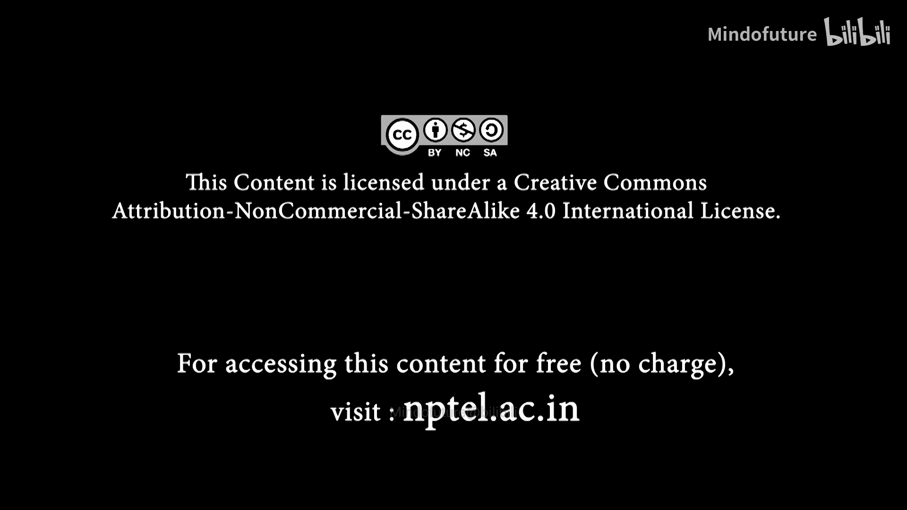
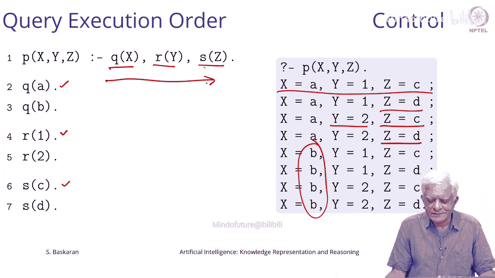

# 049：Prolog 过程性解释




在本节课中，我们将学习 Prolog 语言的过程性解释。我们将了解 Prolog 程序如何像一组过程调用一样执行，以及其基于深度优先搜索的控制流如何影响程序的运行和结果。我们将通过具体的例子来理解规则顺序、目标顺序的重要性，并回顾 Horn 子句在 Prolog 中的表示。

## 概述与 Horn 子句回顾

上一节我们介绍了 Prolog 的基本概念。本节中，我们来看看 Prolog 程序是如何被过程性地解释和执行的。

首先，我们快速回顾一下 Horn 子句，它是 Prolog 程序的基础。一个 Horn 子句是至多含有一个正文字的析取式。在 Prolog 中，主要有三种形式：

*   **单元子句**：仅包含一个正文字。例如 `above(X, Y).`，逻辑上等价于 `True => above(X, Y)`。
*   **定子句**：包含一个正文字和若干负文字。例如 `above(X, Z) :- on(X, Y), above(Y, Z).`，逻辑上等价于 `(on(X, Y) ∧ above(Y, Z)) => above(X, Z)`。在 Prolog 中，结论部分称为 **头**，条件部分称为 **体**。
*   **目标子句**：不包含正文字，仅包含负文字。例如 `?- above(X, Y), maroon(Y).`，它被当作查询来执行。

此外，还有**空子句**，通常用 `□` 表示，它代表 `False`，在过程性解释中意味着程序成功终止。

一个 Prolog 程序本质上就是一系列定子句（事实和规则）的集合。

## Prolog 的过程性解释

从过程性的角度来看，Prolog 程序可以被视为一组过程（或谓词）的定义。启动计算的唯一方式是提出一个查询，这类似于向数据库提问。

Prolog 的控制策略是**深度优先搜索**。程序会沿着知识库中的子句顺序（词法顺序）和规则体内的目标顺序进行搜索。它会先深入探索一个分支，如果失败则回溯并尝试另一个分支。

当查询成功时，系统会生成一个**最一般合一**，其中包含了使查询为真的变量绑定值，并将这些值作为答案输出。

以下是理解 Prolog 执行过程的关键点：

*   **程序即过程**：每个谓词定义就像一个过程。调用谓词时，参数用于传递输入和输出。
*   **深度优先与回溯**：执行顺序遵循知识库中子句的书写顺序（从上到下）以及规则体内目标的书写顺序（从左到右）。失败时会触发回溯。
*   **成功与答案**：当通过合一和规则应用，最终推导出空子句时，意味着查询被成功证明。此时的 MGU 就是答案。

## 示例：理解执行顺序

让我们通过一个简单的例子来具体化上述概念。考虑以下程序：

```prolog
p(X, Y, Z) :- q(X), r(Y), s(Z).
q(a).
q(b).
r(1).
r(2).
s(c).
s(d).
```

如果我们提出查询 `?- p(X, Y, Z).`，Prolog 会尝试证明目标 `p(X, Y, Z)`。其执行流程如下：

1.  它首先匹配规则 `p(X, Y, Z) :- q(X), r(Y), s(Z).`。
2.  然后按从左到右的顺序尝试证明子目标：
    *   首先证明 `q(X)`。根据知识库顺序，它找到第一个匹配事实 `q(a).`，此时 `X = a`。
    *   接着证明 `r(Y)`。找到 `r(1).`，此时 `Y = 1`。
    *   最后证明 `s(Z)`。找到 `s(c).`，此时 `Z = c`。
3.  所有子目标成功，因此整个查询成功，返回第一个答案：`X = a, Y = 1, Z = c`。

如果用户要求更多答案，Prolog 会进行回溯：

*   它会回溯到最后一个被满足的子目标 `s(Z)`，尝试另一个解 `s(d).`，得到 `Z = d`，从而产生第二个答案：`X = a, Y = 1, Z = d`。
*   再次要求更多答案时，`s(Z)` 已无其他可能，继续回溯到 `r(Y)`，尝试 `r(2).`，然后 `s(Z)` 再次从 `c` 和 `d` 中尝试，产生后续答案 `(a,2,c)` 和 `(a,2,d)`。
*   最终，它会回溯到第一个子目标 `q(X)`，尝试 `q(b).`，并重复上述整个过程，生成所有可能的组合。

这个例子清晰地展示了 **“自上而下，从左到右”** 的深度优先搜索以及回溯机制是如何工作的。

## 前向链与后向链

给定一个 Horn 子句知识库，主要有两种推理控制方式：

*   **前向链**：从已知事实出发，应用规则生成新事实，直到目标被满足或没有新事实可生成。这是一个数据驱动的过程。例如，用规则 `nat(s(X)) :- nat(X).` 和事实 `nat(0).`，前向链会不断推导出 `nat(s(0))`, `nat(s(s(0)))`... 可能永不终止。
*   **后向链**：从目标查询出发，寻找能证明该目标的规则和事实。这是一个目标驱动的过程，也是 Prolog 采用的方式。例如，对于查询 `?- nat(X).`，后向链会尝试用规则 `nat(s(X1)) :- nat(X1).` 和事实 `nat(0).` 来证明，通过递归分解目标，最终找到使 `X` 为 `0`, `s(0)`, `s(s(0))`... 的证明。

Prolog 的过程性解释正是基于后向链（目标驱动）的执行模型。

## 总结



本节课中我们一起学习了 Prolog 的过程性解释。我们了解到，Prolog 程序在逻辑上是一组 Horn 子句，在过程上则是一系列相互调用的过程。其执行遵循深度优先搜索策略，严格依赖于知识库中子句和规则体内目标的书写顺序，并通过回溯机制来寻找所有可能的解。通过将逻辑声明（`头 :- 体`）解释为过程调用，并区分前向链与后向链，我们能够更好地理解 Prolog 程序是如何运行并产生结果的。掌握这一过程性视角对于编写和调试高效的 Prolog 程序至关重要。