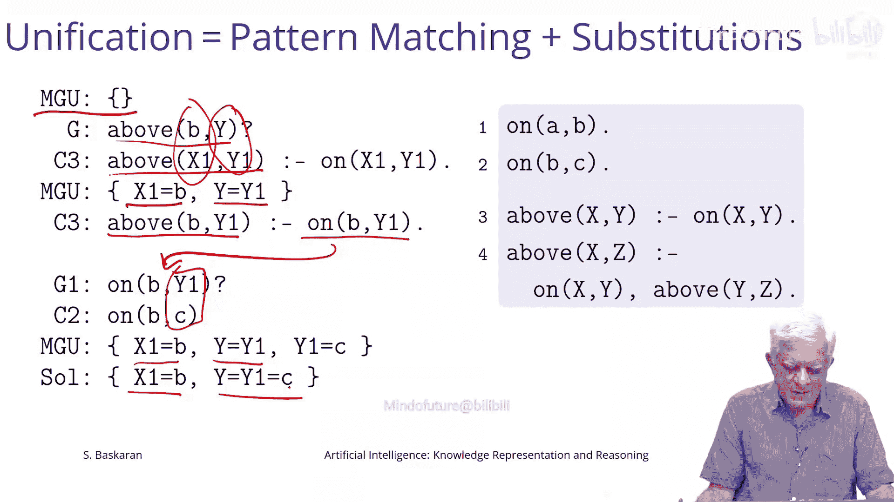

# 050：Prolog查询评估 🧠


在本节课中，我们将学习Prolog语言中查询评估的执行顺序和机制。我们将看到Prolog如何通过深度优先搜索来遍历逻辑程序，并使用统一机制在目标和规则之间传递信息。

## 执行顺序与搜索树 🌲

上一节我们介绍了Prolog作为使用Horn子句的逻辑编程实现。本节中我们来看看Prolog中语句的执行顺序。

Prolog中语句的执行顺序是词法顺序。这意味着当你提出一个查询时，例如查询 `P`，系统会从程序顶部开始扫描，找到第一个匹配的 `P` 并尝试满足它。这个 `P` 可能是一个没有前件的事实，也可能是一个需要满足其体部规则的规则。在规则体内部，目标从左到右依次求解。

我们可以将这个过程可视化为一个过程结构。例如，为了求解 `p(X, Y, Z)`，我们依次调用 `q(X)`、`r(Y)`  和 `s(Z)`。这会产生一个答案。通过重复此过程，我们将得到所有可能的答案。

以下是执行模式的描述：
*   Prolog按程序顺序执行规则，按从左到右的顺序执行目标。
*   这种顺序以深度优先搜索的方式扩展搜索树。
*   在此过程中，它会生成所有解决方案。

## 搜索树与与或树 🔍

上一节我们介绍了执行顺序，本节中我们来看看如何将搜索过程视为搜索树。

相同的执行模式可以看作是一个搜索树。查询从 `p(X, Y, Z)` 是否为真开始。然后，它尝试为第一个变量 `X1` 寻找匹配。它找到的第一个选项是 `Q(a)`。接着，它为变量 `Y1` 寻找 `R`，找到 `R(1)`。最后，它为 `Z` 寻找 `S`，找到 `S(c)`。这给出了树中最左边的分支，即第一个答案。

当回溯发生时，系统会返回并尝试其他分支，从而生成其他答案。这个过程遍历整个搜索树。

这种搜索树也可以被视为**与或树**。为了证明 `p(X, Y, Z)` 为真，必须证明 `q(X)`、`r(Y)` 和 `s(Z)` 三者都为真。这构成了一个“与”节点。在“与”节点下方，每个子目标（如 `q(X)`）又有多个可能的事实或规则可供选择，这些构成了“或”节点。从与或树的视角看，生成的是同一组解决方案，这只是一种不同的理解方式。

## Prolog中的项 📦

在深入查询细节之前，我们需要理解Prolog中“项”的概念。

项是Prolog语言中数据的基本构建块。我们定义了项的家族：
*   变量是项。
*   常量是项。
*   如果 `t1, ..., tn` 是项，那么一个具有这些n个参数的函数符号 `f(t1, ..., tn)` 也是一个项。

例如，列表也可以表示为项，通常使用函数 `cons`（构造对）来构建。一个 `cons` 对包含一个头部和一个尾部。

常量可以看作是零参数的函数。数字和字符串也是项。

一些我们感兴趣的函数符号是 `+`、`-`、`*`、`/`。例如：
*   `1 + 2` 是一个项。
*   `2 * 3 + 4` 是一个项。

在Prolog中，项本身不被求值，它们只是作为数据结构存储。但是，可以使用特殊的 `is` 谓词对数值项进行求值。例如，`X is 2 * 3 + 4` 会将 `X` 与求值结果10进行统一。

## 列表表示法 📝

列表在Prolog中是一种重要的数据结构，有多种表示方法。

我们之前已经见过列表。它们由“点对”构成，有时我们将其画成一个圆圈，也称为 `cons` 对。我们可以使用头部-尾部表示法：`[Head | Tail]`。

在Prolog中，我们通常用方括号表示列表：
*   空列表表示为 `[]`。
*   列表 `[1, 2, 3]` 是 `[1 | [2 | [3 | []]]]` 的简写，也等价于 `cons(1, cons(2, cons(3, nil)))`。

我们还可以使用竖线符号来匹配列表的前几个元素和剩余部分。例如，`[X, Y, Z | Tail]` 表示列表的前三个元素是 `X`, `Y`, `Z`，`Tail` 是列表的其余部分。

## 统一机制与信息传递 🔄

上一节我们介绍了项和列表，本节中我们来看看Prolog中核心的“统一”机制。

统一是使两个表达式相同的过程。这些表达式可以是逻辑公式，也可以是包含函数的项。如果存在一个替换能使它们相等，则统一算法会给出那个替换。

在Prolog中，统一是目标与规则头之间、规则头与规则体之间以及规则体内各谓词之间传递信息的唯一机制。它实现了信息的双向流动：将输入沿调用链向下传递，并将输出沿调用链向上传递。

当一个目标谓词（例如 `P`）被提出时，Prolog会寻找其头部能与该目标统一的规则。谓词名称是常量，但参数可能包含变量，因此仍然需要统一。通过统一，规则头中的变量信息被传递到规则体中，反之亦然。

## 示例解析：`above` 关系 📐

让我们通过一个具体的程序来理解查询评估过程。

考虑定义“在上方”关系的程序：
```prolog
% 事实
on(a, b).
on(b, c).

% 规则
above(X, Y) :- on(X, Y).
above(X, Z) :- on(X, Y), above(Y, Z).
```

给定这个程序，当我们提出查询 `above(b, Y)` 时（`Y` 是变量），Prolog会尝试寻找答案。

1.  查询 `above(b, Y)` 与规则 `above(X1, Y1) :- on(X1, Y1)` 的头 `above(X1, Y1)` 统一，产生替换：`{X1/b, Y/Y1}`。目标变为 `on(b, Y1)`。
2.  子目标 `on(b, Y1)` 与事实 `on(b, c)` 统一，产生替换：`{Y1/c}`。
3.  组合替换，我们得到 `Y = c`。这是第一个答案。
4.  如果请求更多答案（例如输入分号），系统会回溯并尝试其他可能性。在这个简单例子中，没有其他事实或规则能匹配，因此最终返回 `false`，表示没有更多答案。

如果我们查询 `above(X, c)`，根据定义，`b` 在 `c` 上，所以 `b` 在 `c` 上方；同时 `a` 在 `b` 上且 `b` 在 `c` 上方，所以 `a` 也在 `c` 上方。因此，查询会返回两个答案：`X = b` 和 `X = a`。

## 总结 ✨

本节课中我们一起学习了Prolog查询评估的核心概念。



我们了解到Prolog按词法顺序和从左到右的顺序执行目标，这实质上是深度优先搜索遍历一个搜索树，该树也可以被解释为与或树。项是Prolog中数据的基本单位，包括变量、常量和函数结构。列表是使用`cons`或方括号表示法构建的特殊项。统一是Prolog中匹配表达式和传递信息的核心机制，它允许在查询、规则头和规则体之间进行双向数据流。通过分析`above`关系的示例，我们看到了Prolog如何通过匹配、替换和回溯来回答查询并找到所有可能的解决方案。